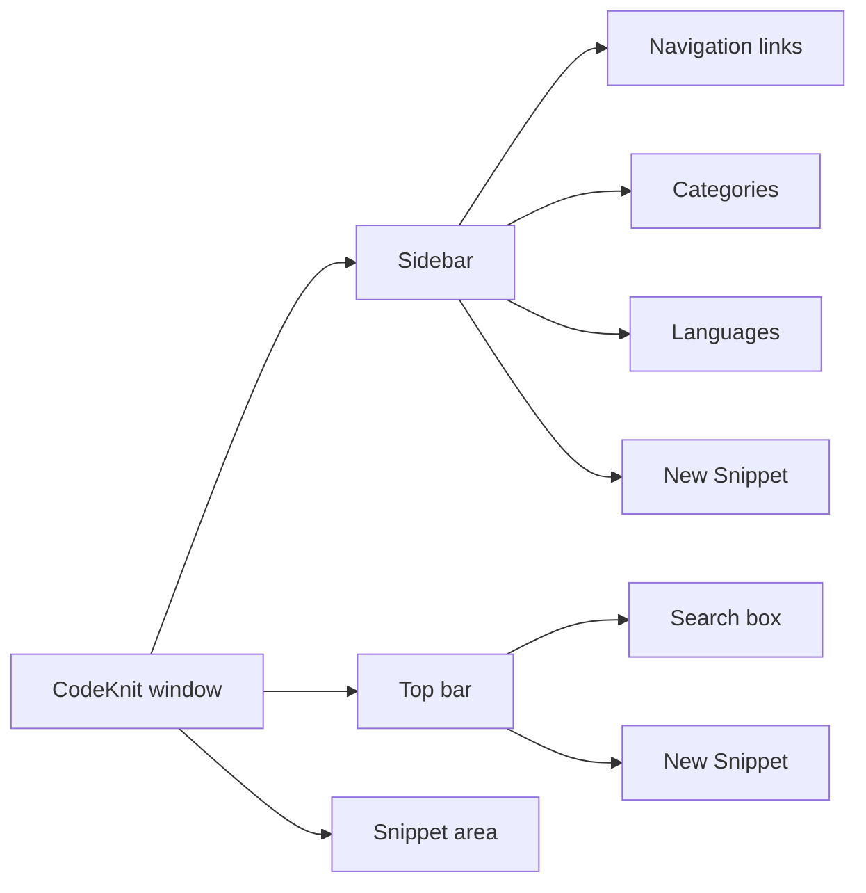
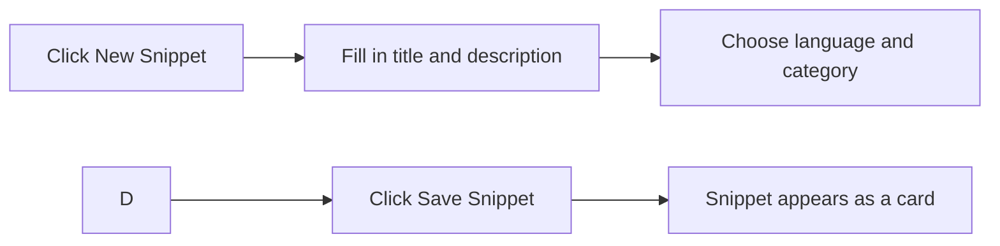

# Quick start guide

This guide helps you get up and running with CodeKnit in under five minutes. By the end, you'll know how to create your first snippet, find it again, favorite it, and export a backup of your library.

CodeKnit works entirely in your web browser. Your snippets are saved on the current device, so no account is required to get started.

## Meet your workspace

When you open CodeKnit, you land on the Dashboard. The screen has three main areas:

- **Sidebar** (left): links to each view, your categories and languages, and the **New Snippet** button.
- **Top bar**: a search box and another **New Snippet** button.
- **Main area**: where your snippets appear as cards or in a list.

The Dashboard shows the heading "Your code, organized." with three summary cards: total snippets, favorites, and languages used.

Figure: Main workspace areas

### Use the sidebar to move around

The sidebar gives you five views:

- **Dashboard**: your home view with a library summary.
- **All Snippets**: every snippet you have saved.
- **Favorites**: snippets you have starred.
- **Recently Added**: newest snippets first.
- **Recently Used**: snippets you have copied, most recent first.

Below the views, you can also click a **category** or a **language** to see only the snippets in that group.

## Create your first code snippet

When your library is empty, the Dashboard shows a "No snippets yet" message with a **+ New Snippet** button. You can start from there, or use the **New Snippet** button in the sidebar or top bar at any time.

Figure: Creating a new snippet

1. Click **New Snippet**.
2. Type a **Title**, this is required.
3. Add a **Description** (optional) to explain what the code does.
4. In **Language**, pick JavaScript, Python, SQL, or Markdown.
5. In **Category**, choose an existing category or select
