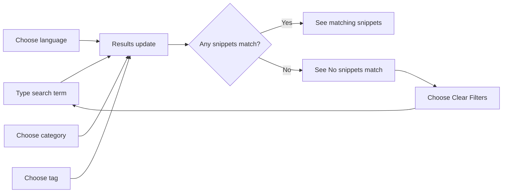

# Search and filtering

Search and Filtering helps you locate the right snippet fast, even as your library grows. You can type a search term or choose from several filters to narrow what you see by language, category, or tag. The snippet list updates immediately with every change.

## Who this is for

Search and Filtering is for anyone with a large snippet library who wants to stop scrolling through dozens of cards and go straight to the code they need. If you save snippets across multiple languages, categories, or tags, these tools help you narrow a long list to a few relevant results in seconds.

## What you can do

The filter bar sits above your snippet list and gives you these controls:

- **Search box**, type a search term to match snippet titles and descriptions.
- **Language dropdown**, show snippets in a specific language, or show **All languages**.
- **Category dropdown**, show snippets from one category, or show **All categories**.
- **Tag dropdown**, show snippets that carry a specific tag, or show **All tags**.
- **Sort dropdown**, order results by **Recently Added**, **Oldest First**, or **A–Z**.

A **Clear Filters** button appears whenever search text is active or a language, category, or tag filter is active. One click removes the search text and resets the language, category, and tag dropdowns to **All**. Your sort choice stays unchanged.

You can also filter directly from the left sidebar:

- The **Categories** section lists every category in your library, each with the number of snippets in that category.
- The **Languages** section lists JavaScript, Python, SQL, and Markdown.

Select a category or language to filter the current list. Select the same item again to remove that filter and show all categories or languages again. The sidebar and the dropdowns stay in sync: choosing a language in the dropdown highlights the same language in the sidebar, and the reverse is also true.

As your filters change, the count next to the section heading, for example, **12 shown**, updates to show how many snippets currently match.

## Combining filters

Filters stack together. When more than one filter is active, only snippets that match all of the selected conditions appear. For example, selecting **Python** as the language and **Utilities** as the category shows only snippets that are both Python and in the Utilities category. Adding a search term or a tag further narrows the results.

Figure: How search and filtering works

## Limits and behavior

- Search checks snippet **titles** and **descriptions** only. It does not search inside the code body. Use the **Language**, **Category**, or **Tag** dropdowns to narrow your search by those properties instead.
- Filters only change what is displayed. They never edit, delete, or reorder your saved snippets.
- There are no saved search presets or saved filter views. Each new session starts with the default **All** filters and **Recently Added** sort.
- If no snippets match your current filters, you see a **No snippets match** message with a **Clear filters** button. Choose it to clear the search text and the language, category, and tag filters.
- Your active filters stay in place when you switch sidebar sections. For example, if you filter to Python and then open **Favorites**, you see only Python snippets that you have favorited.

## Related

- [Understanding Snippet Metadata](doc:0454440c-0145-46fc-910a-1e0a7ef4c962)
- [Snippet Organization](doc:c88b9d7b-71f1-4365-b228-3a4ca18a9db4)
- [Favorites Management](doc:b7298781-db09-4ef9-812c-618f0b3e222c)
- [Snippet Management](doc:d875ccc9-b2fb-4c86-82a0-190a6952a4c7)
