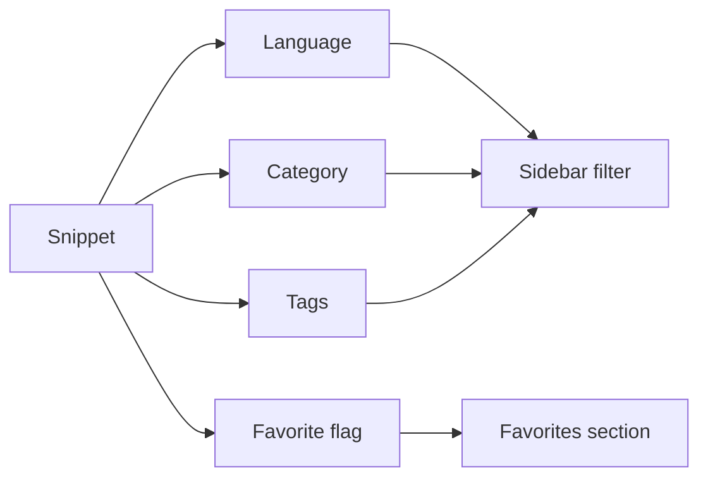
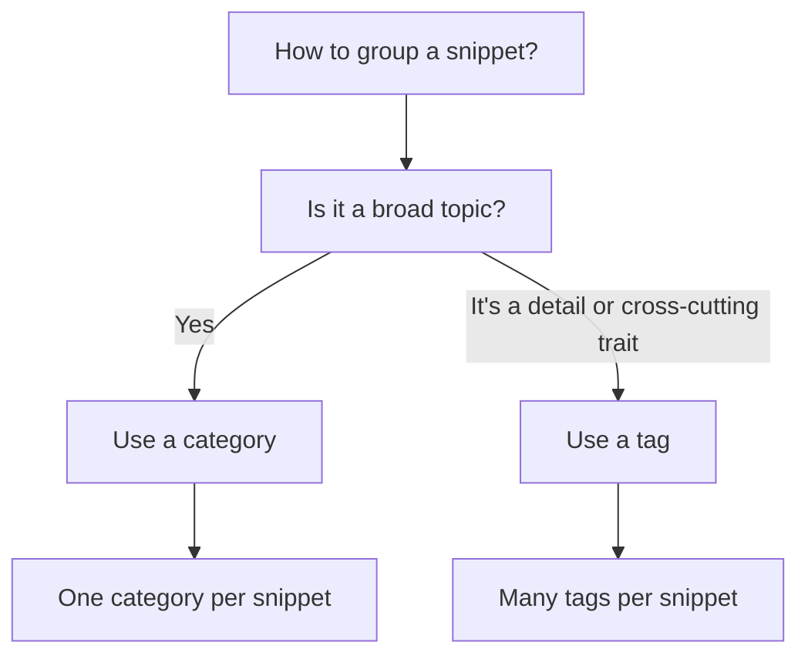
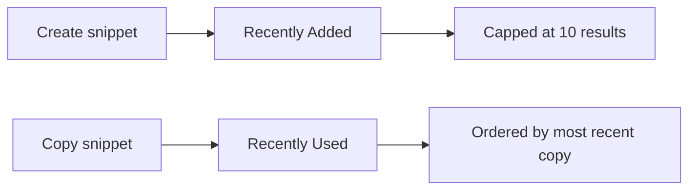
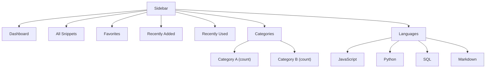

# Snippet organization

Snippet Organization is the set of tools that keeps your code library structured and easy to navigate. It's for developers managing a growing collection of saved code—especially libraries of 50 snippets or more—who need a clear way to find what they've saved without scrolling through an undifferentiated list.

With Snippet Organization, every snippet can be grouped by **category**, labeled with flexible **tags**, identified by **programming language**, marked as a **favorite**, and surfaced automatically in **Recently Added** and **Recently Used** views. A dedicated navigation pane ties all of this together so you always know where you are and what's in each group.

The main organizing tools are:

- **Categories**, broad grouping by purpose or topic
- **Tags**, free-form labels for cross-cutting details
- **Languages**, automatic grouping by the language of the saved code
- **Favorites**, a star-based quick-access list
- **Recently Added**, a time-based view of your latest saves
- **Recently Used**, a view of snippets you've copied, ordered by most recent copy
- **Sidebar navigation**, a persistent pane with sections, counts, and filters

---

## Understanding how your library is organized

Each snippet carries three independent pieces of organizing information: a language, a category, and any number of tags. Favorites, recency, and usage are added on top as ways to surface selected snippets quickly. These schemes work together—for example, a snippet can be JavaScript, saved under **Utilities**, tagged`#async`, and also marked as a favorite.

Figure: How one snippet fits into the organization system

The sidebar reflects this structure in real time. As you add or edit snippets, the category list, counts, and language filters update to match your library.

---

## Categories

Categories provide a broad, preset grouping for snippets. They're ideal for separating different kinds of work—for example, reusable utility functions versus database queries.

### Predefined categories

When you create a snippet, you can pick from the built-in list such as **Utilities**. These categories appear automatically in the sidebar under **Categories**, ready to use without setup.

### Custom categories

If the built-in list doesn't fit your needs, you can create a custom category while adding or editing a snippet:

1. Open the **New snippet** or **Edit snippet** form.
2. Select the **Category** field.
3. Choose **+ Custom category…** from the list.
4. Type the name you want.
5. Save the snippet.

After a custom category exists, it appears in the sidebar alongside the predefined ones, and it's available for future snippets.

### Category counts

Every category in the sidebar displays a count badge showing how many snippets belong to it. This gives you an immediate sense of where your library is concentrated and helps you spot categories that are growing large.

Selecting a category in the sidebar and selecting it again switches the view back to all categories.

**Related:** [Snippet Management](doc:d875ccc9-b2fb-4c86-82a0-190a6952a4c7) and [Understanding Snippet Metadata](doc:0454440c-0145-46fc-910a-1e0a7ef4c962)

---

## Tags

Tags are flexible, user-defined labels attached to individual snippets. Unlike categories, which represent broad groupings, tags capture details that cut across categories—for example,`#async`,`#optimization`, or`#testing`.

### How tagging works

Add tags while creating or editing a snippet. You can attach any number of tags to a single snippet, and the same tag can appear on many snippets across different categories and languages.

When a snippet is displayed, its tags show as rounded chips with a`#` prefix. The tag list in the filter bar is built from all your snippets' tags, so picking a tag narrows the view to snippets labeled with it.

Tags are flat—there's no hierarchy or parent-child relationship between them. They're also fully manual: the app never guesses or automatically creates tags based on code content.

Figure: How categories and tags differ

---

## Languages

Every snippet is associated with exactly one programming language: **JavaScript**, **Python**, **SQL**, or **Markdown**. This grouping is programmatic—your snippets are automatically organized by the language you choose when saving them.

### Language badges

Each snippet shows a small language badge with a colored dot specific to that language. The color coding is consistent across the card view, the detail viewer, and the sidebar, so you can identify languages at a glance.

### Language filters

The sidebar's **Languages** section lists all four languages with their colored dots. Selecting a language filters the visible snippets to that language only. Selecting it again returns to all languages. You can also use the language dropdown in the filter bar for the same purpose.

---

## Favorites

Favorites are a quick-access list of snippets you've starred. Use them for the snippets you reach for most often—utility functions, template code, or anything worth keeping one click away.

### Marking a favorite

You can add or remove a snippet from favorites in three places:

- The star icon on a snippet card
- The **Favorite** button inside the snippet detail window
- The **Mark as favorite** switch on the new/edit snippet form

A gold-filled star indicates a snippet is already a favorite.

### The favorites section

The sidebar's **Favorites** item shows a count badge with the number of starred snippets. Selecting it filters the library to only starred snippets. If you have no favorites, the view shows an empty state prompting you to clear the filter or browse elsewhere.

Favorites are manually controlled—nothing is favorited automatically, and your favorites list only changes when you explicitly add or remove stars.

---

## Recently added

The **Recently Added** section shows the most recent snippets you've added, sorted newest first. It displays the first 10 results, so the view focuses on your latest activity without overwhelming you.

This view is automatically built from your snippet creation timestamps. Whenever you save a new snippet, it appears at the top of this list. The same timestamps also drive the sort dropdown in the filter bar, where you can choose **Recently Added**, **Oldest First**, or **A–Z** for the main list.

Like favorites, the recently added view is action-based—it reflects what you've actually saved, not an algorithmic suggestion.

---

## Recently used

The **Recently Used** section shows snippets you've copied, ordered by most recent copy. This surfaces the snippets you actually reuse, separate from ones you merely saved recently.

Figure: How a snippet moves through recently added and recently used

### Count badge and empty state

The **Recently Used** item in the sidebar shows a count badge with the number of snippets you've copied at least once. If you haven't copied any snippets yet, the section shows an empty state with a **Browse all snippets** button and a note to copy a snippet to see it appear here.

---

## Sidebar navigation

The navigation pane on the left side of the application is the hub for Snippet Organization. It groups navigation into several areas with distinct purposes.

Figure: Sidebar navigation structure

### Main navigation

Five items anchor the top of the sidebar:

- **Dashboard**, the home view, showing a heading and summary statistics
- **All Snippets**, the full library, with a count badge
- **Favorites**, starred snippets only, with a count badge
- **Recently Added**, the newest snippets, capped at 10, no count badge
- **Recently Used**, snippets you've copied, with a count badge

### Category and language groups

Below the main navigation are two groups: **Categories** and **Languages**. Categories show each category name with a snippet count badge, and languages show each of the four supported languages with a colored dot.

### Mobile navigation

On smaller screens, the sidebar collapses into a hamburger menu. Selecting any navigation item—a section, category, or language—closes the mobile sidebar automatically and returns you to the content.

### Quick actions

The sidebar footer includes a **New Snippet** button and a **Settings** button. The settings area also confirms that your snippets are **Saved on this device**, so nothing is uploaded to a server—your organization data stays in your browser.

**Related:** [Dashboard](doc:73800e45-b85d-4bd0-9a64-7620aa9bdf7e) and [Navigation and Layout Modes](doc:971aeb74-0ca3-46ee-9e46-5b25c15adc24)

---

## Filtering by organization

The search and filter bar, visible above the snippet list, mirrors the sidebar's organizational structure. You can narrow your library using:

- **Search**, free-text matching across title, description, tags, and code
- **Language**, a dropdown with all four languages
- **Category**, a dropdown listing every category in your library
- **Tag**, a dropdown listing every tag, each prefixed with`#`
- **Sort**, **Recently Added**, **Oldest First**, or **A–Z**

When you have active filters, a **Clear Filters** button appears. Selecting a category or language from the sidebar applies the same narrowing as the dropdowns, so both paths are equivalent.

**Related:** [Search and Filtering](doc:d4db354c-9033-416f-babe-aaab07cc3975)

---

## Boundaries and current limits

Snippet Organization is intentionally straightforward, which keeps it fast to use but means certain features aren't available:

- **Categories and tags are flat.** There are no nested or hierarchical structures. You can't create a category inside another category or a tag that sits under another tag.
- **No smart auto-tagging.** Tags are only created when you type them. The application never analyzes your code to suggest or apply tags automatically.
- **Favorites and usage are manually controlled.** Nothing is favorited automatically, and the recently used list is based purely on your copy actions, not inferred relevance.
- **Sidebar is read-only.** You can navigate and filter from the sidebar, but you can't rename a category, edit a tag, or modify any snippet directly from it. Changes are made through the snippet form.

These boundaries keep the system predictable: what you see in the sidebar and filters is exactly what you and your library contain.

**Related:**

- [Product Overview and Key Concepts](doc:3a2f38ea-1eb7-45d0-91ef-d101d4eb349c)
- [Quick Start Guide](doc:27bdcaf5-0df9-412f-9cd1-5eaf702b8d97)
- [Code Preview and Highlighting](doc:1af35ce8-def3-409e-a761-91543f16f3d9)
