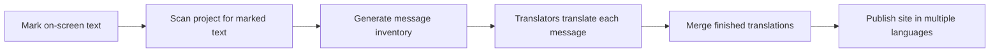

# Translation extraction

Translation extraction finds text in your project that is marked for translation and gathers it into one organized list. That list is the starting point for offering your site in more than one language.

**Who it is for**

- Developers who write the text that visitors see on screen
- Translators and localization managers who need a complete list of every message a project can show

**The translation extraction workflow**

When a project supports translation extraction, you first mark the text that appears on screen. A scanning step then walks through the project, finds every marked piece of text, and writes them into a single inventory. Translators work from the inventory without needing to touch the rest of the project. When translations are done, they are merged back in and each visitor sees the site in their own language.

Figure: Translation extraction workflow

**Benefits**

- Translators see every message in one place, with no risk of missing text
- Developers can add context for translators, such as where a message appears or what it means
- New text is found automatically in the next scan, so the inventory stays current
- Translation work can be handed to a team or a translation service without giving access to the whole project

**What you can do in this project**

This project does not currently include translation extraction. The available project setup does not offer a way to mark individual pieces of text for translation, scan your content into a translation list, or generate an inventory to share with translators.

**What is not available**

- Marking a piece of text as ready for translation
- Collecting marked text from across your project into one list
- Adding a stable identifier or translator note to a piece of text
- Generating a translation inventory for translators to work from

**Limits**

Translation extraction is not a supported feature in this project version. Every message shown in the interface is written directly in English, so there is no marked text for a scanning step to collect. If you need to translate this site, you will need to add a translation workflow outside of the current setup, or replace the fixed messages with a translation system first.

**Related**

- [How to extract translation messages from source code](doc:50153d40-6fea-4614-aa55-400a26b83586)
- [How to generate translation files for localization](doc:fcda591a-7a2e-4c9b-8905-30628c286b07)
- [How to integrate extracted translations with translation management](doc:e56696b4-7363-4a34-acd5-3abe9be1e50e)
