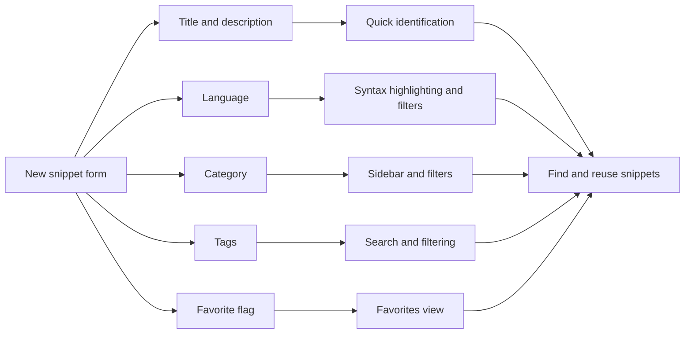
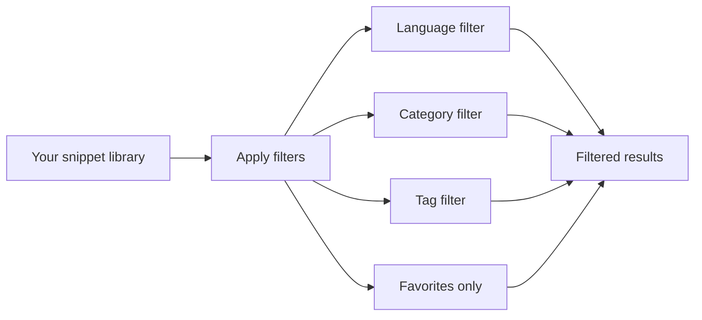

# Understanding snippet metadata

Your snippet library becomes easier to browse and search when every piece of code carries clear descriptive information, not just the code itself. In CodeKnit, that descriptive information is called metadata. Understanding each metadata field helps you save snippets that are faster to recognize, group, and find later.

## What snippet metadata is

Metadata is the set of details you provide—or the app records—around each snippet. When you open the **New snippet** form, you enter some of these details yourself, such as a title, language, and tags. Other details, such as dates, are recorded automatically.

The following figure shows how the details you enter become the hooks you use later to find, filter, and reuse code.

Figure: From snippet details to finding code again

## The fields that describe a snippet

The following table summarizes each metadata field and where it helps.

| Field | What it does | Required? |
|-------|--------------|-----------|
| Title | Identifies the snippet at a glance | Yes |
| Description | Adds optional context about what the code does | No |
| Language | Determines syntax highlighting and language filtering | Yes |
| Category | Groups related snippets under a shared name | No, but a default applies |
| Tags | Adds flexible, searchable keywords | No |
| Favorite flag | Pins a snippet to Favorites for quick access | No |
| Timestamps | Records creation, last update, and copy activity | Automatic |

### Title and description

The **Title** is the first thing you see on a snippet card and in the detail view. It is required, and the form prompts for examples such as **Debounce utility**. A concise, specific title makes a snippet instantly recognizable in a large library.

The **Description** is optional. Use it to explain what the code does, when to use it, or anything your future self might need to know. The form invites you to answer **What does it do?** Descriptions appear under the title on snippet cards and in the detail view.

### Language selection and syntax highlighting

The **Language** field is required when you create or edit a snippet. You choose from four supported languages:

- JavaScript
- Python
- SQL
- Markdown

Your choice has two effects. First, the language determines how the code preview is colorized, so comments, strings, keywords, and numbers appear in distinct colors that make the code easier to read. Second, the language becomes a filter option in the sidebar and the filter bar, so you can narrow your library to a single language.

Each language also has a small colored dot in the sidebar and on snippet cards, giving you a visual cue that works at a glance.

### Category system for grouping related snippets

The **Category** field helps you collect related snippets under a shared name. The app includes built-in categories, and you can also choose **+ Custom category…** to enter your own name. New snippets start with the default category **Utilities**, so you can save immediately or change it to something meaningful.

Categories appear in the navigation sidebar, where each one shows the number of snippets it contains. Selecting a category filters the current view to that group. Categories are also available as a filter on snippet lists.

Choose a category that reflects how you think about the snippet—for example, by project, by task, or by code type. Consistent categories make the sidebar a fast way to move between groups of related snippets.

### Tags for flexible classification and search

Tags are short, optional labels you can attach to a snippet. Unlike categories, which place each snippet in a single group, tags let you combine many labels on one snippet. Tag chips appear with a`#` symbol on snippet cards and in the detail view.

Tags are especially useful for cross-cutting ideas such as`#api`,`#react`, or`#helper`. You can type a tag-based search directly in the main search box or choose a tag from the filter bar to show only snippets that share that label.

### Favorites flag for pinning important snippets

The **Favorite** flag, shown as a star on each snippet card, marks snippets you want to reach quickly. In the new snippet form, you can turn on **Mark as favorite** before saving. You can also toggle the star at any time from a snippet card or the detail view.

Favorited snippets show a filled star and are counted in the **Favorites** section of the sidebar. Selecting **Favorites** filters your library to only the snippets you have starred.

### Timestamps showing creation and last-modified dates

The app tracks two dates automatically for every snippet:

- **Created**, the date the snippet was first saved
- **Updated**, the date the snippet was last edited

On snippet cards, the date shown is the updated date. When a snippet has been changed since creation, the label **Updated** appears before the date. In the detail view, both dates appear together, along with the number of times the code has been copied and the date it was last copied, when available.

Timestamps also feed the sort options in the filter bar. **Recently Added** and **Oldest First** order snippets by how recently they were added, helping you see new additions or older saved items first.

## How metadata affects discoverability

The metadata you enter influences every path to finding a snippet:

- The **search box** matches query text against titles, tags, and code content.
- The **language filter** narrows results by language.
- The **category filter** or sidebar narrows results by category.
- The **tag filter** narrows results by tag.
- The **Favorites** section narrows results to starred snippets.
- Sorting by **Recently Added** or **Oldest First** orders results by creation date.

The following diagram shows how the main filtering paths work together.

Figure: Filtering paths that use snippet metadata

## Tips for consistent metadata

A few habits make metadata work harder for you:

1. Write titles as specific, human-readable names.
2. Add a description whenever the purpose isn't obvious from the title.
3. Pick the language the snippet is actually written in so highlighting looks right and filtering works as expected.
4. Use categories for broad groups and tags for reusable keywords across groups.
5. Star snippets you return to frequently.
6. Rely on timestamps to know whether a snippet is current.

## Next steps

- Learn how to create and edit snippets in [Snippet Management](doc:d875ccc9-b2fb-4c86-82a0-190a6952a4c7)
- See how metadata powers filtering in [Search and Filtering](doc:d4db354c-9033-416f-babe-aaab07cc3975)
- Explore sidebar organization in [Snippet Organization](doc:c88b9d7b-71f1-4365-b228-3a4ca18a9db4)
- Read about starred snippets in [Favorites Management](doc:b7298781-db09-4ef9-812c-618f0b3e222c)
- Understand syntax coloring in [Code Preview and Highlighting](doc:1af35ce8-def3-409e-a761-91543f16f3d9)
