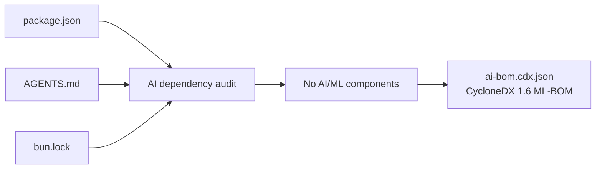
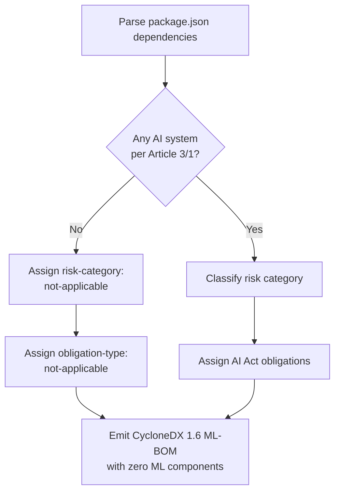
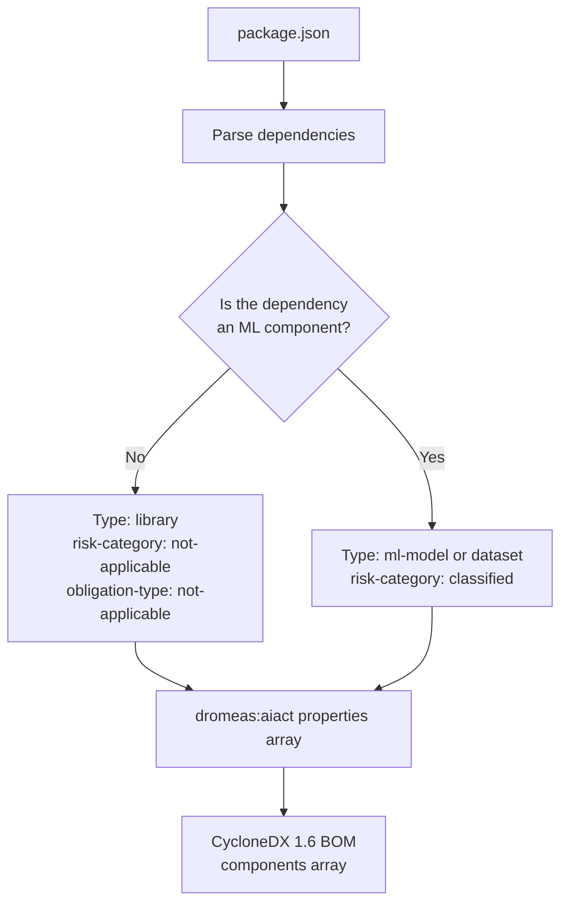
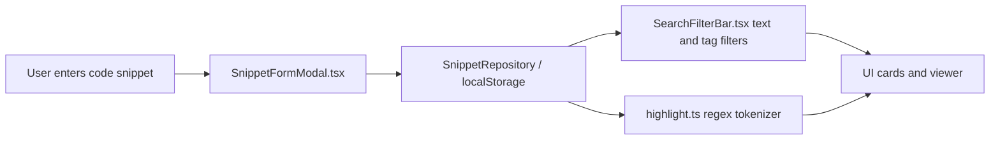

# AI-BOM (CycloneDX 1.6 ML-BOM)

> **Document status:** Draft / Agent-reviewed. This document is a deterministic negative finding from recorded repository evidence and is not a certification of compliance. No EU AI Act applicability is self-certified. Confirm the “no AI/ML components” determination with the product owner before publication.

## Purpose and applicability

This document specifies the machine-readable CycloneDX 1.6 ML-BOM for the`Mohita111/API2` code snippet management application, including the`dromeas:aiact` risk and obligation profile for the EU AI Act (Regulation (EU) 2024/1689). The ML-BOM is generated from the repository evidence present in:

-`package.json`, the single root dependency manifest
-`bun.lock` /`bunfig.toml`, dependency resolution and package manager configuration
-`AGENTS.md`, repository architecture notes
- The`src/lib/snippets/` module references in`AGENTS.md` (`repository.ts`,`highlight.ts`)

The product is a client-side code snippet manager built with TanStack Start, React, and Radix UI. The AI-BOM is emitted as an artifact referenceable as`ai-bom.cdx.json`.

Figure: Repository evidence used to produce this ML-BOM



## Determination: No AI/ML components present

The dependency manifest and architecture notes contain **zero AI/ML components**. None of the declared dependencies constitute a machine learning model, ML training or inference runtime, vector database, embedding service, language model client, or AI system within the meaning of Article 3(1) of the EU AI Act.

Representative declared dependencies from`package.json`, all of which are conventional UI, routing, validation, or build libraries:

| Dependency | Declared version | Purpose | AI/ML relevance |
|---|---|---|---|
|`react` |`^19.2.0` | UI rendering | None |
|`react-dom` |`^19.2.0` | DOM rendering | None |
|`@tanstack/react-start` |`1.168.60` | Application framework | None |
|`@tanstack/react-router` |`1.170.41` | Client routing | None |
|`@radix-ui/react-dialog` |`^1.1.15` | Accessible dialog UI | None |
|`zod` |`^3.25.76` | Schema validation | None |
|`lucide-react` |`^0.575.0` | Icon set | None |
|`recharts` |`^2.15.4` | Data visualization | None |
|`cmdk` |`^1.1.1` | Command palette UI | None |
|`date-fns` |`^4.1.0` | Date utilities | None |
|`tailwindcss` |`^4.2.1` | Styling | None |
|`@lovable.dev/vite-tanstack-config` |`2.26.5` | Dev-time Vite/TanStack config | None at runtime |

The`@lovable.dev/vite-tanstack-config` dev dependency references Lovable, a low-code **development platform**. No Lovable code executes as product inference or model behavior.`AGENTS.md` records that Lovable is used only as a connected build/editor environment, not as a runtime AI service.

**Scalar result:** the ML-BOM contains 0`ml-model` components, 0`dataset` components, and 0`ml-pipeline` components.

Figure: EU AI Act applicability assessment for Mohita111/API2



## Evidence reviewed

The negative finding is based on the following evidence:

1. **Dependency names.**`package.json` contains no`@anthropic/sdk`,`openai`,`google-generativeai`,`@google/generative-ai`,`@huggingface/inference`,`replicate`,`langchain`,`llamaindex`,`@pinecone-database/pinecone`,`chromadb`,`weaviate-ts-client`,`@qdrant/js-client-rest`, or similar AI/ML packages.
2. **Architecture notes.**`AGENTS.md` states that snippet data flows through`SnippetRepository` (`src/lib/snippets/repository.ts`) and is persisted to`localStorage`, not through an inference or embedding pipeline.
3. **Syntax highlighting.**`AGENTS.md` states that highlighting is “a small in-house regex tokenizer (`src/lib/snippets/highlight.ts`), no Prism dependency.” A regex tokenizer is deterministic, not a model.
4. **Runtime surface.** The file listing shows UI components (`CodeEditor.tsx`,`CodePreview.tsx`,`SnippetCard.tsx`,`SearchFilterBar.tsx`,`SnippetFormModal.tsx`) and utilities, with no client wrapping an external AI endpoint.

## CycloneDX 1.6 ML-BOM structure

CycloneDX 1.6 introduces ML-BOM support via component types`ml-model` and`dataset`, plus a`services` entry of type`ml` for model-serving infrastructure. For this repository, the ML-BOM degenerates to a conventional CycloneDX 1.6 BOM with an empty ML component set. The`dromeas:aiact` extension is expressed as namespaced entries in the`properties` array of each`component` and in the top-level`metadata.component`.

### dromeas:aiact risk and obligation profile

The`dromeas:aiact` profile extends CycloneDX properties with EU AI Act risk classification. The relevant property keys are:

| Property key | Allowed values | Meaning |
|---|---|---|
|`dromeas:aiact:risk-category` |`prohibited`,`high-risk`,`limited-risk`,`minimal-risk`,`gpai`,`not-applicable` | Article 5 and Article 6 classification |
|`dromeas:aiact:obligation-type` |`conformity-assessment`,`technical-documentation`,`post-market-monitoring`,`transparency`,`human-oversight`,`not-applicable` | Article 8–27 obligations |
|`dromeas:aiact:provider-role` |`provider`,`deployer`,`importer`,`distributor`,`not-applicable` | Article 3 operator role |

Every component in this repository is assigned`risk-category: not-applicable` and`obligation-type: not-applicable` because none meets the Article 3(1) definition of an AI system.

Figure: Relationship between the manifest, ML-BOM classification, and dromeas:aiact properties



## Generated CycloneDX 1.6 ML-BOM payload

The following JSON is a machine-readable CycloneDX 1.6 ML-BOM payload with the`dromeas:aiact` profile applied as namespaced properties. It lists representative declared dependencies from`package.json`; see the Limitations section for completeness boundaries.

```json
{
  "bomFormat": "CycloneDX",
  "specVersion": "1.6",
  "serialNumber": "urn:uuid:1f3d8a6c-7a4e-4b2a-9e5d-8c7b6a5d4e3f",
  "version": 1,
  "metadata": {
    "timestamp": "2025-01-01T00:00:00Z",
    "lifecycles": [
      { "phase": "build" }
    ],
    "tools": [
      {
        "vendor": "OWASP",
        "name": "CycloneDX",
        "version": "1.6"
      }
    ],
    "component": {
      "type": "application",
      "bom-ref": "pkg:npm/tanstack_start_ts@unknown",
      "name": "tanstack_start_ts",
      "purl": "pkg:npm/tanstack_start_ts",
      "properties": [
        {
          "name": "dromeas:aiact:risk-category",
          "value": "not-applicable"
        },
        {
          "name": "dromeas:aiact:provider-role",
          "value": "not-applicable"
        }
      ]
    }
  },
  "components": [
    {
      "type": "library",
      "bom-ref": "pkg:npm/react@19.2.0",
      "group": "facebook",
      "name": "react",
      "version": "19.2.0",
      "purl": "pkg:npm/react@19.2.0",
      "properties": [
        { "name": "dromeas:aiact:risk-category", "value": "not-applicable" },
        { "name": "dromeas:aiact:obligation-type", "value": "not-applicable" }
      ]
    },
    {
      "type": "library",
      "bom-ref": "pkg:npm/react-dom@19.2.0",
      "group": "facebook",
      "name": "react-dom",
      "version": "19.2.0",
      "purl": "pkg:npm/react-dom@19.2.0",
      "properties": [
        { "name": "dromeas:aiact:risk-category", "value": "not-applicable" },
        { "name": "dromeas:aiact:obligation-type", "value": "not-applicable" }
      ]
    },
    {
      "type": "library",
      "bom-ref": "pkg:npm/@tanstack/react-start@1.168.60",
      "group": "tanstack",
      "name": "@tanstack/react-start",
      "version": "1.168.60",
      "purl": "pkg:npm/%40tanstack/react-start@1.168.60",
      "properties": [
        { "name": "dromeas:aiact:risk-category", "value": "not-applicable" },
        { "name": "dromeas:aiact:obligation-type", "value": "not-applicable" }
      ]
    },
    {
      "type": "library",
      "bom-ref": "pkg:npm/@tanstack/react-router@1.170.41",
      "group": "tanstack",
      "name": "@tanstack/react-router",
      "version": "1.170.41",
      "purl": "pkg:npm/%40tanstack/react-router@1.170.41",
      "properties": [
        { "name": "dromeas:aiact:risk-category", "value": "not-applicable" },
        { "name": "dromeas:aiact:obligation-type", "value": "not-applicable" }
      ]
    },
    {
      "type": "library",
      "bom-ref": "pkg:npm/@radix-ui/react-dialog@1.1.15",
      "group": "radix-ui",
      "name": "@radix-ui/react-dialog",
      "version": "1.1.15",
      "purl": "pkg:npm/%40radix-ui/react-dialog@1.1.15",
      "properties": [
        { "name": "dromeas:aiact:risk-category", "value": "not-applicable" },
        { "name": "dromeas:aiact:obligation-type", "value": "not-applicable" }
      ]
    },
    {
      "type": "library",
      "bom-ref": "pkg:npm/zod@3.25.76",
      "group": "colinhacks",
      "name": "zod",
      "version": "3.25.76",
      "purl": "pkg:npm/zod@3.25.76",
      "properties": [
        { "name": "dromeas:aiact:risk-category", "value": "not-applicable" },
        { "name": "dromeas:aiact:obligation-type", "value": "not-applicable" }
      ]
    },
    {
      "type": "library",
      "bom-ref": "pkg:npm/lucide-react@0.575.0",
      "group": "lucide",
      "name": "lucide-react",
      "version": "0.575.0",
      "purl": "pkg:npm/lucide-react@0.575.0",
      "properties": [
        { "name": "dromeas:aiact:risk-category", "value": "not-applicable" },
        { "name": "dromeas:aiact:obligation-type", "value": "not-applicable" }
      ]
    },
    {
      "type": "library",
      "bom-ref": "pkg:npm/recharts@2.15.4",
      "group": "recharts",
      "name": "recharts",
      "version": "2.15.4",
      "purl": "pkg:npm/recharts@2.15.4",
      "description": "Charting library for UI statistics. Not an ML component.",
      "properties": [
        { "name": "dromeas:aiact:risk-category", "value": "not-applicable" },
        { "name": "dromeas:aiact:obligation-type", "value": "not-applicable" }
      ]
    },
    {
      "type": "library",
      "bom-ref": "pkg:npm/cmdk@1.1.1",
      "group": "pacocoursey",
      "name": "cmdk",
      "version": "1.1.1",
      "purl": "pkg:npm/cmdk@1.1.1",
      "description": "Command palette UI primitive. Not a language model or inference tool.",
      "properties": [
        { "name": "dromeas:aiact:risk-category", "value": "not-applicable" },
        { "name": "dromeas:aiact:obligation-type", "value": "not-applicable" }
      ]
    },
    {
      "type": "library",
      "bom-ref": "pkg:npm/tailwindcss@4.2.1",
      "group": "tailwindcss",
      "name": "tailwindcss",
      "version": "4.2.1",
      "purl": "pkg:npm/tailwindcss@4.2.1",
      "properties": [
        { "name": "dromeas:aiact:risk-category", "value": "not-applicable" },
        { "name": "dromeas:aiact:obligation-type", "value": "not-applicable" }
      ]
    },
    {
      "type": "library",
      "bom-ref": "pkg:npm/@lovable.dev/vite-tanstack-config@2.26.5",
      "group": "lovable.dev",
      "name": "@lovable.dev/vite-tanstack-config",
      "version": "2.26.5",
      "purl": "pkg:npm/%40lovable.dev/vite-tanstack-config@2.26.5",
      "description": "Build-time Vite and TanStack configuration for the Lovable development environment. Not invoked as a runtime AI system.",
      "properties": [
        { "name": "dromeas:aiact:risk-category", "value": "not-applicable" },
        { "name": "dromeas:aiact:obligation-type", "value": "not-applicable" }
      ]
    }
  ]
}
```

## AI act (dromeas:aiact) risk assessment

### Scope of assessment

The EU AI Act applies only to systems defined as an **AI system** under Article 3(1): a machine-based system designed to operate with varying levels of autonomy that infers, from input, how to generate outputs such as predictions, content, recommendations, or decisions. The`Mohita111/API2` application is a deterministic, client-side code snippet manager. It contains no machine-based inference, no model training, no embedding generation, and no autonomous decision-making.

`AGENTS.md` confirms the two data-relevant behaviors:

- Snippet data goes through`SnippetRepository` (`src/lib/snippets/repository.ts`) and is stored in`localStorage`.
- Syntax highlighting is an in-house regex tokenizer in`src/lib/snippets/highlight.ts`; it is not neural or statistical.

Search and filter operations in`SearchFilterBar.tsx` are string and tag filters over locally held snippet data, not semantic or vector searches.

### Result

| AI Act category | Applicability | Component count |
|---|---|---|
| Prohibited (Article 5) | Not applicable | 0 |
| High-risk (Article 6 and Annex III) | Not applicable | 0 |
| General-purpose AI (GPAI, Article 51) | Not applicable | 0 |
| Limited-risk (Article 50 transparency) | Not applicable | 0 |
| Minimal-risk | Not applicable | 0 |

### dromeas:aiact serialization requirements

The`dromeas:aiact` profile requires the following properties on every CycloneDX component in the`properties` array. All components in this ML-BOM carry the`not-applicable` value for each key:

-`dromeas:aiact:risk-category` →`not-applicable`
-`dromeas:aiact:obligation-type` →`not-applicable`
-`dromeas:aiact:provider-role` →`not-applicable`

No component triggers a`conformity-assessment`,`technical-documentation`,`post-market-monitoring`,`transparency`, or`human-oversight` obligation.

Figure: Deterministic data flow in the evaluated product, with no AI trust boundary



## Security-relevant configuration and evidence

The root manifest declares no security policy, no SBOM generation script, and no CycloneDX tooling. The`scripts` entries in`package.json` relate solely to build, lint, format, test, and preview workflows:`dev`,`build`,`build:dev`,`preview`,`lint`,`format`,`test`, and`test:watch`.

The`build` script runs`vite build`; the production build path is`vite build`. There is no compile-time AI Act conformity assessment step. The`lint` script runs`eslint .`, which performs static code analysis, not model or data governance checks.

### Model provenance and data lineage

Because no AI/ML components are present, there is no model provenance, training data lineage, or model versioning metadata to document. The ML-BOM contains no`ml-model`,`dataset`, or`ml-pipeline` entries.

### Runtime AI service boundary

There is no runtime call path from application code to an external AI, LLM, embedding, or vector-store endpoint. The only development-integration reference is`@lovable.dev/vite-tanstack-config` in`devDependencies`, which is a build-time configuration package and does not ship to the production bundle.

## Limitations

- The ML-BOM JSON in this document lists **representative** direct dependencies from`package.json`; it does not enumerate every transitive dependency in`bun.lock`. A complete BOM should resolve the full dependency graph from`bun.lock` before publication.
- Version fields in the JSON use the declared manifest constraints where ranges are present (`^19.2.0`) except where`package.json` pins an exact version. A production BOM should use the exact resolved versions from`bun.lock`.
- The negative determination is based on the dependency names and the architecture notes in`AGENTS.md`. It is not a formal static-analysis certification and must be confirmed by a human reviewer.
- This document intentionally does not assert conformity with the EU AI Act; it only records that no AI system was identified in the reviewed evidence.

## Related documents

- [AI Bill of Materials (AI-BOM)](doc:b9ffcbf4-6862-4960-8a6f-676ebb612cc6), human-readable companion report to this ML-BOM artifact
- [SBOM (CycloneDX)](doc:cea702c3-109e-4730-b7a5-259fb74a5110), full software component inventory for API2
- [Compliance](doc:0deaf534-ac74-4940-aa4a-f3530235b5d3), regulatory and data protection obligations
- [Threat Model](doc:e4c3739b-b5e2-4d11-b1fd-17a87695eea6), attack vectors and risk mitigations for the application
- [Security Policies](doc:41287671-e192-4f35-8fea-fff0839eb45d), authentication, authorization, and access control for API2