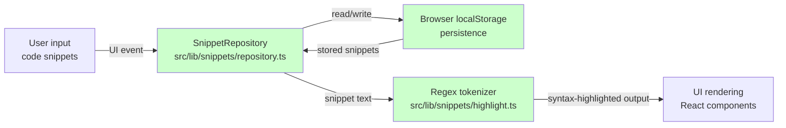
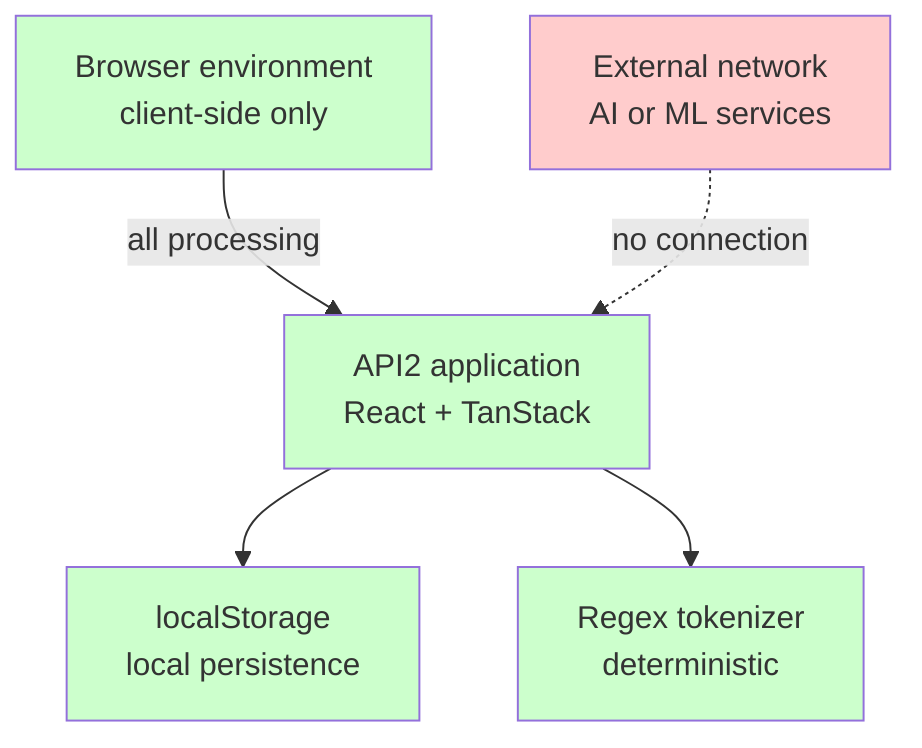

# AI-BOM report

**Repository:** Mohita111/API2
**Documentation type:** Security
**Sub-scope:** ai-bom
**Status:** Agent-drafted, human review required
**Analysis date:** 2026-06-30
**Analyzed source:**`package.json`,`AGENTS.md`,`README.md`

## 1. Executive summary

Analysis of the Mohita111/API2 repository **found zero AI/ML component invocations**. The product is a client-side code snippet manager with`localStorage` persistence and regex-based syntax highlighting. No dependencies in`package.json` implement or invoke AI, machine learning, or large language model (LLM) functionality.

The codebase consists of React 19 UI components, TanStack framework packages, Radix UI primitives, Tailwind CSS styling utilities, and build tooling. Syntax highlighting is explicitly described in`AGENTS.md` as "a small in-house regex tokenizer (src/lib/snippets/highlight.ts), no Prism dependency."

**EU AI Act applicability:** **NOT_APPLICABLE**. The repository contains no AI system as defined in Article 3(1) of the EU AI Act, no general-purpose AI model under Article 3(63), and triggers no obligations under Annex III (high-risk) or Article 50 (transparency).

**Recommendation:** Mark this repository as NOT_APPLICABLE for AI governance review. Do not subject it to AI/ML compliance workflows. No further action required.

## 2. AI/ML capability inventory

### 2.1 AI/ML component inventory

**No AI/ML components were found.** The following inventory is empty by verified absence.

| Component | Version | Source | Purpose | Risk tier | EU AI Act obligations | Mitigation status |
|---|---|---|---|---|---|---|
|, |, |, |, |, |, |, |

### 2.2 Verification checklist

The following checks were performed against`package.json`,`AGENTS.md`, and`README.md`:

| Check | Result | Evidence citation |
|---|---|---|
| LLM API calls (OpenAI, Anthropic, Gemini, Cohere.) | **Not found** | No such packages or API references in`package.json` dependencies or devDependencies. |
| Embedding generation or vector stores | **Not found** | No`pinecone`,`weaviate`,`qdrant`,`chromadb`,`pgvector`, or similar packages. |
| ML inference engines or runtimes | **Not found** | No`onnxruntime`,`tensorflow`,`torch`,`transformers`, or similar packages. |
| Machine learning frameworks | **Not found** | No`scikit-learn`,`keras`,`xgboost`, or similar packages. |
| Data science pipelines | **Not found** | No data processing or model training packages.`package.json` scripts are limited to`dev`,`build`,`preview`,`lint`,`format`,`test`, and`test:watch`. |
| Generative AI SDKs | **Not found** | No`langchain`,`llamaindex`,`openai`,`anthropic`, or similar SDKs. |
| AI model weights or training data | **Not found** | No model artifacts referenced in any analyzed file. |

### 2.3 Assessment verdict

| Classification | Value |
|---|---|
| AI-BOM status | **NOT_APPLICABLE** |
| EU AI Act risk tier | **Minimal / outside scope** |
| AI governance review required | **No** |
| Human confirmation required | **Yes, flag for final sign-off** |

## 3. Architecture and data flows

The API2 application follows a deterministic client-side architecture. Data flows between the browser UI,`SnippetRepository` (localStorage), and the regex tokenizer. No external AI service is invoked at any point.

Figure: API2 runtime data flow

Figure: Trust boundary assessment

### 3.1 Input sources

| Input source | Destination | Data type | AI relevance |
|---|---|---|---|
| User code snippets (UI input) |`SnippetRepository` | Text (source code) | **No AI processing.** Stored directly. |
| User interactions (browser events) | React components | UI state | Deterministic rendering only. |

### 3.2 Output sinks

| Output sink | Source | Data type | AI relevance |
|---|---|---|---|
| User interface (browser DOM) | Regex tokenizer → React render | Highlighted code text | **Deterministic.** Regex-based, not ML-generated. |
| Browser`localStorage` |`SnippetRepository` | Serialized snippet data | Local persistence. No remote sink. |

### 3.3 External API calls

**None identified.**`package.json` contains no network client libraries for AI services. The only development-time external reference is the Lovable platform integration described in`README.md` and`AGENTS.md`, which is a build-time developer tool and **not invoked at runtime by the product**.

## 4. Dependency and supply-chain analysis

### 4.1 Dependencies by category

| Category | Representative packages | Evidence |
|---|---|---|
| React UI framework |`react@^19.2.0`,`react-dom@^19.2.0` |`package.json` dependencies |
| TanStack framework |`@tanstack/react-start`,`@tanstack/react-router`,`@tanstack/react-query` |`package.json` dependencies |
| Radix UI primitives | 20+`@radix-ui/react-*` packages |`package.json` dependencies |
| Styling |`tailwindcss`,`tailwind-merge`,`lucide-react`,`clsx` |`package.json` dependencies |
| Forms and validation |`react-hook-form`,`zod`,`@hookform/resolvers` |`package.json` dependencies |
| Charts and UI widgets |`recharts`,`embla-carousel-react`,`cmdk`,`sonner`,`vaul` |`package.json` dependencies |
| Build tooling |`vite`,`typescript`,`eslint`,`prettier`,`vitest` |`package.json` devDependencies |
| Lovable dev tooling |`@lovable.dev/vite-tanstack-config@2.26.5` |`package.json` devDependencies |

### 4.2 AI/ML package scan

**Zero AI/ML packages found** in either`dependencies` or`devDependencies`. No package name in`package.json` contains or references any of the following keywords:`ai`,`ml`,`llm`,`gpt`,`openai`,`anthropic`,`tensorflow`,`torch`,`transformers`,`embedding`,`vector`,`langchain`,`llamaindex`,`onnx`,`inference`,`model`.

### 4.3 Lovable platform assessment

`README.md` states: "This project was built with Lovable."`AGENTS.md` states: "This project is connected to Lovable."

Lovable is a development-time tool that generates code based on user prompts in its editor. It is **not a runtime dependency** of the API2 product. The product itself does not call Lovable, does not make LLM queries, and does not depend on Lovable at runtime. The only Lovable-related package is`@lovable.dev/vite-tanstack-config` in devDependencies, which is a build configuration helper for Vite integration.

**Assessment:** Lovable's AI-assisted development tooling does not make the shipped product an AI system. The generated code is deterministic JavaScript/TypeScript that runs entirely client-side.

## 5. EU AI act obligations assessment

| EU AI Act article | Applicability | Rationale |
|---|---|---|
| Article 3(1), AI system definition | **NOT_APPLICABLE** | No machine-based system designed to operate with varying levels of autonomy and adaptiveness. The product is deterministic: regex tokenization + localStorage persistence. |
| Article 5, prohibited AI practices | **NOT_APPLICABLE** | No AI practices present to prohibit. |
| Article 6, high-risk AI systems (Annex III) | **NOT_APPLICABLE** | Not a biometric, critical infrastructure, education, employment, essential services, law enforcement, migration, or justice system. Not even an AI system. |
| Article 50, transparency obligations | **NOT_APPLICABLE** | No AI-generated content, no chatbots, no deepfakes. Regex-based syntax highlighting is deterministic, not generative. |
| Articles 52–53, general-purpose AI (GPAI) | **NOT_APPLICABLE** | No general-purpose AI model included in the product. |
| Article 95, voluntary codes of conduct | Voluntary | May be adopted for organizational completeness, but no AI-specific obligations exist. |

### 5.1 Mandatory obligations

**None.** The repository contains no AI system and triggers no EU AI Act obligations.

### 5.2 Recommendation

Mark this repository as **NOT_APPLICABLE** in AI governance registries. Exclude from AI/ML compliance review workflows. No AI-BOM file generation is required beyond this report documenting the verified absence finding.

## 6. Open remediation items and decision points

The following items require human confirmation to close out this assessment.

1. **Confirm repository scope completeness.** Only`package.json`,`AGENTS.md`, and`README.md` were available for analysis. Verify that no additional source files introduce AI functionality (for example, hidden API calls in route handlers or server-side code). *Evidence: The provided files are the only source files available.*

2. **Approve NOT_APPLICABLE determination.** A human reviewer with repository access must sign off on the absence finding before this report is treated as final compliance evidence.

3. **Confirm Lovable generation history.**`AGENTS.md` states the project was built with Lovable. Confirm that the Lovable-generated code does not include any runtime API calls to Lovable or other AI services. *Evidence: No such calls are visible in the three provided files; runtime source needs verification.*

4. **Verify`highlight.ts` implementation.**`AGENTS.md` describes`src/lib/snippets/highlight.ts` as "a small in-house regex tokenizer." Confirm the actual source file contains only deterministic regex logic and no ML-based highlighting. *Not found in the provided file set.*

5. **Verify`repository.ts` implementation.**`AGENTS.md` states`src/lib/snippets/repository.ts` currently uses`localStorage`. Confirm no remote persistence or AI-calling code paths exist. *Not found in the provided file set.*

6. **Confirm devDependencies remain dev-only.**`@lovable.dev/vite-tanstack-config` is in`devDependencies`. Verify it is not bundled into production output.

## 7. Methodology and limitations

### 7.1 Methodology

The AI-BOM assessment was performed by:

1. **Dependency inspection**, Scanning all entries in`package.json``dependencies` and`devDependencies` for AI/ML-related packages.
2. **Documentation review**, Reading`AGENTS.md` and`README.md` for architectural statements about persistence, syntax highlighting, and external service usage.
3. **Data flow mapping**, Inferring data flows from the documented repository pattern (`SnippetRepository` →`localStorage`, regex tokenizer → UI) and verifying no external AI service connections.
4. **EU AI Act classification**, Applying the Article 3(1) definition of AI system to the observed deterministic architecture.

### 7.2 Limitations

- **Only 3 source files were available:**`package.json`,`AGENTS.md`,`README.md`. The actual TypeScript source files (`src/lib/snippets/highlight.ts`,`src/lib/snippets/repository.ts`) were not included in the analysis set.
- **No runtime verification was performed.** Claims about runtime behavior are based on documented architecture statements, not dynamic execution.
- **Transitive dependency analysis was not performed.** A full supply-chain scan requires the lockfile to verify no transitive package pulls in AI/ML libraries.
- **This report is a preliminary assessment, not legal advice.** Organizations should consult legal counsel for EU AI Act compliance decisions.

### 7.3 Recommended next steps

1. Run`npm ls --all` (or equivalent) to generate a full transitive dependency tree and confirm no AI/ML packages are transitively included.
2. Review`src/lib/snippets/highlight.ts` and`src/lib/snippets/repository.ts` to confirm the NOT_APPLICABLE determination.
3. Record the approved NOT_APPLICABLE status in the AI governance registry.
4. Re-run this assessment if any AI features are added to the product (for example, AI-powered search, autocomplete, or summarization).

## 8. Distinction of assertion classes

| Class | Definition | Assigned to |
|---|---|---|
| **NOT_APPLICABLE** | The product definitively does not contain the described capability, verified by dependency and documentation review. | AI/ML components; EU AI Act obligations; runtime AI services |
| **NOT_FOUND_IN_SCOPE** | The capability could not be located within the provided source files, but could theoretically exist in unprovided files. | Runtime source code (`highlight.ts`,`repository.ts`) |
| **HUMAN_REVIEW_REQUIRED** | Assertions that require a human with repository access to confirm. | Scope completeness; NOT_APPLICABLE sign-off; Lovable code inspection |

---

**Related:** [AI Bill of Materials (AI-BOM)](doc:fc24b500-28ae-4203-80f0-702734a29789) | [SBOM (CycloneDX)](doc:cea702c3-109e-4730-b7a5-259fb74a5110) | [SBOM (SPDX)](doc:5c4b9b42-2f1e-4d6b-bd20-5326327e3452) | [Threat Model](doc:e4c3739b-b5e2-4d11-b1fd-17a87695eea6) | [Compliance](doc:0deaf534-ac74-4940-aa4a-f3530235b5d3)