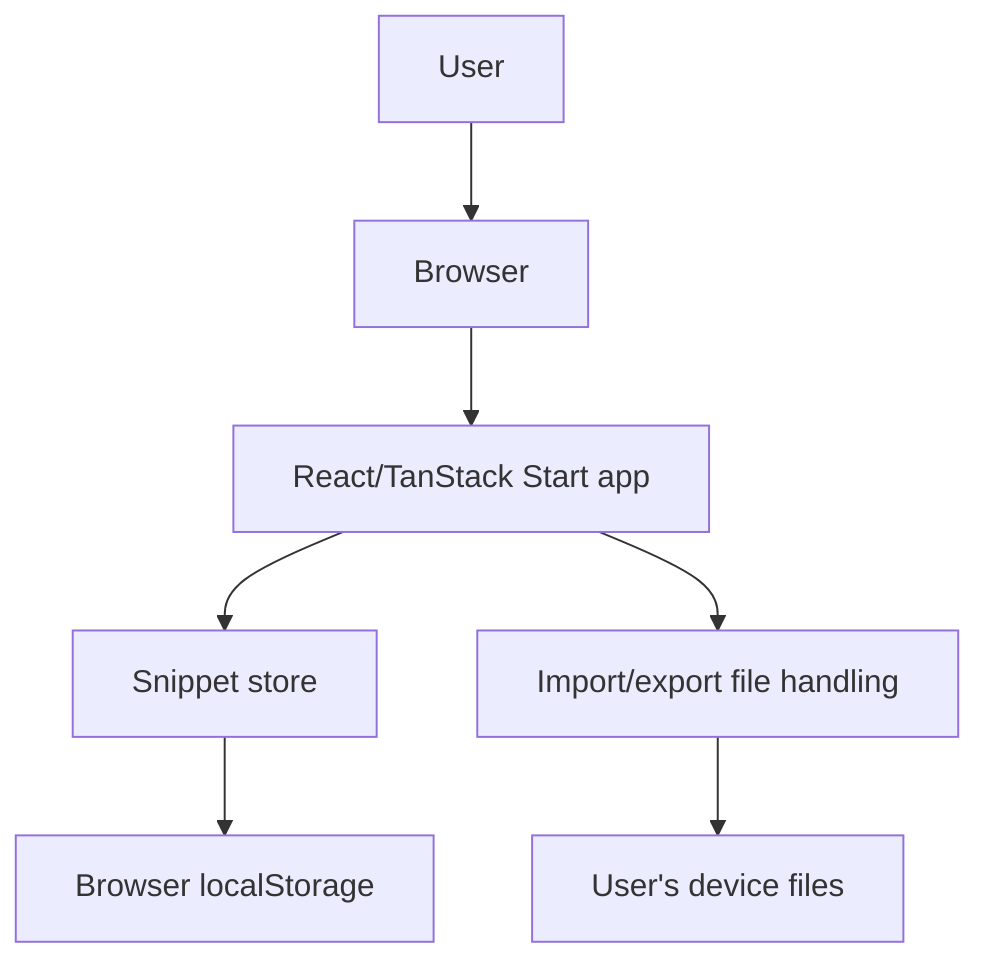
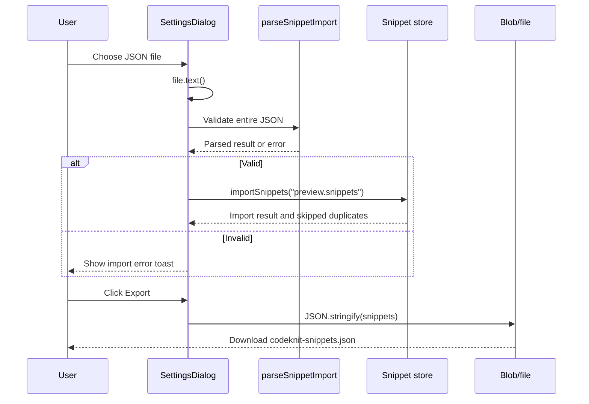

# CodeKnit snippet manager security controls

## Scope

This document covers security-relevant behavior of the CodeKnit snippet manager in`Mohita111/API2`, based on the provided React and TanStack Start source files:`AppLayout.tsx`,`AppSidebar.tsx`,`CodeEditor.tsx`,`CodePreview.tsx`,`ConfirmDeleteDialog.tsx`,`SettingsDialog.tsx`,`SnippetCard.tsx`,`SnippetDetailViewer.tsx`,`SnippetFormModal.tsx`,`StatsCards.tsx`,`LanguageBadge.tsx`,`SearchFilterBar.tsx`,`EmptyState.tsx`, and`package.json`.

CodeKnit is a client-side snippet library. The inspected source files contain no blog plugin, no`@docusaurus` packages, and no server plugin code. Authentication, authorization, data storage, import/export, and rendering controls described here all apply to the client-side snippet application in the provided files.

## Security model

CodeKnit runs in the browser. Snippets are stored locally on the user's device. There is no runtime backend, user database, session management, or remote API in the inspected files. The trust boundary is the user's browser and device storage.

Figure: Client-side trust boundary



The application code in the browser is trusted. Snippet content, metadata, and imported files are treated as potentially untrusted input but are rendered through React text nodes rather than raw HTML.

## Authentication and authorization

- **No authentication:** No login forms, token validation, session management, or credential handling exist in the inspected files.
- **No authorization:** The app has no roles, permissions, or access control. All storage and actions are available to anyone using the browser profile where the app is open.
- **Workspace model:**`AppSidebar.tsx` displays a fixed **My workspace** section with the caption **Saved on this device**. This confirms the local, single-user model and the absence of multi-tenant authorization.

There is no server-side identity to verify, and no code path that checks whether a user may view, create, edit, or delete a snippet.

## Data storage and handling

### LocalStorage persistence

`AppLayout.tsx` reads a layout preference from`localStorage`:

```ts
const saved = localStorage.getItem("codeknit.layout");
if (saved === "list" || saved === "grid") setLayout(saved);
```

`SettingsDialog.tsx` describes snippet storage explicitly:

> Your snippets are stored in this browser. Export a backup or import a previously exported CodeKnit library.

The snippet store is loaded through`useSnippets()` from`@/lib/snippets/store`. The inspected UI files confirm that persistence is local to the browser profile.

### Export

`SettingsDialog.tsx` exports all snippets as a JSON file using`Blob` and`URL.createObjectURL`:

```ts
const url = URL.createObjectURL(new Blob([JSON.stringify(snippets, null, 2)], { type: "application/json" }));
const a = document.createElement("a");
a.href = url;
a.download = "codeknit-snippets.json";
a.click();
URL.revokeObjectURL(url);
```

The exported file contains full snippet code, titles, descriptions, tags, categories, language, favorite state, and timestamps in plain text. No encryption or redaction is applied.

### Import

`SettingsDialog.tsx` reads a selected file with`file.text()`, calls`parseSnippetImport(json)` to validate the whole file before touching saved data, then merges via`importSnippets(preview.snippets)`:

```ts
const json = await file.text();
const preview = parseSnippetImport(json);
const result = await importSnippets(preview.snippets);
```

This validation-before-merge step prevents partially imported or malformed JSON from replacing valid snippets. Duplicate snippets are skipped according to the import result counts.

### Reset

The settings dialog offers a destructive **Reset** action that calls`reset()` after a two-step confirmation. This replaces all snippets with sample data.

### Delete confirmation

`ConfirmDeleteDialog.tsx` requires explicit confirmation before calling the`onConfirm` delete handler. The copy text states the snippet will be permanently removed and cannot be undone. This reduces accidental data loss but is not an authorization control.

## Code rendering and injection controls

CodeKnit renders snippet code with a custom syntax highlighter rather than`dangerouslySetInnerHTML` or raw HTML injection.

`CodePreview.tsx` uses`tokenize()` to produce tokens and renders each token as React text or a`<span>` via`Highlighted`:

```tsx
{tokens.map((t, i) =>
  t.type === "plain" ? t.value : <span key={i} className={CLASS[t.type]}>{t.value}</span>,
)}
```

`CodeEditor.tsx` overlays a transparent`<textarea>` on top of the highlighted preview. User input is bound with React controlled state:

```tsx
<textarea
  value={value}
  onChange={(e) => onChange(e.target.value)}
  ...
/>
```

Titles, descriptions, categories, and tags are rendered through JSX expressions, which React escapes as text. The inspected files contain no`dangerouslySetInnerHTML`,`innerHTML`, or`eval` calls.

## Secrets and sensitive data

- The inspected files contain no environment variable access, API keys, tokens, encryption keys, or secret management code.
-`package.json` lists no authentication, encryption, or server SDK dependencies. Dependencies are React, Radix UI, TanStack Router/Start, Tailwind, Zod, date-fns, and related UI libraries.
- Snippet content is user data, not application secrets. It is treated as private only by virtue of being stored in the local browser profile.
- Exported JSON files and browser storage are plain text. Users should treat exports as sensitive backups and not expose them through untrusted channels.

Do not embed secrets inside snippet content, tags, categories, or exported JSON. The application has no mechanism to detect or redact secrets in snippet bodies.

## Security-relevant configuration

`package.json` defines the runtime and build tooling:

```json
{
  "type": "module",
  "scripts": {
    "dev": "vite dev",
    "build": "vite build",
    "build:dev": "vite build --mode development",
    "preview": "vite preview"
  }
}
```

There is no server configuration, CORS setting, authentication provider, or environment-based access switch in the provided files. Security for deployment depends on hosting static build output behind appropriate web server controls.

## Threat areas and recommendations

| Threat | Present in code | Recommendation |
|---|---|---|
| Imported JSON with unexpected fields or very large payloads |`parseSnippetImport` validates before import; full field schema is outside the inspected files | Enforce a strict Zod schema for imported JSON; reject unknown fields and oversized inputs |
| Injected code snippets displayed as text |`CodePreview.tsx` renders tokens as React text nodes; no`dangerouslySetInnerHTML` | Continue avoiding raw HTML rendering; if a preview library is introduced later, configure it to disable raw HTML |
| Cross-site scripting through other dependencies | Client-side app with no CSP in the inspected files | Add a Content Security Policy at the hosting layer |
| LocalStorage exposure from XSS or malicious browser extensions | Snippets are stored in browser localStorage | Treat browser profile and installed extensions as part of the trust boundary; consider encrypted storage if threat model requires it |
| Plain-text exported backups |`SettingsDialog.tsx` exports full JSON without encryption | Educate users to protect exported`codeknit-snippets.json` files |
| Clipboard leak or accidental copy |`SnippetCard.tsx` and`SnippetDetailViewer.tsx` copy code using`useCopy` | Clipboard copy is user-initiated; no automated exfiltration path was found |
| File input parsing malicious JSON |`importJson` uses`file.text()` on a user-selected file | Limit accepted file size if untrusted files are expected; keep validation-before-merge |

Figure: Import and export data flow



## SBOM considerations

- Directly relevant dependencies for security review include`react`,`react-dom`,`@tanstack/react-start`,`@tanstack/react-router`,`zod`,`react-hook-form`, and`@hookform/resolvers`.
- No cryptographic libraries, authentication libraries, or secret-management packages are present in`package.json`.
- The app uses`sonner` for toast notifications, Radix UI primitives for accessible dialogs and menus, and`lucide-react` for icons.
- Include all`dependencies` and`devDependencies` from`package.json` in an SBOM. The repository does not currently document a generated CycloneDX or SPDX artifact in the provided files.

## Related pages

- [Security Policies and Access Control](doc:41287671-e192-4f35-8fea-fff0839eb45d)
- [Threat Model and Risk Assessment](doc:e4c3739b-b5e2-4d11-b1fd-17a87695eea6)
- [Software Bill of Materials (CycloneDX)](doc:cea702c3-109e-4730-b7a5-259fb74a5110)
- [Software Bill of Materials (SPDX)](doc:5c4b9b42-2f1e-4d6b-bd20-5326327e3452)