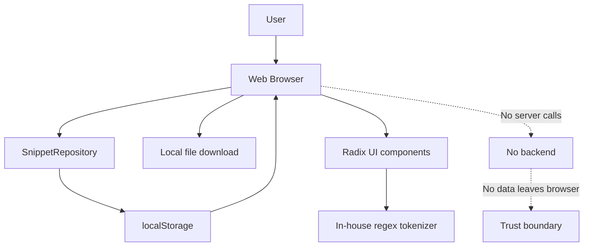
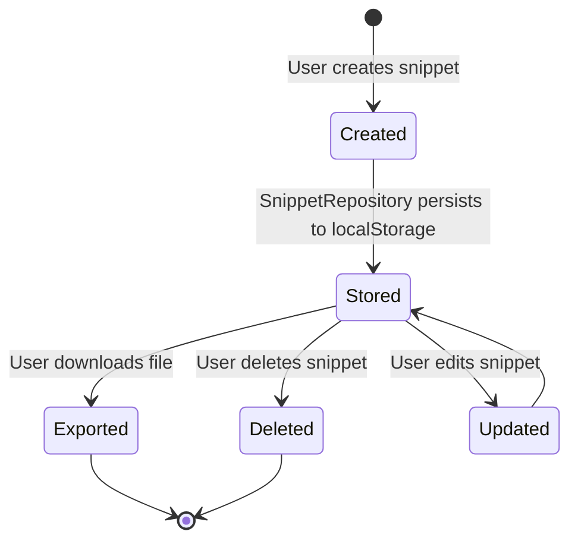
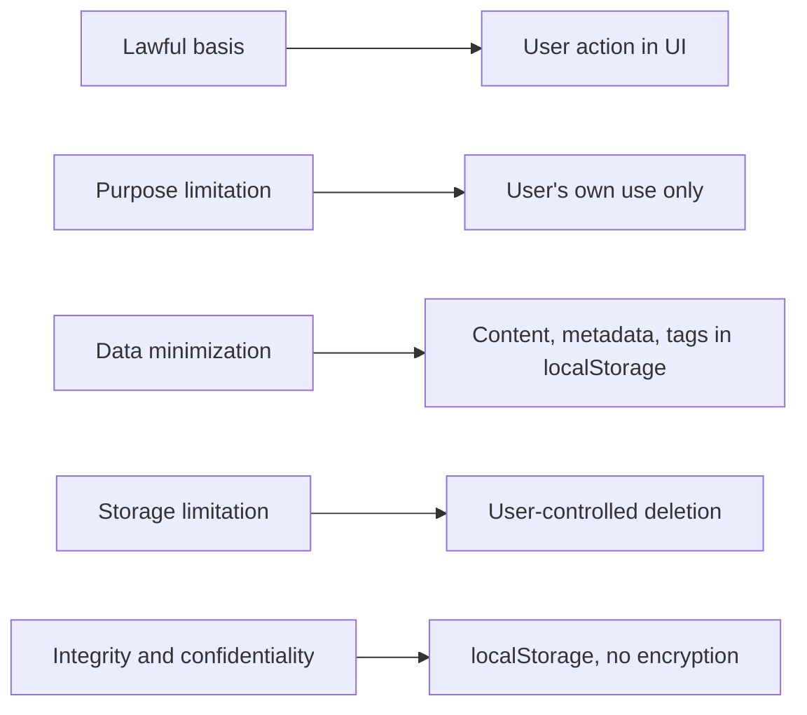
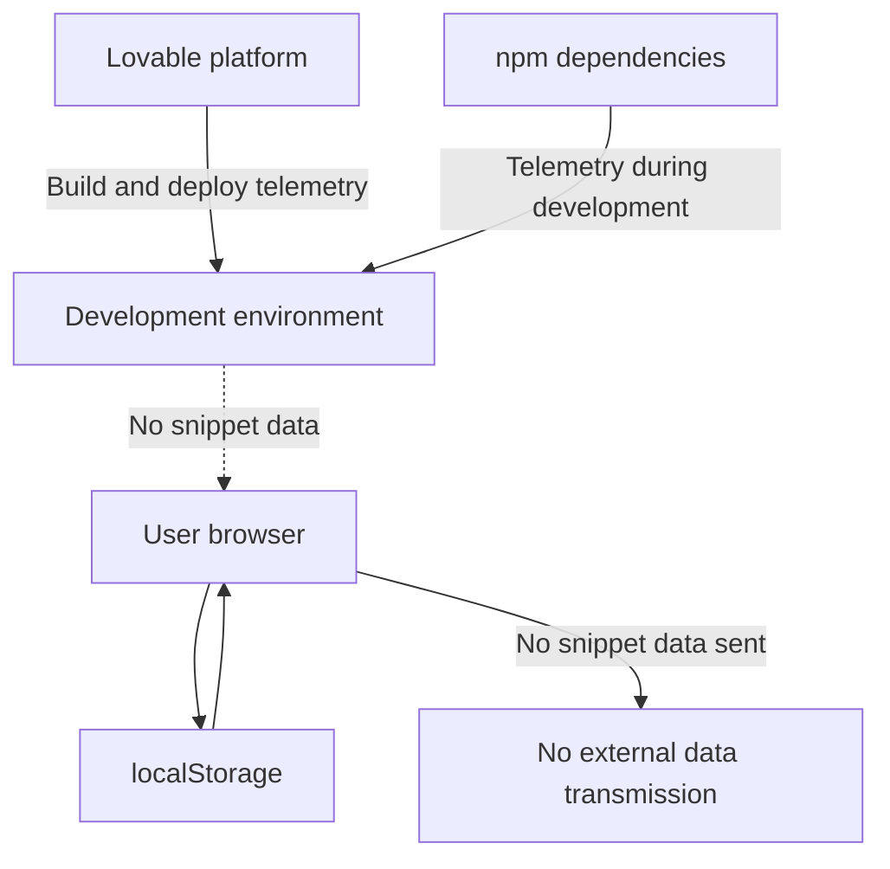

# Regulatory compliance and data protection

## Overview

This document describes the regulatory requirements, legal obligations, and compliance frameworks applicable to the API2 code snippet manager. The product is a client-side application built with TanStack Start, TypeScript, React, and Tailwind CSS, deployed through the Lovable development platform. Based on the code in`package.json`,`README.md`, and`AGENTS.md`, the application has no server backend, no authentication, and no external data transmission.

The compliance posture is defined by a single architectural fact: **all snippet data stays in the user's browser**. This eliminates most regulatory obligations related to data processing, centralized data collection, and breach notification.

Figure: Client-side architecture and trust boundary

## Product architecture and data flow

The code evidence in`AGENTS.md` states: "Snippet data goes through`SnippetRepository` (`src/lib/snippets/repository.ts`), currently localStorage; swap the implementation for an API/database without touching UI components." This confirms that snippet persistence is entirely client-side.

The syntax highlighting component is also local: "Syntax highlighting is a small in-house regex tokenizer (`src/lib/snippets/highlight.ts`), no Prism dependency, keeps SQL/Markdown support simple."

Data flow:
1. The user creates a snippet in the browser UI.
2. The snippet passes through`SnippetRepository` to`localStorage`.
3. The snippet remains in the browser's local storage until the user deletes it or exports it.
4. Export produces a local file download; no data transmits to a server.

Figure: Snippet data lifecycle

## Privacy regulations

### GDPR (EU/EEA)

The General Data Protection Regulation applies only if the product is deployed or used in the EU/EEA, or if it targets EU/EEA users. Under the deployment context, **the user is the data controller**, not the product owner. Snippets may qualify as personal data when they contain code comments, variable names, or embedded text that identifies individuals.

Key GDPR considerations based on code evidence:

- **No data processing agreement (DPA) is required** because the product owner does not process personal data on behalf of the user. All processing occurs locally in the user's browser.
- **No third-party processors** receive snippet data. The application makes no network calls to transmit snippets.
- **Lawful basis** for processing is the user's own action and consent, embedded in the UI when the user creates, edits, or deletes snippets.
- **Data subject rights** are satisfied by local deletion: the user can delete snippets at any time through the browser's localStorage, and clearing browser data removes all snippets.

### CCPA/CPRA (california)

The California Consumer Privacy Act and the California Privacy Rights Act follow the same user-controller model. Because the product owner never collects, shares, or sells personal information, the "do not sell" and "do not share" obligations do not apply. The user retains full control over their snippet data, including the right to delete, which aligns with CCPA/CPRA data subject rights.

### Other regional privacy laws

Similar logic applies to other regional privacy laws, including:

- **PIPEDA (Canada)**: no collection or retention by the product owner.
- **LGPD (Brazil)**: user is the controller; no processor role exists.
- **PDPA (Singapore)**: no organization-level processing occurs.
- **UK GDPR**: mirrors the EU GDPR analysis above.

The deployment jurisdiction determines the final set of obligations. The product owner should document the deployment region in any privacy notice.

## Data protection principles

The following principles map to Article 5 of GDPR and general data protection best practices:

| Principle | Implementation in API2 |
|-----------|------------------------|
| **Lawful basis** | User action and consent, embedded in the UI; no hidden processing |
| **Purpose limitation** | Snippets exist solely for the user's own use; no secondary processing |
| **Data minimization** | Only snippet content, metadata, and tags are stored in`localStorage` |
| **Storage limitation** | User controls deletion; browser data can be cleared at any time |
| **Integrity and confidentiality** |`localStorage` is the default storage; no encryption is applied by the product |
| **Accountability** | No server-side records; the user is responsible for their own data |

**Note on encryption**: The product does not apply encryption to snippet data stored in`localStorage`. The browser's own security model provides isolation between sites, but anyone with access to the browser profile can read the snippets. Users handling sensitive code should not store it in a shared browser environment.

Figure: Data protection principle mapping

## Intellectual property

### User-generated snippets

Snippets created by the user remain the user's copyright unless the user explicitly licenses them. The product does not claim ownership over user content. The`README.md` states: "Full ownership: this code is yours." All user-created snippet content stays in the user's browser and is never transmitted to or claimed by the product owner.

### Product code

The product code is either proprietary or open-source, depending on the`LICENSE` file. **The`LICENSE` file was not present in the provided source files** (`package.json`,`README.md`,`AGENTS.md`). The product owner must add or verify a`LICENSE` file to state the licensing terms clearly.

The`package.json` declares the project as private:`"private": true`. This suggests the product is not distributed as an open-source package, but the copyright license for the repository code remains unspecified without a`LICENSE` file.

## Export control

JavaScript code snippets created by users may contain cryptography, such as encryption algorithms, hashing functions, or cryptographic libraries. For example, a user might write a snippet using the Web Crypto API or a JavaScript crypto library.

**No special export licensing applies** for educational or open-source use. Common exemptions include:

- Publicly available software and technology (EAR 15 CFR 734.7)
- Educational information (EAR 15 CFR 734.9)
- Open-source software published under an open license (EAR 734.3(b)(3))

The product itself does not implement cryptography. The dependency list in`package.json` contains no dedicated cryptographic libraries beyond those in the JavaScript runtime. If a deployment includes custom cryptographic snippets, the product owner should evaluate whether the Bernstein v. U.S. Dept. of Justice ruling and modern export control regulations apply.

## Accessibility compliance

The application uses Radix UI components, which are designed with accessibility in mind. The`package.json` includes extensive Radix UI primitives, including:

-`@radix-ui/react-dialog`
-`@radix-ui/react-dropdown-menu`
-`@radix-ui/react-navigation-menu`
-`@radix-ui/react-tabs`
-`@radix-ui/react-tooltip`
-`@radix-ui/react-accordion`
- And 17 additional Radix packages

Radix UI primitives implement WAI-ARIA patterns, keyboard navigation, focus management, and screen reader support. This suggests the product likely meets WCAG 2.1 Level AA for component-level accessibility. However, **WCAG 2.1 Level AA compliance is not automatic**; the product must still:

1. Test color contrast against WCAG 2.1 contrast ratios.
2. Verify keyboard navigation across all interactive elements.
3. Confirm focus indicators are visible on all focusable components.
4. Test with assistive technologies (screen readers).
5. Validate that the syntax highlighting output does not create inaccessible text.

The product should conduct a formal accessibility audit before claiming WCAG 2.1 Level AA compliance.

## Security standards

### PCI-DSS

**Not applicable.** No payment processing occurs in the product. There are no cardholder data flows, no payment forms, and no financial transactions in the codebase.

### HIPAA

**Not applicable.** No protected health information (PHI) is collected, stored, or transmitted. The product is not a covered entity or business associate under HIPAA.

### SOC 2 type I/II

**Not required** for a client-side tool with no server infrastructure. SOC 2 attestation evaluates the controls of a service organization, but API2 does not operate as a service organization. All data remains in the user's browser, eliminating trust service criteria related to security, availability, processing integrity, confidentiality, and privacy for centralized systems.

### ISO 27001

**Not applicable** for a client-side tool. ISO 27001 is an information security management system (ISMS) standard for organizations that manage information assets. A purely client-side application with no server-side data processing, no organization-controlled infrastructure, and no organizational information assets does not require ISO 27001 certification.

### Minimal applicable security baseline

Although formal certifications are not required, the product should maintain:

- Secure dependency management (the`package.json` lists 54 production dependencies and 19 development dependencies).
- Regular vulnerability scanning of npm packages.
- Code review for any changes to the`SnippetRepository` implementation in`src/lib/snippets/repository.ts`.
- Validation that any future API/database integration preserves data minimization.

## Audit requirements

**No audit trail exists** in the current implementation. The`SnippetRepository` persists to`localStorage` without recording access logs, timestamps, or version history.

**The user is responsible for their own code governance.** Users who need auditability for compliance-sensitive snippets should:

- Use version control (e.g., Git) for snippet code outside the product.
- Export snippets periodically to preserve a record.
- Maintain their own logs of who accessed and modified snippets.

The product owner has no capability to provide audit evidence because no server-side data collection occurs.

## Incident reporting

**No data breach notification is required** because the product operates without a server and without centralized data collection. If a breach occurs, it is a breach of the user's own browser or device, not a breach of product infrastructure.

The product owner cannot detect or report breaches of user data because the data never leaves the user's browser. The product owner should state this clearly in the privacy policy.

## Third-party services

### Lovable development platform

The product is built and deployed through Lovable, as confirmed in`README.md` and`AGENTS.md`. The Lovable platform may collect telemetry, usage data, and build metadata during development and deployment. The privacy policy should disclose:

- Lovable's role as a development and hosting platform.
- Lovable's data collection practices (as defined by Lovable's own privacy policy).
- The fact that snippet data is not transmitted to Lovable during normal product use.

### npm dependencies

The`package.json` includes 54 production dependencies and 19 development dependencies. Some npm packages may collect telemetry or usage analytics during development, such as:

- Build tools (Vite, Nitro, Rolldown) may send error reports or usage statistics if configured.
- The`@lovable.dev/vite-tanstack-config` package may integrate with Lovable's telemetry.
- Developer tools like ESLint and Prettier do not collect telemetry by default.

The privacy policy should note that development-time telemetry may occur but that production use of the product does not transmit snippet data to third parties.

Figure: Third-party data flow boundaries

## Compliance checklist

| Requirement | Status | Evidence |
|-------------|--------|----------|
| GDPR data processing agreement | Not required | No server; user is controller |
| CCPA do-not-sell opt-out | Not applicable | No collection or sale |
| Data subject deletion rights | Satisfied locally | User deletes snippets in browser |
| Data minimization | Implemented | Only content, metadata, tags in`localStorage` |
| Purpose limitation | Implemented | No secondary processing |
| Encryption at rest | Not implemented |`localStorage` is unencrypted |
| PCI-DSS | Not applicable | No payment processing |
| HIPAA | Not applicable | No health data |
| SOC 2 Type I/II | Not required | No service organization controls |
| ISO 27001 | Not applicable | No organized ISMS domain |
| WCAG 2.1 Level AA | Likely met, testing required | Radix UI primitives |
| Audit trail | Not implemented | No server-side logs |
| Breach notification | Not required | No centralized data collection |
| Third-party disclosure | Required | Lovable, npm telemetry |

## Related pages

- [Security Policies](doc:41287671-e192-4f35-8fea-fff0839eb45d), authentication, authorization, and access control mechanisms for the API2 code snippet manager.
- [Threat Model](doc:e4c3739b-b5e2-4d11-b1fd-17a87695eea6), threats, vulnerabilities, and attack vectors against the code snippet manager.
- [SBOM (CycloneDX)](doc:cea702c3-109e-4730-b7a5-259fb74a5110), machine-readable software inventory in CycloneDX.
- [SBOM (SPDX)](doc:5c4b9b42-2f1e-4d6b-bd20-5326327e3452), software inventory in SPDX format.
- [ISO 27001 Readiness](doc:fdfcc3db-8cd5-4daf-bc4d-c0a723cad60c), ISO 27001 readiness assessment from product evidence.
- [SOC 2 Readiness](doc:e3403df2-124f-4ee2-89a0-3fc1a6fbe50c), SOC 2 readiness assessment.