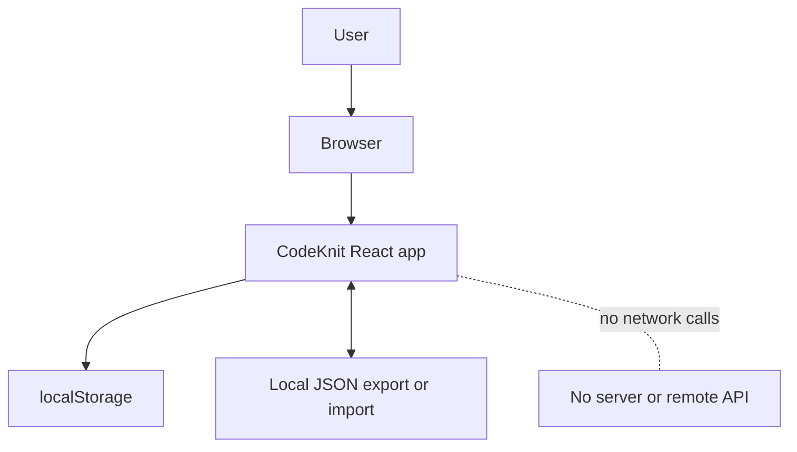
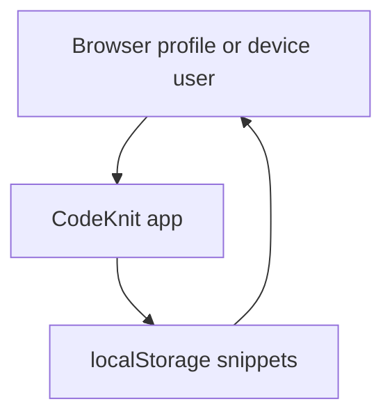
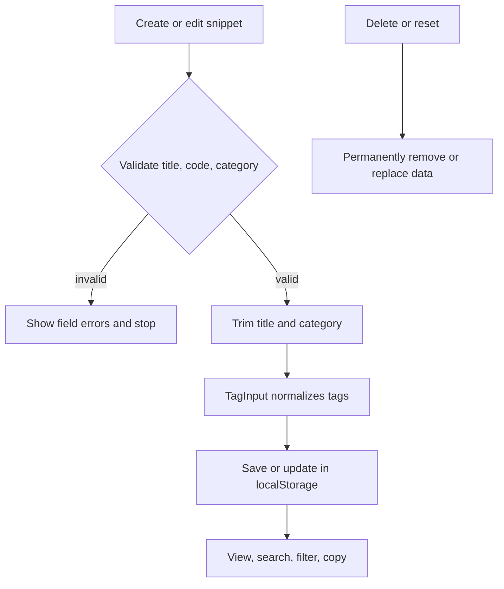

# Security policies and access control

This page defines the security policies and access-control model for CodeKnit, the client-side code snippet management application in the API2 repository. CodeKnit stores all user-created snippet data locally in the browser. There is no remote authentication, no server-side data storage, and no multi-user role system.

For the adversarial view of these controls and their limitations, see [Threat Model and Risk Assessment](doc:e4c3739b-b5e2-4d11-b1fd-17a87695eea6).

## System overview

CodeKnit is a TanStack Start, React, and TypeScript application that renders entirely in the browser. The application state is managed through the`useSnippets` hook in`src/lib/snippets/store.ts`. Snippet data is persisted in`window.localStorage`; settings and layout preferences are also stored locally.

The application has no server API, no database, and no remote authentication provider. Network calls are absent from the provided source files. The only external exchange is the local import and export of JSON files through the browser file picker and download mechanism.

Figure: CodeKnit client-side trust boundary



## Data classification

CodeKnit adopts the following data classification for all information it processes. Because there is no server-side processing, every class is stored exclusively in browser`localStorage` and in user-initiated JSON exports.

| Classification | Data examples | Source |
| --- | --- | --- |
| Sensitive, user-generated | Snippet title, description, code, tags |`SnippetFormModal.tsx`,`useSnippets` store |
| Internal, metadata |`id`, language, category,`isFavorite`,`createdAt`,`updatedAt` |`SnippetCard.tsx`,`SnippetDetailViewer.tsx` |
| Analytics, usage statistics |`copyCount`,`lastCopiedAt` |`SnippetCard.tsx`,`SnippetDetailViewer.tsx` |
| Internal, preference | Layout preference under the`codeknit.layout` key |`AppLayout.tsx` |

The most sensitive data is user-generated snippet content. CodeKnit treats snippet code as sensitive because it may contain proprietary algorithms, credentials pasted accidentally, or other business logic. Metadata and usage statistics are classified as internal because they reveal what the user works on and when, but contain no source code.

## Authentication model

CodeKnit has no authentication system. There is no login form, no session token, no identity provider integration, and no user account object. The sidebar displays a static avatar labeled`ME` and the caption **My workspace**, but this is purely presentational; it is not tied to an authenticated identity.

Relevant evidence from source:

-`AppSidebar.tsx` renders the fixed string`ME` and the caption **Saved on this device**.
-`package.json` lists React, UI, form, and routing dependencies only; no`jsonwebtoken`,`next-auth`,`passport`, or similar authentication package is present.
-`AppLayout.tsx` reads a layout preference from`localStorage` without consulting any identity or session.

The practical consequence is that anyone with access to the browser profile and origin where CodeKnit runs has full access to the snippet library. There is no app-level account boundary.

Figure: Authentication boundary



## Authorization model

CodeKnit uses a single-user authorization model:

- Every user of the browser profile is treated as the owner of all snippets.
- There are no roles, groups, permissions, or access-control lists.
- No component or store function checks whether the current actor may create, read, update, or delete a snippet.
- The principle of least privilege is not enforced by the application. The only restriction is the browser-origin storage boundary and the operating-system or browser-profile controls that already protect that profile.

All available mutations are exposed unconditionally. In`AppLayout.tsx`, the same user interface offers`remove`,`toggleFavorite`,`recordCopied`, create, edit, and settings operations.`SettingsDialog.tsx` further exposes import, export, and reset without additional authorization. A shared or unlocked browser profile therefore grants snippet access to anyone who opens the application.

## Data persistence and isolation

Snippet data is isolated per browser profile and per web origin through`localStorage`. The application does not synchronize snippet data with a remote service and does not provide cross-device availability.

-`AppSidebar.tsx` explicitly informs the user that data is **Saved on this device**.
-`SettingsDialog.tsx` states that snippets are **stored in this browser**.
- No`fetch`,`axios`,`XMLHttpRequest`, or WebSocket call appears in the provided source.
- The only known`localStorage` key in source is`codeknit.layout`, used by`AppLayout.tsx` for grid vs. list layout. Snippet persistence is handled through the`useSnippets` store.

Because`localStorage` is per-origin and per-browser-profile storage, two different operating-system users on the same machine can have separate snippet libraries. However, CodeKnit itself does not add a second layer of isolation; clearing site data or switching to a different browser profile removes or changes the visible library.

## Data lifecycle

New and edited snippets flow through the form validation path before being saved:

-`SnippetFormModal.tsx` collects title, description, language, category, tags, code, and favorite status.
- It trims and requires`title`,`code`, and`category`; invalid submissions are blocked by`errors`.
-`TagInput` normalizes tags before the parent stores the tag array.
- Create and update operations call the`useSnippets` store, which persists to`localStorage`.

Deletion is destructive and immediate after confirmation.`ConfirmDeleteDialog.tsx` warns that the snippet **will be permanently removed** and **can't be undone**.

Figure: Snippet data lifecycle and validation points



## Export and import security

Settings export and import are implemented entirely client-side in`SettingsDialog.tsx`. The related parsing and merge logic lives in`src/lib/snippets/import-export.ts`.

Export behavior:

-`exportJson` serializes the current`snippets` array with`JSON.stringify(snippets, null, 2)`.
- It creates a local`Blob` and downloads it through a temporary object URL.
- The exported file is named`codeknit-snippets.json`.
- No network request is made, and the object URL is revoked after download.

Import behavior:

- The user selects a local`.json` file through a hidden file input with`accept=".json,application/json"`.
-`importJson` reads the file with`file.text()`.
-`parseSnippetImport` validates the entire file before any stored data is changed.
-`importSnippets` merges the result into`localStorage`, preserves existing snippets, and skips duplicates.
- If parsing fails, the error is caught and the stored data remains untouched.

This validation-before-write behavior is a meaningful client-side integrity control: malformed or unexpected import files cannot partially overwrite the library.

Figure: Export and import flow with local validation

```mermaid
sequenceDiagram
  participant U as User
  participant SD as SettingsDialog
  participant P as parseSnippetImport
  participant S as useSnippets store
  participant LS as localStorage

  U->>SD: Clicks Export
  SD->>U: Downloads local Blob JSON
  U->>SD: Selects JSON export file
  SD->>P: parseSnippetImport("file.text("))
  P-->>SD: Validated preview
  SD->>S: importSnippets("preview.snippets")
  S->>LS: Merge and skip duplicates
  Note over SD: File remains in browser; no remote API call
```

## Input validation and sanitization

### Snippet title, description, category, and code

`SnippetFormModal.tsx` performs explicit required-field validation:

-`title` must be non-empty after`trim()`.
-`code` must be non-empty after`trim()`.
-`category` must be non-empty after`trim()`.
-`data` is created with`title: form.title.trim()` and`category: form.category.trim()`.

If validation fails, the save is blocked and field-specific errors are rendered. The code editor in`CodeEditor.tsx` accepts arbitrary text. It does not execute code, and syntax highlighting is purely a visual overlay.

### Tag normalization

Tags are entered through the`TagInput` component, wired from`SnippetFormModal.tsx`. The normalization policy for tags is to trim whitespace, lowercase the value, and remove leading`#` characters. Normalized tags are then stored as strings and rendered as text.

### Output handling and code display

CodeKnit renders snippet data through React JSX text nodes rather than raw HTML. No provided component uses`dangerouslySetInnerHTML`. Code is displayed by`CodePreview.tsx` and`CodeEditor.tsx`, which pass code through`tokenize` and`Highlighted` to produce React spans only. This display path avoids direct HTML injection from snippet content.

## Cryptography and secrets

CodeKnit has no cryptographic controls and stores no secrets.

- No API keys, authentication tokens, JWTs, passwords, or environment-based secrets appear in the provided source.
- Snippet data is stored in`localStorage` in plaintext. There is no encryption at rest.
- Export files are plaintext JSON and carry no signature or integrity hash.
- The only short-lived object is the local blob URL created during export, which is revoked with`URL.revokeObjectURL`.

Users should treat exported `codekn