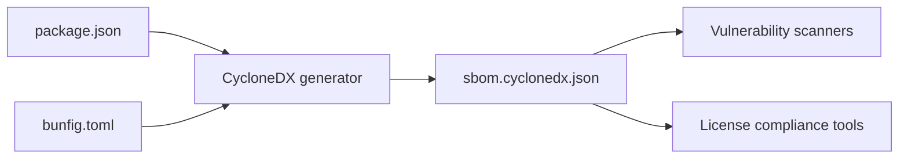
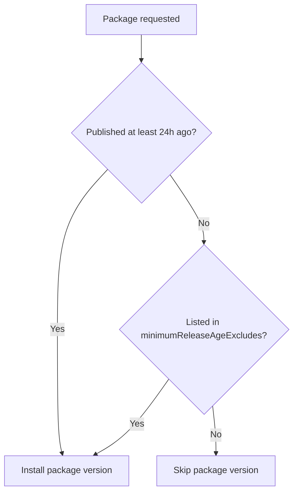

# Software bill of materials (CycloneDX): API2

This page defines the CycloneDX 1.5 software bill of materials for the API2 project. The artifact,`sbom.cyclonedx.json`, is a machine-readable inventory of all direct npm dependencies, development tools, and build utilities declared in`package.json`, plus the supply-chain guard settings in`bunfig.toml`.

The SBOM supports supply chain security scanning, license compliance audits, and vulnerability management through automated tooling.

## Scope and input sources

The CycloneDX SBOM is generated from these files:

| Source file | Data used |
| --- | --- |
|`Mohita111/API2:package.json` | Direct production dependencies, dev dependencies, npm overrides, package identifier |
|`Mohita111/API2:bunfig.toml` | Lockfile behavior, minimum release age guard, package exclusions |
|`Mohita111/API2:vite.config.ts` | Build entry point and TanStack/Vite build configuration |

The package identifier is`tanstack_start_ts` with`"private": true`,`"sideEffects": false`, and`"type": "module"`.

Figure: SBOM generation flow



The generator uses`package.json` for component names and version ranges,`bunfig.toml` for supply-chain guard context, and the configured build entry point under`vite.config.ts` for reproducibility metadata.

## Production dependency inventory

Table: Direct non-development npm packages declared in`package.json`.

| Component | Version range | Component type |
| --- | --- | --- |
|`@hookform/resolvers` |`^5.2.2` | library |
|`@radix-ui/react-accordion` |`^1.2.12` | library |
|`@radix-ui/react-alert-dialog` |`^1.1.15` | library |
|`@radix-ui/react-aspect-ratio` |`^1.1.8` | library |
|`@radix-ui/react-avatar` |`^1.1.11` | library |
|`@radix-ui/react-checkbox` |`^1.3.3` | library |
|`@radix-ui/react-collapsible` |`^1.1.12` | library |
|`@radix-ui/react-context-menu` |`^2.2.16` | library |
|`@radix-ui/react-dialog` |`^1.1.15` | library |
|`@radix-ui/react-dropdown-menu` |`^2.1.16` | library |
|`@radix-ui/react-hover-card` |`^1.1.15` | library |
|`@radix-ui/react-label` |`^2.1.8` | library |
|`@radix-ui/react-menubar` |`^1.1.16` | library |
|`@radix-ui/react-navigation-menu` |`^1.2.14` | library |
|`@radix-ui/react-popover` |`^1.1.15` | library |
|`@radix-ui/react-progress` |`^1.1.8` | library |
|`@radix-ui/react-radio-group` |`^1.3.8` | library |
|`@radix-ui/react-scroll-area` |`^1.2.10` | library |
|`@radix-ui/react-select` |`^2.2.6` | library |
|`@radix-ui/react-separator` |`^1.1.8` | library |
|`@radix-ui/react-slider` |`^1.3.6` | library |
|`@radix-ui/react-slot` |`^1.2.4` | library |
|`@radix-ui/react-switch` |`^1.2.6` | library |
|`@radix-ui/react-tabs` |`^1.1.13` | library |
|`@radix-ui/react-toggle` |`^1.1.10` | library |
|`@radix-ui/react-toggle-group` |`^1.1.11` | library |
|`@radix-ui/react-tooltip` |`^1.2.8` | library |
|`@tailwindcss/vite` |`^4.2.1` | library |
|`@tanstack/react-query` |`^5.101.1` | library |
|`@tanstack/react-router` |`1.170.41` | library |
|`@tanstack/react-start` |`1.168.60` | library |
|`@tanstack/router-plugin` |`1.168.42` | library |
|`class-variance-authority` |`^0.7.1` | library |
|`clsx` |`^2.1.1` | library |
|`cmdk` |`^1.1.1` | library |
|`date-fns` |`^4.1.0` | library |
|`embla-carousel-react` |`^8.6.0` | library |
|`input-otp` |`^1.4.2` | library |
|`lucide-react` |`^0.575.0` | library |
|`react` |`^19.2.0` | library |
|`react-day-picker` |`^9.14.0` | library |
|`react-dom` |`^19.2.0` | library |
|`react-hook-form` |`^7.71.2` | library |
|`react-resizable-panels` |`^4.6.5` | library |
|`recharts` |`^2.15.4` | library |
|`sonner` |`^2.0.7` | library |
|`tailwind-merge` |`^3.5.0` | library |
|`tailwindcss` |`^4.2.1` | library |
|`tw-animate-css` |`^1.3.4` | library |
|`vaul` |`^1.1.2` | library |
|`vite-tsconfig-paths` |`^6.0.2` | library |
|`zod` |`^3.25.76` | library |

All production components are declared as npm packages and map to CycloneDX component type`library` with package URL format`pkg:npm/{name}@{version}`.

## Development dependency inventory

Table: Direct development-only npm packages declared in`package.json`.

| Component | Version range | Component type |
| --- | --- | --- |
|`@eslint/js` |`^9.32.0` | library |
|`@lovable.dev/vite-tanstack-config` |`2.26.5` | library |
|`@testing-library/jest-dom` |`^6.6.0` | library |
|`@testing-library/react` |`^16.0.0` | library |
|`@types/node` |`^22.16.5` | library |
|`@types/react` |`^19.2.0` | library |
|`@types/react-dom` |`^19.2.0` | library |
|`@vitejs/plugin-react` |`^5.2.0` | library |
|`eslint` |`^9.32.0` | library |
|`eslint-config-prettier` |`^10.1.1` | library |
|`eslint-plugin-prettier` |`^5.2.6` | library |
|`eslint-plugin-react-hooks` |`^5.2.0` | library |
|`eslint-plugin-react-refresh` |`^0.4.20` | library |
|`globals` |`^15.15.0` | library |
|`jsdom` |`^20.0.3` | library |
|`nitro` |`3.0.260603-beta` | library |
|`prettier` |`^3.7.3` | library |
|`typescript` |`^5.8.3` | library |
|`typescript-eslint` |`^8.56.1` | library |
|`vite` |`8.1.5` | library |
|`vitest` |`^4.1.10` | library |

Development components appear with CycloneDX scope`excluded` or as separate build-tool components, depending on the consumer workflow.

## npm overrides

`package.json` declares one override:

| Package | Override version |
| --- | --- |
|`rolldown` |`1.2.1` |

The override affects the resolved dependency graph for transitive dependencies that depend on`rolldown`.

## Supply-chain guard configuration

`bunfig.toml` enforces a 24-hour minimum release age before installing new package versions:

```toml
[install]
saveTextLockfile = true
minimumReleaseAge = 86400
minimumReleaseAgeExcludes = [
  "@lovable.dev/vite-tanstack-config",
  "@lovable.dev/mcp-js",
  "@lovable.dev/ai-gateway",
  "@lovable.dev/email-js",
  "@lovable.dev/webhooks-js"
]
```

`minimumReleaseAge = 86400` means package versions published less than 86,400 seconds, or 24 hours, are skipped during installation unless the package is present in`minimumReleaseAgeExcludes`.

Figure: Supply-chain release age gate



The SBOM should include this guard configuration as reproducibility metadata because it constrains which versions can be resolved from the npm registry.

## Component metadata mapping

CycloneDX components require the following fields for each npm package:

| CycloneDX field | Source in this repository |
| --- | --- |
|`type` |`library` |
|`group` | derived from npm scope, for example`@radix-ui` |
|`name` | full package name from`package.json` |
|`version` | version range resolved by the package manager |
|`purl` |`pkg:npm/{group}/{name}@{version}` |
|`scope` |`required` for production dependencies,`excluded` for dev dependencies |
|`supplier` | npm registry or package publisher metadata |
|`licenses` | Not present in`package.json`; must be populated from registry or license scanner |

Example CycloneDX component entry:

```json
{
  "type": "library",
  "name": "@radix-ui/react-dialog",
  "version": "1.1.15",
  "scope": "required",
  "purl": "pkg:npm/%40radix-ui/react-dialog@1.1.15"
}
```

The`package.json` file does not include`license`,`homepage`, or`repository` fields for any dependency. The SBOM generator must resolve those values from the npm registry metadata and add them to the CycloneDX`component.licenses`,`component.externalReferences`, and`component.supplier` fields.

## Vulnerability references

CycloneDX 1.5 supports a top-level`vulnerabilities` array. Each entry can reference a component by`bom-ref` and include:

-`id`, CVE or GHSA identifier
-`source`, NVD, OSV, or GitHub Advisory Database
-`ratings`, CVSS v3 or CVSS v4 severity vector and score
-`analysis`, current triage state, for example`not_affected`,`in_triage`,`resolved`

The provided source files do not contain vulnerability data. The SBOM artifact should be paired with an advisory scanner that adds current CVE and GHSA entries after generation. The`bom-ref` for each component must remain stable across regeneration so scanner results can be matched to components.

## Reproducibility metadata

The SBOM includes reproducibility information from the repository state:

| Item | Source | Value |
| --- | --- | --- |
| Package name |`package.json` |`tanstack_start_ts` |
| Package visibility |`package.json` |`private` |
| Module type |`package.json` |`module` |
| Side effects flag |`package.json` |`false` |
| Lockfile generation |`bunfig.toml` |`saveTextLockfile = true` |
| Build server entry |`vite.config.ts` |`server: { entry: "server" }` |
| Vite/TanStack config package |`vite.config.ts` import |`@lovable.dev/vite-tanstack-config` |

No Git commit hash or CI build identifier is present in the provided source files. The SBOM generation process should inject the commit hash and build timestamp from the CI environment to satisfy CycloneDX reproducibility requirements.

## Coverage limitations

The source files supplied for this artifact are`package.json`,`bunfig.toml`, and`vite.config.ts`. The following CycloneDX data is not present in these files and must be added by the generator or scanner:

- Transitive npm dependencies and their nested versions
- License strings or SPDX license expressions for each dependency
- Component homepage and repository URLs
- CVE or GHSA vulnerability entries
- Git commit hash and build timestamp

The direct dependency inventory above is complete for the declared`dependencies` and`devDependencies` blocks. Any lockfile resolution is managed separately by Bun using the`saveTextLockfile` setting.

## Related documentation

- [SBOM (SPDX)](doc:5c4b9b42-2f1e-4d6b-bd20-5326327e3452)
- [AI Bill of Materials (AI-BOM)](doc:fc24b500-28ae-4203-80f0-702734a29789)
- [Threat Model](doc:e4c3739b-b5e2-4d11-b1fd-17a87695eea6)
- [Security Policies](doc:41287671-e192-4f35-8fea-fff0839eb45d)