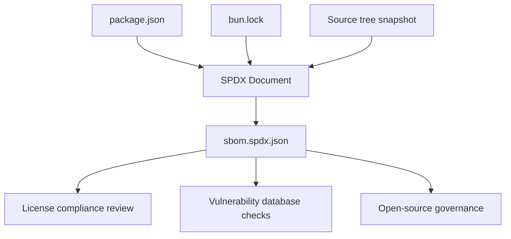
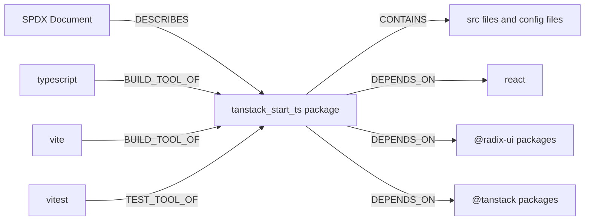
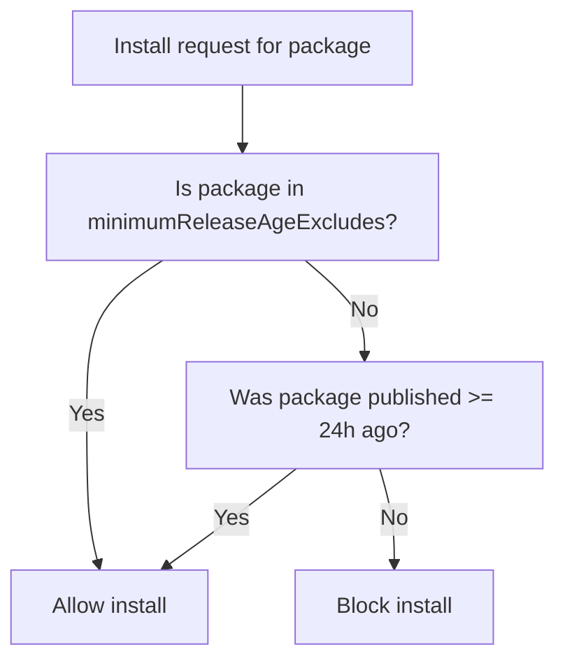

# Software bill of materials (SPDX)

This document specifies the content and generation requirements for a Software Bill of Materials (SBOM) in SPDX 2.3 format for the API2 documentation project (package name:`tanstack_start_ts`). It covers document metadata, package inventory, file-level analysis, license expressions, relationship mapping, and external references.

## Purpose and scope

The SPDX SBOM provides a human-readable, standardized inventory of all software components, dependencies, licenses, and relationships in the`Mohita111/API2` repository. SPDX is the preferred format for open-source license compliance, merger and acquisition due diligence, and export/import control reviews.

Key properties of this SBOM:

- **Format**: SPDX 2.3, serialized as JSON (`sbom.spdx.json`)
- **Primary source of truth**:`package.json` at repository root
- **Coverage**: Direct npm dependencies and source files present in the repository snapshot
- **Exclusions**: Transitive dependencies are noted as present in`bun.lock` but are not individually resolved in this snapshot. Runtime-loaded CDN resources are not included.

> **Limitation**: This is a framework-level snapshot. It does not include runtime-loaded CDN resources, and it lists npm packages that are explicitly declared in`package.json`. Licenses for individual packages require verification against each package's published metadata.

Figure: SBOM coverage and data flow



## SPDX document metadata

The SPDX document header includes the following fields, derived from`package.json`:

| SPDX field | Value |
|---|---|
|`spdxVersion` |`SPDX-2.3` |
|`name` |`tanstack_start_ts` |
|`dataLicense` |`CC0-1.0` |
|`documentNamespace` |`https://spdx.org/spdxdocs/api2-sbom-<uuid>` |
|`creator` |`Tool: SPDX Generator` or`Organization: Mohita111` |
|`created` | Snapshot generation timestamp, in ISO 8601 UTC format |

Additional document metadata:

- **Primary package purpose**: A React + TanStack Start application for managing code snippets.
- **Package manager**: Bun, as evidenced by`bun.lock` and`bunfig.toml`.
- **Module type**: ES module (`"type": "module"` in`package.json`).
- **Privacy flag**:`"private": true`, meaning this package is not published to the npm registry.

### License list version

The SPDX document references a license list version. Use the most recent SPDX license list at generation time; a typical value is`3.22` or later. This is a generation parameter, not a value present in the source files.

## Package information

The root package and all declared dependencies are represented as SPDX`Package` entries. The root package uses the identifier`SPDXRef-Package-tanstack_start_ts`; each dependency uses an`SPDXRef-Package-<name>` identifier.

### Root package

| Field | Value |
|---|---|
|`SPDXID` |`SPDXRef-Package-tanstack_start_ts` |
|`name` |`tanstack_start_ts` |
|`versionInfo` | Empty (no version is set in`package.json`) or inferred from`package.json` |
|`downloadLocation` |`https://github.com/Mohita111/API2` |
|`filesAnalyzed` |`true` |
|`primaryPackagePurpose` |`APPLICATION` |
|`externalRefs` | A`PACKAGE-MANAGER` reference for`purl` with value`pkg:npm/tanstack_start_ts` |

### Runtime dependencies

`package.json``dependencies` section lists 49 runtime packages. These are represented as SPDX packages with`SPDXRef-Package-<name>` and`downloadLocation` of`https://registry.npmjs.org/<name>/-/<name>-<resolved-version>.tgz`.

| Package | Declared version range | SPDX ID |
|---|---|---|
|`@hookform/resolvers` |`^5.2.2` |`SPDXRef-Package-@hookform/resolvers` |
|`@radix-ui/react-accordion` |`^1.2.12` |`SPDXRef-Package-@radix-ui/react-accordion` |
|`@radix-ui/react-alert-dialog` |`^1.1.15` |`SPDXRef-Package-@radix-ui/react-alert-dialog` |
|`@radix-ui/react-aspect-ratio` |`^1.1.8` |`SPDXRef-Package-@radix-ui/react-aspect-ratio` |
|`@radix-ui/react-avatar` |`^1.1.11` |`SPDXRef-Package-@radix-ui/react-avatar` |
|`@radix-ui/react-checkbox` |`^1.3.3` |`SPDXRef-Package-@radix-ui/react-checkbox` |
|`@radix-ui/react-collapsible` |`^1.1.12` |`SPDXRef-Package-@radix-ui/react-collapsible` |
|`@radix-ui/react-context-menu` |`^2.2.16` |`SPDXRef-Package-@radix-ui/react-context-menu` |
|`@radix-ui/react-dialog` |`^1.1.15` |`SPDXRef-Package-@radix-ui/react-dialog` |
|`@radix-ui/react-dropdown-menu` |`^2.1.16` |`SPDXRef-Package-@radix-ui/react-dropdown-menu` |
|`@radix-ui/react-hover-card` |`^1.1.15` |`SPDXRef-Package-@radix-ui/react-hover-card` |
|`@radix-ui/react-label` |`^2.1.8` |`SPDXRef-Package-@radix-ui/react-label` |
|`@radix-ui/react-menubar` |`^1.1.16` |`SPDXRef-Package-@radix-ui/react-menubar` |
|`@radix-ui/react-navigation-menu` |`^1.2.14` |`SPDXRef-Package-@radix-ui/react-navigation-menu` |
|`@radix-ui/react-popover` |`^1.1.15` |`SPDXRef-Package-@radix-ui/react-popover` |
|`@radix-ui/react-progress` |`^1.1.8` |`SPDXRef-Package-@radix-ui/react-progress` |
|`@radix-ui/react-radio-group` |`^1.3.8` |`SPDXRef-Package-@radix-ui/react-radio-group` |
|`@radix-ui/react-scroll-area` |`^1.2.10` |`SPDXRef-Package-@radix-ui/react-scroll-area` |
|`@radix-ui/react-select` |`^2.2.6` |`SPDXRef-Package-@radix-ui/react-select` |
|`@radix-ui/react-separator` |`^1.1.8` |`SPDXRef-Package-@radix-ui/react-separator` |
|`@radix-ui/react-slider` |`^1.3.6` |`SPDXRef-Package-@radix-ui/react-slider` |
|`@radix-ui/react-slot` |`^1.2.4` |`SPDXRef-Package-@radix-ui/react-slot` |
|`@radix-ui/react-switch` |`^1.2.6` |`SPDXRef-Package-@radix-ui/react-switch` |
|`@radix-ui/react-tabs` |`^1.1.13` |`SPDXRef-Package-@radix-ui/react-tabs` |
|`@radix-ui/react-toggle` |`^1.1.10` |`SPDXRef-Package-@radix-ui/react-toggle` |
|`@radix-ui/react-toggle-group` |`^1.1.11` |`SPDXRef-Package-@radix-ui/react-toggle-group` |
|`@radix-ui/react-tooltip` |`^1.2.8` |`SPDXRef-Package-@radix-ui/react-tooltip` |
|`@tailwindcss/vite` |`^4.2.1` |`SPDXRef-Package-@tailwindcss/vite` |
|`@tanstack/react-query` |`^5.101.1` |`SPDXRef-Package-@tanstack/react-query` |
|`@tanstack/react-router` |`1.170.41` |`SPDXRef-Package-@tanstack/react-router` |
|`@tanstack/react-start` |`1.168.60` |`SPDXRef-Package-@tanstack/react-start` |
|`@tanstack/router-plugin` |`1.168.42` |`SPDXRef-Package-@tanstack/router-plugin` |
|`class-variance-authority` |`^0.7.1` |`SPDXRef-Package-class-variance-authority` |
|`clsx` |`^2.1.1` |`SPDXRef-Package-clsx` |
|`cmdk` |`^1.1.1` |`SPDXRef-Package-cmdk` |
|`date-fns` |`^4.1.0` |`SPDXRef-Package-date-fns` |
|`embla-carousel-react` |`^8.6.0` |`SPDXRef-Package-embla-carousel-react` |
|`input-otp` |`^1.4.2` |`SPDXRef-Package-input-otp` |
|`lucide-react` |`^0.575.0` |`SPDXRef-Package-lucide-react` |
|`react` |`^19.2.0` |`SPDXRef-Package-react` |
|`react-day-picker` |`^9.14.0` |`SPDXRef-Package-react-day-picker` |
|`react-dom` |`^19.2.0` |`SPDXRef-Package-react-dom` |
|`react-hook-form` |`^7.71.2` |`SPDXRef-Package-react-hook-form` |
|`react-resizable-panels` |`^4.6.5` |`SPDXRef-Package-react-resizable-panels` |
|`recharts` |`^2.15.4` |`SPDXRef-Package-recharts` |
|`sonner` |`^2.0.7` |`SPDXRef-Package-sonner` |
|`tailwind-merge` |`^3.5.0` |`SPDXRef-Package-tailwind-merge` |
|`tailwindcss` |`^4.2.1` |`SPDXRef-Package-tailwindcss` |
|`tw-animate-css` |`^1.3.4` |`SPDXRef-Package-tw-animate-css` |
|`vaul` |`^1.1.2` |`SPDXRef-Package-vaul` |
|`vite-tsconfig-paths` |`^6.0.2` |`SPDXRef-Package-vite-tsconfig-paths` |
|`zod` |`^3.25.76` |`SPDXRef-Package-zod` |

### Development dependencies

`package.json``devDependencies` section lists 19 development packages:

| Package | Declared version range |
|---|---|
|`@eslint/js` |`^9.32.0` |
|`@lovable.dev/vite-tanstack-config` |`2.26.5` |
|`@testing-library/jest-dom` |`^6.6.0` |
|`@testing-library/react` |`^16.0.0` |
|`@types/node` |`^22.16.5` |
|`@types/react` |`^19.2.0` |
|`@types/react-dom` |`^19.2.0` |
|`@vitejs/plugin-react` |`^5.2.0` |
|`eslint` |`^9.32.0` |
|`eslint-config-prettier` |`^10.1.1` |
|`eslint-plugin-prettier` |`^5.2.6` |
|`eslint-plugin-react-hooks` |`^5.2.0` |
|`eslint-plugin-react-refresh` |`^0.4.20` |
|`globals` |`^15.15.0` |
|`jsdom` |`^20.0.3` |
|`nitro` |`3.0.260603-beta` |
|`prettier` |`^3.7.3` |
|`typescript` |`^5.8.3` |
|`typescript-eslint` |`^8.56.1` |
|`vite` |`8.1.5` |
|`vitest` |`^4.1.10` |

### Version pinning with overrides

`package.json` contains an`overrides` section that forces the resolved version of`rolldown` to`1.2.1`. So the SPDX document must reflect this override in the package entry for`rolldown`:

```
"overrides": {
  "rolldown": "1.2.1"
}
```

This override applies globally, ensuring that any transitive dependency on`rolldown` resolves to version`1.2.1`.

## File-level analysis

The SPDX document includes file entries for all files present in the repository snapshot, with their SHA-1 checksums (from the repository API), sizes, and mime types. The file type values from the API listing are all`file`, with two`dir` entries (`api2-documentation` and`dromeas`) that are empty directories.

### Source files at repository root

The root-level TypeScript and TSX files represent the application UI components:

| File | Size (bytes) | SHA-1 |
|---|---|---|
|`AppLayout.tsx` | 9,728 |`5ff8c6098d889c8c66f125cf957ce6efb7bb9c65` |
|`AppSidebar.tsx` | 4,697 |`de1b4c7a35e748d276ae0cf6c49637ad51bd04ce` |
|`CodeEditor.tsx` | 2,265 |`19965ab9ae521d37f4143a16ad314ffb27d022c9` |
|`CodePreview.tsx` | 2,383 |`a1dd9a7d81d92afe96359a3f30d65b0898037136` |
|`ConfirmDeleteDialog.tsx` | 1,141 |`79e279add4c9ed32a9bf371a694592669f071ef7` |
|`EmptyState.tsx` | 1,159 |`e9ed1e05d50f28a90d3c8282fbaefbce80605b39` |
|`LanguageBadge.tsx` | 803 |`4fc2d808297e605d0e9427f8e557646858e217c0` |
|`SearchFilterBar.tsx` | 3,615 |`eefc80072b4c93da98d5d32e4235d09e45201114` |
|`SettingsDialog.tsx` | 4,598 |`0a519cddde7373cd05f151d40b7f166356f1355d` |
|`SnippetCard.tsx` | 5,615 |`f0dc6490af97a1cf52e2f46de8a79fb37f53bba1` |
|`SnippetDetailViewer.tsx` | 3,325 |`4b1468893cd5c8da83dd22d0abb8b684d17b1535` |
|`SnippetFormModal.tsx` | 6,966 |`172f8ea13a0a186a2f67b725ab48f5a75e1bfd8c` |
|`StatsCards.tsx` | 1,165 |`c0b3bce11abffdafd79cfd60eca16462deac177e` |
|`TagInput.tsx` | 1,710 |`e452e88a5e89d8369ed0d9d57006cedeaf5308ce` |
|`use-copy.ts` | 566 |`1a2d1c7f800560c7b63fd53e577d62c260657de0` |

### Configuration files

The configuration files included in the file-level analysis:

| File | Size (bytes) | SHA-1 |
|---|---|---|
|`.gitignore` | 334 |`d24df8a769e2bd7dd6839f2a51f9e0114d2023c5` |
|`.prettierignore` | 92 |`be49b2655e2222e8a688f616a5c13500298801a0` |
|`.prettierrc` | 90 |`90abee2393e79dff7ec36856c94f662a263f0107` |
|`AGENTS.md` | 813 |`db5cc6e09d37aa42256f9501c8262939b776def4` |
|`README.md` | 839 |`115d456daffb778ee21192176eaf53e547e35ec8` |
|`bun.lock` | 167,405 |`358eaa1fe22327d8b87712c9390d4d65edf035e4` |
|`bunfig.toml` | 407 |`8d73f71edb78b1bf4af8f1c4135343265bb97fcb` |
|`components.json` | 443 |`f0817a84e832a693e7a79a911efe0b081bd97e06` |
|`eslint.config.js` | 1,250 |`be4075bd5e14ae3e6420613f789c3fc8bbeda819` |
|`package.json` | 3,128 |`cc1538ca5fa2e8c8dbe1600b627f05b9178205ad` |
|`tsconfig.json` | 882 |`6b10c714ac8c07db8f7dc4b08af64df500c12ed5` |
|`vite.config.ts` | 820 |`174e074ca30e73877870b02eb162b0c28848051e` |
|`vitest.config.ts` | 396 |`1b7c845b63948f9ff470a750f21e68cd48397fdd` |

### MIME type mapping

SPDX file entries must include a`fileType` property. The recommended mapping for this project is:

| File extension | SPDX file type |
|---|---|
|`.ts` |`SOURCE` |
|`.tsx` |`SOURCE` |
|`.js` |`SOURCE` |
|`.json` |`TEXT` |
|`.md` |`TEXT` |
|`.toml` |`TEXT` |
|`.lock` |`TEXT` |
|`.gitignore` |`TEXT` |
|`.prettierignore` |`TEXT` |
|`.prettierrc` |`TEXT` |

## License identification

The license declared in`package.json` is absent: there is no`license` field in the root`package.json`. Therefore, the root package's`licenseConcluded` SHOULD be`NOASSERTION` (SPDX convention for undetermined license). The generation tool may infer a license from other signals only if additional evidence is supplied.

### Expected license mapping for common dependencies

SPDX license expressions for npm packages are identified from each package's own registry metadata. The following are the conventional SPDX identifiers for the most commonly used packages in this dependency tree, based on published npm ecosystem knowledge:

| Package | Typical SPDX license expression |
|---|---|
|`react` |`MIT` |
|`react-dom` |`MIT` |
|`zod` |`MIT` |
|`date-fns` |`MIT` |
|`clsx` |`MIT` |
|`class-variance-authority` |`Apache-2.0` |
|`tailwind-merge` |`MIT` |
|`tailwindcss` |`MIT` |
|`lucide-react` |`ISC` |
|`@tanstack/react-query` |`MIT` |
|`@tanstack/react-router` |`MIT` |
|`@tanstack/react-start` |`MIT` |
|`cmdk` |`MIT` |
|`sonner` |`MIT` |
|`vaul` |`MIT` |
|`embla-carousel-react` |`MIT` |
|`react-day-picker` |`MIT` |
|`react-hook-form` |`MIT` |
|`react-resizable-panels` |`MIT` |
|`recharts` |`MIT` |
|`input-otp` |`MIT` |
|`@radix-ui/*` (all packages) |`MIT` |
|`@hookform/resolvers` |`MIT` |

> **Note**: The SPDX generation process must confirm each license from the npm registry metadata for the specific resolved version. The values above are typical but not authoritative without registry data. For packages without a resolvable license, use`NOASSERTION` and add a`LicenseInfoInFile` with a`Comment` noting the missing metadata.

### License data insertion in SPDX

For each package, the license field is expressed using the`licenseConcluded` and`licenseDeclared` properties. These use SPDX license expressions:

- Simple:`"licenseConcluded": "MIT"`
- Composite:`"licenseConcluded": "(MIT OR Apache-2.0)"` when dual-licensed
- Undetermined:`"licenseConcluded": "NOASSERTION"`

## Relationship mapping

SPDX relationships link the root package to dependencies and files. The primary relationship types used are:

-`DESCRIBES`: document-level relationship for each root element
-`CONTAINS`: links root package to files
-`DEPENDS_ON`: links root package to npm packages
-`DEPENDENCY_OF`: inverse of`DEPENDS_ON`, linking an npm package back to the root
-`BUILD_TOOL_OF`: links development-only tools such as`vite`,`typescript`, and`eslint` to the root package (SPDX 2.3 supports this relationship)

### Root dependencies

Each runtime package receives a`DEPENDS_ON` edge:

```
Relationship: SPDXRef-Package-tanstack_start_ts DEPENDS_ON SPDXRef-Package-react
Relationship: SPDXRef-Package-tanstack_start_ts DEPENDS_ON SPDXRef-Package-react-dom
Relationship: SPDXRef-Package-tanstack_start_ts DEPENDS_ON SPDXRef-Package-@radix-ui/react-dialog
...
```

### Development tool relationships

Development dependencies are linked with`BUILD_TOOL_OF` or`TEST_TOOL_OF` when the tool has a clearly defined build or test role:

```
Relationship: SPDXRef-Package-typescript BUILD_TOOL_OF SPDXRef-Package-tanstack_start_ts
Relationship: SPDXRef-Package-vite BUILD_TOOL_OF SPDXRef-Package-tanstack_start_ts
Relationship: SPDXRef-Package-eslint BUILD_TOOL_OF SPDXRef-Package-tanstack_start_ts
Relationship: SPDXRef-Package-vitest TEST_TOOL_OF SPDXRef-Package-tanstack_start_ts
```

### File containment

The root package`CONTAINS` every root-level file listed in the file analysis section:

```
Relationship: SPDXRef-Package-tanstack_start_ts CONTAINS SPDXRef-File-AppLayout.tsx
Relationship: SPDXRef-Package-tanstack_start_ts CONTAINS SPDXRef-File-SnippetCard.tsx
...
```

### Document-level describes relationship

The SPDX document uses`DESCRIBES` to link the document to the root package:

```
Relationship: SPDXRef-DOCUMENT DESCRIBES SPDXRef-Package-tanstack_start_ts
```

Figure: SPDX relationship graph for root package



## External references

Each package entry receives an`externalRefs` array with one or more of the following reference categories.

### Package URL (purl)

Every package, including the root, uses`PACKAGE-MANAGER` with`referenceType` of`purl`:

- npm packages:`pkg:npm/<name>@<version>`
- Root package:`pkg:npm/tanstack_start_ts`

Example for`react`:

```json
{
  "referenceCategory": "PACKAGE-MANAGER",
  "referenceType": "purl",
  "referenceLocator": "pkg:npm/react@19.2.0"
}
```

### npm registry reference

For every npm dependency, a`PACKAGE-MANAGER` reference with`referenceType` of`npm` uses the registry URL:

-`https://registry.npmjs.org/<name>/-/<name>-<resolved-version>.tgz`

### GitHub repository reference

When the package's source repository is known, use a`PERSISTENT-ID` or`OTHER` reference with the GitHub URL:

- Root project:`https://github.com/Mohita111/API2`
- Common dependency example:`https://github.com/facebook/react` for`react`

### CVE database reference

For packages with known CVE identifiers, add a`SECURITY` reference with`referenceType` of`cve23` or`advisory` pointing to the NVD entry:

-`https://nvd.nist.gov/vuln/detail/CVE-<id>`

> **Note**: CVE references are generated at SBOM creation time by querying a vulnerability database (such as osv.dev, npm audit, or NVD). The static`package.json` does not contain CVE data, so these references must be injected by the generation pipeline.

## Supply-chain guard from bunfig.toml

The`bunfig.toml` file contains supply-chain security controls that inform the SBOM's dependency-resolution strategy:

| Setting | Value | Security relevance |
|---|---|---|
|`saveTextLockfile` |`true` | Ensures`bun.lock` is in text format for diff review |
|`minimumReleaseAge` |`86400` seconds (24 hours) | Blocks install of packages published less than 1 day ago |
|`minimumReleaseAgeExcludes` |`@lovable.dev/vite-tanstack-config`,`@lovable.dev/mcp-js`,`@lovable.dev/ai-gateway`,`@lovable.dev/email-js`,`@lovable.dev/webhooks-js` | Bypasses the 24-hour age guard for specific internal packages |

Figure: Supply-chain guard decision flow



These settings do not alter the SBOM content but record the project's dependency-pinning posture.

## SPDX document skeleton

The`sbom.spdx.json` structure follows SPDX 2.3 JSON schema. A representative skeleton, populated with the root package and a single dependency for illustration:

```json
{
  "spdxVersion": "SPDX-2.3",
  "dataLicense": "CC0-1.0",
  "SPDXID": "SPDXRef-DOCUMENT",
  "name": "tanstack_start_ts",
  "documentNamespace": "https://spdx.org/spdxdocs/api2-sbom-<uuid>",
  "creationInfo": {
    "created": "<generation-timestamp>",
    "creators": [
      "Tool: SPDX Generator",
      "Organization: Mohita111"
    ],
    "licenseListVersion": "3.25"
  },
  "documentDescribes": ["SPDXRef-Package-tanstack_start_ts"],
  "packages": [
    {
      "SPDXID": "SPDXRef-Package-tanstack_start_ts",
      "name": "tanstack_start_ts",
      "downloadLocation": "https://github.com/Mohita111/API2",
      "filesAnalyzed": true,
      "primaryPackagePurpose": "APPLICATION",
      "externalRefs": [
        {
          "referenceCategory": "PACKAGE-MANAGER",
          "referenceType": "purl",
          "referenceLocator": "pkg:npm/tanstack_start_ts"
        }
      ]
    },
    {
      "SPDXID": "SPDXRef-Package-react",
      "name": "react",
      "versionInfo": "19.2.0",
      "downloadLocation": "https://registry.npmjs.org/react/-/react-19.2.0.tgz",
      "filesAnalyzed": false,
      "licenseConcluded": "MIT",
      "licenseDeclared": "MIT",
      "externalRefs": [
        {
          "referenceCategory": "PACKAGE-MANAGER",
          "referenceType": "purl",
          "referenceLocator": "pkg:npm/react@19.2.0"
        }
      ]
    }
  ],
  "files": [
    {
      "SPDXID": "SPDXRef-File-AppLayout.tsx",
      "fileName": "./AppLayout.tsx",
      "checksums": [
        {
          "algorithm": "SHA1",
          "checksumValue": "5ff8c6098d889c8c66f125cf957ce6efb7bb9c65"
        }
      ],
      "fileTypes": ["SOURCE"],
      "licenseConcluded": "NOASSERTION"
    }
  ],
  "relationships": [
    {
      "spdxElementId": "SPDXRef-Package-tanstack_start_ts",
      "relationshipType": "CONTAINS",
      "relatedSpdxElement": "SPDXRef-File-AppLayout.tsx"
    },
    {
      "spdxElementId": "SPDXRef-Package-tanstack_start_ts",
      "relationshipType": "DEPENDS_ON",
      "relatedSpdxElement": "SPDXRef-Package-react"
    }
  ]
}
```

### Checklist for generation output

When generating`sbom.spdx.json`, ensure the following are present:

- [ ]`spdxVersion` set to`SPDX-2.3`
- [ ]`name` set to`tanstack_start_ts`
- [ ] All 49 runtime dependencies included as`Package` entries
- [ ] All 19 development dependencies included as`Package` entries
- [ ]`rolldown` override captured with`versionInfo` of`1.2.1`
- [ ] All root-level files in the repository snapshot included as`File` entries
- [ ] Every file has a SHA-1 checksum from the repository API
- [ ]`licenseConcluded` for the root package set to`NOASSERTION` (no`license` field in`package.json`)
- [ ]`DEPENDS_ON` relationships for all runtime dependencies
- [ ]`BUILD_TOOL_OF` or`TEST_TOOL_OF` relationships for development-only tools
- [ ]`CONTAINS` relationships for all files
- [ ]`DESCRIBES` relationship for the document
- [ ] External`purl` references for every package

## Security relevance

The SPDX SBOM directly supports the security program for the API2 project by enabling:

1. **CVE scanning**: The`purl` external references allow automated vulnerability databases to match each package against known CVEs. For each package, the CVE database reference URI (`https://nvd.nist.gov/vuln/detail/CVE-<id>`) can be added when a match exists.

2. **License compliance**: SPDX license expressions make it possible to detect copyleft licenses (such as`GPL-2.0-or-later`) that may be incompatible with internal policies.

3. **Open-source hygiene**: The SBOM captures the full dependency graph, so an organization can enforce policies around license types, package age, and dependency tree changes.

4. **Supply-chain review**: The`bunfig.toml` minimumReleaseAge guard and the`rolldown` override are mirrored in the SBOM to document pinning decisions.

## Related documentation

- [SBOM (CycloneDX)](doc:cea702c3-109e-4730-b7a5-259fb74a5110), machine-readable CycloneDX SBOM for API2
- [AI Bill of Materials (AI-BOM)](doc:fc24b500-28ae-4203-80f0-702734a29789), CycloneDX ML-BOM component inventory
- [Compliance](doc:0deaf534-ac74-4940-aa4a-f3530235b5d3), regulatory requirements and compliance frameworks
- [Security Policies](doc:41287671-e192-4f35-8fea-fff0839eb45d), authentication and access control policies
- [Threat Model](doc:e4c3739b-b5e2-4d11-b1fd-17a87695eea6), threat and risk assessment for API2


After generating`sbom.spdx.json`, validate the output against the SPDX 2.3 JSON schema and confirm the license expressions for all 49 runtime dependencies by querying registry metadata. Then, perform an npm or osv.dev audit to populate CVE references for any packages with known vulnerabilities.