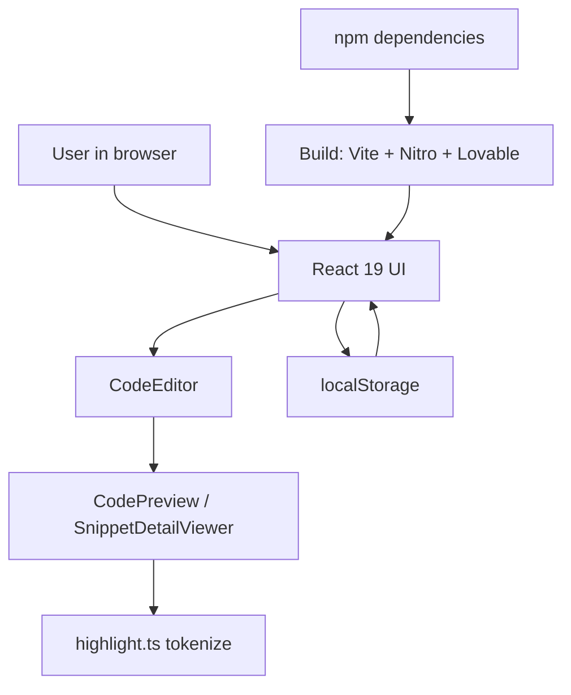

# Threat model and risk assessment

This document identifies and assesses the threats, vulnerabilities, and attack vectors relevant to the API2 code snippet manager. It is intended for security architects, threat hunters, and incident response teams who need to understand the threat landscape and prioritize hardening efforts.

## Executive summary

API2 is a client-side code snippet manager built on TanStack Start, React 19, and Vite. The application runs entirely in the user's browser with no server-side persistence, all data lives in`localStorage`. This architecture concentrates risk in three areas: XSS through rendered user code, local data theft through browser compromise, and supply-chain attacks through the 52 production npm dependencies.

The highest-priority threats are XSS via unsanitized code snippets (risk score 15), social engineering (12), and`localStorage` theft via malware or extensions (12). Supply-chain compromise of the build pipeline is a lower-likelihood but critical-impact scenario.

## System overview and trust boundaries

The application is a single-page app. The`package.json` confirms the stack: React 19.2.0, TanStack Start 1.168.60, TanStack Router 1.170.41, Tailwind CSS 4.2.1, and 26`@radix-ui/react-*` component packages. The build pipeline uses Vite 8.1.5 and Nitro 3.0.260603-beta, wrapped by`@lovable.dev/vite-tanstack-config` 2.26.5.

The`vite.config.ts` bundles several plugins through the Lovable config wrapper: TanStack devtools, TanStack Start, Vite React, Tailwind CSS, tsConfigPaths, Nitro (Cloudflare target by default), VITE_* env injection, the`@` path alias, React/TanStack dedupe, error logger plugins, and sandbox detection.

Figure: API2 data flow and trust boundaries



The diagram shows the four trust boundaries in the application: the user input path through`CodeEditor`, the rendering path through`CodePreview` and`highlight.ts`, the persistence boundary at`localStorage`, and the build-time trust granted to npm dependencies and tooling.

## Threat actors and motivation

The following threat actors are relevant to a client-side, local-storage-backed snippet manager.

| Threat actor | Motivation | Primary attack vectors |
|---|---|---|
| Malware authors | Steal proprietary API code for monetization or espionage | Malware on the user's device reading`localStorage` directly from the browser |
| Competitors | Gain unauthorized access to proprietary code snippets | Social engineering the user to share snippets; exploiting XSS if malicious code reaches the renderer |
| Browser extension authors | Monetize collected user data | Malicious or compromised extensions reading`localStorage` in the same origin |
| Device owners and physical attackers | Access code on shared or found devices | Physical access to an unlocked device with the app open |
| Supply-chain attackers | Inject malicious code at scale through dependencies or build tooling | Compromise of npm packages, the Lovable config wrapper, or Vite/Nitro plugins |
| Social engineers | Trick users into voluntarily disclosing code | Phishing, impersonation of colleagues or vendors |

Figure: Threat actor landscape

```mermaid
graph LR
    User[API2 user]
    Malware[Malware author]
    Ext[Browser