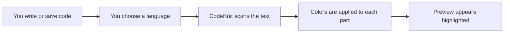

# Code syntax highlighting and preview

CodeKnit colors your code automatically, so JavaScript, Python, SQL, and Markdown are easier to read the moment you save a snippet. Every snippet preview shows clean, formatted text with line numbers, no setup required.

## Who this is for

This feature helps anyone who stores snippets in CodeKnit and wants to scan them quickly:

- **Developers** who save snippets in multiple languages and want each language to look familiar and readable.
- **Anyone browsing a snippet library** who needs to spot functions, comments, strings, and numbers at a glance.
- **People new to CodeKnit** who want previews to just look right without configuring anything.

## What highlighting does

When you save or open a snippet, CodeKnit recognizes its language and applies a distinct color to each meaningful part of the text:

- **Comments** appear in italic so they stand apart from working code.
- **Strings** get their own color.
- **Keywords**, such as`function` or`return`, use another color.
- **Function names** are highlighted separately.
- **Numbers** and **variables** have their own colors too.

For Markdown snippets, CodeKnit also recognizes **headings** (shown in a heavier weight), **bold text**, and **links** (shown underlined).

This happens automatically everywhere a snippet appears. You never need to change settings to make highlighting work.

Figure: How CodeKnit turns your code into a highlighted preview

## Supported languages

CodeKnit supports four languages out of the box:

| Language | Where the language color appears |
| --- | --- |
| JavaScript | The colored dot next to the language name uses the number color |
| Python | The colored dot uses the function-name color |
| SQL | The colored dot uses the string color |
| Markdown | The colored dot uses the keyword color |

Each language also has the same colored dot in the sidebar, in filter menus, and on snippet cards, which makes it easy to recognize the language of a snippet before you even read the code.

## Line numbers in previews

Every snippet preview includes line numbers by default. The numbers appear along the left side of the code and update automatically to match the snippet length.

- Card previews show numbered lines beside the code in both grid and list layouts.
- The full preview also shows numbered lines and lets you scroll when code is taller than the preview area.
- While editing, line numbers remain visible, starting at 8 lines and growing as you add more.

## Preview on snippet cards

Each snippet card shows a read-only preview of the code with:

- The snippet language applied automatically.
- Line numbers on the left.
- A color-coded, formatted version of the code.
- A limit of **8 lines** in the grid layout and **6 lines** in the list layout for longer snippets.

If a snippet has more lines than the preview allows, CodeKnit shows a **+X more lines** badge at the bottom of the preview. Select the card to open the full snippet.

## Full preview in the detail view

When you open a snippet, CodeKnit shows the complete code with the same highlighting and line numbers. The preview sits inside a scrollable area, so long snippets never push the dialog beyond the screen. This full preview is still read-only; use **Edit** to make changes.

## Live highlighting while you write

The highlighting also works while you create or edit a snippet. In the code field:

- The text appears with the same language colors as you type.
- Line numbers stay in sync with the number of lines.
- Pressing **Tab** inserts two spaces, which lets you indent code without losing your place.
- The field uses a monospaced look to keep alignment clear.

When you change the language in the form, the preview and editor automatically apply the new language's highlighting.

## Snippet length and display behavior

Long snippets are handled intentionally:

- Card previews show the first several lines and let you know how many more exist.
- The detail view shows the entire snippet inside a scrollable region.
- The editor preview can scroll within the form if the code grows beyond the field's fixed height.

No data is ever hidden or altered. Preview truncation on cards affects only the display, not the stored snippet.

## Related

- [Supported Languages and Syntax Highlighting](doc:a89e2847-7162-4523-b820-2daa6354792e)
- [Snippet Creation and Management](doc:11c8033a-5527-4445-82ef-8f0f7c8c0ce9)
- [Search, Filter, and Organization](doc:d0dae015-3d01-4e73-9a5d-6d71e9c5894a)
- [Snippets and Metadata](doc:29bc2a99-4091-4a7e-80c7-55aa5fb10d5a)
- [Getting Started with CodeKnit](doc:7f234e87-e4ba-4033-b8f7-2d5423f61808)
- [Glossary of Terms](doc:55b5299e-0d01-4346-b26a-aea098f6e5ea)
