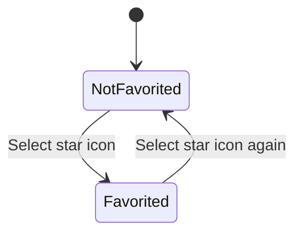
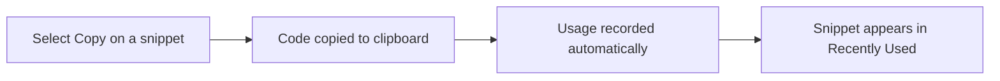
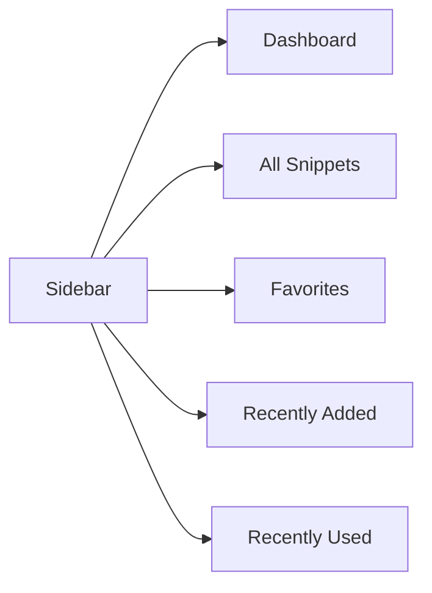

# Favorites and recent snippets tracking

CodeKnit helps you keep your most important snippets within easy reach. You can star any snippet as a favorite, and CodeKnit automatically tracks the snippets you add and use most. Dedicated sections in the sidebar give you one-click access to these collections.

This feature is for anyone who saves lots of snippets and wants a faster way to find the ones that matter most, without searching or filtering every time.

## What you can do

- Mark any snippet as a favorite with a single star toggle
- See all your favorites in a dedicated sidebar section with a live count
- See your 10 most recently added snippets in a dedicated section
- See snippets you've copied, ordered by most recently used
- View your favorite count at a glance on the Dashboard
- Remove favorites just as easily as you added them

## Favorites

Favorites are snippets you've starred for quick access. Starring does not change or copy the snippet, it simply adds a marker that tells CodeKnit to include it in your **Favorites** section.

You can star or unstar a snippet from several places:

- On any snippet card, select the **star icon**
- In the snippet detail viewer, select **Favorite** or **Favorited**
- When creating or editing a snippet, turn on **Mark as favorite**

A filled, colored star means the snippet is a favorite. An outlined star means it is not.

Figure: Favoriting and unfavoriting a snippet

### Where favorites appear

Favorites show up in three places:

- The **Favorites** section in the sidebar, with a count badge showing how many snippets you've starred
- The **Favorites** stat card on the Dashboard
- The selectable **star icon** on the snippet itself, filled when active

When you choose **Favorites** in the sidebar, CodeKnit shows only your starred snippets. You can still search or apply filters within that section to narrow things down further.

## Recently added

The **Recently Added** section shows the 10 most recently added snippets in your library, starting with the newest. This is a quick way to get back to something you just saved.

This section automatically updates as you create snippets. You don't need to turn anything on, CodeKnit orders your snippets by when they were added and shows the newest 10.

## Recently used

The **Recently Used** section lists snippets you've copied, ordered by the most recent copy first. CodeKnit records when you use the **Copy** action on a snippet card or in the snippet detail viewer.

This makes it easy to re-find code you've already put to work, even if you didn't favorite it.

Figure: How a copied snippet enters Recently Used

The **Recently Used** section also has a count badge in the sidebar. If you haven't copied any snippets yet, the section shows an empty state with the message "No recently used snippets" and a prompt to copy a snippet to see it there.

## Sidebar sections

All five browsing sections live in the same sidebar for quick switching:

Figure: Sidebar sections for browsing your snippets

- **Dashboard** shows a summary and your stats
- **All Snippets** shows your entire library
- **Favorites** shows only starred snippets
- **Recently Added** shows the newest 10 snippets
- **Recently Used** shows snippets you've copied, most recent first

## Usage counts

CodeKnit counts how many times you've copied each snippet. You'll see this as a small "Copied X times" note on snippet cards and in the snippet detail viewer, along with the date it was last copied.

This count is updated automatically whenever you use the **Copy** action, so you always know which snippets you actually rely on.

## Related pages

- [How to Mark Snippets as Favorites](doc:17d66e8d-646a-42c4-82c7-6f754e38e7b5)
- [How to Copy Code and Track Usage](doc:4ac9349d-2c1c-4646-9b5a-8a0f20f1d510)
- [Search, Filter, and Organization](doc:d0dae015-3d01-4e73-9a5d-6d71e9c5894a)
- [Snippet Creation and Management](doc:11c8033a-5527-4445-82ef-8f0f7c8c0ce9)
- [Glossary of Terms](doc:55b5299e-0d01-4346-b26a-aea098f6e5ea)
