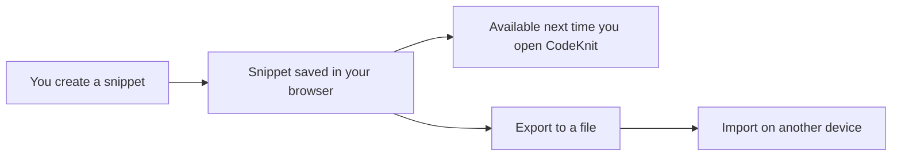
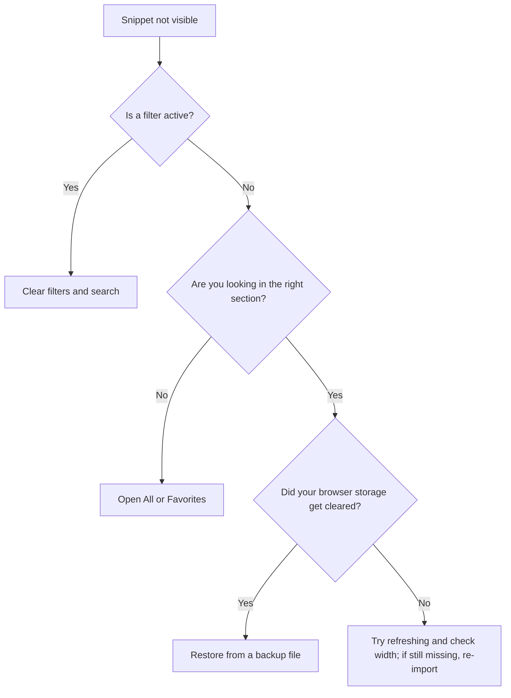

# Frequently asked questions

This FAQ answers common questions about CodeKnit's core day-to-day topics: storing snippets, finding them again, backing up your library, using tags, and understanding privacy. If you're brand new, start with Getting Started with CodeKnit.

## What is CodeKnit?

CodeKnit is a personal snippet library that lives entirely in your browser. You can save useful pieces of code or text, organize them with languages, categories, and tags, and find them again with search and filters. There's no account to create and nothing to install.

For definitions of key terms used throughout this FAQ, see the Glossary of Terms.

## Do I need an account?

No. There are no logins and no sign-ups. When you open CodeKnit, you're already in your personal workspace. Everything you create belongs to you on that device.

## What languages are supported?

CodeKnit supports syntax highlighting for four languages:

- JavaScript
- Python
- SQL
- Markdown

When you create a snippet, you assign one of these languages, and CodeKnit color-codes the text to make it easier to read. For a deeper look at how highlighting works, see Supported Languages and Syntax Highlighting and Code Syntax Highlighting and Preview.

## How do I create a snippet?

1. Click the **New** button.
2. Enter your code or text in the editor.
3. Choose a language from the language selector.
4. Assign a category or add tags if you want to organize it now.
5. Click **Save**.

Your snippet is saved immediately and appears in your library. For a first-time walkthrough, see How to Create and Save Your First Snippet. For the full feature overview, see Snippet Creation and Management and Snippets and Metadata.

## How do I delete a snippet?

You can delete any snippet from its snippet card or its detail view using the delete control. There is no undo after deletion, so only delete a snippet when you're sure you no longer need it. If you think you might want it later, consider exporting your library first, see How to Backup and Restore Snippets.

## Is my data private?

Your snippets are stored locally in your browser using your browser's own storage; nothing is uploaded to a CodeKnit server. Because there is no account or server involved, your library is as private as the browser and device you keep it on. Shared or public computers can expose your snippets to other users of that browser.

For more on how storage works, see Local Storage and Data Persistence.

## Can I sync across devices?

There's no built-in automatic sync between devices. Your library is stored on each device separately. To move snippets to another device, export your library as a file on the first device, then import that file on the second device.

The following diagram shows the two ways your snippets can travel:

Figure: Where snippets live and how they can move between devices

For step-by-step backups and transfers, see How to Backup and Restore Snippets and Import and Export Snippets.

## How do I export or back up my snippets?

1. Open the export or backup action for your library.
2. CodeKnit creates a single file containing your entire snippet library.
3. Save that file somewhere safe, such as a documents folder or an external drive.

The export includes all of your snippets and their metadata, so you can restore the full library later. For complete instructions, see How to Backup and Restore Snippets.

## How do I restore snippets from a backup?

Use the import action and choose the file you previously exported. CodeKnit reads the file and adds the snippets back into your library. This is how you recover from an accidental loss or move your library to a new device. For details, see How to Backup and Restore Snippets.

## Will my snippets disappear when I close the browser?

No. Your snippets are stored in your browser's persistent local storage, which survives closing the tab and closing the browser. They remain available the next time you open CodeKnit on the same device and in the same browser profile.

The main exception is if your browser's storage is cleared or if you use a private or incognito window that discards data at the end of each session. For a full explanation, see Local Storage and Data Persistence.

## How do I use tags effectively?

Tags are short free-form labels that help you describe a snippet beyond its language or category. When you create or edit a snippet, add tags using the`#` prefix, for example`#api`,`#regex`, or`#debugging`. You can then use those tags to filter your library and find related snippets quickly.

A few practical tips:

- Keep tag names short and consistent.
- Reuse the same tags across similar snippets instead of creating near-duplicates.
- Combine tags with search or language filters to narrow a large library.

For a full guide on tagging, see How to Organize Snippets with Categories and Tags. For how filters work together, see Search, Filter, and Organization.

## What's the difference between a category and a tag?

A category is a single broad grouping you assign to a snippet, for example, work, personal, or a project name. A tag is a shorter, more specific label, and a snippet can have multiple tags. Categories help you separate large areas of your library; tags help you capture specific themes within those areas.

Both appear as filtering options. For more, see Snippets and Metadata and How to Organize Snippets with Categories and Tags.

## How do I find a snippet quickly?

You have several ways to locate snippets:

1. Type in the search box to match text in your snippets.
2. Filter by language from the sidebar.
3. Filter by category or tag.
4. Open a dedicated sidebar section such as **All**, **Favorites**, **Recent**, or **Used**.

You can also combine search and filters to narrow a large library. For a practical walkthrough, see How to Search and Filter Snippets.

## What are favorites, recent, and used?

These are quick-access views in the sidebar:

- **Favorites** appears when you tap the star on a snippet, letting you pin important snippets for fast access.
- **Recent** shows snippets you've recently viewed or worked with.
- **Used** shows snippets you've recently copied.

For more, see Favorites and Recent Snippets Tracking and How to Mark Snippets as Favorites.

## How does copy and usage tracking work?

When you click the copy icon on a snippet, CodeKnit copies the content to your clipboard and shows a confirmation. Copying also feeds the **Recent** and **Used** views so the snippets you actually use rise to the top. For details, see How to Copy Code and Track Usage.

## I saved a snippet but can't see it anywhere

This usually means a filter is still active. If the current view shows a language, category, tag, or search filter that doesn't match your new snippet, the snippet will be hidden even though it was saved. Clear the filters and search box, then look again in **All**.

The following decision diagram walks through the most common causes:

Figure: Troubleshooting a missing snippet

For more fixes, see the Troubleshooting Guide.

## Can I accidentally lose all my data?

Because your library is stored only in your browser, clearing your browser's site data, such as cookies and storage, can remove your snippets. Your best protection is regular exports. Keep at least one recent backup file stored outside your browser. For the backup workflow, see How to Backup and Restore Snippets and Local Storage and Data Persistence.

## Where should I go next?

- Getting Started with CodeKnit
- Snippet Creation and Management
- Search, Filter, and Organization
- How to Backup and Restore Snippets
- Troubleshooting Guide
