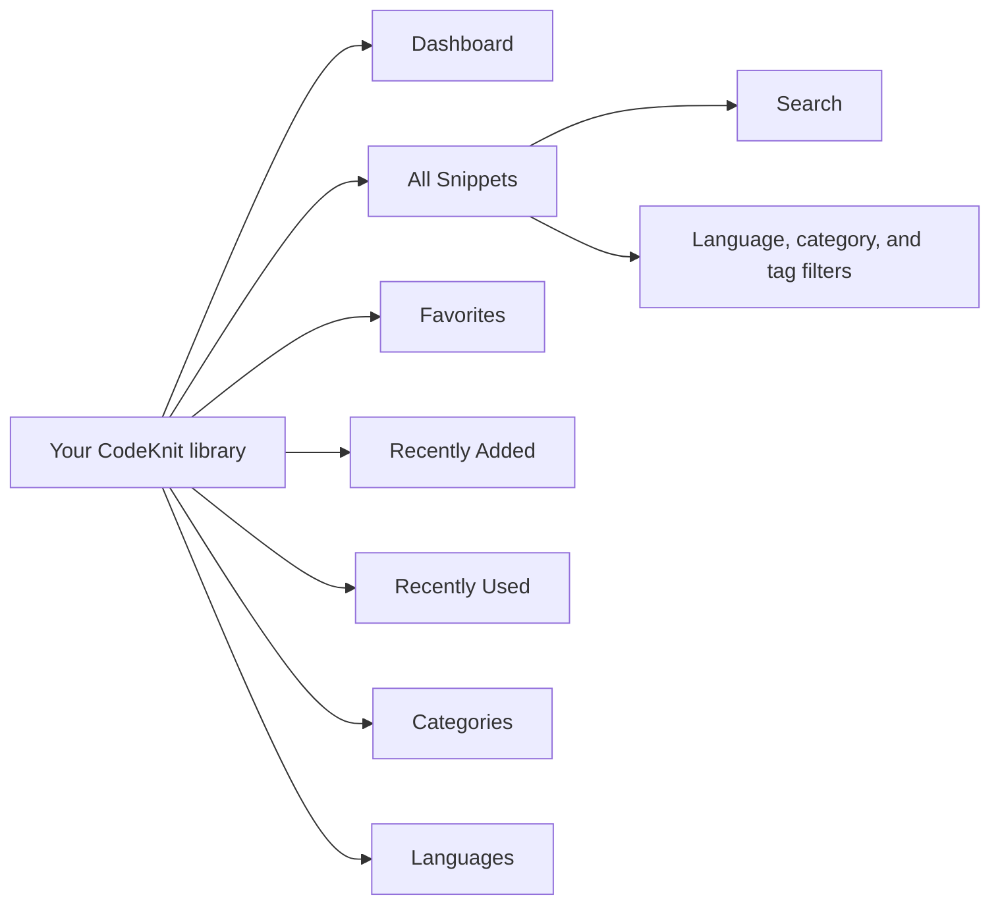
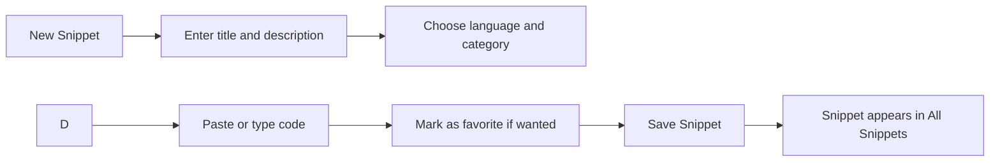
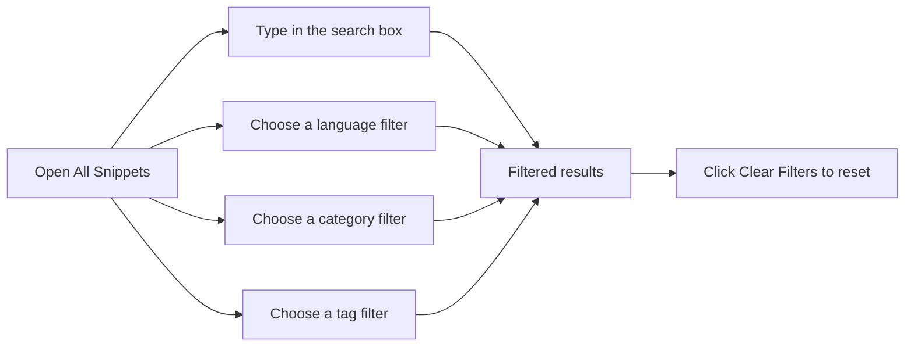

# Getting started with CodeKnit

CodeKnit is a personal library for saving and reusing code snippets. It lives in your browser, so your snippets are always close by and stay saved on your device. This guide explains what CodeKnit can do and walks you through creating your first snippet.

## What you can do with CodeKnit

- Save snippets with a title, optional description, language, category, and tags.
- See syntax highlighting and line numbers while you write or read code.
- Find snippets quickly with search and filters for language, category, and tag.
- Mark snippets as favorites for one-click access.
- Copy code to your clipboard and track how often you use each snippet.
- Back up your library by exporting it, and restore it later by importing that file.

Figure: How your CodeKnit workspace is organized

## Explore the workspace

When you open CodeKnit, you land on the **Dashboard**. It shows three summary cards, **Total snippets**, **Favorites**, and **Languages**, followed by your snippet collection.

The sidebar is your main navigation:

- **Dashboard**, your home view with summary cards and current snippets
- **All Snippets**, every snippet in your library
- **Favorites**, snippets you have starred
- **Recently Added**, the 10 most recently added snippets
- **Recently Used**, snippets you have copied, most recent first

Below these, the **Categories** and **Languages** sections let you browse by a single category or language. Each entry shows how many snippets match.

## Create your first snippet

1. From the workspace, click **New Snippet** in the sidebar or in the top header.
2. In the **New snippet** dialog, enter a **Title**, such as “Debounce utility”.
3. Add a **Description** that explains what the code does. This step is optional.
4. Choose a **Language**. CodeKnit supports **JavaScript**, **Python**, **SQL**, and **Markdown**, and highlights each accordingly.
5. Choose a **Category** from the list, or select **+ Custom category…** and type your own.
6. Under **Tags**, type a tag and confirm it. Tags appear with a`#` prefix, such as`#utility`.
7. Paste or write your code in the **Code** box. The editor shows line numbers and color-coded syntax as you work.
8. Optionally turn on **Mark as favorite** to send the snippet straight to your **Favorites**.
9. Click **Save Snippet**.

Your snippet is saved and appears on the **Dashboard** and in **All Snippets**.

Figure: The journey from New Snippet to your saved library

## Find and reuse a snippet

Use the search bar at the top to search snippets, tags, or code. To narrow results further, use the filter bar to choose a **language**, **category**, or **tag**, and to set the sort order to **Recently Added**, **Oldest First**, or **A–Z**.

On any snippet card, click **Copy** to copy that snippet's code to your clipboard. CodeKnit records the action, so the snippet shows up under **Recently Used**. Click **View**, or the snippet card itself, to open the full snippet in a larger reader.

Figure: Narrowing down snippets with search and filters

## Back up your work

CodeKnit keeps your snippets on your device in your browser. To protect them, open **Settings** from the bottom of the sidebar. Choose **Export** to download all your snippets as a file, or choose **Import JSON** to restore or merge a previously exported library. If you ever want to start over, choose **Reset to sample data**.

Now that you have your first snippet, continue with these guides:

- [How to Create and Save Your First Snippet](doc:06f6d9bd-a5b1-4088-a8a3-2cec8e394ff7)
- [How to Search and Filter Snippets](doc:fccf0484-3f06-4f6b-a471-3781538722ff)
- [How to Mark Snippets as Favorites](doc:17d66e8d-646a-42c4-82c7-6f754e38e7b5)
- [How to Backup and Restore Snippets](doc:190d9a14-796e-4052-9687-79c5c6e2bcb7)
- [Snippets and Metadata](doc:29bc2a99-4091-4a7e-80c7-55aa5fb10d5a)
- [Supported Languages and Syntax Highlighting](doc:a89e2847-7162-4523-b820-2daa6354792e)
