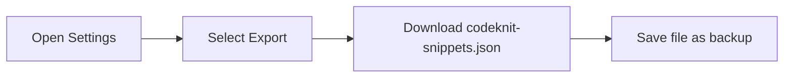
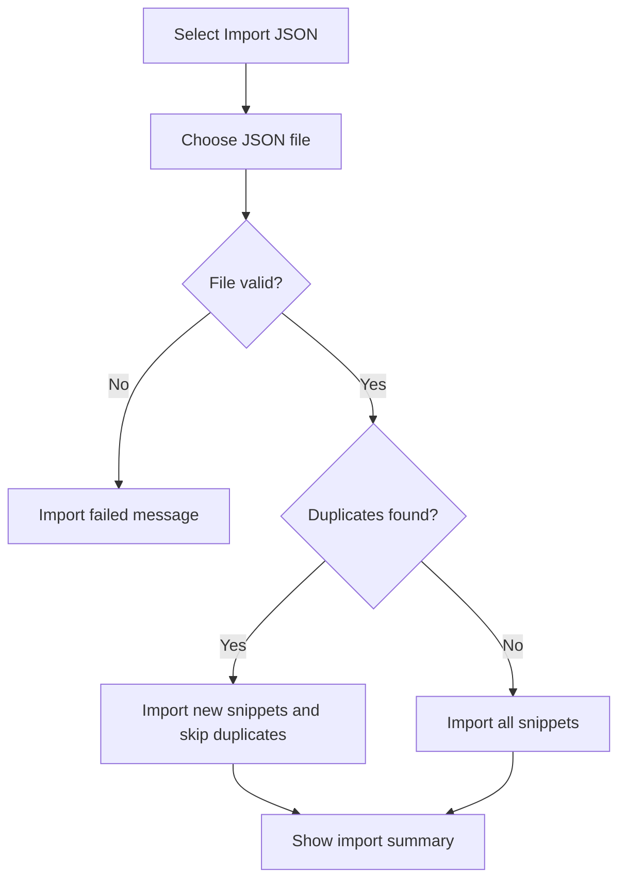

# Import and export snippets

Import and export let you back up your CodeKnit library, move your snippets between browsers or devices, and restore them after a reset. Your snippets are stored in the browser, so exporting them gives you a portable copy you can keep safe.

Export creates a single JSON file named`codeknit-snippets.json` that contains your entire library. Import reads a CodeKnit JSON export and adds the snippets to your current library. Existing snippets stay in place, and duplicates are skipped automatically.

## Who this is for

- Anyone who wants a backup of their snippet library
- Anyone moving CodeKnit to a new browser, device, or profile
- Anyone restoring their library after a reset

## What you can do

- Download all your snippets as a single JSON file
- Import a previously exported CodeKnit library
- Merge imported snippets into your existing library without overwriting anything
- Reset your library to sample data when you want a fresh start

## Accessing import and export

Open **Settings** from the gear icon in the lower-left corner of the sidebar. The Settings dialog shows your library's current location and presents three actions: **Export**, **Import JSON**, and **Reset**.

The dialog explains that your snippets are stored in the current browser, and that exporting creates a backup while importing pulls in a previously exported CodeKnit library.

## Exporting your library

Export downloads every snippet in your library as one JSON file. The file is named`codeknit-snippets.json` and is saved through your browser's normal download flow.

When you select **Export**, CodeKnit counts your snippets and shows a confirmation such as "Exported snippets" with "12 snippets downloaded."

The exported file contains the full details of each snippet, including the title, description, code, language, category, tags, favorite status, creation and update dates, and copy history. This means a restored library carries over the metadata and organizational information, not just the code.

Figure: Export backup flow

## Importing snippets

Import reads a CodeKnit JSON export and merges the snippets into your current library. Your existing snippets are kept, and duplicate snippets are skipped rather than replaced.

When you select **Import JSON**, your browser opens a file picker that accepts`.json` files. CodeKnit validates the entire file before changing any saved data, so an invalid file will not damage your existing library.

Figure: Import validation and merge flow

The success message tells you how many snippets were imported and how many duplicates were skipped. If no new snippets were imported, you see "No new snippets imported" with the number of duplicates skipped.

If the import fails, you see "Import failed" with a reason such as "Could not read this file." After an import attempt, the file picker resets, so you can immediately select the same file again after fixing it.

## Merge behavior

Import uses a merge, not a replace. This keeps your existing library safe:

- Snippets already in your library are not changed or overwritten
- Snippets in the import file that are already present are skipped as duplicates
- Only new snippets are added
- Favorites, tags, categories, and usage history on existing snippets remain intact

The import summary reports the imported and skipped counts as evidence of what changed.

## Resetting your library

The Settings dialog also includes a **Reset** option that replaces all your snippets with sample data. This is a two-step action to prevent accidental deletion: select **Reset**, then select **Confirm reset**. When complete, you see "Library reset."

If you plan to reset, export your library first so you can import it again later.

## Limits and notes

- Export and import work with CodeKnit JSON files only
- Import adds snippets from the file; it does not remove anything from your current library
- CodeKnit does not sync snippets across devices automatically, import and export are the way to move data from one browser to another
- The import file must be selected from the local device; there is no cloud import or export option

## Related

- [How to Backup and Restore Snippets](doc:190d9a14-796e-4052-9687-79c5c6e2bcb7)
- [Local Storage and Data Persistence](doc:719ab5d9-7496-49ec-b3c5-b352165f654b)
- [Snippet Creation and Management](doc:11c8033a-5527-4445-82ef-8f0f7c8c0ce9)
- [Frequently Asked Questions](doc:f79c6fef-109a-49de-a0a8-c2c527e12743)
- [Snippets and Metadata](doc:29bc2a99-4091-4a7e-80c7-55aa5fb10d5a)
