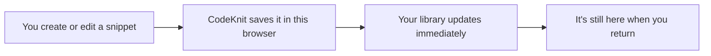
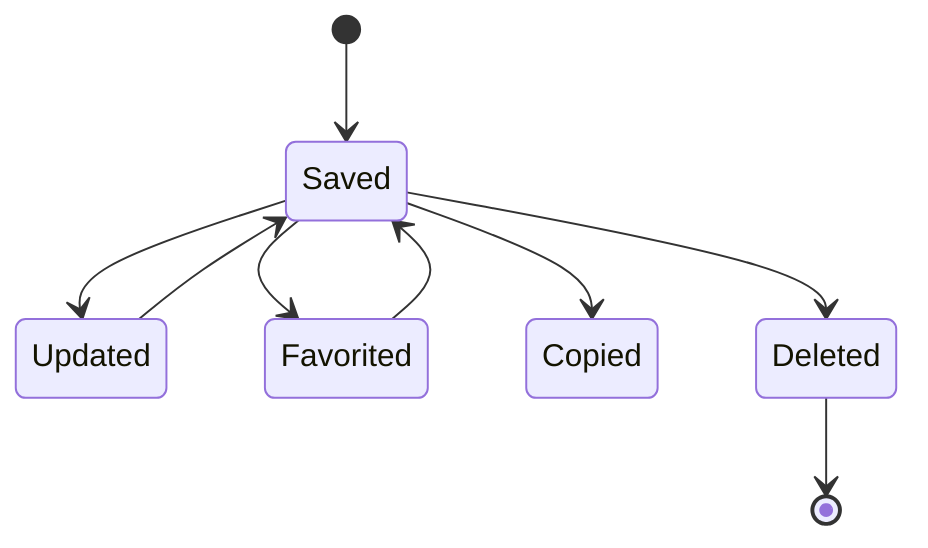

# Local storage and data persistence

CodeKnit keeps your snippet library inside your web browser's local storage, a private storage area on your device. You don't need an account or an internet connection to save, edit, or find your snippets. Anything you save in CodeKnit stays on the device and in the browser you're using until you change or delete it.

## Where your data lives

When you use CodeKnit, your saved information is associated with the browser you're using. The workspace area in the sidebar says **Saved on this device**, and the Settings dialog explains that your snippets are stored in this browser.

This has two practical results:

- Your library is available immediately, even when you're offline.
- Your library is not sent to a cloud account automatically.

Figure: How a snippet reaches your library

## What gets stored automatically

CodeKnit saves every part of a snippet as you work:

- **Snippet details**, title, description, code, language, category, and tags. Learn more in [Snippets and Metadata](doc:29bc2a99-4091-4a7e-80c7-55aa5fb10d5a).
- **Favorites**, whether you've starred a snippet.
- **Usage activity**, how many times you've copied a snippet and when it was last copied.
- **Dates**, when each snippet was created and last updated.
- **View preference**, whether your library uses grid or list view.

This means if you tell CodeKnit to show your snippets as a list, that preference is remembered on your next visit.

## Persistence across sessions

"Across sessions" simply means CodeKnit doesn't forget your data when you leave. You can:

1. Create or edit snippets.
2. Close the browser tab or quit the browser entirely.
3. Return to CodeKnit later, your snippets, favorites, recent items, and view preferences are still there.

No extra save step is needed when you close the app. The data is already stored in your browser.

## What does not sync automatically

CodeKnit is a local-first app. It doesn't have its own account-based sync service. This means:

- **Different browser, different library.** If you use CodeKnit in a different browser on the same device, your snippets won't be there.
- **Different device, different library.** If you open CodeKnit on another computer or phone, your snippets won't be there.
- **No automatic online backup.** Your snippets live in your browser until you export them.

The Settings dialog reflects this: it offers **Export library** and **Import library** as the supported ways to back up or move a library.

## Lifecycle of a saved snippet

A snippet moves through a small number of states after you create it, and each state is remembered locally.

Figure: Lifecycle of a saved snippet

- **Saved**, the snippet exists in your library.
- **Updated**, you edited it and saved again.
- **Favorited**, you starred it for quick access.
- **Copied**, CodeKnit records the copy and adds the snippet to **Recently Used**.
- **Deleted**, you removed it permanently; this cannot be undone.

Deletion is permanent because the snippet is removed from your browser's local storage. For more on favorites and usage tracking, see [Favorites and Recent Snippets Tracking](doc:df417b15-e94f-4cf5-a298-996cfe891b92).

## Keeping your library safe

Because your data is stored in your browser, it's wise to make backups.

- **Export**, from Settings, choose **Export library** to download all your snippets as a JSON file.
- **Import**, choose **Import JSON** to merge a previously exported file into the current browser. Existing snippets are kept and duplicates are skipped.
- **Reset**, choose **Reset to sample data** to replace all your snippets with fresh sample content.

For step-by-step instructions, see [How to Backup and Restore Snippets](doc:190d9a14-796e-4052-9687-79c5c6e2bcb7) and [Import and Export Snippets](doc:c3460112-04bd-4c8f-9712-121f35796862).

## Limitations to keep in mind

- Your library is tied to one browser on one device.
- Clearing your browser's site data or browsing data can remove your snippets. Export a backup before doing this.
- There is no built-in automatic sync across devices. You can move snippets manually by exporting from one browser and importing in another.
- **Reset** and **Delete** actions are destructive; use them only when you intend to replace or remove data.
- Large code libraries benefit from periodic exports, since browser storage capacity varies by browser.

## Next steps

- [Getting Started with CodeKnit](doc:7f234e87-e4ba-4033-b8f7-2d5423f61808)
- [Snippets and Metadata](doc:29bc2a99-4091-4a7e-80c7-55aa5fb10d5a)
- [Favorites and Recent Snippets Tracking](doc:df417b15-e94f-4cf5-a298-996cfe891b92)
- [Import and Export Snippets](doc:c3460112-04bd-4c8f-9712-121f35796862)
- [Frequently Asked Questions](doc:f79c6fef-109a-49de-a0a8-c2c527e12743)
