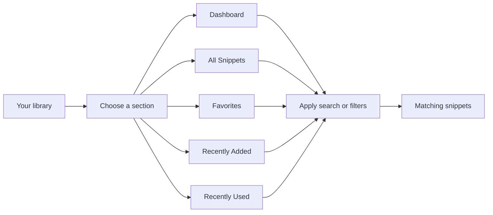
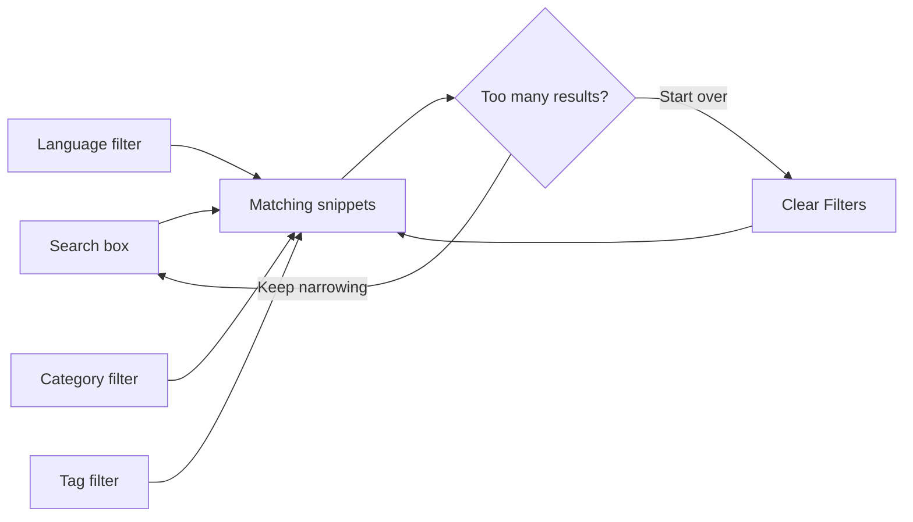
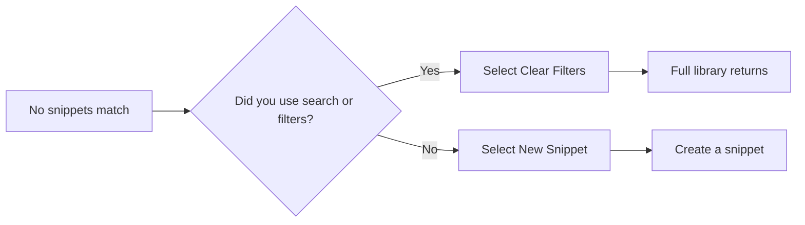

# Search, filter, and organization

CodeKnit helps you find the right saved snippet quickly. You can search across your library, narrow results by language, category, or tag, jump between purpose-built sections in the sidebar, and choose how your results appear. This page explains the discovery options available after you've saved a few snippets.

## Browse with sidebar sections

The navigation sidebar groups your library into five sections:

- **Dashboard** shows your at-a-glance totals alongside all your snippets.
- **All Snippets** shows your entire library with whatever search and filters you've applied.
- **Favorites** shows only the snippets you've starred.
- **Recently Added** shows the 10 newest snippets, newest first.
- **Recently Used** shows snippets you've copied, ordered by the most recent copy.

Sections that have a known number of snippets display a count next to their name. Selecting a section changes the collection of snippets you're viewing; your search and filters still apply on top of that collection.

Figure: How sidebar sections narrow your snippet library

## Search your snippets

You can search from the search box at the top of the workspace. Its placeholder reads **Search snippets, tags, or code...** and it helps you find snippets by title, tag, or code. There's also a **Filter…** search box in the filter area below the section heading. Both boxes update the same search, so you can start typing in whichever is most convenient.

As you type, the results list updates immediately. The heading above your snippets shows how many snippets currently match, for example **12 shown**.

## Filter by language, category, and tag

Use filters to narrow your results by how a snippet is organized:

- **Language filter** shows a dropdown labeled **All languages**. Choose a language to see only snippets saved in that language.
- **Category filter** shows a dropdown labeled **All categories**. Choose a category to see only snippets assigned to that category.
- **Tag filter** shows a dropdown labeled **All tags**. Choose a tag to see only snippets that carry that tag.

The sidebar offers two quick-filter groups that perform the same language and category filtering:

- **Languages** lists each supported language with a color dot. Select a language to filter by it; select it again to return to all languages.
- **Categories** lists your categories with snippet counts. Select a category to filter by it; select it again to return to all categories.

Figure: Applying search and filters to find a snippet

## Sort your results

The sort dropdown in the filter area lets you order matching snippets in three ways:

- **Recently Added** shows the newest snippets first.
- **Oldest First** shows the oldest snippets first.
- **A–Z** sorts snippets alphabetically by title.

The **Recently Added** and **Recently Used** sidebar sections have their own fixed ordering. **Recently Added** always shows the newest snippets first, and **Recently Used** always orders snippets by the most recent copy, regardless of the sort dropdown.

## Combine search, filters, and sections

You can layer several discovery options at once. For example, open **Favorites** and then type in the search box to search only your starred snippets. Or choose a language in the sidebar and a category in the filter area to see snippets that match both.

When a section, filter, or search combination returns no results, you'll see a **No snippets match** message with a **Clear Filters** button. Selecting **Clear Filters** removes your search text and resets the language, category, and tag filters, but keeps your chosen sort order.

Figure: What happens when no snippets match

## Switch between grid and list

The view toggle in the filter area switches how matching snippets appear:

- **Grid view** shows snippets as cards arranged in columns on larger screens.
- **List view** shows snippets as full-width rows.

Your layout choice is remembered on the current device, so the next time you open CodeKnit it restores the view you selected.

## Related

- [Snippets and Metadata](doc:29bc2a99-4091-4a7e-80c7-55aa5fb10d5a)
- [Favorites and Recent Snippets Tracking](doc:df417b15-e94f-4cf5-a298-996cfe891b92)
- [Snippet Creation and Management](doc:11c8033a-5527-4445-82ef-8f0f7c8c0ce9)
- [How to Search and Filter Snippets](doc:fccf0484-3f06-4f6b-a471-3781538722ff)
- [How to Organize Snippets with Categories and Tags](doc:8558c904-88d6-4a60-9b3c-1334c735f35c)
- [Troubleshooting Guide](doc:0ce6eed9-9cef-4bee-b68e-282ae030c706)
