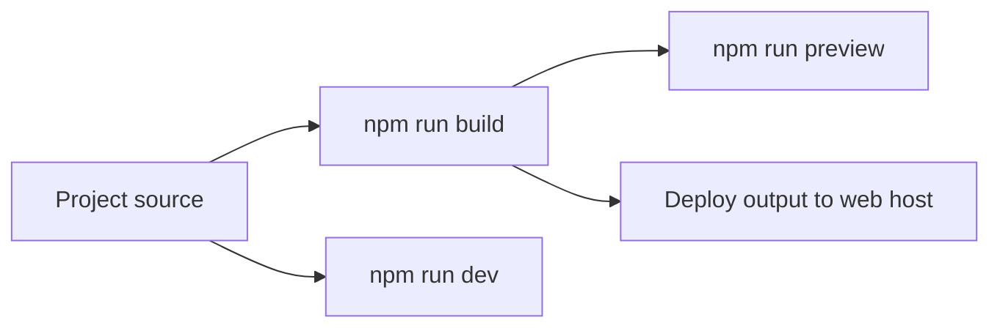
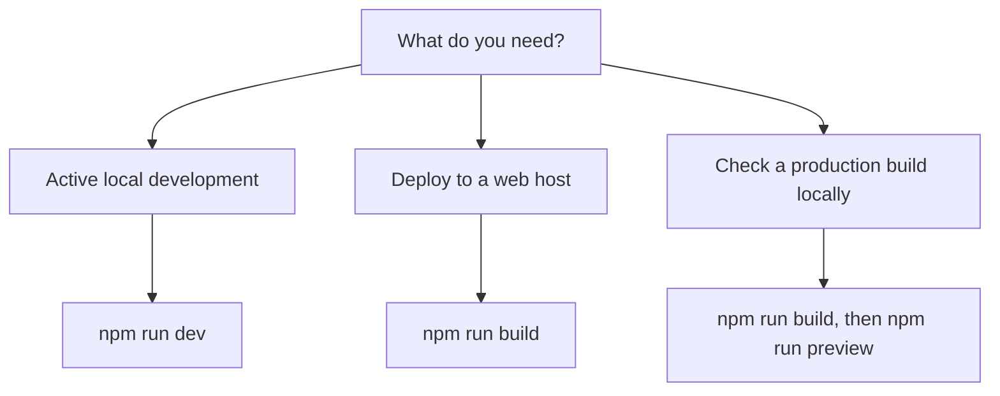

# Site building and bundling

Site Building & Bundling compiles the site's source code into a production-ready package you can preview locally and then deploy to a web host. It is for developers who maintain the site and site administrators who need to verify a production build before it goes live.

You control the build through npm commands that call Vite. Four commands cover the full cycle from local development to production preview.

| Goal | Command | What it runs |
| --- | --- | --- |
| Build an optimized production bundle |`npm run build` |`vite build` |
| Build a development bundle with easier debugging |`npm run build:dev` |`vite build --mode development` |
| Preview a completed production bundle locally |`npm run preview` |`vite preview` |
| Start the local development server |`npm run dev` |`vite dev` |

These commands are defined in the project's`package.json` file. Each requires Node.js and npm, plus a local copy of the project with its dependencies installed.

## How the build and preview cycle fits together

The diagram below shows how source code moves through the development and production paths.

Figure: Site build and preview flow

## Choosing which command to use

The right command depends on what you want to accomplish.

Figure: Build command decision flow

## Options and limits

- Build configuration in the reviewed source is controlled entirely through`package.json`, build scripts, the Vite version, the Rolldown version override, and bundler-related plugins. No separate Vite configuration file is included in the source reviewed.
- The reviewed source uses Vite and TanStack Start. It does not include Docusaurus configuration or Docusaurus-specific build settings.
- Production builds prioritize performance and smaller file sizes. Development builds keep behavior easier to debug at the cost of larger output.
- Build and preview commands are available to anyone with a local copy of the project and the required Node.js and npm versions installed.

## Related

- [How to build production site](doc:b060aa33-db67-4a84-afe0-823e5d9feea9)
- [How to minify HTML output](doc:7b25956e-fd86-4dff-8335-b17248d4dea5)
- [How to minify JavaScript bundles](doc:14d587d7-dcd7-42b1-82e7-03e0261ce124)
