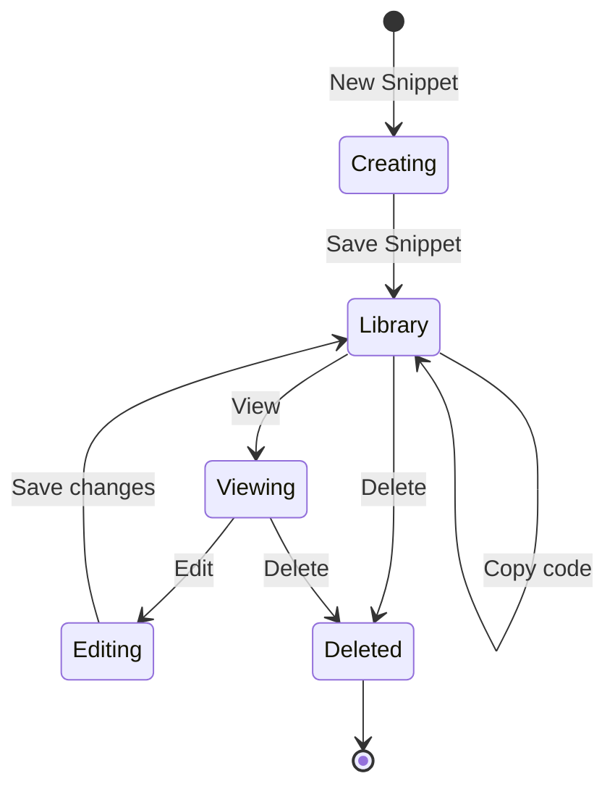
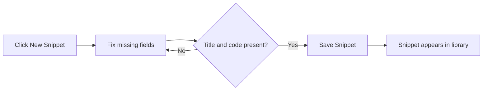

# Snippet creation and management

CodeKnit helps you save, organize, and reuse code snippets. Create a snippet in seconds, tag it, assign a category, and find it again whenever you need it. Everything stays on your device, in your browser, so your library is private and available when you return.

This page covers the everyday work of managing snippets: creating them, viewing details, updating, deleting, and using metadata such as language, category, and tags to stay organized.

## At a glance

- Create snippets with a title, description, language, category, tags, and code
- Choose from 4 supported languages: JavaScript, Python, SQL, and Markdown
- Assign any category, including custom ones
- Star snippets as favorites for fast access
- View full code with syntax highlighting and line numbers
- Edit and delete snippets directly from your library
- Track how often you copy each snippet

Figure: Snippet lifecycle from creation to deletion

## Creating snippets

You can start a new snippet from anywhere in the app. Select **New Snippet** in the top bar or in the sidebar footer. A dialog opens with fields for all the information about your snippet.

The dialog asks for:

| Field | Required? | Notes |
|---|---|---|
| Title | Yes | Appears at the top of the snippet card |
| Description | No | A short summary of what the code does |
| Language | Yes | JavaScript, Python, SQL, or Markdown |
| Category | Yes | Select one or create a custom one |
| Tags | No | One or more short labels |
| Code | Yes | The code or text you want to save |
| Favorite | No | Toggle to star the snippet immediately |

The form checks that a title, code, and category are present before saving. If any is missing, an error message appears under the field. The snippet form stays open if you click outside it, so use **Cancel** or the close button when you want to leave without saving.

For a step-by-step walkthrough of your first snippet, see [How to Create and Save Your First Snippet](doc:06f6d9bd-a5b1-4088-a8a3-2cec8e394ff7).

Figure: Flow for creating a new snippet

After you save, a toast notification confirms the snippet was saved, and the snippet appears in your library and on the Dashboard.

## Choosing a language

CodeKnit supports 4 languages for syntax highlighting. The language you select controls how your code is color-coded when you preview it. Pick from:

- JavaScript
- Python
- SQL
- Markdown

Each language has a color dot in the sidebar so you can identify snippets at a glance. For more about syntax highlighting, see [Code Syntax Highlighting and Preview](doc:2cb5bb53-7f7e-418d-a558-bd10548fce84).

## Assigning a category

Categories group related snippets. Use the **Category** selector to choose from existing categories or select **+ Custom category…** to type your own. The category field is required, so if you choose a custom category you need to enter a name before saving.

Categories appear in the sidebar with the number of snippets each contains. Selecting a category filters your library to show only matching snippets. For more about organizing with categories, see [How to Organize Snippets with Categories and Tags](doc:8558c904-88d6-4a60-9b3c-1334c735f35c).

## Adding tags

Tags are short, reusable labels you add to a snippet. Use the **Tags** field to add as many tags as you want. Tags display with a`#` prefix on snippet cards and in the detail viewer.

Tags help you filter snippets by specific topics or technologies. For more about filtering, see [Search, Filter, and Organization](doc:d0dae015-3d01-4e73-9a5d-6d71e9c5894a).

## Viewing snippet details

Select any snippet card to open the detail viewer. It shows:

- The full code with syntax highlighting and line numbers
- All metadata: language, category, tags, and description
- Created and updated dates
- Copy count and last copied date
- Action buttons: **Favorite**, **Delete**, **Edit**, and **Copy code**

The detail viewer gives you room to read your code without the compact card layout.

## Editing snippets

You can edit a snippet in two ways:

- Select the **More actions** (⋯) menu on a card and choose **Edit**
- Open the detail viewer and select **Edit**

The same form opens, pre-filled with the current values. Change anything you need and select **Save Snippet**. A toast confirms the update, and your changes appear immediately in the library.

## Deleting snippets

You can delete a snippet from a card's **More actions** menu or from the detail viewer. A confirmation dialog asks "Delete this snippet?" and shows the snippet title so you know exactly which one you're removing. Deletion is permanent and can't be undone.

Select **Delete** to confirm, or **Cancel** to keep the snippet.

## Favoriting snippets

Select the star icon on any card to mark it as a favorite. Favorited snippets show a filled star and are available in the sidebar under **Favorites**. You can also toggle the **Mark as favorite** option when creating or editing a snippet.

For more about favorites, see [Favorites and Recent Snippets Tracking](doc:df417b15-e94f-4cf5-a298-996cfe891b92).

## Copying and tracking usage

Every snippet card includes a **Copy** button. When you copy a snippet, the confirmation appears on the button and CodeKnit records the action. The snippet's copy count increments and its last copied timestamp updates. Recently copied snippets appear in the sidebar under **Recently Used**, sorted by most recent copy.

## Browsing your library

Your snippets appear as cards in a grid or list layout. Toggle between the two using the grid and list icons in the filter bar. Your preferred layout is remembered on your device.

The Dashboard shows summary cards:

- **Total snippets**, how many snippets are in your library
- **Favorites**, how many you have starred
- **Languages**, the different languages represented in your library

The sidebar sections let you browse by **All Snippets**, **Favorites**, **Recently Added**, or **Recently Used**. Categories and languages also appear in the sidebar for one-click filtering.

If you have no snippets yet, you see an empty state with the message "Save your first snippet to start building your library" and a **New Snippet** button to get started. If filters return no results, the empty state offers a **Clear filters** button.

## Storage and privacy

Your snippets are stored in your browser on this device. Nothing is sent to a server, and your library is private to you. You can back up your library at any time through the **Settings** dialog, covered in [Import and Export Snippets](doc:c3460112-04bd-4c8f-9712-121f35796862).

## Related

- [Snippets and Metadata](doc:29bc2a99-4091-4a7e-80c7-55aa5fb10d5a), Learn what a snippet is and how its metadata works
- [Favorites and Recent Snippets Tracking](doc:df417b15-e94f-4cf5-a298-996cfe891b92), Star snippets and see recent usage
- [Code Syntax Highlighting and Preview](doc:2cb5bb53-7f7e-418d-a558-bd10548fce84), See how code is color-coded by language
- [Import and Export Snippets](doc:c3460112-04bd-4c8f-9712-121f35796862), Back up and restore your library
- [Search, Filter, and Organization](doc:d0dae015-3d01-4e73-9a5d-6d71e9c5894a), Find snippets with filters and sidebar browsing
- [Local Storage and Data Persistence](doc:719ab5d9-7496-49ec-b3c5-b352165f654b), Understand how your data is stored locally
