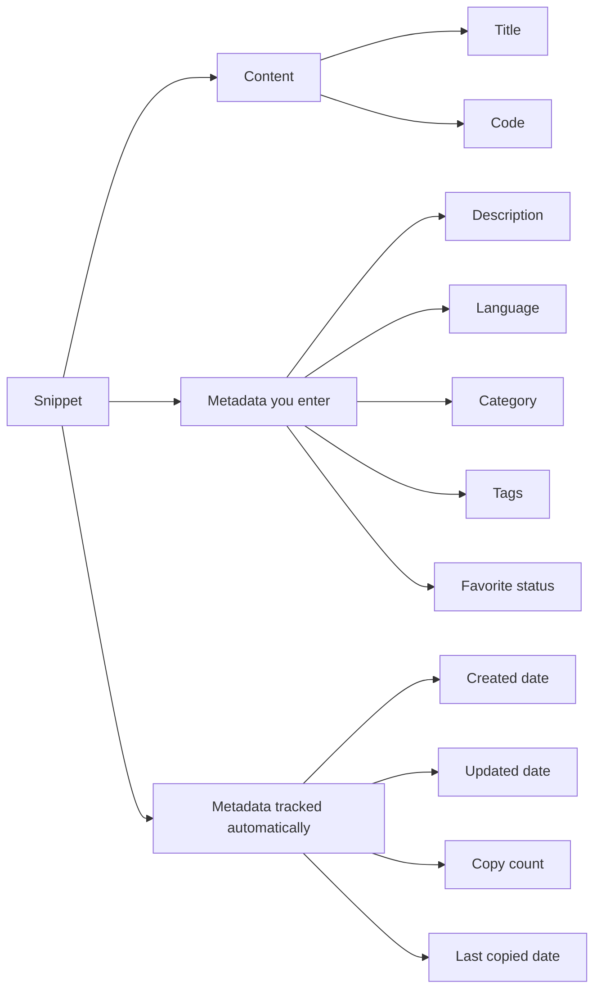
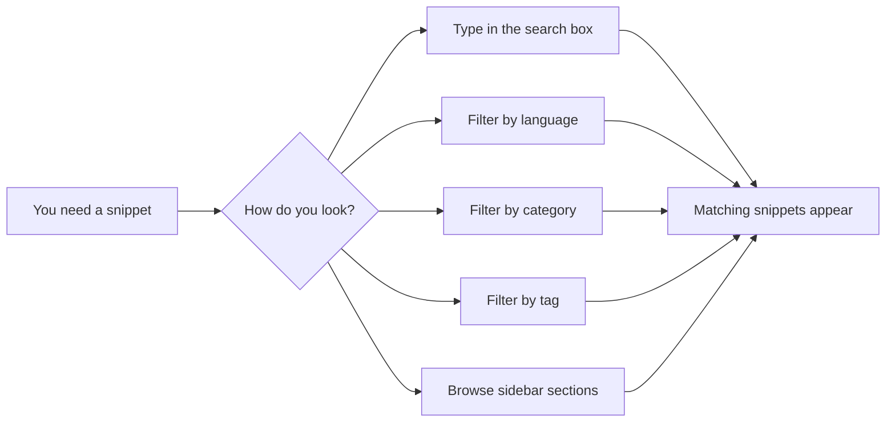

# Snippets and metadata

A snippet is a saved piece of code or text that you plan to reuse. In CodeKnit, every snippet holds two kinds of information: the **content** itself and **metadata**, which is the descriptive information that helps you organize, find, and understand the snippet later.

This guide explains what makes up a snippet and how its metadata improves organization and discovery.

## What is a snippet?

A snippet is a self-contained entry in your CodeKnit library. It typically includes the code you want to save, along with a short title and a set of descriptive labels. You create snippets from the **New Snippet** dialog, and they appear on your **Dashboard** and in your **All Snippets** view.

Each snippet bundles together:

- The actual code or text you want to remember
- A title that identifies it at a glance
- Descriptive labels such as language, category, and tags
- Automatic tracking details such as creation date and copy count

Together, these make a snippet more than raw code, they make it searchable, filterable, and easy to return to.

## Core metadata fields

Every snippet includes the following fields. Some you enter yourself when creating or editing a snippet; others are maintained automatically by CodeKnit.

### Title

The title is a short, human-readable name for the snippet, such as “Debounce utility”. It is required, and it is the first thing you see on a snippet card and in the detail view.

### Description

The description is an optional sentence or two that explains what the snippet does or when to use it. You enter it when creating or editing a snippet. The description appears under the title on snippet cards and in the full detail viewer.

### Code

The code is the main content of the snippet. It can be a piece of JavaScript, Python, SQL, or Markdown, or any plain text you want to keep. Code is required, and CodeKnit highlights the syntax automatically based on the language you choose.

### Language

The language identifies the programming language or format of the snippet. CodeKnit supports four language options:

- JavaScript
- Python
- SQL
- Markdown

Each language has its own color-coded highlighting and a small colored dot in the user interface, which makes it easy to spot the type of snippet at a glance. Language is required and used both for syntax highlighting and for filtering.

### Category

A category groups snippets into broad buckets, such as **Utilities**. Categories appear in the sidebar with counts, and you can pick an existing category or create your own custom one when creating or editing a snippet.

Categories are best for coarse grouping: anything that belongs to a general area of your work. The sidebar shows each category and how many snippets it contains.

### Tags

Tags are short, freeform labels you attach to a snippet. Multiple tags can be assigned to one snippet, and tags are shown with a`#` prefix, for example`#api` or`#async`. Tags provide a more flexible way to describe a snippet than a single category.

A snippet can have many tags at once, which is useful when one snippet relates to several topics.

### Favorite status

A snippet can be marked as a favorite. Favorites are starred for quick access and appear in the dedicated **Favorites** section in the sidebar. You can toggle favorite status from a snippet card or from the detail viewer.

### Date created and date updated

CodeKnit records two dates for every snippet:

- **Created date**: when the snippet was first saved
- **Updated date**: the last time the snippet was edited

If a snippet has never been edited, only the created date is shown. The detail view shows both dates clearly.

### Usage statistics

CodeKnit tracks how often you copy a snippet. The key details are:

- **Copy count**: how many times the snippet's code has been copied
- **Last copied date**: the most recent time you copied the snippet

These statistics help you see which snippets are your most-used, and they feed the **Recently Used** section in the sidebar.

Figure: The parts of a CodeKnit snippet

## How metadata helps with organization

Metadata gives you structure beyond a single list of code. Here is how the fields work together to organize your library:

- **Language** organizes snippets by the type of code, with a dedicated **Languages** section in the sidebar.
- **Category** groups related snippets into broad areas. The sidebar lists each category with a count, so you can see how your library is distributed.
- **Tags** let you apply multiple, specific labels to a snippet. Tags are especially helpful for cross-cutting topics that do not fit neatly into a single category.
- **Favorites** create a shortlist of snippets you want to reach quickly.

For example, you might save a Python function in the **Utilities** category, tag it with`#string` and`#formatting`, and star it as a favorite. Now it appears under three different organization paths: by language, by category, and by favorites.

## How metadata helps with discovery

The same fields that organize your library also make snippets easy to find later.

Figure: Finding a snippet through metadata

- **Search** works across snippet titles, descriptions, tags, and code content, so a descriptive title or tag makes a snippet easier to recall.
- **Language, category, and tag filters** narrow down the visible list based on the metadata you assigned.
- **Sorting** lets you view snippets by **Recently Added**, **Oldest First**, or **A–Z** title order.
- **Dashboard statistics** show your total snippets, your favorites count, and how many different languages you use, giving you a quick overview of your library.

Together, these tools mean that the more consistent you are with titles, categories, and tags, the faster you can find exactly the snippet you need.

## Where to see snippet metadata

Metadata appears in several places:

- **Snippet cards** show the title, language, category, description, tags, updated date, and copy count at a glance.
- **Detail viewer** shows the full set of metadata including created and updated dates, full description, tags, copy count, and last copied date.
- **Sidebar** lists categories and languages with counts, along with favorite and recently used totals.
- **Dashboard statistics** summarize total snippets, favorites, and language variety.

To see the full details for any snippet, select the snippet card or use its **View** action.

## Best practices for metadata

- Write short, specific titles that say what the snippet does.
- Add a description for anything that is not obvious from the code alone.
- Pick the correct language so syntax highlighting and language filtering work properly.
- Use categories for broad groups and keep the number of categories small enough to scan quickly.
- Use tags for specific, reusable ideas and try to be consistent with tag wording.
- Star the snippets you use most so they are always one click away in **Favorites**.

For step-by-step instructions on setting these fields, see [Snippet Creation and Management](doc:11c8033a-5527-4445-82ef-8f0f7c8c0ce9). For details on searching and filtering, see [Search, Filter, and Organization](doc:d0dae015-3d01-4e73-9a5d-6d71e9c5894a). To understand how favorites and usage tracking work, see [Favorites and Recent Snippets Tracking](doc:df417b15-e94f-4cf5-a298-996cfe891b92). For more about where snippets are stored, see [Local Storage and Data Persistence](doc:719ab5d9-7496-49ec-b3c5-b352165f654b). For terminology definitions, see [Glossary of Terms](doc:55b5299e-0d01-4346-b26a-aea098f6e5ea).
