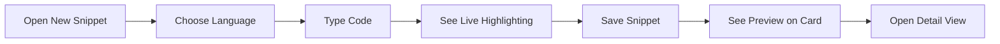

# Supported languages and syntax highlighting

CodeKnit supports four programming and markup languages, with automatic color-coded highlighting that makes your code easier to read at a glance. This guide explains which languages are supported, how highlighting works, and what each color means.

## Supported languages

You can save snippets in any of these four languages:

| Language | What it's for | Example use |
| --- | --- | --- |
| **JavaScript** | Web scripts and utilities | Debounce functions, array helpers |
| **Python** | Scripts and data work | Data transformations, file processing |
| **SQL** | Database queries | Creating tables, filtering records |
| **Markdown** | Formatted text and notes | Documentation, checklists, readme content |

Each language has its own highlighting rules, so the same word may appear in different colors depending on the language you select. When you create a new snippet, **JavaScript** is selected by default, but you can switch to any supported language from the language picker in the snippet form.

### Selecting a language

1. Open the **New Snippet** form by clicking the **New Snippet** button in the sidebar or header.
2. Find the **Language** dropdown.
3. Choose from JavaScript, Python, SQL, or Markdown.
4. Enter your code in the code area, it will be highlighted automatically as you type.

Language badges appear on snippet cards and in the detail view, each with a small colored dot that identifies the language. The dots are color-coded so you can quickly scan your library and spot languages at a glance:

- **JavaScript**, amber dot
- **Python**, green dot
- **SQL**, teal dot
- **Markdown**, blue dot

Figure: Language selection and highlight flow

## How syntax highlighting works

Syntax highlighting is automatic. When you type or paste code into the snippet editor, CodeKnit analyzes the text and assigns a color to each piece based on what it represents, keywords, strings, comments, numbers, and more. You don't need to apply any formatting manually.

This works in two places:

- **While editing**, the editor shows highlighted code behind your cursor as you type, with line numbers on the left.
- **While browsing**, snippet cards and the detail view show a read-only highlighted preview with line numbers.

If a snippet is longer than the preview area on a card, only the first several lines are shown with a small badge that indicates how many more lines exist (for example, **+12 more lines**). Opening the full detail view reveals the entire snippet.

## What the colors mean

Each color in the highlighted code has a specific meaning. The exact color mapping is built into CodeKnit and adapts to the language you selected.

### Comments and documentation
Comments, text that explains code but doesn't run, appear in **italic gray text**. In JavaScript and Python, comments start with`//` or`#`. In Markdown, section headings take on a different role (see below).

### Strings
Text values enclosed in quotes (for example,`"hello"` or`'world'`) appear in **green**. In SQL, string values also use this color. In Markdown, quoted text follows the same rule.

### Keywords
Reserved words that have special meaning in a language, like`function`,`return`,`if`,`else`, and`const` in JavaScript, or`SELECT`,`WHERE`, and`FROM` in SQL, appear in **purple**.

### Functions and links
Function names and called methods appear in **blue**. In Markdown, hyperlinks are also displayed in blue with an underline, matching the function color.

### Numbers
Numeric values such as`42` or`3.14` appear in **amber**, distinguishing them from ordinary text.

### Variables
User-defined variable names appear in **teal**, helping you tell them apart from built-in keywords.

### Markdown-specific highlighting
Markdown gets special treatment because it's about formatting text rather than code. In addition to regular strings and numbers:

- **Headings** appear in **bold purple**, making section titles stand out
- **Bold text** appears in **bold foreground color**
- **Links** appear underlined in blue

### Plain text and punctuation
Any text that doesn't match one of the categories above stays in the default text color. Punctuation (like parentheses, brackets, and commas) appears in muted gray.

## Seeing highlighting across your workspace

The same highlighting appears consistently everywhere:

- **Snippet cards**, a compact preview with line numbers, limited to 6 or 8 lines depending on your layout
- **Detail viewer**, the full snippet with line numbers and scrollable content
- **Editor**, live highlighting as you type or paste

This consistent coloring means you can trust the same visual language whether you're scanning your library, viewing a snippet, or editing it.

## Language-specific examples

### JavaScript
Keywords like`function`,`return`, and`const` appear in purple. Strings appear in green. Function names appear in blue. Comments appear in italic gray.

### Python
Keywords like`def`,`return`, and`import` appear in purple. Strings appear in green. Indented blocks are preserved, and line numbers help you follow the structure.

### SQL
Commands like`SELECT`,`FROM`, and`WHERE` appear in purple keywords. Table names and values are distinguished with the appropriate colors for strings, numbers, and identifiers.

### Markdown
Headings, bold text, and links get their own distinct styling. Code in Markdown uses the same general highlighting rules, but the emphasis is on document structure.

## Related

- [Code Syntax Highlighting and Preview](doc:2cb5bb53-7f7e-418d-a558-bd10548fce84)
- [Snippet Creation and Management](doc:11c8033a-5527-4445-82ef-8f0f7c8c0ce9)
- [Snippets and Metadata](doc:29bc2a99-4091-4a7e-80c7-55aa5fb10d5a)
- [Glossary of Terms](doc:55b5299e-0d01-4346-b26a-aea098f6e5ea)
- [Getting Started with CodeKnit](doc:7f234e87-e4ba-4033-b8f7-2d5423f61808)
