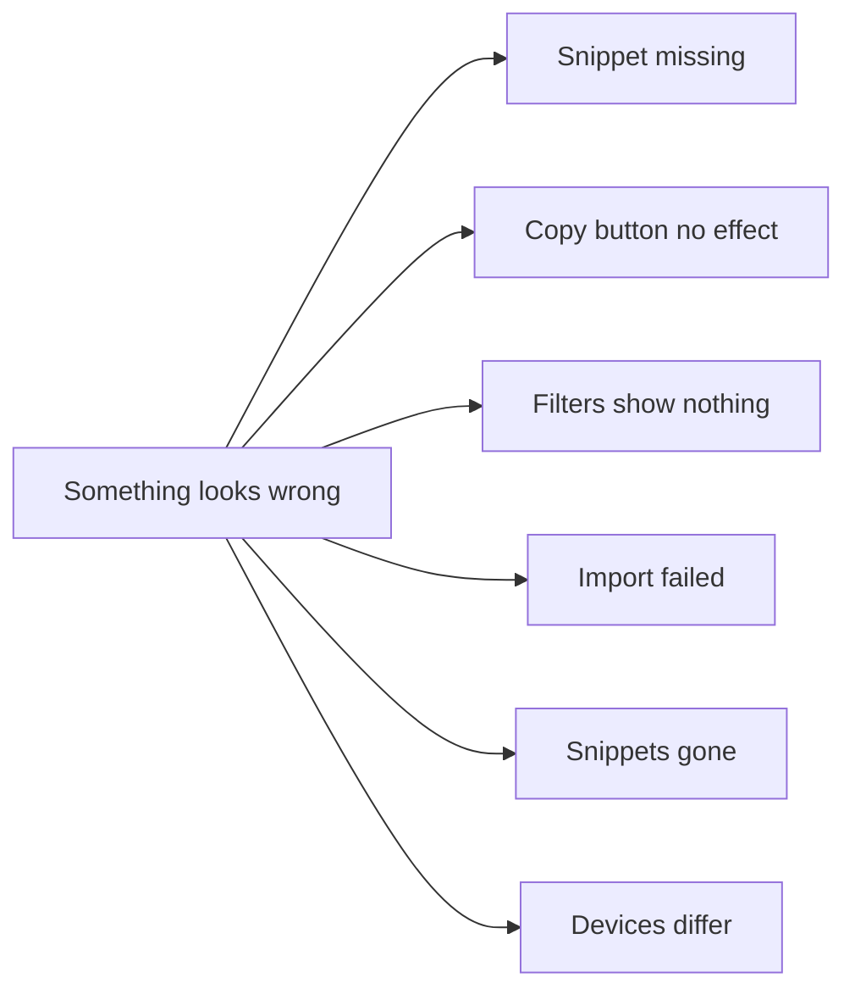
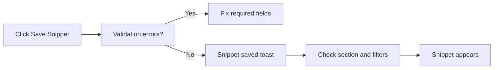
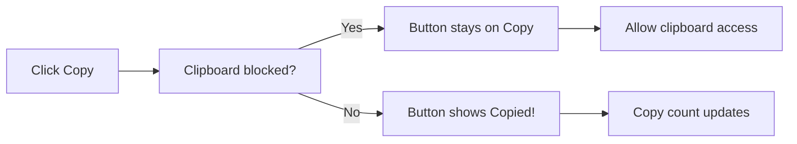
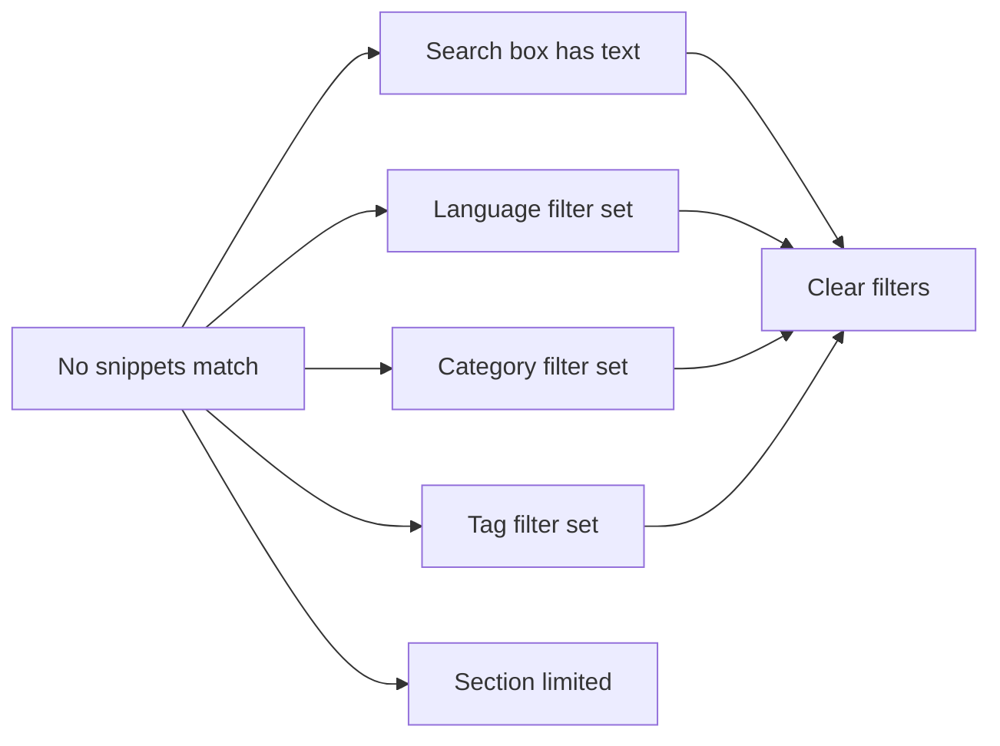
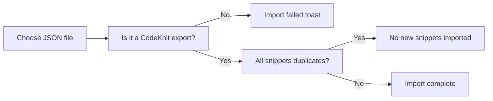
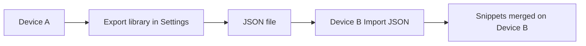

# Troubleshooting CodeKnit

This guide helps you solve the most common CodeKnit issues, from snippets that seem to disappear to import errors and missing data. Start with the quick decision tree to find your issue, then go to the matching section.

Figure: Choose the issue you're seeing

## Snippet doesn't appear after saving

If you saved a snippet but can't find it, the cause is usually a required field, the section you're viewing, or an active filter.

Figure: Save and visibility flow

**What to check**

1. Check the form for red validation messages when you try to save. If you see **Title is required.**, **Code is required.**, or **Enter a category name.**, fill those fields and save again.
2. Look for the confirmation toast. A successful save shows **Snippet saved** or **Snippet updated**.
3. Check which section you're viewing in the sidebar:
   - **Favorites** shows only starred snippets. A new snippet that isn't marked as favorite won't appear here.
   - **Recently Used** shows only snippets you've copied at least once.
   - **Recently Added** shows only the 10 newest snippets. Older snippets still exist but aren't listed here.
4. Check the search box and filter dropdowns. If any filter is active, click **Clear Filters** to reset them.

## Copy button doesn't copy code

Figure: Copy action flow

**What to check**

1. Click **Copy** and watch for the **Copied!** confirmation. If the button stays on **Copy**, the clipboard attempt failed.
2. Make sure CodeKnit is served over a secure connection (HTTPS). Some browsers block clipboard access on non-secure connections.
3. Allow clipboard permission when the browser asks for it.
4. If copying still fails, try the copy button in the snippet detail view as an alternative.
5. The usage count, such as **Copied 1 time**, only increases when a copy succeeds. If you don't see the count increase, the code wasn't copied.

## Filters show no results

If you see the **No snippets match** message, at least one search or filter condition is hiding everything.

Figure: Filter troubleshooting flow

**What to do**

1. Check the search box. It searches snippets, tags, and code, any text here can hide items that don't match.
2. Check the **Language**, **Category**, and **Tag** dropdowns in the filter bar.
3. Check the sidebar for an active language or category. Selected items are highlighted.
4. Click **Clear Filters**. This resets the search, language, category, and tag filters while keeping your sort order.
5. If you're in **Recently Used**, you'll see only snippets that have been copied at least once. Copy any snippet to make it appear.
6. If you're in **Recently Added**, only the 10 newest snippets appear.

## Import fails

Figure: Import validation flow

**What to check**

1. Import only accepts a JSON file that was exported from CodeKnit using **Settings**, then **Export library**.
2. If you see **Import failed**, read the description under the toast for the reason.
3. Duplicate snippets are skipped by design, not treated as an error. If every snippet in the file already exists, you'll see **No new snippets imported** instead of an error.
4. You can select the same file again after correcting it, the file picker resets itself after each attempt.
5. Importing merges new snippets into your library. Existing snippets are never removed.

## Data missing after clearing browser data

CodeKnit keeps your snippets in your current browser. This is why the sidebar says **Saved on this device**.

**What happens**

- Clearing your browser's site data or cache can remove your snippets.
- Using private or incognito browsing stores a separate, temporary library.
- Choosing **Settings**, then **Reset to sample data**, replaces all your snippets with the sample library.

**How to protect and restore your data**

1. Open **Settings** from the sidebar.
2. Click **Export** under **Export library** to download all your snippets as`codeknit-snippets.json`.
3. Store that file somewhere safe, such as a cloud drive or backup folder.
4. To restore, open **Settings** on the same browser or another browser and click **Import JSON**.
5. Choose the exported JSON file. Your snippets are merged back into the library.

## Snippets don't sync across devices

CodeKnit doesn't sync automatically between devices. Each browser and device has its own local library. If your laptop and phone show different snippets, this is expected.

Figure: Manual transfer between devices

**To move snippets manually**

1. On the device with your snippets, open **Settings** and click **Export**.
2. Save the downloaded JSON file somewhere you can access on the other device, such as email, a drive, or a file transfer app.
3. On the other device, open CodeKnit, go to **Settings**, and click **Import JSON**.
4. Select the JSON file. Existing snippets are kept and duplicates are skipped.

## Common messages and what they mean

| Message | What it means | What to do |
|---|---|---|
| **Title is required.** | The save form has no title. | Add a title and save again. |
| **Code is required.** | The save form has no code. | Add code and save again. |
| **Enter a category name.** | The category field is empty. | Choose or enter a category, then save. |
| **Couldn't save the snippet** | The save operation failed. | Check the message details, then try saving again. |
| **Couldn't load your snippets** | CodeKnit couldn't read your library. | Click **Try again** on the error screen. |
| **No snippets match** | A filter or search hides all snippets. | Click **Clear Filters**. |
| **No snippets yet** | You have no saved snippets in this library. | Click **+ New Snippet** to create one. |
| **Import failed** | The selected file isn't a valid CodeKnit JSON export. | Export a fresh JSON file, then import it. |
| **No new snippets imported** | Every snippet in the file already exists. | This is expected; duplicates are skipped. |
| **Exported snippets** | Your library download finished. | Store the JSON file as a backup. |
| **Could not reset library** | The reset operation failed. | Try the **Reset** action again. |

## Related

- [How to Backup and Restore Snippets](doc:190d9a14-796e-4052-9687-79c5c6e2bcb7)
- [How to Search and Filter Snippets](doc:fccf0484-3f06-4f6b-a471-3781538722ff)
- [How to Copy Code and Track Usage](doc:4ac9349d-2c1c-4646-9b5a-8a0f20f1d510)
- [Local Storage and Data Persistence](doc:719ab5d9-7496-49ec-b3c5-b352165f654b)
- [Frequently Asked Questions](doc:f79c6fef-109a-49de-a0a8-c2c527e12743)
