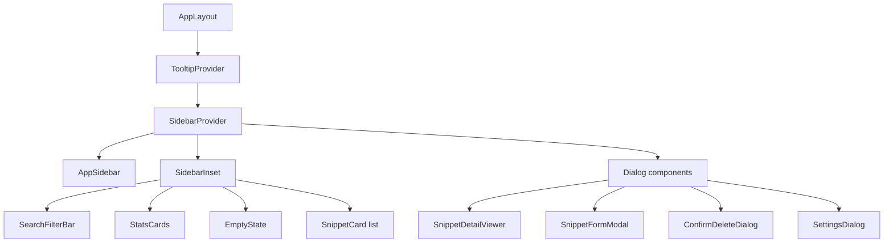
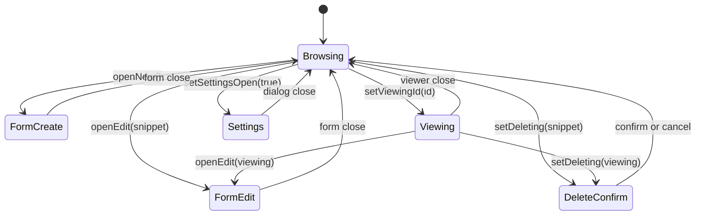
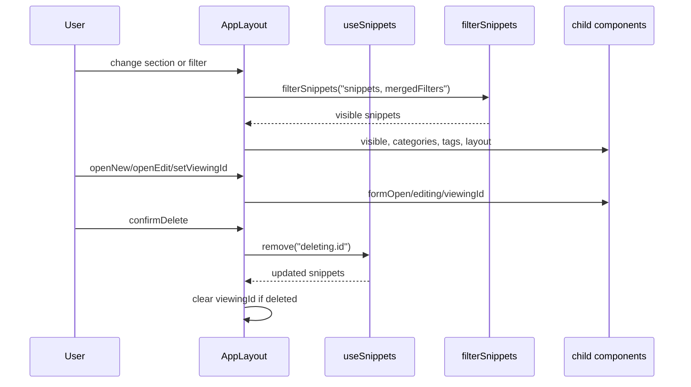

# AppLayout component internals and state management

`AppLayout` is the root state container for CodeKnit. It's defined in`AppLayout.tsx` and owns every piece of cross-cutting UI state: the active sidebar section, snippet filters, grid/list layout, and the open/closed state of all modal dialogs. It reads data from the snippet store through`useSnippets()` and passes filtered results down to presentational components.

## Where AppLayout sits in the tree

`AppLayout` wraps the application shell in`TooltipProvider` and`SidebarProvider`, then renders the sidebar, main content area, and four dialog components as siblings.

Figure: AppLayout component tree



The`Dialog components` node in the diagram is an editorial grouping. In the JSX,`SnippetDetailViewer`,`SnippetFormModal`,`ConfirmDeleteDialog`, and`SettingsDialog` are rendered as direct children of`SidebarProvider`, after`SidebarInset`.

## State owned by AppLayout

All local state is declared with`useState` at the top of`AppLayout`. The snippet collection itself is not local state, it comes from`useSnippets()`.

| State variable | Type | Initial value | Purpose |
| --- | --- | --- | --- |
|`section` |`Section` |`"dashboard"` | Active sidebar section. One of`dashboard`,`all`,`favorites`,`recent`, or`used`. |
|`filters` |`SnippetFilters` |`DEFAULTS` | Query, language, category, tag, and sort filters. |
|`layout` |`"grid" \| "list"` |`"grid"` | Card layout mode. Persisted to`localStorage` under`codeknit.layout`. |
|`formOpen` |`boolean` |`false` | Whether`SnippetFormModal` is open. |
|`editing` |`Snippet \| null` |`null` | Snippet being edited, if any.`null` means create mode. |
|`viewingId` |`string \| null` |`null` | ID of the snippet shown in`SnippetDetailViewer`. |
|`deleting` |`Snippet \| null` |`null` | Snippet pending deletion in`ConfirmDeleteDialog`. |
|`settingsOpen` |`boolean` |`false` | Whether`SettingsDialog` is open. |

The`DEFAULTS` constant is:

```tsx
const DEFAULTS: SnippetFilters = {
  query: "",
  language: "all",
  category: "all",
  tag: "all",
  sort: "recent",
};
```

The section title map is:

```tsx
const TITLES: Record<Section, string> = {
  dashboard: "Your Snippets",
  all: "All Snippets",
  favorites: "Favorites",
  recent: "Recently Added",
  used: "Recently Used",
};
```

## Modal and viewer state machine

The four dialogs are driven by independent`useState` values, not by a single route or enum. Because the state values are independent, some states overlay others. For example, opening the delete confirmation while the detail viewer is open keeps the viewer mounted underneath the confirmation dialog.

Figure: Modal and viewer state transitions



`DeleteConfirm` is shown as a transition out of`Viewing` in the diagram, but in the actual implementation the viewer remains open because`viewingId` is not cleared by`setDeleting(...)`. The delete dialog overlays the viewer until deletion succeeds, at which point`confirmDelete` clears`viewingId` only if the deleted snippet is the one being viewed.

## Store connection

`AppLayout` receives persistence operations from`@/lib/snippets/store`:

```tsx
const {
  snippets,
  status,
  error,
  reload,
  create,
  remove,
  toggleFavorite,
  recordCopied,
} = useSnippets();
```

-`snippets` is the source data array.
-`status` is one of`loading`,`error`, or`ready` and controls the main content render path.
-`error` is shown in the error state.
-`reload` retries loading from the error state.
-`create`,`remove`,`toggleFavorite`, and`recordCopied` are async mutations passed down as callbacks.

## Lifecycle and layout persistence

The only`useEffect` in`AppLayout` reads the persisted layout value on mount:

```tsx
useEffect(() => {
  const saved = localStorage.getItem("codeknit.layout");
  if (saved === "list" || saved === "grid") setLayout(saved);
}, []);
```

`changeLayout` updates state and writes the selection back to`localStorage`:

```tsx
const changeLayout = (l: "grid" | "list") => {
  setLayout(l);
  localStorage.setItem("codeknit.layout", l);
};
```

## Derived values

Three`useMemo` blocks compute derived data, and two inline expressions derive modal-related values.

### Currently viewed snippet

The viewer receives the full`Snippet` object or`null`:

```tsx
const viewing = snippets.find((s) => s.id === viewingId) ?? null;
```

### Categories with counts

Categories are aggregated by counting occurrences of`snippet.category` across all snippets and sorted by name:

```tsx
const categories = useMemo(() => {
  const m = new Map<string, number>();
  snippets.forEach((s) => m.set(s.category, (m.get(s.category) ?? 0) + 1));
  return [...m]
    .map(([name, count]) => ({ name, count }))
    .sort((a, b) => a.name.localeCompare(b.name));
}, [snippets]);
```

### Unique tags

Tags are deduplicated across every snippet and sorted:

```tsx
const tags = useMemo(
  () => [...new Set(snippets.flatMap((s) => s.tags))].sort(),
  [snippets],
);
```

### Visible snippets and section semantics

`visible` is the main filter pipeline. The section changes the filter input before calling`filterSnippets`, then applies section-specific tweaks.

```tsx
const visible = useMemo(() => {
  const f = {
    ...filters,
    favoritesOnly: section === "favorites",
    sort: section === "recent" ? ("recent" as const) : filters.sort,
  };
  const r = filterSnippets(snippets, f);

  if (section === "recent") return r.slice(0, 10);

  if (section === "used") {
    return r
      .filter((s) => Boolean(s.lastCopiedAt))
      .sort((a, b) =>
        (b.lastCopiedAt ?? "").localeCompare(a.lastCopiedAt ?? ""),
      );
  }

  return r;
}, [snippets, filters, section]);
```

Section-specific behavior:

-`favorites` sets`favoritesOnly: true` on the filter object.
-`recent` forces`sort` to`"recent"` and limits the result to 10 items.
-`used` keeps only snippets with a truthy`lastCopiedAt`, then sorts them newest to oldest by`lastCopiedAt`.
- All other sections return the filtered result unchanged.

### Active filter detection

`hasActive` determines whether any non-sort filter is set. It controls the visibility of the **Clear Filters** button and the empty state copy:

```tsx
const hasActive =
  filters.query !== "" ||
  filters.language !== "all" ||
  filters.category !== "all" ||
  filters.tag !== "all";
```

## Event handlers

###`openNew`

Resets edit mode and opens the form in create mode:

```tsx
const openNew = () => {
  setEditing(null);
  setFormOpen(true);
};
```

###`openEdit`

Closes the viewer, sets the snippet to edit, and opens the form:

```tsx
const openEdit = (s: Snippet) => {
  setViewingId(null);
  setEditing(s);
  setFormOpen(true);
};
```

###`fav`

Toggles the favorite flag and surfaces store errors as toasts:

```tsx
const fav = (s: Snippet) =>
  toggleFavorite(s.id).catch((e: Error) => toast.error(e.message));
```

###`duplicate`

Creates a copy of a snippet using`buildDuplicateInput`, then shows a success or error toast:

```tsx
const duplicate = async (s: Snippet) => {
  try {
    const created = await create(
      buildDuplicateInput(s, snippets.map((item) => item.title)),
    );
    toast.success(`Created "${created.title}"`);
  } catch (e) {
    toast.error((e as Error).message);
  }
};
```

`buildDuplicateInput` comes from`@/lib/snippets/duplicate` and receives the source snippet plus all existing titles so it can generate a unique derived title.

###`confirmDelete`

Runs the store`remove` mutation for the snippet in`deleting`, clears`viewingId` when the viewed snippet was deleted, and shows toast feedback:

```tsx
const confirmDelete = async () => {
  if (!deleting) return;
  try {
    await remove(deleting.id);
    if (viewingId === deleting.id) setViewingId(null);
    toast.success("Snippet deleted");
  } catch (e) {
    toast.error((e as Error).message);
  }
  setDeleting(null);
};
```

`setDeleting(null)` runs after the`try/catch`, so the dialog closes on both success and failure.

###`update`

Merges a partial filter update into`filters`:

```tsx
const update = (p: Partial<SnippetFilters>) =>
  setFilters((f) => ({ ...f, ...p }));
```

###`clear`

Resets filters to`DEFAULTS` but preserves the current sort selection:

```tsx
const clear = () => setFilters((f) => ({ ...DEFAULTS, sort: f.sort }));
```

## Data flow through the component

`AppLayout` is the single source of truth for filter state. It computes`visible`,`categories`, and`tags` from the store data, then hands those values to the sidebar, filter bar, and card list.

Figure: Filter and mutation data flow



## Render paths

The main content area switches on the store`status` value.

### Loading

When`status === "loading"`, three`Skeleton` cards of height`h-72` are rendered in a responsive grid:

```tsx
<div className="grid gap-4 md:grid-cols-2 xl:grid-cols-3">
  {[0, 1, 2].map((i) => (
    <Skeleton key={i} className="h-72 rounded-xl" />
  ))}
</div>
```

### Error

When`status === "error"`, an`AlertTriangle` icon, the error message, and a **Try again** button calling`reload` are rendered.

### Ready

When`status === "ready"`, the component renders either:

-`EmptyState`, when`visible.length === 0`, or
- the list of`SnippetCard` components, otherwise.

The card list uses conditional classes for grid or list layout:

```tsx
<div
  className={cn(
    "grid gap-4",
    layout === "grid"
      ? "md:grid-cols-2 xl:grid-cols-3"
      : "grid-cols-1",
  )}
>
```

Each`SnippetCard` receives the snippet plus callbacks that route to`AppLayout` state:

```tsx
<SnippetCard
  key={s.id}
  snippet={s}
  layout={layout}
  onView={() => setViewingId(s.id)}
  onEdit={() => openEdit(s)}
  onDelete={() => setDeleting(s)}
  onDuplicate={() => { void duplicate(s); }}
  onToggleFavorite={() => fav(s)}
  onRecordCopy={() => recordCopied(s.id)}
/>
```

## Dashboard section

When`section === "dashboard"`,`AppLayout` renders a hero heading and a stats row before the normal snippet section:

```tsx
{section === "dashboard" && (
  <section className="space-y-6">
    <div>
      <h1 className="text-2xl font-semibold tracking-tight md:text-3xl">
        Your code, organized.
      </h1>
      <p className="mt-1 text-muted-foreground">
        Save, discover, and reuse your best snippets.
      </p>
    </div>
    {status === "ready" && <StatsCards snippets={snippets} />}
  </section>
)}
```

The dashboard section heading is rendered as an`h2`, while other sections use`h1`:

```tsx
{section === "dashboard"
  ? <h2 className="text-lg font-semibold">{TITLES[section]}</h2>
  : <h1 className="text-2xl font-semibold tracking-tight">{TITLES[section]}</h1>}
```

## Props passed to child components

### AppSidebar

`AppSidebar` receives navigation state, filter selections, category data, and counts:

```tsx
<AppSidebar
  section={section}
  onSection={setSection}
  language={filters.language}
  onLanguage={(l) => update({ language: l })}
  category={filters.category}
  onCategory={(c) => update({ category: c })}
  categories={categories}
  counts={{
    all: snippets.length,
    favorites: snippets.filter((s) => s.isFavorite).length,
    used: snippets.filter((s) => Boolean(s.lastCopiedAt)).length,
  }}
  onNew={openNew}
  onSettings={() => setSettingsOpen(true)}
/>
```

The`counts` object is computed inline. Favorites and used counts come from filtering`snippets` directly, not from the currently visible list.

### SearchFilterBar

`SearchFilterBar` receives the filter state, available category names and tags, layout state, and clear/layout callbacks:

```tsx
<SearchFilterBar
  filters={filters}
  onChange={update}
  categories={categories.map((c) => c.name)}
  tags={tags}
  layout={layout}
  onLayout={changeLayout}
  hasActive={hasActive}
  onClear={clear}
/>
```

### SnippetDetailViewer

The viewer receives the derived`viewing` snippet and callbacks that guard against a null snippet:

```tsx
<SnippetDetailViewer
  snippet={viewing}
  onClose={() => setViewingId(null)}
  onEdit={() => viewing && openEdit(viewing)}
  onDelete={() => viewing && setDeleting(viewing)}
  onDuplicate={() => viewing && void duplicate(viewing)}
  onToggleFavorite={() => viewing && fav(viewing)}
  onRecordCopy={() =>
    viewing
      ? recordCopied(viewing.id).catch((e: Error) => {
          toast.error(e.message);
        })
      : Promise.resolve()
  }
/>
```

### SnippetFormModal

The form receives its open state, an open-change setter, the snippet being edited or`null`, and the current category names:

```tsx
<SnippetFormModal
  open={formOpen}
  onOpenChange={setFormOpen}
  editing={editing}
  categories={categories.map((c) => c.name)}
/>
```

### ConfirmDeleteDialog

The delete dialog is open whenever`deleting` is non-null. It receives the pending snippet title and closes by clearing`deleting`:

```tsx
<ConfirmDeleteDialog
  open={!!deleting}
  title={deleting?.title}
  onOpenChange={(o) => !o && setDeleting(null)}
  onConfirm={confirmDelete}
/>
```

### SettingsDialog

Settings state is a simple boolean:

```tsx
<SettingsDialog open={settingsOpen} onOpenChange={setSettingsOpen} />
```

## Related

- [CodeKnit Application Architecture and Component Structure](doc:65126544-0263-482c-8d4f-774eac140854)
- [Layout Toggle and View Modes](doc:b604b18f-81fa-471b-a20e-002df8ef85c2)
- [How to Create a New Snippet](doc:8bdfc7c1-2c72-46b6-94e1-b33ec10b97f6)
- [How to Edit an Existing Snippet](doc:959dc4fd-3e38-43a7-919d-524764220f84)
- [How to Delete a Snippet Permanently](doc:51b2df7f-976b-4f26-9b14-8dde23bb0c32)