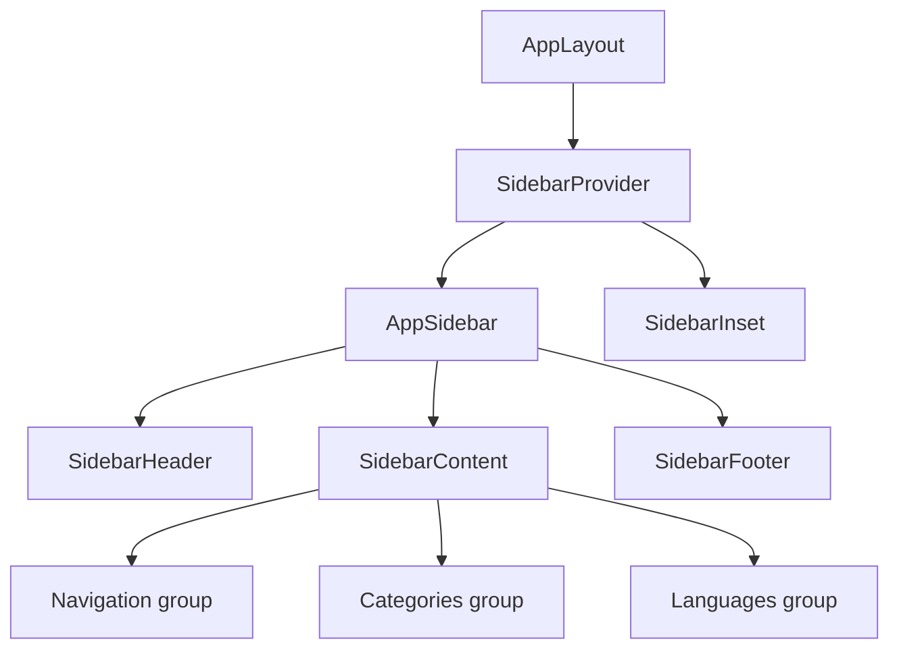
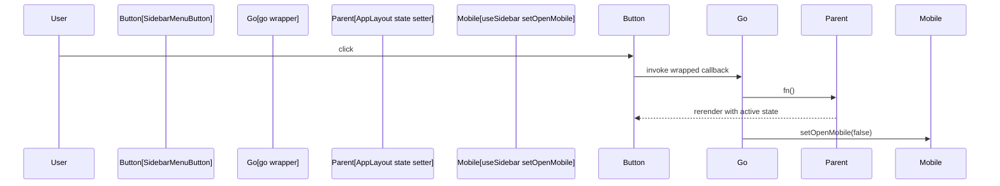

# AppSidebar component navigation and section filtering

`AppSidebar` (`src/components/AppSidebar.tsx`) is the primary navigation surface in CodeKnit. It renders five section links, a category list with per-category counts, and a language list. The component is controlled: its parent,`AppLayout` (`src/components/AppLayout.tsx`), owns`section`,`language`, and`category` state and passes down current values plus callbacks.

## Component structure

`AppSidebar` builds on the shadcn/ui sidebar primitives imported from`@/components/ui/sidebar`. It wraps its content in`Sidebar` and uses`SidebarHeader`,`SidebarContent`,`SidebarFooter`,`SidebarGroup`,`SidebarGroupContent`,`SidebarGroupLabel`,`SidebarMenu`,`SidebarMenuBadge`,`SidebarMenuButton`, and`SidebarMenuItem`.

Figure: AppSidebar composition within the layout



The header renders the CodeKnit brand mark with a`Code2` icon. The footer renders a **New Snippet** button and a workspace card with a **Settings** icon button.

## Props interface

The component signature is:

```ts
export type Section = "dashboard" | "all" | "favorites" | "recent" | "used";

interface Props {
  section: Section;
  onSection: (s: Section) => void;
  language: Language | "all";
  onLanguage: (l: Language | "all") => void;
  category: string;
  onCategory: (c: string) => void;
  categories: { name: string; count: number }[];
  counts: { all: number; favorites: number; used: number };
  onNew: () => void;
  onSettings: () => void;
}
```

| Prop | Type | Purpose |
| --- | --- | --- |
|`section` |`Section` | Currently selected section. |
|`onSection` |`(s: Section) => void` | Sets the active section. |
|`language` |`Language \| "all"` | Current language filter.`"all"` means no language filter. |
|`onLanguage` |`(l: Language \| "all") => void` | Sets the language filter. |
|`category` |`string` | Current category filter. The string`"all"` is the no-filter sentinel. |
|`onCategory` |`(c: string) => void` | Sets the category filter. |
|`categories` |`{ name: string; count: number }[]` | Category names with snippet counts. |
|`counts` |`{ all: number; favorites: number; used: number }` | Badge totals for section menu items. |
|`onNew` |`() => void` | Opens the new-snippet form modal. |
|`onSettings` |`() => void` | Opens the settings dialog. |

## Section navigation

The navigation list is built inside`AppSidebar`:

```ts
const nav = [
  { id: "dashboard" as const, label: "Dashboard", icon: LayoutDashboard },
  { id: "all" as const, label: "All Snippets", icon: Library, count: p.counts.all },
  { id: "favorites" as const, label: "Favorites", icon: Star, count: p.counts.favorites },
  { id: "recent" as const, label: "Recently Added", icon: Clock },
  { id: "used" as const, label: "Recently Used", icon: History, count: p.counts.used },
];
```

Each item is rendered as a`SidebarMenuItem` containing a`SidebarMenuButton`. The`isActive` flag is set with strict equality:

```tsx
<SidebarMenuButton isActive={p.section === n.id} onClick={go(() => p.onSection(n.id))}>
```

Only`all`,`favorites`, and`used` define a`count`. The badge is rendered conditionally:

```tsx
{n.count !== undefined && <SidebarMenuBadge>{n.count}</SidebarMenuBadge>}
```

### Section semantics

`AppLayout` passes section-specific counts and computes the visible snippet list. The counts come from the active snippet collection:

```tsx
counts={{
  all: snippets.length,
  favorites: snippets.filter((s) => s.isFavorite).length,
  used: snippets.filter((s) => Boolean(s.lastCopiedAt)).length,
}}
```

The section value drives how`visible` snippets are produced in`AppLayout`:

```ts
const visible = useMemo(() => {
  const f = {
    ...filters,
    favoritesOnly: section === "favorites",
    sort: section === "recent" ? "recent" as const : filters.sort,
  };
  const r = filterSnippets(snippets, f);
  if (section === "recent") return r.slice(0, 10);
  if (section === "used") {
    return r
      .filter((s) => Boolean(s.lastCopiedAt))
      .sort((a, b) => (b.lastCopiedAt ?? "").localeCompare(a.lastCopiedAt ?? ""));
  }
  return r;
}, [snippets, filters, section]);
```

This means:

| Section | Filtering and sorting |
| --- | --- |
|`dashboard` | Default section. Applies the user's regular filters with default sort behavior. |
|`all` | Applies the user's regular filters. No section-specific overrides. |
|`favorites` | Forces`favoritesOnly: true` in the call to`filterSnippets`. |
|`recent` | Forces`sort: "recent"`, then returns the first 10 results with`r.slice(0, 10)`. |
|`used` | Filters to snippets with a truthy`lastCopiedAt`, then sorts by`lastCopiedAt` descending. |

> [!NOTE]
> The`used` section still honors the active search, language, category, and tag filters before applying its copy-time filter.

## Category and language filtering

Categories are rendered under the **Categories** group label. The parent computes category counts from all snippets:

```ts
const categories = useMemo(() => {
  const m = new Map<string, number>();
  snippets.forEach((s) => m.set(s.category, (m.get(s.category) ?? 0) + 1));
  return [...m].map(([name, count]) => ({ name, count }))
    .sort((a, b) => a.name.localeCompare(b.name));
}, [snippets]);
```

Each category button uses a`Folder` icon and a count badge:

```tsx
{p.categories.map((c) => (
  <SidebarMenuItem key={c.name}>
    <SidebarMenuButton
      isActive={p.category === c.name}
      onClick={go(() => p.onCategory(p.category === c.name ? "all" : c.name))}
    >
      <Folder /><span>{c.name}</span>
    </SidebarMenuButton>
    <SidebarMenuBadge>{c.count}</SidebarMenuBadge>
  </SidebarMenuItem>
))}
```

Language buttons are rendered from the`LANGUAGES` constant imported from`@/lib/snippets/types`. Each language has a colored dot from`LANG_DOT` in`src/components/LanguageBadge.tsx`:

```ts
export const LANG_DOT: Record<Language, string> = {
  JavaScript: "bg-syn-number",
  Python: "bg-syn-function",
  SQL: "bg-syn-string",
  Markdown: "bg-syn-keyword",
};
```

The language button markup is:

```tsx
{LANGUAGES.map((l) => (
  <SidebarMenuItem key={l}>
    <SidebarMenuButton
      isActive={p.language === l}
      onClick={go(() => p.onLanguage(p.language === l ? "all" : l))}
    >
      <span className={cn("ml-1 h-2 w-2 rounded-full", LANG_DOT[l])} />
      <span>{l}</span>
    </SidebarMenuButton>
  </SidebarMenuItem>
))}
```

Both category and language buttons use a toggle pattern. Clicking the currently active value passes`"all"` back to the parent, clearing that filter. For example,`onCategory(p.category === c.name ? "all" : c.name)`.

## The`go()` handler and mobile close behavior

`AppSidebar` reads`setOpenMobile` from the`useSidebar` hook:

```ts
const { setOpenMobile } = useSidebar();
const go = (fn: () => void) => () => { fn(); setOpenMobile(false); };
```

`go` wraps every mutating callback in the sidebar: section selection, category selection, language selection, **New Snippet**, and **Settings**. It runs the callback first, then closes the mobile sidebar drawer. On desktop, calling`setOpenMobile(false)` is harmless.

Figure: Sidebar navigation click flow



This is why navigation works as expected inside the mobile drawer: state changes first, then the drawer closes.

## Integration with AppLayout

`AppLayout` renders`AppSidebar` inside`SidebarProvider`:

```tsx
<SidebarProvider>
  <AppSidebar
    section={section} onSection={setSection}
    language={filters.language} onLanguage={(l) => update({ language: l })}
    category={filters.category} onCategory={(c) => update({ category: c })}
    categories={categories}
    counts={{
      all: snippets.length,
      favorites: snippets.filter((s) => s.isFavorite).length,
      used: snippets.filter((s) => Boolean(s.lastCopiedAt)).length,
    }}
    onNew={openNew} onSettings={() => setSettingsOpen(true)}
  />
  <SidebarInset className="min-w-0">
    {/* main header and snippet list */}
  </SidebarInset>
</SidebarProvider>
```

The main header renders`SidebarTrigger` with`aria-label="Toggle navigation"`:

```tsx
<SidebarTrigger aria-label="Toggle navigation" />
```

`SidebarTrigger` opens and closes the mobile sidebar. The`go()` handler closes it after each navigation action.

## Responsive behavior

Mobile responsiveness comes from the`SidebarProvider` /`Sidebar` primitives. The provider manages open state;`SidebarTrigger` toggles the drawer.`AppSidebar` does not implement responsive CSS itself. The only mobile-specific logic in the component is`setOpenMobile(false)` inside`go`.

Key responsive points:

- The provider wraps both`AppSidebar` and`SidebarInset`.
-`SidebarTrigger` is placed in the sticky main header.
- Every sidebar action calls`go`, which closes the mobile overlay after invocation.
- In the main header, the full **New Snippet** button is hidden on small screens with`hidden sm:inline-flex`; the icon-only **New Snippet** button appears on small screens with`sm:hidden`.
- In the sidebar footer, the **New Snippet** button uses`className="w-full"` so it fills the sidebar width.

## Related

- [CodeKnit Codebase Architecture and Component Structure](doc:63985ccd-5af9-463e-8ee4-58b4c60d6ed9)
- [Search, Filter, and Organization](doc:b7aa3d4d-2368-4ec0-aade-8145a9c56850)
- [Favorites and Recent Snippets](doc:15f8dec3-b569-4bb6-bd0e-323e2ba5bb34)
- [Understanding the Snippet Library Navigation](doc:e0118183-593a-457b-a0f1-1611dfdbc959)