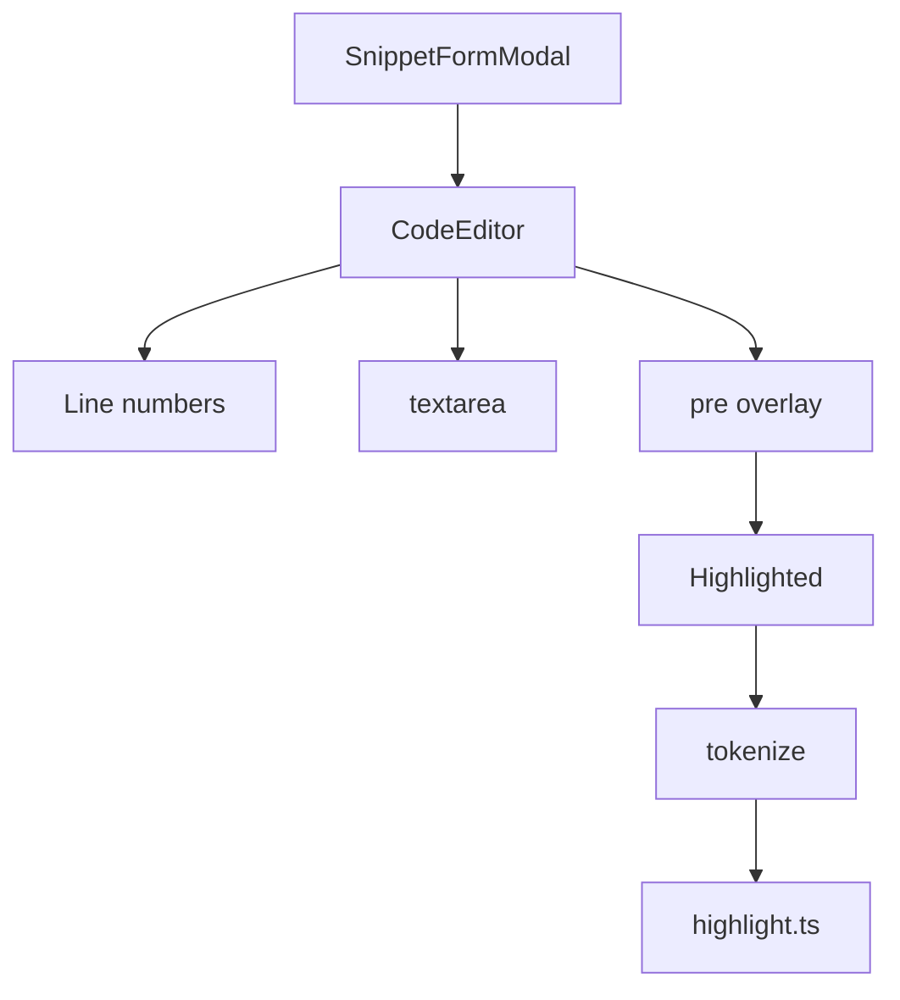
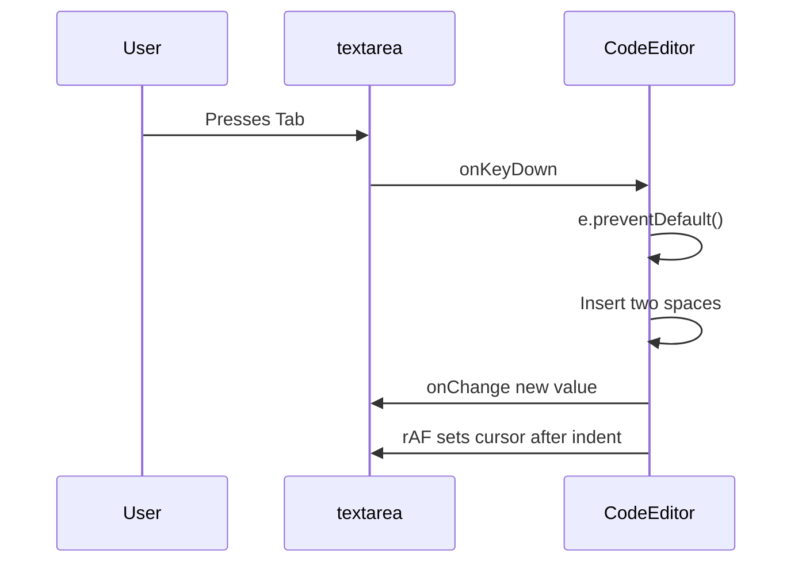

# CodeEditor component with syntax highlighting and tab key handling

The`CodeEditor` component in`CodeEditor.tsx` is a controlled code input used by`SnippetFormModal` to create and edit snippets. It combines a native`<textarea>` with an overlaid, syntax-highlighted`<pre>` layer, adds line numbers, and intercepts the Tab key to insert indentation.

The editor is fully controlled:`value` and`onChange` are owned by the parent, while`CodeEditor` only renders and forwards input events. The form in`SnippetFormModal.tsx` uses it as follows:

```tsx
<CodeEditor
  id="sn-code"
  value={form.code}
  onChange={(v) => set("code", v)}
  language={form.language}
  invalid={!!errors.code}
/>
```

## Component signature

`CodeEditor` accepts five props defined in`CodeEditor.tsx`:

```tsx
interface Props {
  id: string;
  value: string;
  onChange: (v: string) => void;
  language: Language;
  invalid?: boolean;
}
```

| Prop | Type | Required | Behavior |
| --- | --- | --- | --- |
|`id` |`string` | Yes | Passed to the underlying`<textarea>` so a`<Label htmlFor="sn-code">` can associate with it |
|`value` |`string` | Yes | Controlled code text; also drives highlighting and line-number count |
|`onChange` |`(v: string) => void` | Yes | Called with the new text after any edit, including Tab insertion |
|`language` |`Language` | Yes | Passed to`tokenize` through`Highlighted` to select the syntax rules |
|`invalid` |`boolean` | No | When true, adds the`border-destructive` class and sets`aria-invalid` on the textarea |

`Language` is imported from`@/lib/snippets/types` and represents the supported snippet languages, for example`"JavaScript"`,`"Python"`,`"SQL"`, and`"Markdown"`.

## Rendering architecture

`CodeEditor` uses the overlay technique: a transparent`<textarea>` is stacked on top of a syntax-highlighted`<pre>` element inside the same grid cell. Both layers share the same font, padding, and white-space settings, so the highlighted text visually aligns with the editable text.

Figure: CodeEditor rendering architecture



The outer wrapper applies the shared editor chrome:

```tsx
<div
  className={cn(
    "max-h-80 overflow-auto rounded-lg border bg-code-bg font-mono text-[13px] leading-6 focus-within:ring-2 focus-within:ring-ring",
    invalid && "border-destructive",
  )}
>
```

The wrapper is the scroll container. It uses`max-h-80` and`overflow-auto` so long code scrolls within a fixed-height editor, and`focus-within:ring-2 focus-within:ring-ring` draws a focus ring whenever the textarea inside has focus.

Inside the wrapper, a flex row places the line-number gutter next to the editor area:

```tsx
<div className="flex min-w-full w-max">
  <div aria-hidden className="sticky left-0 select-none border-r bg-code-bg px-3 py-3 text-right text-muted-foreground/60">
    {Array.from({ length: lines }, (_, i) => <div key={i}>{i + 1}</div>)}
  </div>
  <div className="relative grid flex-1">
    <pre aria-hidden className="col-start-1 row-start-1 whitespace-pre px-4 py-3 text-foreground/90">
      <Highlighted code={value + "\n"} language={language} />
    </pre>
    <textarea
      ref={ref}
      id={id}
      value={value}
      onChange={(e) => onChange(e.target.value)}
      onKeyDown={onKeyDown}
      spellCheck={false}
      wrap="off"
      aria-invalid={invalid}
      placeholder="// Paste or write your code here"
      className="col-start-1 row-start-1 h-full w-full resize-none overflow-hidden whitespace-pre bg-transparent px-4 py-3 text-transparent caret-foreground outline-none placeholder:text-muted-foreground/50 selection:bg-primary/30"
    />
  </div>
</div>
```

The grid area uses`relative grid` with both`<pre>` and`<textarea>` assigned`col-start-1 row-start-1`, which stacks them in the same grid cell. The textarea sits on top and is interactive; the`<pre>` is`aria-hidden` and renders only visual syntax highlighting.

To keep the layers aligned, both share`whitespace-pre` and`px-4 py-3`. The textarea also sets:

-`text-transparent` so the typed characters are invisible, letting the highlighted`<pre>` show through
-`caret-foreground` so the text cursor remains visible
-`selection:bg-primary/30` so selected text shows a visible overlay
-`resize-none` to prevent browser resizing
-`overflow-hidden` because the outer wrapper owns scrolling
-`wrap="off"` and`spellCheck={false}` to disable wrapping and browser spell checking

The component declares`const ref = useRef<HTMLTextAreaElement>(null);` and attaches it with`ref={ref}`, but the Tab handler reads cursor and selection values from`e.currentTarget` rather than from the ref.

## Line number rendering

`CodeEditor` computes the number of line-number rows from the controlled value and always renders at least 8 rows:

```tsx
const lines = Math.max(value.split("\n").length, 8);
```

The gutter renders one`<div>` per line, starting at 1:

```tsx
{Array.from({ length: lines }, (_, i) => <div key={i}>{i + 1}</div>)}
```

The gutter is marked`aria-hidden`, is non-selectable (`select-none`), and uses`sticky left-0` so line numbers remain visible during horizontal scrolling. Because there is no cap on`lines`, a long snippet produces a long gutter that scrolls with the editor.

## Tab key handling and cursor management

`CodeEditor` intercepts the Tab key and inserts two literal spaces instead of moving focus. Shift+Tab is deliberately not intercepted, so it retains the browser's default focus navigation behavior.

Figure: Tab key indentation flow



The handler is defined as:

```tsx
const onKeyDown = (e: KeyboardEvent<HTMLTextAreaElement>) => {
  if (e.key === "Tab" && !e.shiftKey) {
    e.preventDefault();
    const el = e.currentTarget;
    const { selectionStart: s, selectionEnd: end } = el;
    onChange(value.slice(0, s) + "  " + value.slice(end));
    requestAnimationFrame(() => {
      el.selectionStart = el.selectionEnd = s + 2;
    });
  }
};
```

The handler performs these steps:

1. **Guard on Tab**: It only acts when`e.key === "Tab"` and Shift is not held.
2. **Prevent browser default**:`e.preventDefault()` stops the browser from moving focus to the next control.
3. **Read the current selection**:`selectionStart` (`s`) and`selectionEnd` (`end`) are read from`e.currentTarget`.
4. **Build the new value**:`value.slice(0, s) + "  " + value.slice(end)` replaces any selected range with two spaces. When there is no selection,`s === end`, so this inserts two spaces at the cursor.
5. **Notify the parent**:`onChange` is called with the updated string.
6. **Restore the cursor**: a`requestAnimationFrame` callback sets both`selectionStart` and`selectionEnd` to`s + 2`, placing the caret immediately after the inserted spaces.

The`requestAnimationFrame` deferral is important because`value` is controlled: React must commit the new value to the DOM before the textarea's selection can be set reliably. The handler therefore captures the original cursor position before calling`onChange` and restores it after the next repaint.

This implementation only handles forward indentation. There is no Shift+Tab outdent handler in the component.

## Syntax highlighting integration

The highlighted layer is rendered by the`Highlighted` component imported from`./CodePreview`:

```tsx
<Highlighted code={value + "\n"} language={language} />
```

`Highlighted` calls the in-house tokenizer inside a`useMemo`:

```tsx
const tokens = useMemo(() => tokenize(code, language), [code, language]);
```

It then maps each token to a Tailwind color class. The`value + "\n"` argument ensures the overlay includes a trailing blank line so the final line of code is rendered in the`<pre>` at the correct vertical position.

The tokenizer itself lives in`src/lib/snippets/highlight.ts` and returns typed tokens such as`comment`,`string`,`keyword`,`function`,`number`,`variable`,`heading`,`bold`,`link`,`punct`, and`plain`.

For details on the tokenizer and the highlight rendering, see [Syntax highlighter (tokenizer) API](doc:63d0bbe1-be5e-4ebb-8235-69713ce63ce6) and [CodePreview component and highlighted text rendering](doc:cd3f8be2-2446-4b51-a0a8-72d7008af212).

## Form integration

`SnippetFormModal.tsx` owns the snippet form state and passes`form.code` into`CodeEditor` through the`value` prop. Changes flow back through`onChange`, which calls`set("code", v)`. The language prop follows`form.language`, so the highlighting switches immediately when the user changes the form's **Language** selector.

Validation is also wired through the`invalid` prop:

```tsx
<CodeEditor
  id="sn-code"
  value={form.code}
  onChange={(v) => set("code", v)}
  language={form.language}
  invalid={!!errors.code}
/>
```

When`errors.code` is set by form validation,`invalid` becomes true, the wrapper gets`border-destructive`, and the textarea gets`aria-invalid={true}` for assistive technology.

## Related pages

- [CodePreview component and highlighted text rendering](doc:cd3f8be2-2446-4b51-a0a8-72d7008af212)
- [Syntax highlighter (tokenizer) API](doc:63d0bbe1-be5e-4ebb-8235-69713ce63ce6)
- [How to use keyboard shortcuts and Tab key for code indentation](doc:3df33844-5dee-4595-9651-1ed8dfd37c0f)
- [Syntax highlighting and code preview in CodeKnit](doc:b67c41f8-ec7f-48e2-ac63-9599d5440993)
- [How to edit an existing code or Markdown snippet](doc:56ffdde4-4a2f-4b13-9cc2-54423f7c58f0)