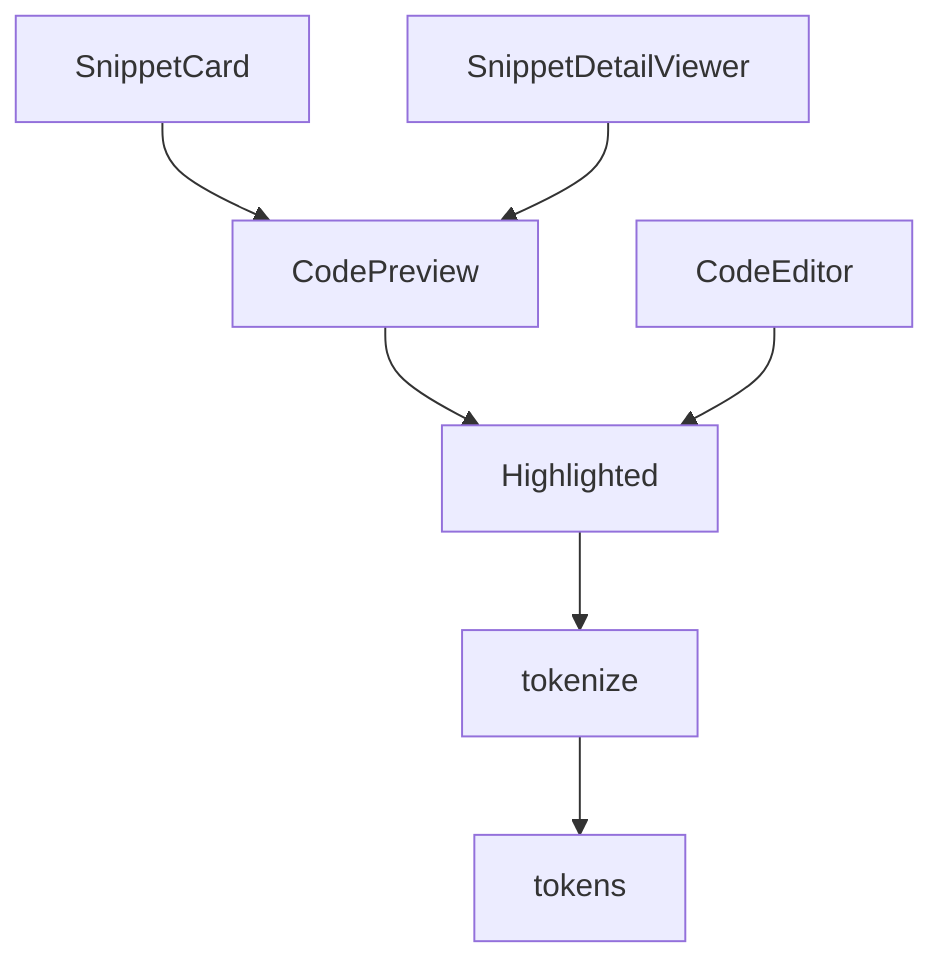
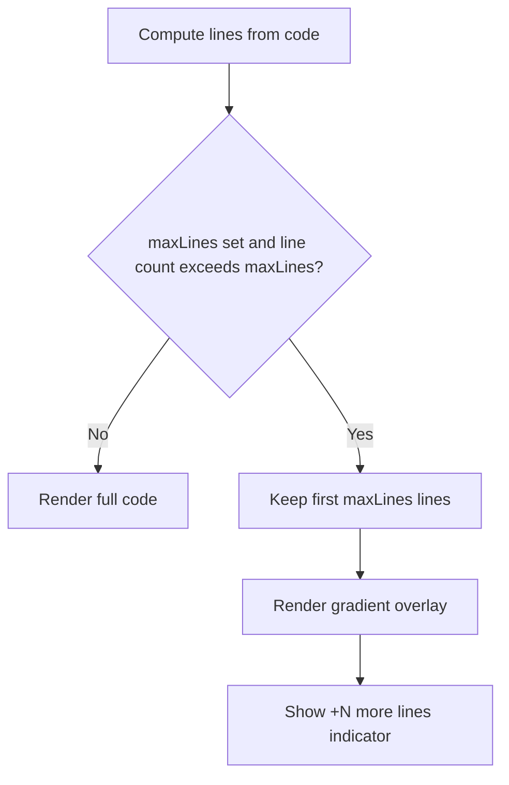

# CodePreview component and highlighted text rendering

`CodePreview` is the presentational component that renders syntax-highlighted code fragments throughout CodeKnit. It is defined in`src/components/CodePreview.tsx` and exposes two exports:

-`CodePreview` renders a full code block with optional line numbers, truncation, and overlay.
-`Highlighted` renders tokenized code as React elements.

`CodePreview` is used by`SnippetCard` and`SnippetDetailViewer` to display snippet code.`CodeEditor` uses`Highlighted` directly because its own textarea overlays the highlighted output.

## Component relationships

`CodePreview` composes the tokenized output from`Highlighted` with a line-number column and an optional maximum-lines overlay.`CodeEditor` uses`Highlighted` separately but not`CodePreview` itself.

Figure: CodePreview component graph



## Props

The`CodePreview` component accepts the following props in`src/components/CodePreview.tsx`.

```tsx
interface Props {
  code: string;
  language: Language;
  maxLines?: number;
  showLineNumbers?: boolean;
  className?: string;
}
```

| Prop | Type | Default | Purpose |
| --- | --- | --- | --- |
|`code` |`string` | required | The code or Markdown text to display |
|`language` |`Language` | required | Used by the tokenizer to apply language-specific rules |
|`maxLines` |`number` |`undefined` | Limits visible lines and enables truncation overlay |
|`showLineNumbers` |`boolean` |`true` | Toggles the line-number column |
|`className` |`string` |`undefined` | Added to the root container via`cn` |

`Language` is imported from`src/lib/snippets/types`. The supported values are`JavaScript`,`Python`,`SQL`, and`Markdown`.

## Highlighted subcomponent

`Highlighted` is a small functional component. It memoizes tokenization so it only reruns when`code` or`language` changes.

```tsx
export function Highlighted({ code, language }: { code: string; language: Language }) {
  const tokens = useMemo(() => tokenize(code, language), [code, language]);
  return (
    <>
      {tokens.map((t, i) =>
        t.type === "plain" ? t.value : <span key={i} className={CLASS[t.type]}>{t.value}</span>,
      )}
    </>
  );
}
```

The tokenizer is imported from`src/lib/snippets/highlight`:

```ts
import { tokenize, type TokenType } from "@/lib/snippets/highlight";
```

`tokenize` returns tokens whose`type` values map to class names in the`CLASS` record.

### Token class map

```tsx
const CLASS: Record<TokenType, string> = {
  comment: "text-syn-comment italic",
  string: "text-syn-string",
  keyword: "text-syn-keyword",
  function: "text-syn-function",
  number: "text-syn-number",
  variable: "text-syn-variable",
  heading: "text-syn-heading font-semibold",
  bold: "text-foreground font-semibold",
  link: "text-syn-function underline",
  punct: "text-muted-foreground",
  plain: "",
};
```

| Token type | Rendered class or style |
| --- | --- |
|`plain` | No span wrapper; raw text is returned directly |
|`comment` |`text-syn-comment italic` |
|`string` |`text-syn-string` |
|`keyword` |`text-syn-keyword` |
|`function` |`text-syn-function` |
|`number` |`text-syn-number` |
|`variable` |`text-syn-variable` |
|`heading` |`text-syn-heading font-semibold` |
|`bold` |`text-foreground font-semibold` |
|`link` |`text-syn-function underline` |
|`punct` |`text-muted-foreground` |

Plain tokens are returned as plain text, not as a React element. All non-plain tokens are rendered inside a`<span>` with the corresponding class.

For full tokenizer behavior, refer to [Tokenizer API for Syntax Highlighting](doc:79aeb875-0e59-46cf-a0a9-86808f84d4d3).

## CodePreview rendering logic

`CodePreview` computes the amount of code to show before rendering.

```tsx
const lines = code.split("\n");
const truncated = maxLines !== undefined && lines.length > maxLines;
const shown = truncated ? lines.slice(0, maxLines).join("\n") : code;
const count = truncated ? maxLines! : lines.length;
```

-`lines` is the full code split on newline characters.
-`truncated` is`true` only when`maxLines` is provided and the actual line count exceeds it.
-`shown` is the full code when not truncated, or the first`maxLines` lines joined again with newlines.
-`count` is the number of line-number cells to render.

## Line number rendering

Line numbers render only when`showLineNumbers` is`true`.

```tsx
{showLineNumbers && (
  <div aria-hidden className="select-none border-r px-3 py-3 text-right text-muted-foreground/60">
    {Array.from({ length: count }, (_, i) => <div key={i}>{i + 1}</div>)}
  </div>
)}
```

The line-number column is:

- marked`aria-hidden` because it is visual only
-`select-none` so users cannot select the numbers
- rendered from`1` to`count`, where`count` follows truncation logic
- styled with`border-r`,`px-3`,`py-3`,`text-right`, and`text-muted-foreground/60`

`CodeEditor` has its own separate line-number column. In`CodeEditor.tsx`, the column uses`sticky left-0` so it remains visible during horizontal scrolling.`CodePreview` does not make the line numbers sticky.

## Truncation and gradient overlay

When`truncated` is`true`,`CodePreview` adds a bottom overlay announcing how many lines are hidden.

```tsx
{truncated && (
  <div className="pointer-events-none absolute inset-x-0 bottom-0 flex h-12 items-end justify-center bg-gradient-to-t from-code-bg to-transparent pb-1.5">
    <span className="rounded-full border bg-card px-2 py-0.5 text-[11px] text-muted-foreground">
      +{lines.length - maxLines!} more lines
    </span>
  </div>
)}
```

The overlay:

- is absolutely positioned across the bottom of the code block
- has`pointer-events-none` so it never blocks interaction
- uses`bg-gradient-to-t from-code-bg to-transparent` to fade the code out toward the bottom
- displays the message`+N more lines`, where`N = lines.length - maxLines`

Figure: CodePreview truncation flow



## Container and text styling

The root element combines the base classes with any caller-provided`className`.

```tsx
<div className={cn("relative overflow-hidden rounded-lg border bg-code-bg", className)}>
```

The code area uses a monospace font,`12.5px` text, and`leading-6`.

```tsx
<div className="flex overflow-x-auto font-mono text-[12.5px] leading-6">
```

The actual code is placed in a`<pre>` block with preserved whitespace.

```tsx
<pre className="flex-1 whitespace-pre px-4 py-3 text-foreground/90">
  <code><Highlighted code={shown} language={language} /></code>
</pre>
```

Key style decisions:

-`overflow-x-auto` on the inner flex row enables horizontal scrolling for long lines.
-`whitespace-pre` preserves newlines and indentation.
-`bg-code-bg` is used on the root container and again in the gradient overlay.
-`text-foreground/90` is the default code text color; token classes override specific token colors.

## Callers and usage

### SnippetCard

`SnippetCard` renders`CodePreview` for both grid and list layouts.

```tsx
<CodePreview
  code={s.code}
  language={s.language}
  maxLines={list ? 6 : 8}
  className="min-w-0 flex-1"
/>
```

-`maxLines` is`8` in grid layout and`6` in list layout.
- The`className` value`min-w-0 flex-1` allows the preview to shrink and use remaining card space.

The full card implementation is in`src/components/SnippetCard.tsx`.

### SnippetDetailViewer

`SnippetDetailViewer` renders the full snippet without truncation.

```tsx
<CodePreview
  code={s.code}
  language={s.language}
  className="max-h-[50vh] overflow-auto"
/>
```

Here`maxLines` is omitted, so`truncated` is always`false` and the gradient overlay never renders. The caller instead limits the height through`max-h-[50vh]` and allows scrolling.

See [SnippetDetailViewer Modal Component Internals](doc:0c144c12-b5da-44d7-acd8-683054ca2e31) for the modal details.

### CodeEditor

`CodeEditor` does not use`CodePreview`. It uses`Highlighted` directly because the editor needs an invisible textarea layered over the highlighted output.

```tsx
<pre aria-hidden className="col-start-1 row-start-1 whitespace-pre px-4 py-3 text-foreground/90">
  <Highlighted code={value + "\n"} language={language} />
</pre>
```

The extra newline in`value + "\n"` prevents the last line from being visually lost when the textarea is empty or the final line has no newline.

See [Code Editor and Syntax Highlighting Internals](doc:c16ba8ac-fc97-4df5-a8dd-2f8cbe2e23d8) for the full editor rendering and Tab key behavior.

## Where to find the code

| File | Contents |
| --- | --- |
|`src/components/CodePreview.tsx` |`CodePreview`,`Highlighted`,`CLASS` token style map |
|`src/components/CodeEditor.tsx` | Direct use of`Highlighted` inside the editor overlay |
|`src/components/SnippetCard.tsx` | Uses`CodePreview` with grid/list max-line limits |
|`src/components/SnippetDetailViewer.tsx` | Uses`CodePreview` without truncation |

## Related documentation

- [Tokenizer API for Syntax Highlighting](doc:79aeb875-0e59-46cf-a0a9-86808f84d4d3)
- [Code Editor and Syntax Highlighting Internals](doc:c16ba8ac-fc97-4df5-a8dd-2f8cbe2e23d8)
- [SnippetDetailViewer Modal Component Internals](doc:0c144c12-b5da-44d7-acd8-683054ca2e31)
- [Syntax Highlighting and Code Preview in CodeKnit](doc:b67c41f8-ec7f-48e2-ac63-9599d5440993)
- [Code Syntax Highlighting for All Supported Languages](doc:77ced4d6-145b-408d-a100-08ef75a34994)