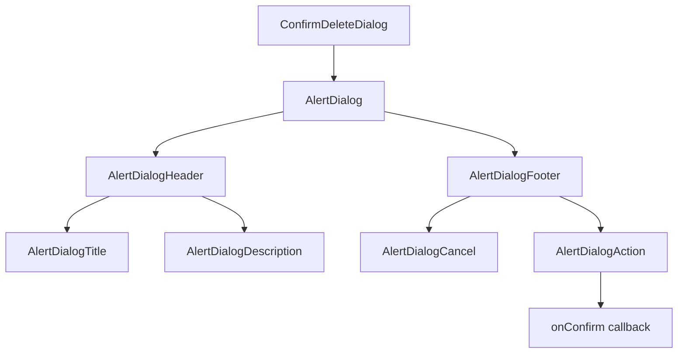
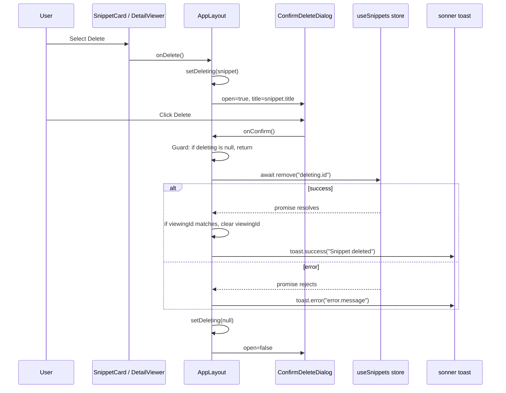

# ConfirmDeleteDialog component and deletion flow

`ConfirmDeleteDialog` is a controlled confirmation prompt built on the Radix UI Alert Dialog primitive. It asks the user to confirm deletion before`AppLayout` removes a snippet from the repository. This page covers the component API, the deletion flow triggered from snippet cards and the detail viewer, state updates after deletion, and error handling with`sonner` toast notifications.

## Component overview

`ConfirmDeleteDialog` lives in`src/components`, alongside`AppLayout` and the other UI components. It imports the Radix UI alert dialog primitives and the shared`buttonVariants` helper:

```tsx
// src/components/ConfirmDeleteDialog.tsx
import {
  AlertDialog, AlertDialogAction, AlertDialogCancel, AlertDialogContent,
  AlertDialogDescription, AlertDialogFooter, AlertDialogHeader, AlertDialogTitle,
} from "@/components/ui/alert-dialog";
import { buttonVariants } from "@/components/ui/button";
```

The component is fully controlled. It does not own internal state, track the snippet being deleted, or perform the deletion itself.`AppLayout` supplies the open state, snippet title, and confirmation callback.

## Component API

The exported function accepts four props:

```tsx
export function ConfirmDeleteDialog({ title, open, onOpenChange, onConfirm }: {
  title?: string | undefined;
  open: boolean;
  onOpenChange: (o: boolean) => void;
  onConfirm: () => void;
}) {
  // ...
}
```

| Prop | Type | Required | Purpose |
| --- | --- | --- | --- |
|`title` |`string \| undefined` | No | The title of the snippet being deleted, displayed inside the confirmation description. |
|`open` |`boolean` | Yes | Controls whether the Radix`AlertDialog` is rendered and visible. |
|`onOpenChange` |`(o: boolean) => void` | Yes | Called by Radix when the dialog wants to change open state, such as when the user presses **Escape** or clicks the backdrop. |
|`onConfirm` |`() => void` | Yes | Called when the user activates the **Delete** action button. |

The component returns a single`AlertDialog` with the standard Radix structure:

```tsx
return (
  <AlertDialog open={open} onOpenChange={onOpenChange}>
    <AlertDialogContent>
      <AlertDialogHeader>
        <AlertDialogTitle>Delete this snippet?</AlertDialogTitle>
        <AlertDialogDescription>
          “{title}” will be permanently removed. This can't be undone.
        </AlertDialogDescription>
      </AlertDialogHeader>
      <AlertDialogFooter>
        <AlertDialogCancel>Cancel</AlertDialogCancel>
        <AlertDialogAction className={buttonVariants({ variant: "destructive" })} onClick={onConfirm}>
          Delete
        </AlertDialogAction>
      </AlertDialogFooter>
    </AlertDialogContent>
  </AlertDialog>
);
```

The **Delete** action uses`buttonVariants({ variant: "destructive" })` to render with destructive styling. The action is wired directly to the`onConfirm` callback.

Figure: ConfirmDeleteDialog component structure



## Deletion triggers in AppLayout

`ConfirmDeleteDialog` is triggered by two UI paths:

1. **From a snippet card**, the user opens the card's overflow menu and selects **Delete**.`SnippetCard` calls the`onDelete` prop.
2. **From the detail viewer**, the user opens`SnippetDetailViewer` and selects **Delete**. The viewer calls its`onDelete` prop.

In both cases,`AppLayout` does not delete immediately. It stores the snippet in local`deleting` state and opens the confirmation dialog:

```tsx
// AppLayout.tsx
const [deleting, setDeleting] = useState<Snippet | null>(null);

// SnippetCard onDelete
onDelete={() => setDeleting(s)}

// SnippetDetailViewer onDelete
onDelete={() => viewing && setDeleting(viewing)}
```

The dialog is rendered toward the end of`AppLayout`'s return:

```tsx
<ConfirmDeleteDialog
  open={!!deleting}
  title={deleting?.title}
  onOpenChange={(o) => !o && setDeleting(null)}
  onConfirm={confirmDelete}
/>
```

When`deleting` is`null`,`open` is`false`. When the user closes the dialog without confirming, the`onOpenChange` handler sets`deleting` back to`null`, clearing the selection.

## Deletion flow

`confirmDelete` is defined in`AppLayout` and performs the actual removal:

```tsx
const confirmDelete = async () => {
  if (!deleting) return;
  try {
    await remove(deleting.id);
    if (viewingId === deleting.id) setViewingId(null);
    toast.success("Snippet deleted");
  } catch (e) {
    toast.error((e as Error).message);
  }
  setDeleting(null);
};
```

The`remove` function comes from the`useSnippets` hook:

```tsx
const { snippets, status, error, reload, remove, toggleFavorite, recordCopied } = useSnippets();
```

`remove` returns a promise that rejects when deletion fails. On success, the function:

1. Removes the snippet through`useSnippets`.
2. Clears`viewingId` if the deleted snippet was open in the detail viewer.
3. Shows a success toast: **Snippet deleted**.
4. Resets`deleting` to`null`, closing the dialog.

On failure:

1. Shows an error toast with the message from the caught`Error`.
2. Does not change`viewingId`.
3. Resets`deleting` to`null`, closing the dialog.

Figure: Snippet deletion flow



## State updates after deletion

Deletion affects two pieces of state in`AppLayout`:

1. **`snippets` state**, managed by`useSnippets`. The`remove` call updates the stored snippet list.`AppLayout` does not manually modify`snippets` in`confirmDelete`; it relies on the store hook.

2. **`viewingId` state**, local to`AppLayout`:

```tsx
const [viewingId, setViewingId] = useState<string | null>(null);
```

After`remove` resolves,`confirmDelete` sets`viewingId` to`null` only if the deleted snippet was the one currently being viewed:

```tsx
if (viewingId === deleting.id) setViewingId(null);
```

This prevents`SnippetDetailViewer` from continuing to show a snippet that no longer exists.

3. **`deleting` state**, always reset to`null` in both success and error branches. The`setDeleting(null)` call is placed after the`try`/`catch` block, so it runs regardless of the outcome:

```tsx
try {
  // ...
} catch (e) {
  // ...
}
setDeleting(null);
```

## Error handling and toasts

The deletion flow uses`sonner` toast notifications.`AppLayout` imports`toast` from`sonner`:

```tsx
import { toast } from "sonner";
```

Success path:

```tsx
toast.success("Snippet deleted");
```

Error path:

```tsx
catch (e) {
  toast.error((e as Error).message);
}
```

The error message is extracted from the caught error by casting it to`Error`. This pattern assumes`remove` rejects with an`Error` object. If`remove` rejects with a different type, the cast may produce an invalid message, but the code does not provide a fallback at this level.

The dialog always closes after the operation completes because`setDeleting(null)` runs outside the success/error branches.

## Store dependency

The deletion operation calls`remove` from the`useSnippets` hook:

```tsx
import { useSnippets } from "@/lib/snippets/store";
```

The source set provided for this document does not include`@/lib/snippets/store`, so the repository-level implementation is not covered here. The contract visible in`AppLayout` is that`remove(id: string)` returns a promise and rejects on failure.

For the user-facing guide to deleting snippets and how count and favorites state are affected, see [How to Delete a Snippet Permanently](doc:51b2df7f-976b-4f26-9b14-8dde23bb0c32).

## Related pages

- [AppLayout Component Internals and State Management](doc:40a3c2b0-9843-45b5-8768-fe031c98da4e)
- [SnippetDetailViewer Modal Component Internals](doc:0c144c12-b5da-44d7-acd8-683054ca2e31)
- [SnippetCard Component Layout and Interaction Modes](doc:3718b1e8-a236-4756-9e04-3ce2feda6d77)
- [How to Delete a Snippet Permanently](doc:51b2df7f-976b-4f26-9b14-8dde23bb0c32)