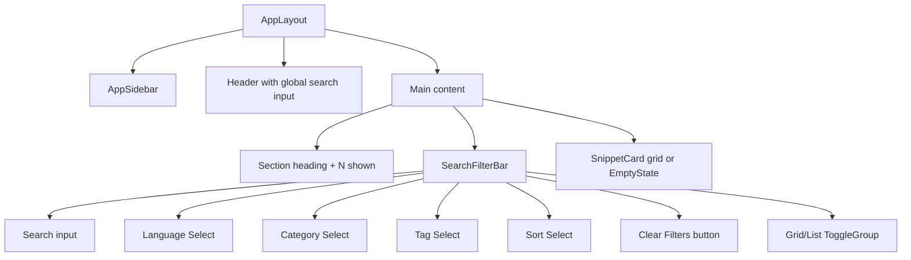
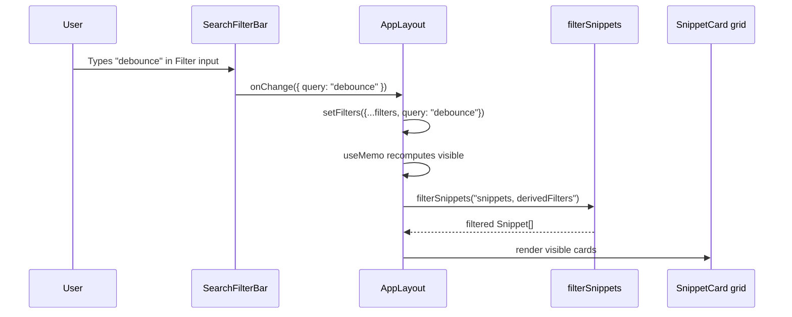
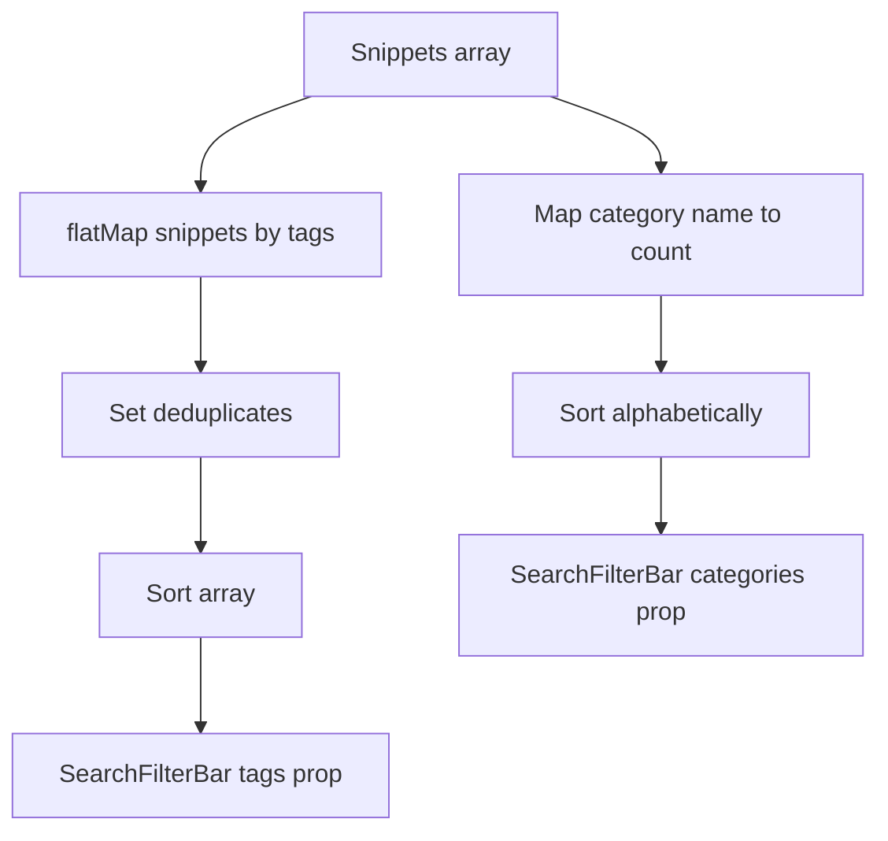

# SearchFilterBar component and filter state UI

`SearchFilterBar` is the primary filtering toolbar in CodeKnit. It renders a search input, four filter and sort dropdowns, an optional **Clear Filters** button, and a grid/list layout toggle. The component is fully controlled: it owns no state and delegates every user interaction to its parent through prop callbacks.

The component lives at`src/components/SearchFilterBar.tsx`. Its parent,`AppLayout`, owns the active`SnippetFilters` state and passes the values back down together with change handlers.

## Where SearchFilterBar fits

`SearchFilterBar` sits inside the main content area of`AppLayout`, directly beneath the section heading and the`"N shown"` counter, and above the snippet card grid. It does not include the sidebar language/category navigation or the header search input; those are separate controls in`AppSidebar` and the`AppLayout` header.

Figure: SearchFilterBar position in the AppLayout render tree



## Filter state model

`AppLayout` declares one`filters` state object of type`SnippetFilters` and treats`SearchFilterBar` as a controlled view over that object.

### SnippetFilters shape

The type is imported from`@/lib/snippets/types` in both`AppLayout.tsx` and`SearchFilterBar.tsx`. Based on its usage across these files, it has this shape:

```ts
interface SnippetFilters {
  query: string;
  language: Language | "all";
  category: string;
  tag: string;
  sort: "recent" | "oldest" | "az";
}
```

`Language` is the union of supported snippet languages (`"JavaScript"`,`"Python"`,`"SQL"`,`"Markdown"`) defined in`@/lib/snippets/types`. The`"all"` value for language, category, and tag means no filter is applied on that axis.

### Defaults

`AppLayout.tsx` defines the initial filter state:

```ts
const DEFAULTS: SnippetFilters = {
  query: "",
  language: "all",
  category: "all",
  tag: "all",
  sort: "recent",
};
```

- Empty query means no keyword search.
-`"all"` for language, category, and tag means no constraint on that axis.
- The default sort is`"recent"`, which displays newest-added snippets first.

### Updating filters

`AppLayout` exposes a single partial-update function that`SearchFilterBar` receives as`onChange`:

```ts
const update = (p: Partial<SnippetFilters>) =>
  setFilters((f) => ({ ...f, ...p }));
```

Each control in`SearchFilterBar` emits only the slice of state it changed. For example, the search input calls:

```tsx
onChange({ query: e.target.value })
```

and the language select calls:

```tsx
onChange({ language: v as SnippetFilters["language"] })
```

###`hasActive` derivation

`SearchFilterBar` does not compute whether filters are active. Its parent computes this and passes the result as the`hasActive` boolean:

```ts
const hasActive =
  filters.query !== "" ||
  filters.language !== "all" ||
  filters.category !== "all" ||
  filters.tag !== "all";
```

Notably,`sort` is excluded from`hasActive`. Changing only the sort order does not reveal the **Clear Filters** button, because sort is not considered an active filter.

### Clear behavior

The`clear` function in`AppLayout.tsx` resets all filter axes but preserves the current sort order:

```ts
const clear = () => setFilters((f) => ({ ...DEFAULTS, sort: f.sort }));
```

## SearchFilterBar props API

The component interface in`SearchFilterBar.tsx` is:

```ts
interface Props {
  filters: SnippetFilters;
  onChange: (f: Partial<SnippetFilters>) => void;
  categories: string[];
  tags: string[];
  layout: "grid" | "list";
  onLayout: (l: "grid" | "list") => void;
  hasActive: boolean;
  onClear: () => void;
}
```

| Prop | Type | Description |
| --- | --- | --- |
|`filters` |`SnippetFilters` | Current filter values. The component is controlled; it renders these values and never mutates them directly. |
|`onChange` |`(f: Partial<SnippetFilters>) => void` | Called with a partial patch for any changed filter axis. |
|`categories` |`string[]` | Candidate category names for the category dropdown. Derived by`AppLayout` from actual snippets. |
|`tags` |`string[]` | Candidate tag names for the tag dropdown. Derived by`AppLayout` from actual snippets. |
|`layout` |`"grid" \| "list"` | Current snippet card layout. |
|`onLayout` |`(l: "grid" \| "list") => void` | Called when the layout toggle changes. |
|`hasActive` |`boolean` | Whether any search/language/category/tag filter is non-default. Controls the **Clear Filters** button. |
|`onClear` |`() => void` | Called when the user clicks **Clear Filters**. |

## UI controls

The root layout is:

```tsx
<div className="flex flex-col gap-2 lg:flex-row lg:items-center">
```

On small screens the controls stack vertically. At the`lg` breakpoint they sit in a row with the search box taking the available width.

### Search input

```tsx
<div className="relative flex-1">
  <Search className="pointer-events-none absolute left-2.5 top-1/2 h-4 w-4 -translate-y-1/2 text-muted-foreground" />
  <Input
    aria-label="Filter snippets"
    value={filters.query}
    onChange={(e) => onChange({ query: e.target.value })}
    placeholder="Filter…"
    className="pl-8"
  />
</div>
```

The search icon is positioned absolutely and is non-interactive. The`Input` is controlled by`filters.query` and emits`{ query: e.target.value }` on every keystroke.

### Language select

```tsx
<Select
  value={filters.language}
  onValueChange={(v) => onChange({ language: v as SnippetFilters["language"] })}
>
  <SelectTrigger aria-label="Language filter" className="sm:w-36">
    <SelectValue />
  </SelectTrigger>
  <SelectContent>
    <SelectItem value="all">All languages</SelectItem>
    {LANGUAGES.map((l) => (
      <SelectItem key={l} value={l}>{l}</SelectItem>
    ))}
  </SelectContent>
</Select>
```

The language options come from the`LANGUAGES` constant imported from`@/lib/snippets/types`. The first option is`"all"` with the label **All languages**, followed by one item per supported language.

### Category select

```tsx
<Select value={filters.category} onValueChange={(v) => onChange({ category: v })}>
  <SelectTrigger aria-label="Category filter" className="sm:w-36">
    <SelectValue />
  </SelectTrigger>
  <SelectContent>
    <SelectItem value="all">All categories</SelectItem>
    {categories.map((c) => (
      <SelectItem key={c} value={c}>{c}</SelectItem>
    ))}
  </SelectContent>
</Select>
```

Unlike language, category options are dynamic. They come from the`categories` string array prop. The list starts with **All categories**, then renders each candidate category exactly as it appears in snippet data.

### Tag select

```tsx
<Select value={filters.tag} onValueChange={(v) => onChange({ tag: v })}>
  <SelectTrigger aria-label="Tag filter" className="sm:w-32">
    <SelectValue />
  </SelectTrigger>
  <SelectContent>
    <SelectItem value="all">All tags</SelectItem>
    {tags.map((t) => (
      <SelectItem key={t} value={t}>#{t}</SelectItem>
    ))}
  </SelectContent>
</Select>
```

The displayed tag options are prefixed with`#`, but the stored filter value is the tag string without the hash. The`value`s are raw tag names so they match snippet tag arrays directly.

### Sort select

```tsx
<Select value={filters.sort} onValueChange={(v) => onChange({ sort: v as SnippetFilters["sort"] })}>
  <SelectTrigger aria-label="Sort" className="sm:w-40">
    <SelectValue />
  </SelectTrigger>
  <SelectContent>
    <SelectItem value="recent">Recently Added</SelectItem>
    <SelectItem value="oldest">Oldest First</SelectItem>
    <SelectItem value="az">A–Z</SelectItem>
  </SelectContent>
</Select>
```

The three sort options are fixed. The value strings are`"recent"`,`"oldest"`, and`"az"`.

### Clear filters button

The button renders only when`hasActive` is`true`:

```tsx
{hasActive && (
  <Button variant="ghost" onClick={onClear} className="col-span-1">
    <X className="h-4 w-4" />Clear Filters
  </Button>
)}
```

Because sort is not included in`hasActive`, a user can change sort without the clear button appearing. Clicking the button invokes the`onClear` callback from`AppLayout`, which resets query, language, category, and tag to defaults while retaining the current sort.

### Layout toggle

```tsx
<ToggleGroup
  type="single"
  value={layout}
  onValueChange={(v) => v && onLayout(v as "grid" | "list")}
  variant="outline"
  className="justify-self-end"
>
  <ToggleGroupItem value="grid" aria-label="Grid view" title="Grid view">
    <LayoutGrid className="h-4 w-4" />
  </ToggleGroupItem>
  <ToggleGroupItem value="list" aria-label="List view" title="List view">
    <List className="h-4 w-4" />
  </ToggleGroupItem>
</ToggleGroup>
```

The toggle group is a single-select control whose value is either`"grid"` or`"list"`. The`v && onLayout(...)` guard prevents a deselection from producing an empty value. The icon-only toggle items have`aria-label` and`title` attributes for accessibility and hover tooltips.

## State flow

Figure: Filter change flow from user interaction to visible cards



All state changes caused by`SearchFilterBar` are applied in`AppLayout` through`setFilters`.`AppLayout` then recomputes the visible snippet list in a`useMemo` that spreads the active filters and invokes`filterSnippets` from`@/lib/snippets/filter`. The result is rendered in the`SnippetCard` grid.

### Section-aware filter derivation

`SearchFilterBar` only knows about the five`SnippetFilters` fields.`AppLayout` derives additional filter constraints based on the active sidebar section before calling`filterSnippets`:

```ts
const visible = useMemo(() => {
  const f = {
    ...filters,
    favoritesOnly: section === "favorites",
    sort: section === "recent" ? ("recent" as const) : filters.sort,
  };
  const r = filterSnippets(snippets, f);

  if (section === "recent") return r.slice(0, 10);
  if (section === "used") {
    return r
      .filter((s) => Boolean(s.lastCopiedAt))
      .sort((a, b) =>
        (b.lastCopiedAt ?? "").localeCompare(a.lastCopiedAt ?? ""),
      );
  }
  return r;
}, [snippets, filters, section]);
```

When the active section is **Favorites**,`favoritesOnly` is set to`true`. When the section is **Recently Added**, the sort is forced to`"recent"` regardless of what the sort dropdown says. **Recently Used** applies its own`lastCopiedAt` sort after the base filter pass.

## Dropdown option derivation

`AppLayout` computes the category and tag options from the actual snippet list with`useMemo` so the dropdowns never contain stale or unused values.

Figure: Dropdown option derivation from the snippet list



Category options are built from a`Map` that counts snippets per category, then sorted alphabetically:

```ts
const categories = useMemo(() => {
  const m = new Map<string, number>();
  snippets.forEach((s) => m.set(s.category, (m.get(s.category) ?? 0) + 1));
  return [...m]
    .map(([name, count]) => ({ name, count }))
    .sort((a, b) => a.name.localeCompare(b.name));
}, [snippets]);
```

When passed to`SearchFilterBar`, only the names are sent:

```tsx
<SearchFilterBar
  ...
  categories={categories.map((c) => c.name)}
  ...
/>
```

Tag options are a sorted, deduplicated array of all tags across snippets:

```ts
const tags = useMemo(
  () => [...new Set(snippets.flatMap((s) => s.tags))].sort(),
  [snippets],
);
```

## Layout persistence

`SearchFilterBar` does not persist layout itself.`AppLayout` persists the layout choice to`localStorage` so it survives page reloads.

Initial load:

```ts
useEffect(() => {
  const saved = localStorage.getItem("codeknit.layout");
  if (saved === "list" || saved === "grid") setLayout(saved);
}, []);
```

Change handler:

```ts
const changeLayout = (l: "grid" | "list") => {
  setLayout(l);
  localStorage.setItem("codeknit.layout", l);
};
```

Only the literal strings`"list"` and`"grid"` are accepted from storage; the value is validated before it is applied.

## Duplicate search input in AppLayout header

There are two search inputs bound to the same`filters.query` value. The`AppLayout` header contains the first one:

```tsx
<Input
  aria-label="Search snippets"
  value={filters.query}
  onChange={(e) => update({ query: e.target.value })}
  placeholder="Search snippets, tags, or code..."
  className="h-9 bg-card pl-9"
/>
```

`SearchFilterBar` renders a second one with`aria-label="Filter snippets"` and placeholder`"Filter…"`. Both are controlled by`filters.query` and call the same`update` function, so they stay in sync. The header input is always visible near the top of the viewport; the toolbar input appears only within the snippet section.

## Related documentation

- [Search and Filtering Internals](doc:43513054-8dee-4d00-b32d-33b003db5b2f), how`filterSnippets` applies query, language, category, tag, and sort filters.
- [AppLayout Component Internals and State Management](doc:40a3c2b0-9843-45b5-8768-fe031c98da4e), parent component state, sections, modals, and event handlers.
- [AppSidebar Component Navigation and Section Filtering](doc:d5ac354d-5963-4b5a-af7b-fdcd67ce63fd), sidebar language and category filtering that shares filter state with`AppLayout`.
- [How to Filter and Search Snippets Efficiently](doc:05685938-4f17-4222-8703-05f1eb52dba6), guide for using the filter UI to find snippets quickly.
- [How to Switch Between Grid and List View Layouts](doc:c785e