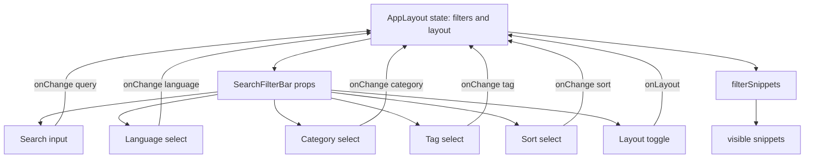

# SearchFilterBar component and filter UI state management

## Overview

`SearchFilterBar` is a controlled, presentational component in`src/components/SearchFilterBar.tsx`. It renders the primary filter controls for the snippet library: free-text search, language, category, tag, and sort selectors, plus a layout toggle and a conditional **Clear Filters** action.

The component owns no local state. All current values arrive through props, and every user interaction calls the`onChange` or`onLayout` callback passed from`AppLayout`. This keeps filter state and layout state centralized in [AppLayout](doc:40a3c2b0-9843-45b5-8768-fe031c98da4e).

## Props reference

The component exposes the following prop contract:

```ts
interface Props {
  filters: SnippetFilters;
  onChange: (f: Partial<SnippetFilters>) => void;
  categories: string[];
  tags: string[];
  layout: "grid" | "list";
  onLayout: (l: "grid" | "list") => void;
  hasActive: boolean;
  onClear: () => void;
}
```

| Prop | Type | Purpose |
| --- | --- | --- |
|`filters` |`SnippetFilters` | Current filter values:`query`,`language`,`category`,`tag`, and`sort` |
|`onChange` |`(f: Partial<SnippetFilters>) => void` | Merges a partial filter update into`AppLayout` state |
|`categories` |`string[]` | Available category names derived from existing snippets |
|`tags` |`string[]` | Unique, sorted tag names derived from existing snippets |
|`layout` |`"grid" \| "list"` | Current card layout mode |
|`onLayout` |`(l: "grid" \| "list") => void` | Updates layout and persists it to`localStorage` |
|`hasActive` |`boolean` | Whether any query, language, category, or tag filter is active |
|`onClear` |`() => void` | Resets filters while preserving the current sort order |

The`SnippetFilters` shape is consumed directly by both`SearchFilterBar` and`AppLayout`. See [How Snippets and Filters Work Together](doc:5aa23d07-2c0d-44f6-8a85-df82ca070b77) for the filter mental model and type usage.

## State ownership and update flow

`AppLayout` owns the filter state with a single`useState` instance:

```ts
const DEFAULTS: SnippetFilters = { query: "", language: "all", category: "all", tag: "all", sort: "recent" };
const [filters, setFilters] = useState<SnippetFilters>(DEFAULTS);
const [layout, setLayout] = useState<"grid" | "list">("grid");
```

The update and clear helpers are defined in`AppLayout`:

```ts
const update = (p: Partial<SnippetFilters>) => setFilters((f) => ({ ...f, ...p }));
const clear = () => setFilters((f) => ({ ...DEFAULTS, sort: f.sort }));
```

`SearchFilterBar` receives the current`filters` object and calls`update` through its`onChange` prop. Every input or select change therefore produces a new filter object and rerenders the visible snippet list.

Figure: SearchFilterBar controlled state and filtering flow



The actual filtering behavior lives in`filterSnippets` in`src/lib/snippets/filter.ts`. See [Search and Filtering Internals](doc:43513054-8dee-4d00-b32d-33b003db5b2f) for the matching, language, category, tag, and sort logic.

## Search input

The query input is a controlled`Input` with the current`filters.query` value:

```tsx
<Input
  aria-label="Filter snippets"
  value={filters.query}
  onChange={(e) => onChange({ query: e.target.value })}
  placeholder="Filter…"
  className="pl-8"
/>
```

The`Search` icon is layered over the input with absolute positioning. The same`filters.query` value is also used by the global search input in the`AppLayout` header, so both search surfaces stay in sync.

## Language, category, tag, and sort selectors

All four selectors use the Radix-based`Select` components from`@/components/ui/select`. Each one is controlled by the corresponding field in`filters`.

Language options come from the static`LANGUAGES` array:

```tsx
<Select
  value={filters.language}
  onValueChange={(v) => onChange({ language: v as SnippetFilters["language"] })}
>
  <SelectTrigger aria-label="Language filter" className="sm:w-36">
    <SelectValue />
  </SelectTrigger>
  <SelectContent>
    <SelectItem value="all">All languages</SelectItem>
    {LANGUAGES.map((l) => (
      <SelectItem key={l} value={l}>{l}</SelectItem>
    ))}
  </SelectContent>
</Select>
```

Category options are passed from`AppLayout` as a plain string list:

```tsx
<Select value={filters.category} onValueChange={(v) => onChange({ category: v })}>
  <SelectTrigger aria-label="Category filter" className="sm:w-36">
    <SelectValue />
  </SelectTrigger>
  <SelectContent>
    <SelectItem value="all">All categories</SelectItem>
    {categories.map((c) => (
      <SelectItem key={c} value={c}>{c}</SelectItem>
    ))}
  </SelectContent>
</Select>
```

Tag options are rendered with a`#` prefix:

```tsx
<Select value={filters.tag} onValueChange={(v) => onChange({ tag: v })}>
  <SelectTrigger aria-label="Tag filter" className="sm:w-32">
    <SelectValue />
  </SelectTrigger>
  <SelectContent>
    <SelectItem value="all">All tags</SelectItem>
    {tags.map((t) => (
      <SelectItem key={t} value={t}>#{t}</SelectItem>
    ))}
  </SelectContent>
</Select>
```

Sort options are limited to three values:

```tsx
<Select value={filters.sort} onValueChange={(v) => onChange({ sort: v as SnippetFilters["sort"] })}>
  <SelectTrigger aria-label="Sort" className="sm:w-40">
    <SelectValue />
  </SelectTrigger>
  <SelectContent>
    <SelectItem value="recent">Recently Added</SelectItem>
    <SelectItem value="oldest">Oldest First</SelectItem>
    <SelectItem value="az">A–Z</SelectItem>
  </SelectContent>
</Select>
```

## Clear filters action

The **Clear Filters** button appears only when`hasActive` is`true`.`AppLayout` computes`hasActive` as:

```ts
const hasActive =
  filters.query !== "" ||
  filters.language !== "all" ||
  filters.category !== "all" ||
  filters.tag !== "all";
```

Sort is intentionally excluded from`hasActive`, so selecting a sort order alone does not show the clear button.

When clicked, the button calls`onClear`. In`AppLayout`,`clear` resets query, language, category, and tag back to`DEFAULTS`, but preserves the current sort value:

```ts
const clear = () => setFilters((f) => ({ ...DEFAULTS, sort: f.sort }));
```

> [!NOTE]
> Clearing filters does not reset the sort order. This allows a user to clear all filtering criteria and still keep their preferred ordering.

## Layout toggle

The grid/list toggle is a single-value Radix`ToggleGroup`:

```tsx
<ToggleGroup
  type="single"
  value={layout}
  onValueChange={(v) => v && onLayout(v as "grid" | "list")}
  variant="outline"
  className="justify-self-end"
>
  <ToggleGroupItem value="grid" aria-label="Grid view" title="Grid view">
    <LayoutGrid className="h-4 w-4" />
  </ToggleGroupItem>
  <ToggleGroupItem value="list" aria-label="List view" title="List view">
    <List className="h-4 w-4" />
  </ToggleGroupItem>
</ToggleGroup>
```

The`v && onLayout(...)` guard prevents the toggle group from passing an empty string when the active item is clicked again. This keeps`layout` in`AppLayout` clamped to`"grid"` or`"list"`.

`AppLayout` persists the layout choice under the`codeknit.layout` key:

```ts
const changeLayout = (l: "grid" | "list") => {
  setLayout(l);
  localStorage.setItem("codeknit.layout", l);
};
```

On mount,`AppLayout` restores the saved preference:

```ts
useEffect(() => {
  const saved = localStorage.getItem("codeknit.layout");
  if (saved === "list" || saved === "grid") setLayout(saved);
}, []);
```

See [How to Switch Between Grid and List View Layouts](doc:c785e12d-e080-4060-b945-2d3db1e185c6) for the user-facing behavior.

## Dropdown data sources

`SearchFilterBar` does not derive its own options from snippets. It receives them as props from`AppLayout`.

`AppLayout` computes the category list with counts, but only passes names to`SearchFilterBar`:

```ts
const categories = useMemo(() => {
  const m = new Map<string, number>();
  snippets.forEach((s) => m.set(s.category, (m.get(s.category) ?? 0) + 1));
  return [...m]
    .map(([name, count]) => ({ name, count }))
    .sort((a, b) => a.name.localeCompare(b.name));
}, [snippets]);
```

The prop passed to`SearchFilterBar` is:

```tsx
categories={categories.map((c) => c.name)}
```

Tags are flattened from all snippets, deduplicated with a`Set`, and sorted:

```ts
const tags = useMemo(
  () => [...new Set(snippets.flatMap((s) => s.tags))].sort(),
  [snippets]
);
```

Languages come from the static`LANGUAGES` constant in`src/lib/snippets/types.ts`, not from snippet data.

## Responsive layout

The component uses two layout tiers:

- The outer wrapper is`flex flex-col gap-2 lg:flex-row lg:items-center`. On small screens, the search input stacks above the selectors. On large screens, all controls share one row.
- The selector group is`grid grid-cols-2 gap-2 sm:flex sm:flex-wrap`. On very small screens, controls form a 2-column grid. Starting at the`sm` breakpoint, they wrap horizontally.

The clear button and layout toggle are included in the selector group. The layout toggle uses`justify-self-end` so it remains aligned to the right in the mobile grid.

## Related documentation

- [AppLayout Component Internals and State Management](doc:40a3c2b0-9843-45b5-8768-fe031c98da4e)
- [Search and Filtering Internals](doc:43513054-8dee-4d00-b32d-33b003db5b2f)
- [How Snippets and Filters Work Together](doc:5aa23d07-2c0d-44f6-8a85-df82ca070b77)
- [How to Filter and Search Snippets Efficiently](doc:05685938-4f17-4222-8703-05f1eb52dba6)
- [How to Switch Between Grid and List View Layouts](doc:c785e12d-e080-4060-b945-2d3db1e185c6)