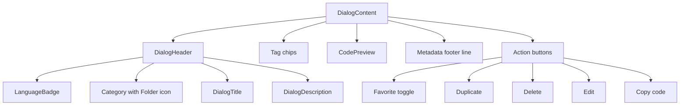

# SnippetDetailViewer modal component

The`SnippetDetailViewer` component renders the modal dialog used to view a snippet's full details. It is rendered by`AppLayout` in`src/components/AppLayout.tsx` and opens when a user clicks a`SnippetCard` or its **View** button. The dialog shows metadata, tags, a syntax-highlighted code preview, and action buttons for copying, duplicating, favoriting, editing, and deleting.

`SnippetDetailViewer` is a controlled component.`AppLayout` passes either a`Snippet` object or`null`, and every side effect is supplied as a callback prop.

## Component signature and dependencies

`SnippetDetailViewer` lives in`src/components/SnippetDetailViewer.tsx`.

```tsx
interface Props {
  snippet: Snippet | null;
  onClose: () => void;
  onEdit: () => void;
  onDelete: () => void;
  onDuplicate: () => void;
  onToggleFavorite: () => void;
  onRecordCopy: () => Promise<void>;
}

export function SnippetDetailViewer({ snippet: s, onClose, onEdit, onDelete, onDuplicate, onToggleFavorite, onRecordCopy }: Props) {
  const { copied, copy } = useCopy();
  return (
    <Dialog open={!!s} onOpenChange={(o) => !o && onClose()}>
      <DialogContent className="max-h-[92vh] overflow-y-auto sm:max-w-3xl">
        {s && (
          // metadata, tags, code preview, actions
        )}
      </DialogContent>
    </Dialog>
  );
}
```

The component imports:

-`Snippet` from`@/lib/snippets/types`
-`CodePreview` from`./CodePreview` for highlighted code rendering
-`LanguageBadge` and`formatDate` from`./LanguageBadge`
-`useCopy` from`./use-copy` for clipboard handling and copied-state feedback
- Radix UI`Dialog`,`DialogContent`,`DialogDescription`,`DialogHeader`, and`DialogTitle` from`@/components/ui/dialog`

The component does not own internal modal state. Whether the dialog is open derives from whether the`snippet` prop is non-null, represented by`open={!!s}`.

## Dialog structure and render order

`DialogContent` is configured with:

```tsx
className="max-h-[92vh] overflow-y-auto sm:max-w-3xl"
```

This constrains the dialog to 92 percent of the viewport height and allows the whole dialog to scroll vertically when content is tall.

Content is rendered only when`s` is truthy, so`CodePreview` and metadata never render against`null`.

The visual order inside`DialogContent` is:

1.`DialogHeader` with language badge, category, title, and description
2. Tag chips, only when the snippet has tags
3.`CodePreview` with the full snippet code
4. Metadata footer line
5. Action button group

Figure: SnippetDetailViewer dialog content structure



## Metadata presentation

The header renders language and category inline before the title. It reuses`LanguageBadge` and a`Folder` icon to match the visual treatment used by`SnippetCard`.

```tsx
<DialogHeader>
  <div className="flex flex-wrap items-center gap-2 text-xs text-muted-foreground">
    <LanguageBadge language={s.language} />
    <span className="inline-flex items-center gap-1"><Folder className="h-3 w-3" />{s.category}</span>
  </div>
  <DialogTitle className="text-xl">{s.title}</DialogTitle>
  <DialogDescription>{s.description || "No description."}</DialogDescription>
</DialogHeader>
```

If`description` is empty, the fallback text`"No description."` is rendered as the accessible dialog description.

Tags render only when`s.tags.length > 0`:

```tsx
{s.tags.length > 0 && (
  <div className="flex flex-wrap gap-1.5">
    {s.tags.map((t) => (
      <span key={t} className="rounded-full bg-accent px-2 py-0.5 text-xs text-accent-foreground">#{t}</span>
    ))}
  </div>
)}
```

## Code preview

The full snippet body is rendered with`CodePreview`:

```tsx
<CodePreview code={s.code} language={s.language} className="max-h-[50vh] overflow-auto" />
```

Because no`maxLines` prop is supplied,`CodePreview` does not truncate the code. The`className` adds a maximum height of 50 percent of the viewport and enables vertical scrolling inside the preview container.

`CodePreview` calls`Highlighted`, which tokenizes the code based on`language` through`useMemo`. The tokenizer supports JavaScript, Python, SQL, and Markdown. See [CodePreview Component and Highlighted Text Rendering](doc:cd3f8be2-2446-4b51-a0a8-72d7008af212) for rendering details and [Syntax Highlighter (Tokenizer) API](doc:63d0bbe1-be5e-4ebb-8235-69713ce63ce6) for tokenizer details.

## Metadata footer

A single text line summarizes the created date, updated date, copy count, and optional last copied date:

```tsx
<p className="text-xs text-muted-foreground">
  Created {formatDate(s.createdAt)} · Updated {formatDate(s.updatedAt)} · Copied {s.copyCount ?? 0} {(s.copyCount ?? 0) === 1 ? "time" : "times"}{s.lastCopiedAt ? ` · Last copied ${formatDate(s.lastCopiedAt)}` : ""}
</p>
```

`copyCount` is treated as optional with`?? 0`, and the text switches between singular`"time"` and plural`"times"`.

`formatDate` is defined in`LanguageBadge.tsx` and formats ISO date strings as short month, day, and year:

```tsx
export function formatDate(iso: string) {
  return new Date(iso).toLocaleDateString(undefined, { month: "short", day: "numeric", year: "numeric" });
}
```

## Action buttons

The action bar is responsive. It stacks vertically on small screens and becomes a horizontal row from the`sm:` breakpoint upward, with the metadata line on the left and the buttons on the right.

```tsx
<div className="flex flex-col gap-3 sm:flex-row sm:items-center sm:justify-between">
  <p className="text-xs text-muted-foreground">
    Created {formatDate(s.createdAt)} · Updated {formatDate(s.updatedAt)} · Copied {s.copyCount ?? 0} {(s.copyCount ?? 0) === 1 ? "time" : "times"}{s.lastCopiedAt ? ` · Last copied ${formatDate(s.lastCopiedAt)}` : ""}
  </p>
  <div className="flex flex-wrap gap-2">
    <Button variant="ghost" size="sm" onClick={onToggleFavorite} aria-pressed={s.isFavorite}>
      <Star className={cn("h-4 w-4", s.isFavorite && "fill-syn-number text-syn-number")} />
      {s.isFavorite ? "Favorited" : "Favorite"}
    </Button>
    <Button variant="ghost" size="sm" onClick={onDuplicate}><CopyPlus className="h-4 w-4" />Duplicate</Button>
    <Button variant="ghost" size="sm" onClick={onDelete} className="text-destructive hover:text-destructive">
      <Trash2 className="h-4 w-4" />Delete
    </Button>
    <Button variant="secondary" size="sm" onClick={onEdit}><Pencil className="h-4 w-4" />Edit</Button>
    <Button size="sm" onClick={async () => { if (await copy(s.code)) { onRecordCopy().catch(() => undefined); } }}>
      {copied ? <Check className="h-4 w-4" /> : <Copy className="h-4 w-4" />}{copied ? "Copied!" : "Copy code"}
    </Button>
  </div>
</div>
```

The five action buttons are:

- **Favorite** toggle using`onToggleFavorite`
- **Duplicate** using`onDuplicate`
- **Delete** using`onDelete`, styled with destructive text
- **Edit** using`onEdit`, styled as a secondary button
- **Copy code** using the`copy` function from`useCopy`

All callbacks are supplied by`AppLayout`.`SnippetDetailViewer` does not call the snippet store or persistence functions directly.

### Copy behavior

The copy button uses the local`useCopy` hook:

```tsx
const { copied, copy } = useCopy();
```

When clicked,`copy(s.code)` writes the snippet code to the clipboard. If`copy` resolves truthy, the component calls`onRecordCopy()`. The additional`catch(() => undefined)` prevents an unhandled rejection from`onRecordCopy`, even though the`AppLayout` implementation of`onRecordCopy` already catches persistence errors and reports them with a toast.

## Modal state management in AppLayout

`AppLayout` stores the selected snippet ID in local state:

```tsx
const [viewingId, setViewingId] = useState<string | null>(null);
```

It then derives the current`Snippet` object by ID:

```tsx
const viewing = snippets.find((s) => s.id === viewingId) ?? null;
```

`SnippetDetailViewer` is rendered unconditionally at the bottom of`AppLayout`:

```tsx
<SnippetDetailViewer
  snippet={viewing