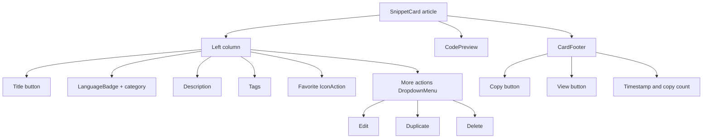
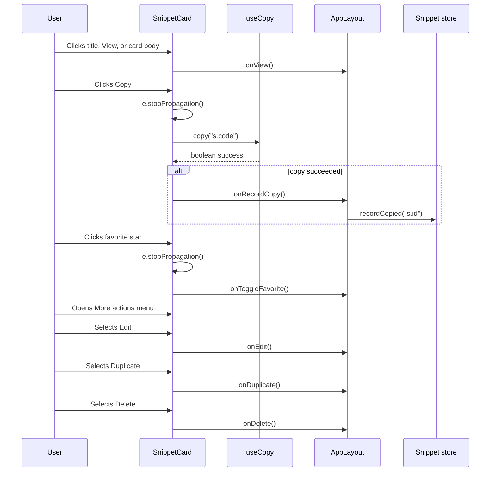

# SnippetCard component layout and interaction modes

`SnippetCard` renders an individual snippet in either a grid or list layout. It combines metadata, a syntax-highlighted code preview, and a set of action buttons while coordinating with the parent`AppLayout` component for viewing, editing, deleting, duplicating, favorite toggling, and copy tracking.

## Props interface

`SnippetCard` is defined in`SnippetCard.tsx` with the following props contract:

```ts
interface Props {
  snippet: Snippet;
  layout: "grid" | "list";
  onView: () => void;
  onEdit: () => void;
  onDelete: () => void;
  onDuplicate: () => void;
  onToggleFavorite: () => void;
  onRecordCopy: () => Promise<void>;
}
```

The`snippet` object provides all display data. The`layout` prop controls the card arrangement. The six callback props delegate actions to`AppLayout`, which owns snippet state and handles persistence through the snippet store.

## Component structure

The rendered`<article>` is always clickable and calls`onView` when clicked. Inside, the card splits into a metadata column, a`CodePreview`, and a nested`CardFooter` function that renders timestamps and action buttons.

Figure: SnippetCard rendering tree



## Layout modes

The`layout` prop accepts`"grid"` or`"list"`.`AppLayout` preserves the user's choice in`localStorage` under the key`codeknit.layout`.

```ts
const [layout, setLayout] = useState<"grid" | "list">("grid");

useEffect(() => {
  const saved = localStorage.getItem("codeknit.layout");
  if (saved === "list" || saved === "grid") setLayout(saved);
}, []);

const changeLayout = (l: "grid" | "list") => {
  setLayout(l);
  localStorage.setItem("codeknit.layout", l);
};
```

`AppLayout` passes this value down to each`SnippetCard`:

```tsx
<SnippetCard
  key={s.id}
  snippet={s}
  layout={layout}
  onView={() => setViewingId(s.id)}
  onEdit={() => openEdit(s)}
  onDelete={() => setDeleting(s)}
  onDuplicate={() => { void duplicate(s); }}
  onToggleFavorite={() => fav(s)}
  onRecordCopy={() => recordCopied(s.id)}
/>
```

The container that wraps all cards also adapts to the chosen layout:

```tsx
<div className={cn(
  "grid gap-4",
  layout === "grid" ? "md:grid-cols-2 xl:grid-cols-3" : "grid-cols-1"
)}>
```

### Grid layout

In grid mode,`SnippetCard` uses a vertical stack. The`<article>` gets`flex-col`, and the code preview is limited to 8 lines by default.

```tsx
const list = layout === "list";

return (
  <article
    onClick={onView}
    className={cn(
      "group flex cursor-pointer gap-4 rounded-xl border bg-card p-4 shadow-card transition-colors hover:border-primary/40",
      list ? "flex-col md:flex-row" : "flex-col"
    )}
  >
    {/* metadata */}
    <CodePreview
      code={s.code}
      language={s.language}
      maxLines={list ? 6 : 8}
      className="min-w-0 flex-1"
    />
    {/* CardFooter below code in grid mode */}
  </article>
);
```

### List layout

In list mode, the card becomes a two-column arrangement on medium screens and larger. The metadata column gets a fixed width of 80 Tailwind units (`md:w-80`) and`md:shrink-0`, while the code preview flexes into the remaining space and is capped at 6 lines.

```tsx
<div className={cn(
  "flex min-w-0 flex-col gap-2",
  list && "md:w-80 md:shrink-0"
)}>
  {/* metadata */}
  {list && <CardFooter />}
</div>
<CodePreview
  code={s.code}
  language={s.language}
  maxLines={list ? 6 : 8}
  className="min-w-0 flex-1"
/>
```

In list mode,`CardFooter` renders inside the left metadata column. In grid mode, it renders after the`CodePreview` at the bottom of the card. The nested`CardFooter` function is hoisted within`SnippetCard`, so it can be used in either position.

## Metadata rendering

The metadata column always includes:

- A title button that triggers`onView` and stops the outer card click.
- A`LanguageBadge` with the snippet language.
- A folder icon and category name.
- The description if`s.description` is non-empty.
- Tag chips if`s.tags.length > 0`.

```tsx
<div className="min-w-0">
  <h3 className="truncate font-semibold leading-tight">
    <button
      className="text-left hover:text-primary focus-visible:outline-2 focus-visible:outline-ring"
      onClick={(e) => { e.stopPropagation(); onView(); }}
    >
      {s.title}
    </button>
  </h3>
  <div className="mt-1.5 flex flex-wrap items-center gap-2 text-xs text-muted-foreground">
    <LanguageBadge language={s.language} />
    <span className="inline-flex items-center gap-1">
      <Folder className="h-3 w-3" />
      {s.category}
    </span>
  </div>
</div>
```

Description and tags render only when present:

```tsx
{s.description && (
  <p className="line-clamp-2 text-sm text-muted-foreground">{s.description}</p>
)}
{s.tags.length > 0 && (
  <div className="flex flex-wrap gap-1.5">
    {s.tags.map((t) => (
      <span key={t} className="rounded-full bg-accent px-2 py-0.5 text-[11px] text-accent-foreground">
        #{t}
      </span>
    ))}
  </div>
)}
```

## Action buttons and copy tracking

`SnippetCard` exposes direct actions for copy, view, and favorite, plus a dropdown menu containing edit, duplicate, and delete.

### Favorite action

The star button is rendered by the local`IconAction` component, which wraps a`Button` in a`Tooltip`. It sets`aria-pressed` based on whether the snippet is a favorite.

```tsx
function IconAction({ label, onClick, children, active }: {
  label: string;
  onClick: () => void;
  children: React.ReactNode;
  active?: boolean;
}) {
  return (
    <Tooltip>
      <TooltipTrigger asChild>
        <Button
          variant="ghost"
          size="icon"
          aria-label={label}
          aria-pressed={active}
          className="h-8 w-8"
          onClick={(e) => { e.stopPropagation(); onClick(); }}
        >
          {children}
        </Button>
      </TooltipTrigger>
      <TooltipContent>{label}</TooltipContent>
    </Tooltip>
  );
}
```

The favorite button shown in`SnippetCard` uses`IconAction`:

```tsx
<IconAction
  label={s.isFavorite ? "Remove from favorites" : "Add to favorites"}
  onClick={onToggleFavorite}
  active={s.isFavorite}
>
  <Star className={cn("h-4 w-4", s.isFavorite && "fill-syn-number text-syn-number")} />
</IconAction>
```

### Edit, duplicate, and delete menu

The overflow menu is a Radix`DropdownMenu`. The trigger stops propagation so the menu does not activate the card's`onView`. Menu items call`onEdit`,`onDuplicate`, and`onDelete` through`onSelect`.

```tsx
<DropdownMenu>
  <Tooltip>
    <TooltipTrigger asChild>
      <DropdownMenuTrigger asChild>
        <Button
          variant="ghost"
          size="icon"
          className="h-8 w-8"
          aria-label="More actions"
          onClick={(e) => e.stopPropagation()}
        >
          <MoreHorizontal className="h-4 w-4" />
        </Button>
      </DropdownMenuTrigger>
    </TooltipTrigger>
    <TooltipContent>More actions</TooltipContent>
  </Tooltip>
  <DropdownMenuContent align="end" onClick={(e) => e.stopPropagation()}>
    <DropdownMenuItem onSelect={onEdit}>
      <Pencil className="h-4 w-4" />
      Edit
    </DropdownMenuItem>
    <DropdownMenuItem onSelect={onDuplicate}>
      <CopyPlus className="h-4 w-4" />
      Duplicate
    </DropdownMenuItem>
    <DropdownMenuItem onSelect={onDelete} className="text-destructive focus:text-destructive">
      <Trash2 className="h-4 w-4" />
      Delete
    </DropdownMenuItem>
  </DropdownMenuContent>
</DropdownMenu>
```

### Copy button and copy tracking

The`Copy` button lives inside`CardFooter`. It uses the`useCopy` hook, which returns`{ copied, copy }`. When the user clicks copy, the handler stops propagation, calls`copy(s.code)`, and if the copy succeeds, calls`onRecordCopy()`.

```tsx
<Button
  size="sm"
  variant="secondary"
  className="h-8"
  onClick={async (e) => {
    e.stopPropagation();
    if (await copy(s.code)) {
      onRecordCopy().catch(() => undefined);
    }
  }}
>
  {copied ? <Check className="h-3.5 w-3.5" /> : <Copy className="h-3.5 w-3.5" />}
  {copied ? "Copied!" : "Copy"}
</Button>
```

`onRecordCopy` is supplied by`AppLayout` as`() => recordCopied(s.id)`, which updates the snippet's`copyCount` and`lastCopiedAt` in the store. The card also displays the current copy count when it is greater than zero:

```tsx
{(s.copyCount ?? 0) > 0 && (
  <span className="text-[11px] text-muted-foreground">
    Copied {s.copyCount} {(s.copyCount ?? 0) === 1 ? "time" : "times"}
  </span>
)}
```

The timestamp area shows the last update date and prepends`"Updated "` if`updatedAt` differs from`createdAt`:

```tsx
<time dateTime={s.updatedAt} className="text-xs text-muted-foreground">
  {s.updatedAt !== s.createdAt ? "Updated " : ""}{formatDate(s.updatedAt)}
</time>
```

### View button

The`View` button also lives in`CardFooter`. It stops propagation and calls`onView` directly, which opens`SnippetDetailViewer`.

```tsx
<Button
  size="sm"
  variant="ghost"
  className="h-8"
  onClick={(e) => { e.stopPropagation(); onView(); }}
>
  <Eye className="h-3.5 w-3.5" />
  View
</Button>
```

## Interaction flow

The card's root`<article>` calls`onView` when any non-interactive area is clicked. All interactive controls call`e.stopPropagation()` before running their own handler, preventing the card-level`onView` from firing.

Figure: SnippetCard action delegation



## Related documentation

- [SnippetCard Component Props and Rendering API](doc:3affe2be-e1b7-4ca3-85f3-66cfae35be3c)
- [SnippetCard Dropdown Menu and Action Handlers](doc:efe4e773-6d51-494c-946b-ad2b39ab04a8)
- [Layout Toggle and View Modes](doc:b604b18f-81fa-471b-a20e-002df8ef85c2)
- [How to Copy Code and Track Copy Count](doc:1bdbeea5-a86d-4fcf-ae76-4c596954414f)
- [How to Mark Snippets as Favorites](doc:600531b5-99ed-407f-a718-085ac16ca9f0)
- [How to Duplicate a Snippet](doc:e0bd5f5a-aa30-4b58-bbd8-bfc92aa81530)