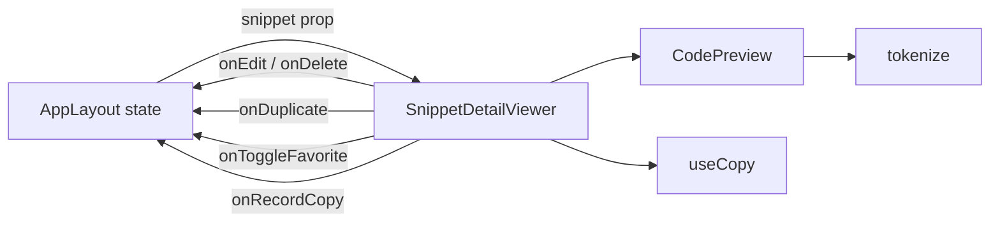
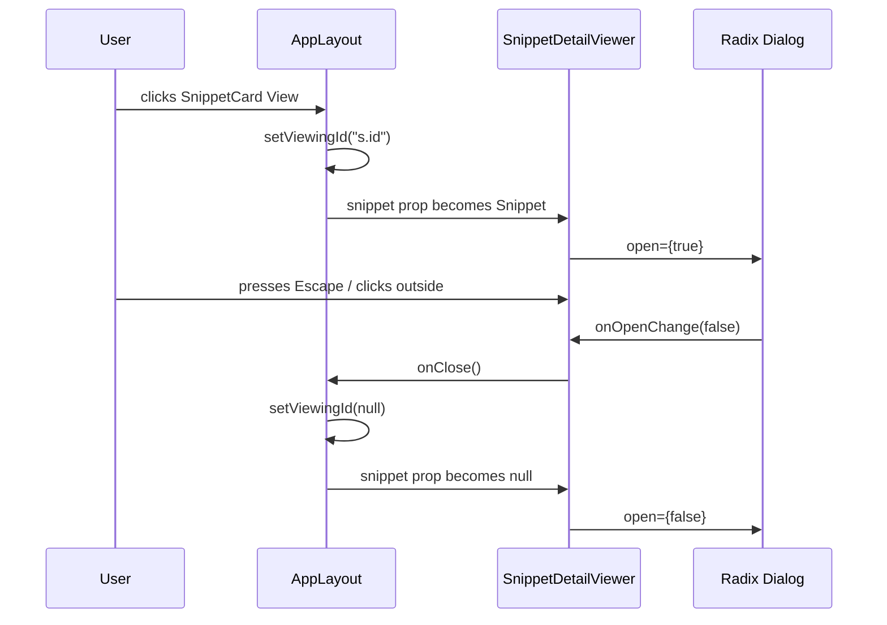
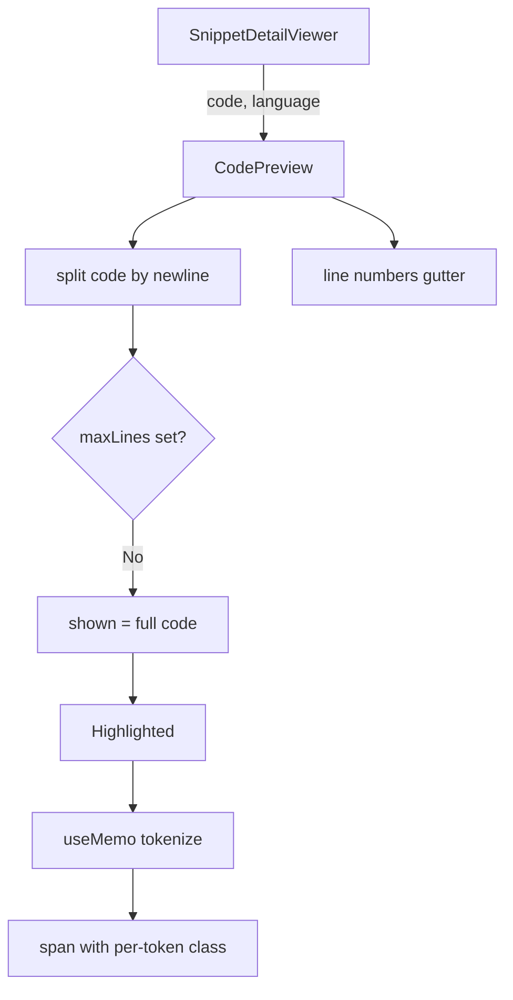
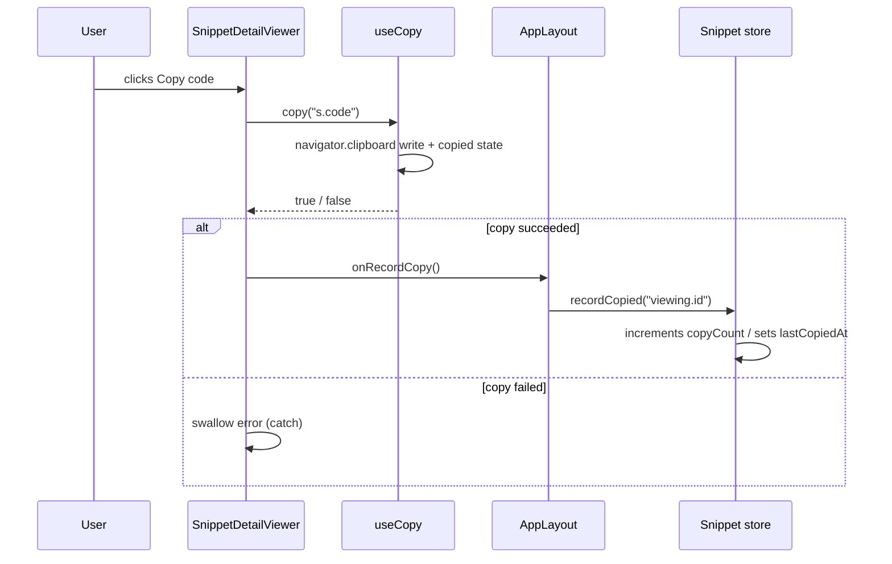

# SnippetDetailViewer modal component internals

This page documents the`SnippetDetailViewer` component (`src/components/SnippetDetailViewer.tsx`). It renders a read-only modal that displays the full details of a single snippet—metadata, tags, highlighted code, and action buttons.

## Purpose and role

`SnippetDetailViewer` is the "view" destination in CodeKnit's snippet lifecycle:

- It receives a`Snippet | null` prop. When the prop is null, the dialog stays closed; when non-null, the dialog opens.
- It renders the complete snippet body using`CodePreview`, which delegates syntax highlighting to the in-house tokenizer.
- It exposes five operation callbacks: edit, delete, duplicate, favorite toggle, and copy recording. All stateful operations remain owned by`AppLayout` and the snippet store.

> [!NOTE]
> The component is intentionally presentational. It does not call`useSnippets()` directly and never mutates the store. All operation callbacks are provided by`AppLayout`.

Figure: SnippetDetailViewer role in the snippet lifecycle



The component is mounted once in`AppLayout.tsx` and remains mounted; only its`snippet` prop changes. The dialog opens and closes through the`open={!!s}` expression rather than through mount/unmount.

## Props interface

```ts
interface Props {
  snippet: Snippet | null;
  onClose: () => void;
  onEdit: () => void;
  onDelete: () => void;
  onDuplicate: () => void;
  onToggleFavorite: () => void;
  onRecordCopy: () => Promise<void>;
}

export function SnippetDetailViewer({
  snippet: s, onClose, onEdit, onDelete, onDuplicate, onToggleFavorite, onRecordCopy,
}: Props) {
```

| Prop | Type | Purpose |
|---|---|---|
|`snippet` |`Snippet \| null` | The snippet to display.`null` closes the dialog. |
|`onClose` |`() => void` | Called when the dialog requests close (click outside, Escape, or close button). |
|`onEdit` |`() => void` | Opens the edit form for the viewed snippet. |
|`onDelete` |`() => void` | Opens the delete confirmation for the viewed snippet. |
|`onDuplicate` |`() => void` | Creates a duplicate of the viewed snippet. |
|`onToggleFavorite` |`() => void` | Toggles`isFavorite` on the viewed snippet in the store. |
|`onRecordCopy` |`() => Promise<void>` | Increments`copyCount` and sets`lastCopiedAt` after a successful clipboard copy. |

The`Snippet` type is defined in`src/lib/snippets/types.ts`. The`recordCopied` operation comes from`useSnippets()` in`src/lib/snippets/store.ts`.

## Dialog structure

The component wraps content in`Dialog` from`@/components/ui/dialog` (a Radix UI wrapper).

```tsx
<Dialog open={!!s} onOpenChange={(o) => !o && onClose()}>
  <DialogContent className="max-h-[92vh] overflow-y-auto sm:max-w-3xl">
    {s && (
      <>
        {/* header, tags, CodePreview, footer */}
      </>
    )}
  </DialogContent>
</Dialog>
```

Key structural decisions:

- **Open state** is derived from`!!s`, no separate`open` state. When`AppLayout` sets`viewingId` to a valid ID, the prop resolves to a`Snippet` and the dialog opens.
- **Close handling** uses`onOpenChange={(o) => !o && onClose()}`. Radix fires`onOpenChange(false)` when the user clicks outside, presses Escape, or clicks the close button; the component delegates that to`onClose`, which sets`viewingId` to`null`.
- **Scrolling** is handled by`max-h-[92vh] overflow-y-auto` on`DialogContent`. The dialog caps its height at 92% of the viewport and scrolls internal content.
- **Width** is`sm:max-w-3xl` (48rem on small screens and up).

The conditional`{s && ...}` guard prevents rendering content when the snippet is null during close/transition states. The dialog still mounts the`DialogContent`, but only renders children when a snippet exists.

Figure: Dialog open/close flow



## Component anatomy

The rendered content has five sections:

```tsx
{/* 1. Header */}
<DialogHeader>
  <div className="flex flex-wrap items-center gap-2 text-xs text-muted-foreground">
    <LanguageBadge language={s.language} />
    <span className="inline-flex items-center gap-1">
      <Folder className="h-3 w-3" />{s.category}
    </span>
  </div>
  <DialogTitle className="text-xl">{s.title}</DialogTitle>
  <DialogDescription>{s.description || "No description."}</DialogDescription>
</DialogHeader>

{/* 2. Tags */}
{s.tags.length > 0 && (
  <div className="flex flex-wrap gap-1.5">
    {s.tags.map((t) => (
      <span key={t} className="rounded-full bg-accent px-2 py-0.5 text-xs text-accent-foreground">
        #{t}
      </span>
    ))}
  </div>
)}

{/* 3. Code preview */}
<CodePreview code={s.code} language={s.language} className="max-h-[50vh] overflow-auto" />

{/* 4. Footer metadata + actions */}
<div className="flex flex-col gap-3 sm:flex-row sm:items-center sm:justify-between">
  {/* metadata and buttons */}
</div>
```

### Header

-`DialogTitle` uses`text-xl` for the snippet title.
-`DialogDescription` falls back to`"No description."` when the snippet has no description.
-`LanguageBadge` renders the language name with a colored dot. Its implementation is in`src/components/LanguageBadge.tsx` and uses`LANG_DOT` to map`JavaScript`,`Python`,`SQL`, and`Markdown` to syntax color classes.

### Tags section

- Only rendered when`s.tags.length > 0`.
- Each tag displays with a`#` prefix and`rounded-full` pill styling (`bg-accent`,`text-xs`,`text-accent-foreground`).
- This mirrors the tag markup in`SnippetCard`, but uses`text-xs` instead of`text-[11px]`.

### CodePreview integration

The code is rendered read-only via`CodePreview`, not the editable`CodeEditor`. The viewer passes no`maxLines` prop, so`CodePreview` displays the full snippet:

```tsx
<CodePreview code={s.code} language={s.language} className="max-h-[50vh] overflow-auto" />
```

Because`maxLines` is undefined,`CodePreview`:

- Splits`code` by`\n`.
- Sets`truncated = false` (the condition`lines.length > maxLines` is false).
- Sets`shown = code` (full source).
- Sets`count = lines.length` for line numbers.

The`className="max-h-[50vh] overflow-auto"` prop is passed to the outer`div` inside`CodePreview` via`cn("relative overflow-hidden rounded-lg border bg-code-bg", className)`. This caps the code area at 50% of the viewport height and adds internal scrolling.

`CodePreview` includes line numbers by default (`showLineNumbers` defaults to`true`) and renders the highlighted code via the`Highlighted` component, which calls`tokenize(code, language)` from`src/lib/snippets/highlight.ts`. See [CodePreview Component and Highlighted Text Rendering](doc:cd3f8be2-2446-4b51-a0a8-72d7008af212) and [Tokenizer API for Syntax Highlighting](doc:79aeb875-0e59-46cf-a0a9-86808f84d4d3).

Figure: CodePreview rendering path inside SnippetDetailViewer



### Footer metadata

The metadata line is a single`<p>` with several segments:

```tsx
<p className="text-xs text-muted-foreground">
  Created {formatDate(s.createdAt)} · Updated {formatDate(s.updatedAt)} · Copied {s.copyCount ?? 0} {(s.copyCount ?? 0) === 1 ? "time" : "times"}{s.lastCopiedAt ? ` · Last copied ${formatDate(s.lastCopiedAt)}` : ""}
</p>
```

| Segment | Source field | Format |
|---|---|---|
| Created |`s.createdAt` |`formatDate(iso)` → localized`{ month, day, year }` |
| Updated |`s.updatedAt` |`formatDate(iso)` |
| Copied count |`s.copyCount` | numeric, pluralized ("time" vs "times") |
| Last copied |`s.lastCopiedAt` | only rendered when truthy |

`formatDate` is exported from`src/components/LanguageBadge.tsx`:

```ts
export function formatDate(iso: string) {
  return new Date(iso).toLocaleDateString(undefined, { month: "short", day: "numeric", year: "numeric" });
}
```

## Action buttons

Five buttons appear in the footer, ordered in source: Favorite, Duplicate, Delete, Edit, Copy code.

```tsx
<div className="flex flex-wrap gap-2">
  <Button variant="ghost" size="sm" onClick={onToggleFavorite} aria-pressed={s.isFavorite}>
    <Star className={cn("h-4 w-4", s.isFavorite && "fill-syn-number text-syn-number")} />
    {s.isFavorite ? "Favorited" : "Favorite"}
  </Button>
  <Button variant="ghost" size="sm" onClick={onDuplicate}>
    <CopyPlus className="h-4 w-4" />Duplicate
  </Button>
  <Button variant="ghost" size="sm" onClick={onDelete} className="text-destructive hover:text-destructive">
    <Trash2 className="h-4 w-4" />Delete
  </Button>
  <Button variant="secondary" size="sm" onClick={onEdit}>
    <Pencil className="h-4 w-4" />Edit
  </Button>
  <Button size="sm" onClick={async () => { if (await copy(s.code)) { onRecordCopy().catch(() => undefined); } }}>
    {copied ? <Check className="h-4 w-4" /> : <Copy className="h-4 w-4" />}
    {copied ? "Copied!" : "Copy code"}
  </Button>
</div>
```

### Favorite toggle

- Uses`variant="ghost"` and`size="sm"`.
- Star icon is conditionally filled when`s.isFavorite` is true:`fill-syn-number text-syn-number`.
- Label flips between "Favorited" and "Favorite".
-`aria-pressed={s.isFavorite}` communicates toggle state to assistive tech.

### Duplicate

- Uses`variant="ghost"` and`size="sm"`.
- Renders a`CopyPlus` icon.
- Calls`onDuplicate` directly.`AppLayout` builds the duplicate input via`buildDuplicateInput` from`src/lib/snippets/duplicate.ts` and calls`create`.

### Delete

- Visually distinct with`text-destructive` and`hover:text-destructive`.
- Calls`onDelete` directly. The confirmation dialog (`ConfirmDeleteDialog`) is rendered by`AppLayout`, not inside`SnippetDetailViewer`.

### Edit

-`variant="secondary"`.
- Calls`onEdit` directly.`AppLayout` handles closing the viewer and opening`SnippetFormModal`.

### Copy code

- Uses the`useCopy` hook imported from`./use-copy`:

```tsx
const { copied, copy } = useCopy();
```

- On click, calls`copy(s.code)`. If the copy succeeds, it invokes`onRecordCopy()` and swallows errors with`.catch(() => undefined)`.
- Button face toggles between`Copy` icon and`Copied!` with`Check` icon based on`copied` state.
- Unlike`SnippetCard`, which also invokes`onRecordCopy` after`useCopy`, the viewer's handler wraps the promise in`async () => { ... }` to await the clipboard write before recording the copy.

Figure: Copy action flow



## Integration with AppLayout

`AppLayout.tsx` controls the`viewingId` state and derives the`snippet` prop.

Figure: SnippetDetailViewer state flow through AppLayout

```mermaid
graph TD
  A[AppLayout] -->|viewingId| B["snippets.find("s => s.id === viewingId")"]
  B --> C["viewing: Snippet | null"]
  C -->|prop| D[SnippetDetailViewer]

  D -->|onClose| E["setViewingId(null)"]
  D -->|onEdit| F["openEdit(viewing)"]
  D -->|onDelete| G["setDeleting(viewing)"]
  D -->|onDuplicate| H["duplicate(viewing)"]
  D -->|onToggleFavorite| I["fav(viewing)"]
  D -->|onRecordCopy| J["recordCopied("viewing.id")"]
```

### State and derivation

```tsx
const [viewingId, setViewingId] = useState<string | null>(null);
// ...
const viewing = snippets.find((s) => s.id === viewingId) ?? null;
```

`viewing` is recomputed on every render. If`viewingId` no longer matches an existing snippet (for example, after deletion),`viewing` is`null` and the dialog closes.

### Mounting the viewer

```tsx
<SnippetDetailViewer
  snippet={viewing}
  onClose={() => setViewingId(null)}
  onEdit={() => viewing && openEdit(viewing)}
  onDelete={() => viewing && setDeleting(viewing)}
  onDuplicate={() => viewing && void duplicate(viewing)}
  onToggleFavorite={() => viewing && fav(viewing)}
  onRecordCopy={() => viewing ? recordCopied(viewing.id).catch((e: Error) => { toast.error(e.message); }) : Promise.resolve()}
/>
```

### openEdit

```tsx
const openEdit = (s: Snippet) => {
  setViewingId(null);   // close viewer
  setEditing(s);        // populate form with snippet
  setFormOpen(true);    // open form modal
};
```

`openEdit` guarantees the viewer closes before the form opens. The edit form is`SnippetFormModal`.

### Delete handoff

```tsx
const confirmDelete = async () => {
  if (!deleting) return;
  try {
    await remove(deleting.id);
    if (viewingId === deleting.id) setViewingId(null);  // close viewer after confirmed delete
    toast.success("Snippet deleted");
  } catch (e) { toast.error((e as Error).message); }
  setDeleting(null);
};
```

When the user confirms deletion,`AppLayout` removes the snippet and then sets`viewingId` to`null`, closing`SnippetDetailViewer`. The`ConfirmDeleteDialog` is rendered by`AppLayout` and is not part of this component.

### Duplicate handoff

```tsx
const duplicate = async (s: Snippet) => {
  try {
    const created = await create(buildDuplicateInput(s, snippets.map((item) => item.title)));
    toast.success(`Created "${created.title}"`);
  } catch (e) {
    toast.error((e as Error).message);
  }
};
```

`duplicate` builds a new snippet input from the existing snippet and a list of existing titles, then calls`create`. The viewer does not close during duplication.

### Favorite and copy recording

```tsx
const fav = (s: Snippet) => toggleFavorite(s.id).catch((e: Error) => toast.error(e.message));
```

`fav` invokes`toggleFavorite` from`useSnippets()` and surfaces failures via`sonner` toast. For copy recording, the callback calls`recordCopied`:

```tsx
onRecordCopy={() => viewing ? recordCopied(viewing.id).catch((e: Error) => { toast.error(e.message); }) : Promise.resolve()}
```

If`viewing` is null, the callback resolves immediately.

## Relations to SnippetCard

`SnippetCard` and`SnippetDetailViewer` share several rendering patterns but differ in purpose:

| Aspect | SnippetCard | SnippetDetailViewer |
|---|---|---|
| Scope | Preview (grid/list) | Full detail (modal) |
|`CodePreview maxLines` |`list ? 6 : 8` | unset (full code) |
|`CodePreview` height | none |`max-h-[50vh] overflow-auto`