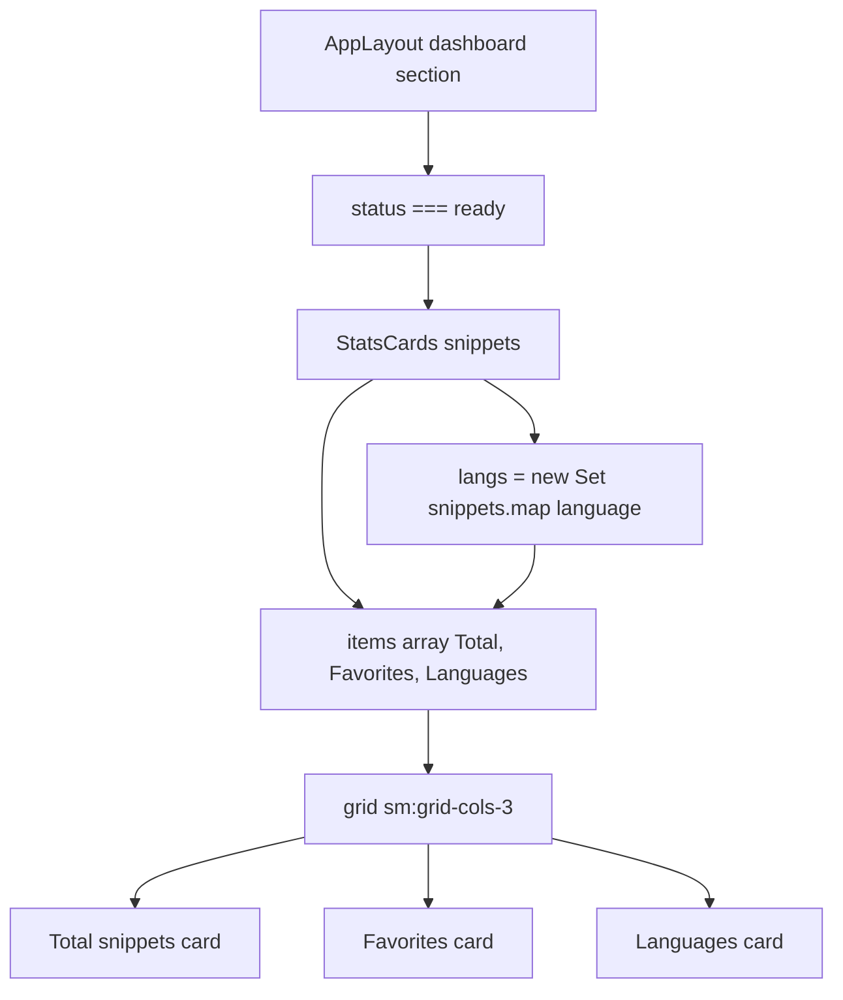

# StatsCards component and dashboard metrics

`StatsCards` is a presentational dashboard component that renders three aggregate metrics for the CodeKnit snippet library:

- total snippets in the library
- favorites count
- unique languages count

The component lives in`src/components/StatsCards.tsx` and is imported by`AppLayout` as`./StatsCards`.

The component has no internal state or side effects. It receives the full snippet list and computes the metrics directly during render.

## Component API

The component accepts a single required prop with an inline type:

```tsx
import { Code2, Languages, Star } from "lucide-react";
import type { Snippet } from "@/lib/snippets/types";

export function StatsCards({ snippets }: { snippets: Snippet[] }) {
  // ...
}
```

| Prop | Type | Description |
| --- | --- | --- |
|`snippets` |`Snippet[]` | The complete snippet library from`useSnippets()`, not the filtered`visible` list used by the library grid |

The`Snippet` type comes from`@/lib/snippets/types`. For the definition of a snippet as a saved unit of code or Markdown text with a title, language, and category, see [Key Concepts and Terminology](doc:08c7b9ec-c366-4fc5-b62c-01999c0ae167).

## Metric calculations

`StatsCards` builds exactly three metrics from the`snippets` array:

```tsx
const langs = new Set(snippets.map((s) => s.language));

const items = [
  { label: "Total snippets", value: snippets.length, icon: Code2, hint: "in your library" },
  { label: "Favorites", value: snippets.filter((s) => s.isFavorite).length, icon: Star, hint: "starred for quick access" },
  { label: "Languages", value: langs.size, icon: Languages, hint: [...langs].join(", ") || "none yet" },
];
```

| Metric | Calculation | Icon | Hint |
| --- | --- | --- | --- |
| Total snippets |`snippets.length` |`Code2` from`lucide-react` |`"in your library"` |
| Favorites |`snippets.filter((s) => s.isFavorite).length` |`Star` from`lucide-react` |`"starred for quick access"` |
| Languages |`langs.size` |`Languages` from`lucide-react` | Comma-separated list of languages, or`"none yet"` when empty |

### Unique language derivation

Unique languages are derived using a`Set`:

```tsx
const langs = new Set(snippets.map((s) => s.language));
```

`Set` deduplicates the`language` values. The card value uses`langs.size` for the count, and the hint displays the deduplicated values:

```tsx
[...langs].join(", ") || "none yet"
```

When`langs` is empty, the spread produces an empty string, so the fallback`"none yet"` is displayed.

## Rendering and responsive layout

The outer wrapper uses a CSS grid that stacks on small screens and switches to three columns at the Tailwind`sm` breakpoint:

```tsx
<div className="grid gap-3 sm:grid-cols-3">
```

Each metric is rendered as a card:

```tsx
{items.map(({ label, value, icon: Icon, hint }) => (
  <div key={label} className="rounded-xl border bg-card p-4 shadow-card">
    <div className="flex items-center justify-between text-sm text-muted-foreground">
      {label}<Icon className="h-4 w-4 text-primary" />
    </div>
    <div className="mt-2 text-2xl font-semibold tabular-nums">{value}</div>
    <div className="mt-0.5 truncate text-xs text-muted-foreground">{hint}</div>
  </div>
))}
```

### Card anatomy

Each metric card follows the same structure:

1. Card container:`rounded-xl border bg-card p-4 shadow-card`
2. Header row: metric label on the left, icon on the right
3. Value:`text-2xl font-semibold tabular-nums`
4. Hint:`truncate text-xs text-muted-foreground`

The`tabular-nums` class keeps numeric values aligned across cards. The`truncate` class prevents long language lists from breaking the card layout.

## Dashboard integration

`StatsCards` is a single-caller component.`AppLayout` renders it only when the active sidebar section is`dashboard` and the snippet store status is`ready`:

```tsx
{section === "dashboard" && (
  <section className="space-y-6">
    <div>
      <h1 className="text-2xl font-semibold tracking-tight md:text-3xl">Your code, organized.</h1>
      <p className="mt-1 text-muted-foreground">Save, discover, and reuse your best snippets.</p>
    </div>
    {status === "ready" && <StatsCards snippets={snippets} />}
  </section>
)}
```

The`snippets` prop comes directly from`useSnippets()` in`AppLayout`:

```tsx
const { snippets, status, error, reload, remove, toggleFavorite, recordCopied } = useSnippets();
```

The dashboard metrics always represent the complete library. Filters, section-specific views, and the`visible` computed array do not affect these numbers.

> [!NOTE]
>`StatsCards` receives the full`snippets` array, not the filtered`visible` array used by the snippet grid. The dashboard metrics show global library totals.

## Data flow

The following diagram shows how the metrics are derived from the snippet store and rendered as three cards.

Figure: StatsCards metric calculation and render path



## Behavior notes

- The component recalculates`snippets.length`, the favorites filter, and the`Set` on every render. There is no`useMemo` optimization in the source.
- With an empty snippet array, all three cards render`0`, and the Languages hint displays`"none yet"`.
- Loading and error states are handled by`AppLayout`, not by`StatsCards`. During`status === "loading"` or`"error"`, the dashboard does not render`StatsCards`.

## Complete component source

```tsx
import { Code2, Languages, Star } from "lucide-react";
import type { Snippet } from "@/lib/snippets/types";

export function StatsCards({ snippets }: { snippets: Snippet[] }) {
  const langs = new Set(snippets.map((s) => s.language));
  const items = [
    { label: "Total snippets", value: snippets.length, icon: Code2, hint: "in your library" },
    { label: "Favorites", value: snippets.filter((s) => s.isFavorite).length, icon: Star, hint: "starred for quick access" },
    { label: "Languages", value: langs.size, icon: Languages, hint: [...langs].join(", ") || "none yet" },
  ];
  return (
    <div className="grid gap-3 sm:grid-cols-3">
      {items.map(({ label, value, icon: Icon, hint }) => (
        <div key={label} className="rounded-xl border bg-card p-4 shadow-card">
          <div className="flex items-center justify-between text-sm text-muted-foreground">
            {label}<Icon className="h-4 w-4 text-primary" />
          </div>
          <div className="mt-2 text-2xl font-semibold tabular-nums">{value}</div>
          <div className="mt-0.5 truncate text-xs text-muted-foreground">{hint}</div>
        </div>
      ))}
    </div>
  );
}
```

## Related pages

- [AppLayout Component Internals and State Management](doc:40a3c2b0-9843-45b5-8768-fe031c98da4e)
- [Dashboard](doc:0cccb845-62f3-4e2b-b0ca-c7d768eaf700)
- [Key Concepts and Terminology](doc:08c7b9ec-c366-4fc5-b62c-01999c0ae167)