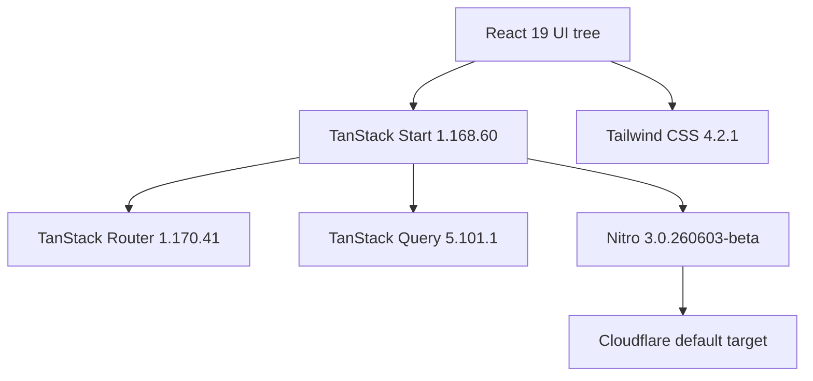
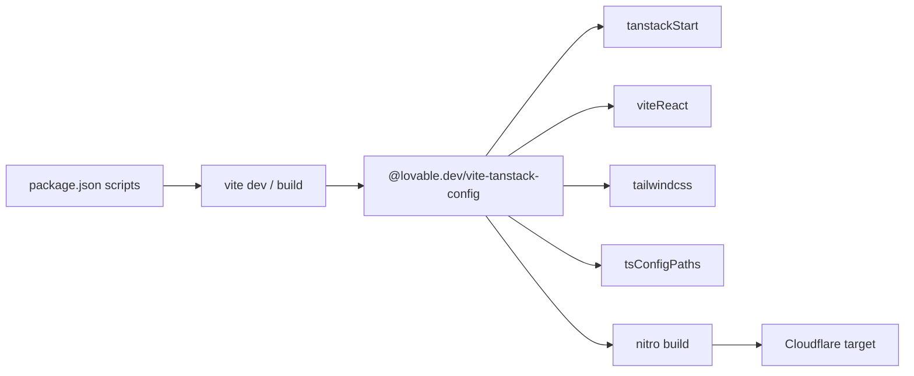
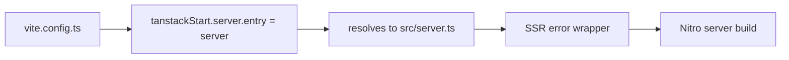
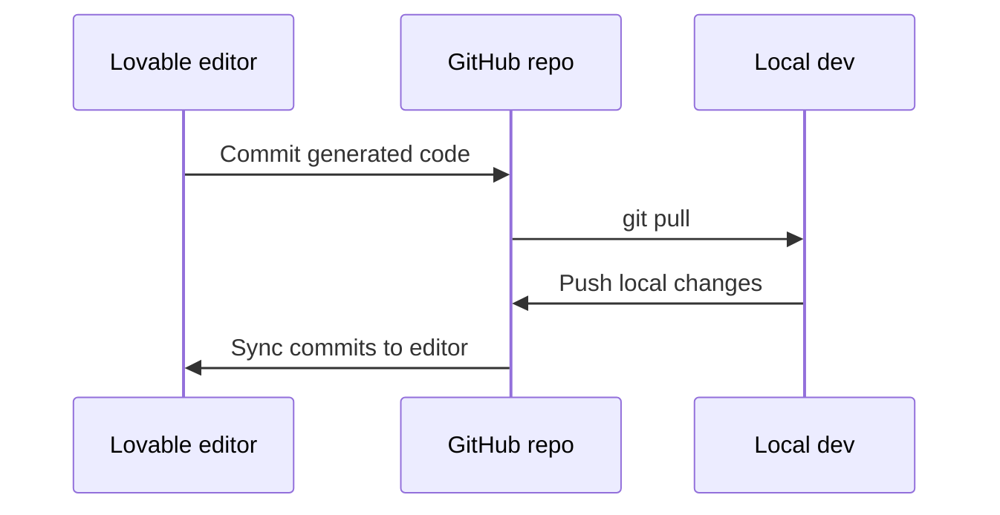
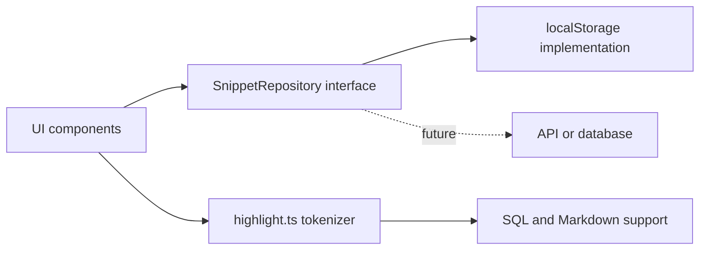

# TanStack start and lovable integration architecture

This document describes the CodeKnit application architecture as built on TanStack Start, TypeScript, React, and Tailwind CSS, including the Lovable editor integration model, the Vite build system, and deployment considerations.

## Overview

CodeKnit uses`react` 19,`@tanstack/react-start` 1.168.60, and`tailwindcss` 4.2.1 as the core UI and framework stack. The build is driven through`@lovable.dev/vite-tanstack-config`, which supplies the Vite, React, Tailwind, TanStack, and Nitro plugins so the repository`vite.config.ts` remains intentionally small.

The application has two major concerns separated by the repository design:

- Core editing and organization features run in the browser with React 19 and Radix UI primitives.
- TanStack Start provides the server entry, routing, and build layer, with Nitro handling production deployment targeting Cloudflare by default.

Figure: High-level stack architecture



## Tech stack and versions

The following versions are pinned in`package.json`:

| Stack area | Package | Version |
| --- | --- | --- |
| UI runtime |`react`,`react-dom` | 19.2.0 |
| App framework |`@tanstack/react-start` | 1.168.60 |
| Routing |`@tanstack/react-router` | 1.170.41 |
| Server-side data |`@tanstack/react-query` | 5.101.1 |
| Styling |`tailwindcss` | 4.2.1 |
| Styling Vite plugin |`@tailwindcss/vite` | 4.2.1 |
| Build tool |`vite` | 8.1.5 |
| Server build |`nitro` | 3.0.260603-beta |
| Lovable Vite wrapper |`@lovable.dev/vite-tanstack-config` | 2.26.5 |
| Language |`typescript` | 5.8.3 |
| Testing |`vitest` | 4.1.10 |
| Bundler override |`rolldown` | 1.2.1 |

The`overrides` block in`package.json` locks`rolldown` to`1.2.1` to avoid version conflicts across the build chain.

## Build configuration

The entire Vite configuration is defined in`vite.config.ts` through`@lovable.dev/vite-tanstack-config`. The file itself adds only one custom TanStack Start setting: the server entry is redirected to`src/server.ts`.

```ts
// vite.config.ts
import { defineConfig } from "@lovable.dev/vite-tanstack-config";

export default defineConfig({
  tanstackStart: {
    server: { entry: "server" },
  },
});
```

The comment in`vite.config.ts` states that`@lovable.dev/vite-tanstack-config` already includes the following plugins and should not have duplicates added manually, because doing so breaks the app:

- TanStack devtools in development only
-`tanstackStart`
-`viteReact`
-`tailwindcss`
-`tsConfigPaths`
-`nitro` in production only, using Cloudflare as the default target
-`VITE_*` environment variable injection
-`@` path alias
- React and TanStack dependency deduplication
- Error logger plugins
- Sandbox detection for port, host, and strict port handling

Figure: Build pipeline through the Lovable Vite wrapper



Environment variable injection, the`@` path alias, React and TanStack deduplication, error logging, and sandbox detection are also handled by the wrapper rather than by separate plugins in`vite.config.ts`.

Because`@lovable.dev/vite-tanstack-config` owns the plugin pipeline, changes to React or Tailwind configuration should normally happen through the wrapper's accepted configuration surface, not by adding separate plugins in`vite.config.ts`. For a more detailed breakdown, see [Vite and TanStack Start Configuration](doc:56670023-ad41-4ddf-aae3-738ca3a9dd22).

## Server entry and SSR wrapper

The`tanstackStart.server.entry` value`"server"` tells Nitro and Vite to resolve the bundled server entry point to`src/server.ts`. The comment in`vite.config.ts` describes`src/server.ts` as the SSR error wrapper for the app. The actual implementation of that wrapper is outside the source files provided for this document.

Figure: Server entry resolution



## Lovable editor integration

The project is explicitly connected to the Lovable editor, as documented in`README.md` and`AGENTS.md`. Lovable treats the GitHub repository as the source of truth and pushes committed changes directly to the repository.

The bidirectional sync model works as follows:

1. You open the project in the Lovable editor and describe a change.
2. Lovable generates the code and commits it directly to the connected GitHub repository.
3. A local developer pulls that commit with`git pull`.
4. Local changes are pushed back to the connected branch.
5. Lovable syncs those commits back into the editor.

Figure: Lovable and GitHub sync flow



### Git history constraint

`AGENTS.md` has the following required history rule:

> Avoid rewriting published git history, force pushing, or rebasing/amending/squashing commits that are already pushed, as it rewrites history on Lovable's side and the user will likely lose their project history.

The same file also requires that the connected branch remain in a working state, since commits pushed to that branch sync back to Lovable and appear in the editor. This makes a rebase-free, fast-forward-friendly history the safe default for local development.

## Development lifecycle

`README.md` documents the local workflow as:

```sh
git clone <this-repository-url>
cd <repository-name>
npm i
npm run dev
```

For full local environment and dependency setup, see [Local Development Environment Setup and Build Configuration](doc:1303c38c-f594-4f8d-8995-b85a8e7dec21).

The scripts defined in`package.json` cover development, build, preview, linting, formatting, and testing:

| Script | Command | Purpose |
| --- | --- | --- |
|`dev` |`vite dev` | Start the local Vite development server |
|`build` |`vite build` | Create a production build |
|`build:dev` |`vite build --mode development` | Create a development-mode build |
|`preview` |`vite preview` | Preview the built app locally |
|`lint` |`eslint .` | Run ESLint across the project |
|`format` |`prettier --write .` | Format all files with Prettier |
|`test` |`vitest run` | Run the test suite once |
|`test:watch` |`vitest` | Run tests in watch mode |

## Deployment considerations

Nitro is the serverless deployment layer included in`devDependencies` at`3.0.260603-beta`. According to`vite.config.ts`, the default Nitro build target is Cloudflare. This means`vite build` emits both the client bundle and the Nitro server output configured for Cloudflare unless a different deployment target is supplied.

Environment configuration uses Vite's`VITE_*` variable injection, which is handled by`@lovable.dev/vite-tanstack-config`. Only variables prefixed with`VITE_` are exposed to the client bundle.

## Repository data architecture

While this document focuses on the framework and build layer,`AGENTS.md` records two architectural decisions that describe how the CodeKnit feature layer is organized:

- All snippet data flows through`SnippetRepository` in`src/lib/snippets/repository.ts`. Its current implementation uses browser`localStorage`. The intended evolution is to swap that implementation for an API or database backend without changing UI components.
- Syntax highlighting is implemented as a small in-house regex tokenizer in`src/lib/snippets/highlight.ts`. The project intentionally does not depend on Prism, which keeps SQL and Markdown highlighting lightweight.

These decisions isolate persistence and highlighting behind narrow abstractions, so the React and TanStack Start layers interact with repository and tokenizer interfaces rather than directly with storage or third-party highlighting libraries.

Figure: Data flow boundary



## What is not included in this document

The source files provided do not include the implementation of`src/server.ts`, route definitions, component hierarchy, or the repository internals. Those details belong to the component and API reference pages listed in the related section.

## Related

- [Lovable Integration and Build System Overview](doc:f70b6ce7-9413-4cbf-b1fc-e8e547b1be8e)
- [TanStack Start Configuration and Build System](doc:2df025f8-168c-45e7-ba3f-a91daecafa0a)
- [Vite and TanStack Start Configuration](doc:56670023-ad41-4ddf-aae3-738ca3a9dd22)
- [CodeKnit Codebase Structure and Architecture Overview](doc:a2b9a50a-1312-4b57-a8ac-f42e5f28a5cd)
- [CodeKnit Application Architecture Overview](doc:20aa63ca-be9d-4ffc-95a1-73225323dc6b)
- [Project Structure and Source Code Organization](doc:818b2bc5-0a7e-4efe-8135-13b0c4f7095c)