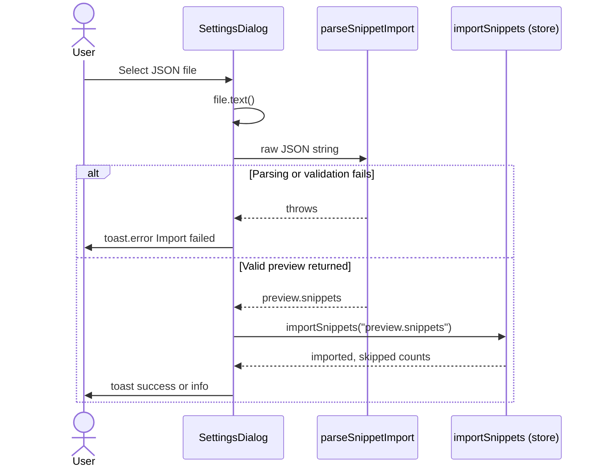
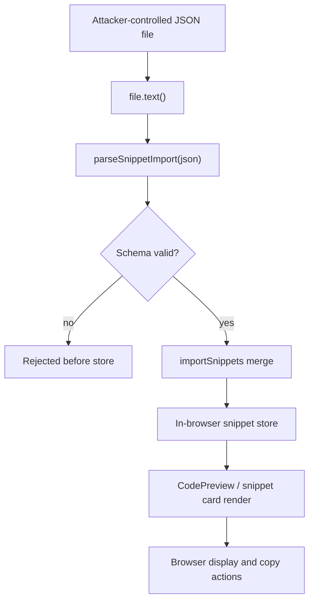

# Client-side data export and import security

**Scope:**`SettingsDialog.tsx` export and import flows, JSON validation, file handling, data integrity, and attack vectors.

**Primary source:**`SettingsDialog.tsx` in the application root, which exposes`exportJson`,`importJson`, and`reset`. The import path references`parseSnippetImport` from`@/lib/snippets/import-export` and`importSnippets` from`@/lib/snippets/store`; those modules are not present in the provided source files, so any behavior not visible in`SettingsDialog.tsx` is identified explicitly as an unverified boundary.

---

## Overview

CodeKnit exports and imports the entire snippet library as a single JSON file from the Settings dialog. Both operations run entirely in the browser; no network request or server-side processing is involved.

The file`SettingsDialog.tsx` defines the full user-facing flow:

- **Export** serializes the in-memory snippet array with`JSON.stringify(snippets, null, 2)`, wraps it in a`Blob` typed as`application/json`, creates a temporary object URL, and triggers a download named`codeknit-snippets.json`.
- **Import** reads the selected file through`file.text()`, passes the raw string to`parseSnippetImport(json)` for validation, and only after that returns a parsed preview does it call`importSnippets(preview.snippets)` to merge into the store.

The central import safety property is stated directly in the code comment inside`importJson`:

```ts
// Validate the entire file before touching saved data.
const preview = parseSnippetImport(json);
```

Figure: Export and import data flow through SettingsDialog

```mermaid
graph LR
    A["Snippets in store"] --> B["exportJson"]
    B --> C["JSON.stringify(snippets)"]
    C --> D["Blob (application/json)"]
    D --> E["Object URL"]
    E --> F["Download codeknit-snippets.json"]

    G["User-selected file"] --> H["file.text()"]
    H --> I["parseSnippetImport(json)"]
    I --> J{"Valid preview?"}
    J -- no --> K["toast.error Import failed"]
    J -- yes --> L["importSnippets("preview.snippets")"]
    L --> M["Merge into browser store"]
```

---

## Export flow and security controls

The export handler in`SettingsDialog.tsx`:

```ts
const exportJson = () => {
  const url = URL.createObjectURL(new Blob([JSON.stringify(snippets, null, 2)], { type: "application/json" }));
  const a = document.createElement("a");
  a.href = url;
  a.download = "codeknit-snippets.json";
  a.click();
  URL.revokeObjectURL(url);
  toast.success("Exported snippets", { description: `${snippets.length} snippets downloaded.` });
};
```

### Security-relevant properties

- **No network transmission.** The`Blob` and object URL are local browser APIs;`a.click()` triggers a client-side download only.
- **Object URL is revoked.**`URL.revokeObjectURL(url)` releases the temporary URL reference after`click()`. Failure to revoke would leak a browser-held blob reference until document unload.
- **Fixed download filename.**`a.download = "codeknit-snippets.json"` prevents attacker-controlled filenames. The extension is hardcoded, not derived from user input.
- **Content type is explicit.** The`Blob` is typed as`application/json`, which constrains how the browser treats the download.

### Data exposure in exports

The export contains the complete snippet record for every entry in the library. Fields used across the application include`id`,`title`,`description`,`language`,`category`,`tags`,`isFavorite`,`code`,`createdAt`,`updatedAt`,`copyCount`, and`lastCopiedAt`. The export performs **no redaction or filtering**: if snippet code contains secrets, API keys, or environment-specific values, those are written to the JSON in plaintext.

Because the download is local, its confidentiality risk depends on the destination file system. Anyone with read access to that file can read the full snippet contents.

---

## Import flow and validation

The import handler in`SettingsDialog.tsx`:

```ts
const importJson = async (file?: File) => {
  if (!file) return;
  setIsImporting(true);
  try {
    const json = await file.text();
    // Validate the entire file before touching saved data.
    const preview = parseSnippetImport(json);
    const result = await importSnippets(preview.snippets);
    const skipped = result.skipped + preview.duplicateCount;
    if (result.imported === 0) {
      toast.info("No new snippets imported", { description: `${skipped} duplicate snippet(s) skipped.` });
    } else {
      toast.success("Import complete", {
        description: `${result.imported} imported${skipped ? `, ${skipped} duplicate(s) skipped` : ""}.`,
      });
    }
  } catch (error) {
    toast.error("Import failed", {
      description: error instanceof Error ? error.message : "Could not read this file.",
    });
  } finally {
    setIsImporting(false);
    if (fileInputRef.current) fileInputRef.current.value = "";
  }
};
```

Figure: Import validation sequence through SettingsDialog



### File input constraints

The file picker element:

```tsx
<input
  ref={fileInputRef}
  type="file"
  accept=".json,application/json"
  className="hidden"
  aria-label="Choose CodeKnit JSON export"
  onChange={(event) => void importJson(event.target.files?.[0])}
/>
```

-`accept=".json,application/json"` filters the default file picker to JSON files. This is a **UX affordance, not a security boundary**. A user can switch the picker to **All files** and select any file; the actual defense must come from`parseSnippetImport`, not the`accept` attribute.
- The input is visually hidden and triggered only through the **Import JSON** button, reducing accidental imports.
-`isImporting` disables the button and changes its label to **Importing…**, preventing concurrent import attempts while one file is being parsed or merged.
- The`finally` block clears`fileInputRef.current.value`, allowing the same file to be selected again after a failed correction.

### Validation before mutation

The ordering in`importJson` is the principal defensive control visible in the provided source:

1. Read the file fully into a string with`file.text()`.
2. Parse and validate it with`parseSnippetImport(json)`.
3. Only if`parseSnippetImport` returns a preview does the handler call`importSnippets(preview.snippets)`.

Any exception thrown by`file.text()` or`parseSnippetImport` is caught before the store is touched. The catch block shows a`toast.error` titled **Import failed** and preserves existing snippets.

> [!IMPORTANT]
> The internal validation rules of`parseSnippetImport` and the merge behavior of`importSnippets` live in`@/lib/snippets/import-export` and`@/lib/snippets/store`, which are not included in the provided source. The exact schema checks, type coercion, and duplicate-key handling cannot be verified from`SettingsDialog.tsx` alone. See [JSON File Validation and Import Security Controls](doc:41ce0b28-4d51-493e-987c-e51904964939) and [CodeKnit JSON File Import Validation and Security](doc:13db5f40-c64f-4e12-aa9f-6234ca27360c) for the validation policy.

---

## Data integrity and merge semantics

The Settings dialog copy states the merge contract to the user:

> Merge snippets from a CodeKnit JSON export. Existing snippets are kept; duplicates are skipped.

The code reflects that contract through the return shape used after import:

```ts
const skipped = result.skipped + preview.duplicateCount;
```

-`result.skipped` comes from`importSnippets`;`preview.duplicateCount` comes from`parseSnippetImport`. Both are combined into the single`skipped` count reported to the user.
- The import is **merge-only** for imported records: existing data is not replaced by default. The separate **Reset to sample data** action is the only flow that replaces all snippets.
- The import does not overwrite the whole library: it adds new snippets and skips duplicates.

### Duplicate handling

Duplicate snippets are skipped rather than overwriting existing entries. This prevents a malformed or stale export file from silently clobbering newer local data. When`result.imported === 0`, the UI shows an informational toast titled **No new snippets imported** with the number of duplicates skipped.

---

## Threat model and attack vectors

The import file is untrusted user input until`parseSnippetImport` successfully validates it. The following vectors are relevant within the boundaries visible in the provided source.

Figure: Import threat boundary and downstream exposure



### 1. Malformed JSON

`file.text()` returns raw text;`JSON.parse` inside`parseSnippetImport` (unverified but strongly implied by the function name) will throw on malformed input. The`try/catch` in`importJson` catches that throw and surfaces`error.message` in a toast. Existing snippets remain untouched.

### 2. Oversized JSON (denial of service via memory pressure)

There is **no visible file size limit** before`file.text()` reads the entire selected file into a JavaScript string. A very large file can consume unbounded browser memory during the read and during JSON parsing. This is a client-local availability concern rather than a network DoS, but a crafted multi-megabyte file can freeze the tab. No`file.size` check is present in`SettingsDialog.tsx`.

### 3. Wrong-shape JSON

A file may be valid JSON but not a valid snippet export—for example, a number, a string, an array, or an object without the expected`snippets` key.`parseSnippetImport` is responsible for rejecting these shapes before`importSnippets` runs. The exact shape checks are not visible in the provided files. See [JSON Import File Validation and Deserialization Security](doc:7102313a-7a6a-44c1-9dc2-625c4d9e90b6) for the validation policy.

### 4. Imported content rendered later

Snippet fields such as`title`,`description`,`code`,`category`, and`tags` are eventually rendered by React components. React escapes text nodes by default, but`code` is also passed through`Highlighted` /`tokenize` from the custom highlighter in`CodePreview.tsx`. Import is a delivery path for attacker-influenced strings into those rendering surfaces. For threat modeling details, see [File Upload and Import Validation Security Threats](doc:cf9514b9-bbd2-4e9e-b2bb-0e00c49990f5).

### 5. Prototype pollution through imported keys

If`parseSnippetImport` or`importSnippets` shallow-merges imported objects using spread syntax without rejecting keys such as`__proto__` or`constructor`, a crafted JSON object could pollute`Object.prototype`. This cannot be confirmed or ruled out from`SettingsDialog.tsx` alone; the import/export and store modules must be audited separately.

### 6. Duplicate or spoofed identifiers

An import file can contain snippet`id` values that collide with local IDs. The intended duplicate-skip behavior is the mitigation, but the matching key and normalization logic reside in the unverified store module. If identity is determined by mutable fields rather than a stable`id`, duplicate detection could behave differently than expected.

---

## Reset behavior and state safeguards

The Settings dialog also contains a **Reset to sample data** control with a confirmation gate:

```tsx
<Button variant="destructive" onClick={async () => {
  if (!confirm) return setConfirm(true);
  try {
    await reset();
    toast.success("Library reset");
    onOpenChange(false);
  } catch (error) {
    toast.error("Could not reset library", { description: error instanceof Error ? error.message : "Please try again." });
  }
}}>{confirm ? "Confirm reset" : "Reset"}</Button>
```

- The first click only flips the local`confirm` flag to`true` and changes the label to **Confirm reset**; a second click performs`reset()`.
- Closing the dialog resets`confirm` to`false` through the`onOpenChange` wrapper:

```tsx
onOpenChange={(o) => { onOpenChange(o); setConfirm(false); }}
```

- A failed`reset()` keeps the dialog open and does not close the panel, preserving the existing state and showing an error toast.

---

## Residual risks and hardening gaps

These are risks visible in the provided source that remain unmitigated:

| Risk | Evidence | Status |
|------|----------|--------|
| No file size limit before`file.text()` | No`file.size` check in`importJson` | Open |
| No cryptographic integrity check | Export has no checksum/HMAC; import has no signature verification | Open |
| Export is plaintext and unredacted |`JSON.stringify(snippets)` serializes all fields | Open |
|`accept` attribute is not a true boundary | Users can bypass the file-type filter | Inherent; validation must compensate |
|`parseSnippetImport` internals unverified | Module not in provided sources | Audit required |
|`importSnippets` internals unverified | Module not in provided sources | Audit required |

---

## Related pages

- [JSON File Validation and Import Security Controls](doc:41ce0b28-4d51-493e-987c-e51904964939)
- [JSON Import File Validation and Deserialization Security](doc:7102313a-7a6a-44c1-9dc2-625c4d9e90b6)
- [CodeKnit JSON File Import Validation and Security](doc:13db5f40-c64f-4e12-aa9f-6234ca27360c)
- [File Upload and Import Validation Security Threats](doc:cf9514b9-bbd2-4e9e-b2bb-0e00c49990f5)
- [Client-Side Data Privacy and User Consent Controls](doc:d4c8dfe6-7de6-4d1a-9727-7fbebf541be7)
- [Settings and Data Management](doc:23aefc87-ca4f-4220-98f9-a85aea4a7855)