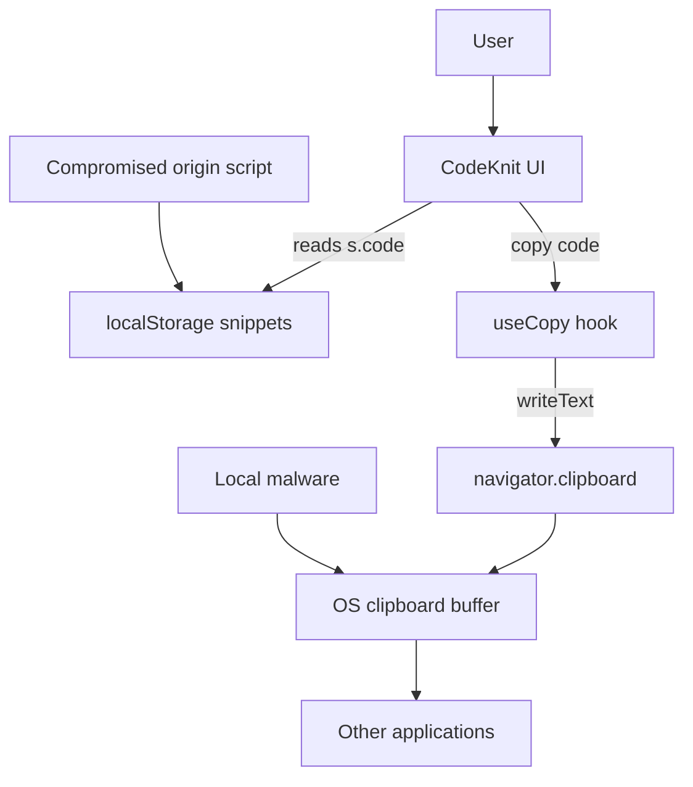

# Clipboard access and copy operations security threats

## Overview

CodeKnit copies snippet content to the system clipboard through a`useCopy` React hook. The hook is invoked from two UI surfaces:

-`SnippetCard`, the snippet card shown in the library grid or list view.
-`SnippetDetailViewer`, the modal that opens when you select a snippet.

This page analyzes the security-relevant behavior of these clipboard operations: what data enters the clipboard, how browser restrictions affect access, how failures are surfaced to you, and what the copy operation implies for confidentiality and integrity.

The`useCopy` implementation is not present in the provided source files. Its contract is inferred from its call sites in`SnippetCard.tsx` and`SnippetDetailViewer.tsx`, plus the stated design intent that the hook accesses`navigator.clipboard`. Findings that rest on inference rather than direct code evidence are marked as such.

## Clipboard data sensitivity

CodeKnit copies the full raw snippet body —`s.code`, with no truncation, redaction, or transformation. A snippet may contain:

- API keys, bearer tokens, or password strings embedded in example code
- SQL connection strings with embedded credentials
- Proprietary or unreviewed source code
- Markdown or code comments that mention secrets or environment details

When you click **Copy**, the entire`s.code` string is placed on the system clipboard. Both`SnippetCard.tsx` and`SnippetDetailViewer.tsx` pass`s.code` directly to the copy function:

- In`SnippetCard.tsx`:`copy(s.code)`
- In`SnippetDetailViewer.tsx`:`copy(s.code)`

The copied value is the exact string stored in the`Snippet` object. No redaction step exists between the stored snippet and the clipboard write.

## Copy operation flow

The diagram below shows the end-to-end flow from user interaction to localStorage tracking. The`navigator.clipboard.writeText` step is inferred from the task description; the remaining steps are evidenced by the provided call sites.

Figure: Clipboard copy operation flow

```mermaid
sequenceDiagram
    participant U as User
    participant V as SnippetCard / DetailViewer
    participant H as useCopy hook
    participant C as navigator.clipboard
    participant S as Snippet store
    U->>V: Click Copy button
    V->>H: copy("s.code")
    H->>C: writeText("s.code")
    alt Clipboard write allowed
        C-->>H: Resolve success
        H-->>V: Return true
        V->>S: recordCopied("s.id")
        S-->>S: increment copyCount, set lastCopiedAt
    else Clipboard access blocked or denied
        C-->>H: Reject or error
        H-->>V: Return false
        Note over V: No recordCopied call; button stays in Copy state
    end
```

The copy attempt is always initiated by a user gesture: the **Copy** button click. This gesture is important because modern browsers frequently require transient user activation for clipboard writes.

## Trust boundaries

The critical security boundary in this feature is between the browser's origin-isolated storage and the operating-system clipboard.

Figure: Clipboard trust boundary



Inside the browser origin, snippet data is scoped to the origin that wrote it, as indicated in`SettingsDialog.tsx`: "Your snippets are stored in this browser." In contrast, the system clipboard is shared across the operating system. Once CodeKnit writes code to the clipboard, any process with the appropriate OS-level permissions can read it, a boundary the application cannot enforce.

## Browser security restrictions on clipboard access

The browser itself enforces several limiting controls on`navigator.clipboard.writeText`. These are platform properties of the Clipboard API rather than CodeKnit-specific code, but they directly constrain this feature:

- **Secure context requirement.**`navigator.clipboard` is available only in secure contexts: HTTPS or`localhost`. On plain HTTP, the API is typically unavailable, and`copy()` is expected to fail.
- **Permissions Policy.** A host document or browser policy can block`clipboard-write`, causing write attempts to reject.
- **User activation.** Modern browsers generally require transient user activation before a script may write to the clipboard. The CodeKnit call sites satisfy this because the write happens inside a click handler.
- **Browser or extension interference.** Privacy-focused browsers, enterprise policies, and some extensions can silently deny clipboard writes.

Because`use-copy.ts` is not in the provided source set, the exact rejection handling inside the hook is unverified. The call sites imply the hook normalizes denial by returning a falsy value rather than throwing; each call site tests the resolved result with`if (await copy(s.code))`.

## Error handling and failure modes

The two call sites handle copy outcomes in slightly different ways:

- In`SnippetCard.tsx`, the click handler is:`if (await copy(s.code)) { onRecordCopy().catch(() => undefined); }`.
- In`SnippetDetailViewer.tsx`, the click handler is:`if (await copy(s.code)) { onRecordCopy().catch(() => undefined); }`.

In both cases,`recordCopied()` runs only after a successful copy. If the clipboard write fails, no copy-count update occurs.

Copy-failure feedback is limited at the provided call sites. When`copy()` returns a falsy value:

- The`copied` state remains false.
- The button label remains **Copy** rather than **Copied!**.
- No error toast or inline message is rendered in`SnippetCard.tsx` or`SnippetDetailViewer.tsx`.

> [!WARNING]
> A silent copy failure can leave previously copied content in the system clipboard. If you then paste, you may paste stale or unrelated data, potentially a previously copied credential, into an unintended destination.

The`useCopy` hook may render its own error toast internally, but the provided source files do not show that behavior. Treat any error notification beyond the uncopied button state as unverified.

## Copy usage tracking: Auditability and privacy

After a successful copy, the caller invokes`recordCopied(s.id)`. The implementation lives in the snippet store (`useSnippets`), which is not included in the provided files. The UI evidence is clear about what is tracked:

-`SnippetCard.tsx` renders "Copied {s.copyCount} time(s)" when`s.copyCount` is greater than zero.
-`SnippetDetailViewer.tsx` renders "Copied {s.copyCount} time(s)" and "Last copied {s.lastCopiedAt}".

This means each successful copy increments`copyCount` and updates`lastCopiedAt` in localStorage. The tracking is functional metadata, not a copy of the clipboard contents. It does, however, reveal usage patterns: an attacker who extracts localStorage learns which snippets you copied and when you last copied them.

## Threat scenarios

The following scenarios describe realistic risks from clipboard access.

1. **Persistent sensitive data in the system clipboard.** Once you copy a snippet, the text remains in the OS clipboard until overwritten or cleared. Some operating systems and clipboard managers retain clipboard history indefinitely.

2. **Clipboard monitoring by local malware.** A malicious user-level process on the same device can read the clipboard buffer. Credentials, connection strings, or proprietary code placed there are directly available to that process.

3. **Secrets embedded in stored snippets.** CodeKnit accepts arbitrary`s.code` input from`SnippetFormModal.tsx` and`CodeEditor.tsx`. A snippet that