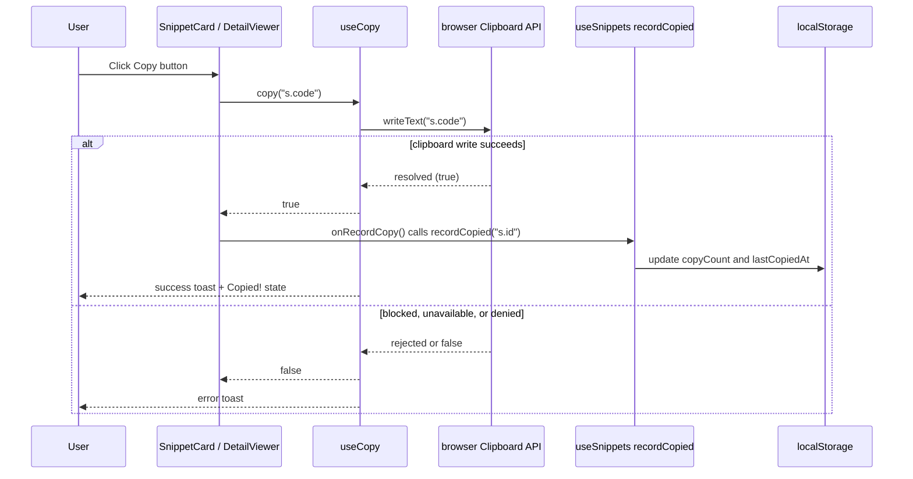
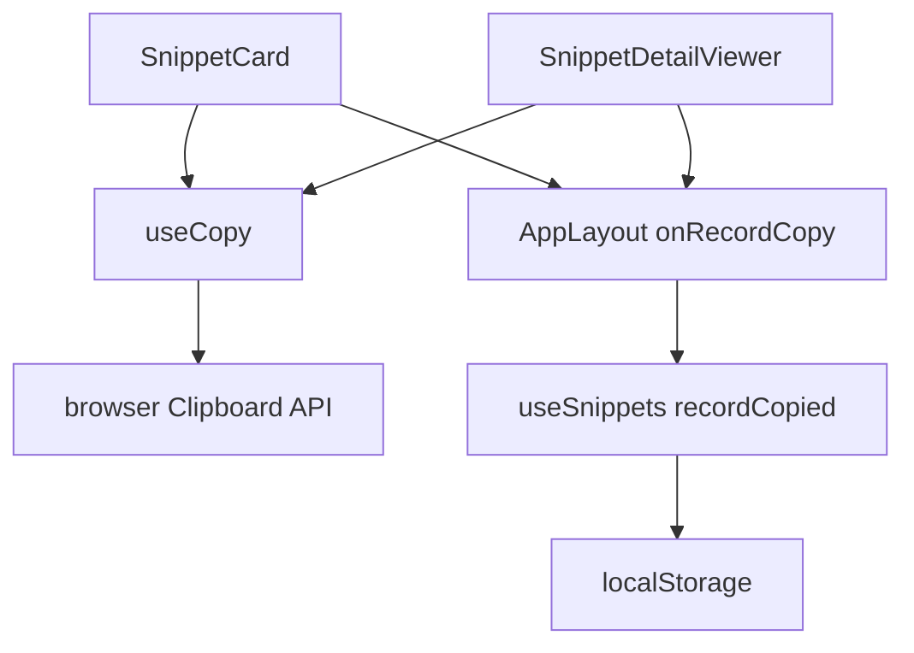

# Clipboard security and copy tracking controls

This document describes the security controls for clipboard operations in CodeKnit, how copy counts are tracked, and how blocked clipboard access is handled. It covers the`SnippetCard`,`SnippetDetailViewer`, and`AppLayout` components, and the`useCopy` and`recordCopied` mechanisms.

## Overview

CodeKnit copies only the snippet code string to the system clipboard. The copy operation is user-initiated and requires an explicit click of a **Copy** or **Copy code** button. Copy counts and last-copied timestamps update only after a successful clipboard write. Metadata such as title, description, tags, category, and favorite status is never written to the clipboard.

The copy flow is split into two phases:

1. **Clipboard write**, handled by the`useCopy` hook.
2. **Copy tracking**, handled by`recordCopied` from the`useSnippets` store.

The implementation of`use-copy.ts` is not included in the provided source files. Its behavior is inferred from how`SnippetCard.tsx` and`SnippetDetailViewer.tsx` call it:`copy()` returns a`Promise<boolean>` where`true` means the clipboard write succeeded and`false` means it failed. The hook is also responsible for success and error toast feedback.

## Copy operation flow

The copy action is triggered by a button click. The component calls`copy(s.code)`. If the clipboard write succeeds, the component calls`onRecordCopy()`, which invokes`recordCopied(s.id)` in`AppLayout.tsx`. If the clipboard write fails, no copy tracking occurs.

Figure: Copy operation and tracking flow



The flow ensures that`recordCopied` is invoked only when the clipboard write succeeds. The copy button's click handler in`SnippetCard.tsx` contains this guard:

```tsx
if (await copy(s.code)) {
  onRecordCopy().catch(() => undefined);
}
```

The same guard appears in`SnippetDetailViewer.tsx`.

## Security controls

### User-gesture requirement

Copying is available only through explicit button clicks. There is no automatic copy on snippet render, on view, or on navigation.

- In`SnippetCard.tsx`, the **Copy** button is inside the`CardFooter` function and handles its own`onClick` with`e.stopPropagation()` to prevent card-level navigation.
- In`SnippetDetailViewer.tsx`, the **Copy code** button is rendered in the dialog action area and calls`copy(s.code)` inside its`onClick`.

### Clipboard API restrictions

The browser Clipboard API requires a secure context (HTTPS or localhost). When the API is unavailable or the user denies clipboard permission,`useCopy` returns`false` or rejects. The provided components do not implement a fallback to legacy`document.execCommand("copy")`; error handling is delegated to`useCopy`.

### Success-only copy tracking

Copy counts and`lastCopiedAt` values update only after`copy(s.code)` resolves to`true`. This prevents inflated copy counts when the clipboard is blocked, unavailable, or denied. The branch is present in both components:

```tsx
if (await copy(s.code)) {
  onRecordCopy().catch(() => undefined);
}
```

### Recording error handling

- In`SnippetCard.tsx`, errors from`onRecordCopy` are swallowed with`catch(() => undefined)`. A copy-tracking failure does not prevent the success state from appearing.
- In`SnippetDetailViewer.tsx`, the`onRecordCopy` passed from`AppLayout.tsx` includes its own error handler:

```tsx
onRecordCopy={() =>
  viewing
    ? recordCopied(viewing.id).catch((e: Error) => { toast.error(e.message); })
    : Promise.resolve()
}
```

A failure to persist copy metadata after a successful clipboard write shows an error toast in the detail viewer, but the code copy itself has already succeeded.

### Content copied

Only the snippet's`code` property is passed to`copy()`:

-`SnippetCard.tsx`:`copy(s.code)`
-`SnippetDetailViewer.tsx`:`copy(s.code)`

No other snippet metadata is copied to the clipboard.

### User feedback

The`useCopy` hook exposes a`copied` boolean. The button label changes to **Copied!** with a check icon when copying succeeds. The hook also displays toast notifications for success and failure through the`sonner` library, which is listed in`package.json` dependencies.

## Copy count and lastCopiedAt metadata

Copy tracking data is stored in browser`localStorage` through the`useSnippets` store. The`recordCopied` function updates the snippet's`copyCount` and`lastCopiedAt`; its implementation is not included in the provided source files. The data is displayed in:

-`SnippetCard.tsx`, shows`Copied {s.copyCount} times` when`(s.copyCount ?? 0) > 0`.
-`SnippetDetailViewer.tsx`, shows`Copied {s.copyCount ?? 0} times · Last copied {formatDate(s.lastCopiedAt)}`.
-`AppLayout.tsx`, computes the **Recently Used** count with`snippets.filter((s) => Boolean(s.lastCopiedAt)).length` and sorts the **Recently Used** section by`lastCopiedAt` in descending order.

These values persist locally and are never written to the clipboard.

## Error handling for blocked clipboard access

The UI handles blocked clipboard access gracefully. The following table summarizes the behavior.

| Condition | Result of`copy()` | User feedback | Copy count updated? |
|---|---|---|---|
| Clipboard write succeeds |`true` | Success toast + **Copied!** state | Yes |
| Clipboard API unavailable, blocked, or denied |`false` | Error toast from`useCopy` | No |
| Clipboard write succeeds, but`recordCopied` fails |`true` (copy already done) | Error toast only in`SnippetDetailViewer` | No (localStorage update failed) |

The copy count is not updated when the clipboard is blocked because`onRecordCopy` is called only after`copy()` returns`true`.

## Component relationships

The following diagram shows the relationship between the copy buttons, the`useCopy` hook, the`recordCopied` store function, and`localStorage`.

Figure: Clipboard and copy tracking components



`AppLayout.tsx` passes`onRecordCopy` to both`SnippetCard` and`SnippetDetailViewer`. The components call it only after a successful clipboard write.

## Threat considerations

Refer to the threat model page [Clipboard Access and Copy Operations Security Threats](doc:3a24d172-b0e2-4bc8-85ab-963e55a9961c) for a deeper analysis of clipboard exposure risks. In particular:

- Copied code remains in the system clipboard after the operation. CodeKnit does not clear the clipboard.
- Any application with clipboard read access on the OS may read the copied content.
- Copy metadata (`copyCount`,`lastCopiedAt`) is stored in`localStorage`, which is subject to the same XSS and origin isolation concerns documented in [Data Storage and Clipboard Security Controls](doc:a76d6ad0-4688-42fe-805e-75b7c7e11edc).

## Source references

| File | Relevant content |
|---|---|
|`SnippetCard.tsx` | Imports`useCopy`, calls`copy(s.code)`, uses`onRecordCopy`, displays copy count |
|`SnippetDetailViewer.tsx` | Imports`useCopy`, calls`copy(s.code)`, uses`onRecordCopy`, displays copy count and last-copied date |
|`AppLayout.tsx` | Destructures`recordCopied` from`useSnippets`, passes`onRecordCopy` to both components, shows`toast.error` for detail-view tracking failures, filters **Recently Used** by`lastCopiedAt` |
|`package.json` | Lists`sonner` for toast notifications and`lucide-react` for icons |

## Related documentation

- [Data Storage and Clipboard Security Controls](doc:a76d6ad0-4688-42fe-805e-75b7c7e11edc)
- [Clipboard Access and Copy Operations Security Threats](doc:3a24d172-b0e2-4bc8-85ab-963e55a9961c)
- [Copy to Clipboard and Usage Tracking](doc:7d5a411f-313a-4ac5-861f-9e0f3b8dc18c)
- [How to Copy Code and Track Copy Count](doc:1bdbeea5-a86d-4fcf-ae76-4c596954414f)
- [How to Manage Favorites and Track Recent Snippets](doc:13382f42-0d59-424f-be1a-05fe802b7d5e)
- [System Requirements and Browser Compatibility](doc:056ec399-4c14-4adf-9db4-b4bbc0279236)