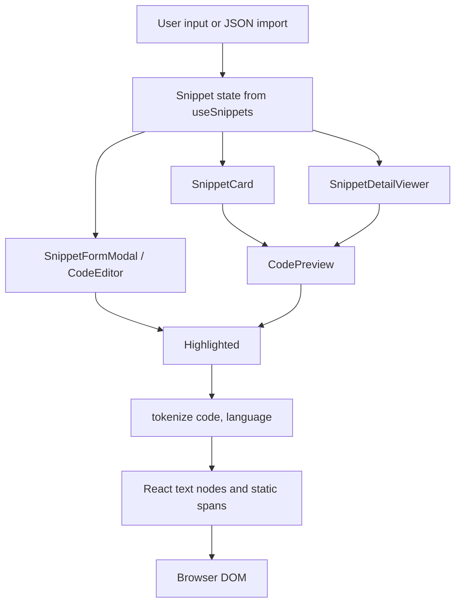
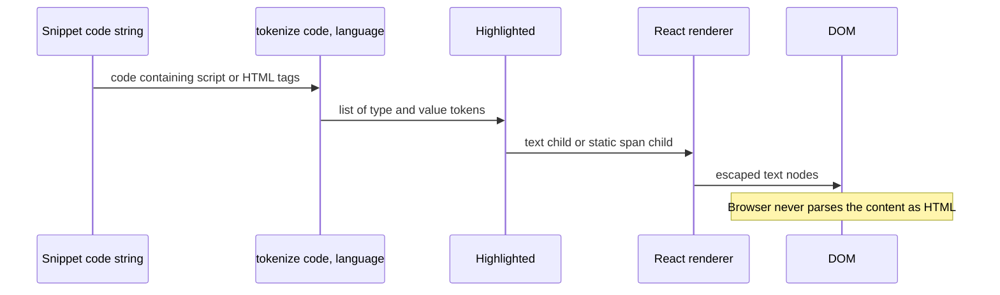

# Cross-Site scripting (XSS) and Code injection attack vectors

This document maps the XSS and code injection attack surface for CodeKnit's snippet rendering, Markdown handling, code highlighting, and import paths. It is based on inspection of the rendered UI components and their input sinks, not on the internal tokenizer implementation, which is outside the supplied source set.

## Threat boundary overview

The primary injection target is any path where user-controlled snippet data is converted into DOM content. In the supplied components, every such path ends in React JSX text children or`<span>` elements with a compile-time class map. No path reaches`dangerouslySetInnerHTML`,`innerHTML`,`document.write`,`eval`,`new Function`, or any HTML parser.

Figure: Snippet data flow from storage to rendered DOM



Snippet state is supplied through`useSnippets()` from`@/lib/snippets/store`. The settings dialog confirms the persistence boundary with the text "Your snippets are stored in this browser." Composition of that store alone, however, is not sufficient for injection: the renderer that consumes the store is the trust boundary that matters here.

## Why highlighted code is rendered safely

`CodePreview.tsx` defines the render behavior for highlighted tokens:

```tsx
const CLASS: Record<TokenType, string> = {
  comment: "text-syn-comment italic",
  string: "text-syn-string",
  keyword: "text-syn-keyword",
  function: "text-syn-function",
  number: "text-syn-number",
  variable: "text-syn-variable",
  heading: "text-syn-heading font-semibold",
  bold: "text-foreground font-semibold",
  link: "text-syn-function underline",
  punct: "text-muted-foreground",
  plain: "",
};

export function Highlighted({ code, language }: { code: string; language: Language }) {
  const tokens = useMemo(() => tokenize(code, language), [code, language]);
  return (
    <>
      {tokens.map((t, i) =>
        t.type === "plain" ? t.value : <span key={i} className={CLASS[t.type]}>{t.value}</span>,
      )}
    </>
  );
}
```

`CLASS` is a compile-time constant keyed by the`TokenType` union. User input controls only`t.value`, never the class name or element name. The token type produced by`tokenize()` is a TypeScript union member, not an arbitrary string, so an attacker cannot import a malicious token type to control an attribute or tag name.

Figure: Rendering script-like input as inert text



Because`t.value` is placed as a JSX text child, React escapes`<`,`>`,`&`, and quotes before creating the DOM. Input such as`<script>alert(1)</script>` is rendered as visible text, not executed.

## Input sink safety status

| Sink | Source files | Rendering mechanism | XSS status |
| --- | --- | --- | --- |
| Snippet code |`CodePreview.tsx` | JSX text`{t.value}` inside static`<span>` | Escaped |
| Snippet title |`SnippetCard.tsx`,`SnippetDetailViewer.tsx`,`ConfirmDeleteDialog.tsx` | JSX text`{s.title}` or`{title}` | Escaped |
| Description |`SnippetCard.tsx`,`SnippetDetailViewer.tsx` | JSX text`{s.description}` | Escaped |
| Category |`SnippetCard.tsx`,`LanguageBadge.tsx` | Text inside badge and filter items | Escaped |
| Tags |`SnippetCard.tsx`,`SnippetDetailViewer.tsx` |`#{t}` string built as JSX text | Escaped |
| Search and filter input |`AppLayout.tsx`,`SearchFilterBar.tsx` | Controlled React`value` prop | Safe |
| Imported JSON |`SettingsDialog.tsx` |`parseSnippetImport` then same rendering paths | Depends on parser; parser source not supplied |
| Layout preference |`AppLayout.tsx` |`localStorage` value checked against`"list"` or`"grid"` only | Safe |

## Component-by-component threat analysis

### CodePreview and highlighted

`CodePreview.tsx` splits code for line counting and truncation, then joins the visible portion back into a plain string before calling`Highlighted`. This splitting does not interpret the content. The output is placed inside`<pre><code>` with React-rendered children. No HTML string is ever produced from snippet code.

### CodeEditor.tsx

The editor layers a transparent`<textarea>` over an`aria-hidden``<pre>`. The`<textarea>` holds the real value; the highlighted`<pre>` is display-only.

```tsx
<textarea
  value={value}
  onChange={(e) => onChange(e.target.value)}
  className="... text-transparent caret-foreground ..."
/>
```

The user types into the textarea, and`onChange` updates string state.`Tab` handling only inserts two spaces into the string value. The overlay is generated through`Highlighted`, so it follows the same escaping rules as preview rendering. A script tag pasted into the editor is text state, not parsed content.

### SnippetCard.tsx

Rendering of user metadata is plain JSX text:

```tsx
<h3>{s.title}</h3>
<p>{s.description}</p>
<span>#{t}</span>
```

The card copy action in`useCopy` copies the raw string to the clipboard, which is a browser clipboard operation and not a DOM injection sink.

### SnippetDetailViewer.tsx

The detail dialog renders the same`CodePreview` component with the snippet's code, alongside text values for title, description, tags, and dates. The title and description are placed inside`DialogTitle` and`DialogDescription` children as JSX text. No HTML conversion occurs.

### ConfirmDeleteDialog.tsx

The deletion confirmation interpolates the snippet title directly:

```tsx
"{title}" will be permanently removed.
```

This is escaped as a React text child. A title containing markup cannot break out of the dialog text.

### SettingsDialog.tsx import path

`SettingsDialog.tsx` reads a JSON file, passes it through`parseSnippetImport(json)`, and then imports the resulting snippets. The parser implementation comes from`@/lib/snippets/import-export`, which is not part of the supplied files. Imported snippets are rendered by the same components, so once accepted they receive the same escaping treatment. Validation of the JSON structure itself must be confirmed in that module.

## Markdown interpretation vector

Markdown is a value in the`Language` union, for example in`LanguageBadge.tsx` and the language selector. The supplied components treat Markdown as a highlighting language only. There is no Markdown-to-HTML renderer in the provided files. Markdown source runs through`tokenize(code, "Markdown")` and is rendered as escaped text and static spans. Consequently, Markdown-specific injection vectors such as raw HTML blocks, inline HTML, or JavaScript links are not executable in the current UI.

This is a notable difference from many documentation and blog systems: CodeKnit does not currently interpret Markdown syntax into HTML, which eliminates the typical Markdown XSS class.

## Injection controls verified in the supplied source

- No`dangerouslySetInnerHTML` in any supplied component
- No`innerHTML`,`outerHTML`,`insertAdjacentHTML`,`document.write`, or`document.writeln`
- No`eval`,`new Function`, or`execScript`
- No dynamic element creation from user strings
- No dynamic class names derived from user input;`CLASS[t.type]` uses a constant record
- No`javascript:` URL construction from snippet data
- The`Button` and`Input` components receive React props, not HTML strings

## Residual risks and gaps

> [!WARNING]
> If Markdown-to-HTML rendering is added later, this threat model no longer applies. A Markdown renderer that allows raw HTML would re-introduce stored XSS unless paired with a sanitizer and an allowlist.

-`parseSnippetImport` is not in the supplied files. The JSON import boundary should be audited separately for prototype pollution, malformed JSON handling, and validation of all snippet fields.
- The tokenizer implementation in`@/lib/snippets/highlight` is outside the supplied set. The rendering contract is verified, but the regular expressions and token-type validation are not.
- If another same-origin script can write to the localStorage used by`useSnippets()`, it could plant malicious snippet content. Rendering remains escaped, but the storage boundary itself is a separate trust decision.
- Third-party dependencies such as Radix UI primitives and`sonner` may carry separate vulnerabilities; they are outside the scope of this component review.

## Recommended hardening

1. Keep all snippet rendering through React JSX text children or`Highlighted`.
2. Add unit tests that pass`<script>`,``, and Markdown raw HTML through`CodePreview` and assert they are rendered as text.
3. If Markdown rendering is ever introduced, use an explicit allowlist and reject raw HTML; all user-controlled links should be validated before becoming clickable.
4. Audit`parseSnippetImport` to ensure imported fields match the`Snippet` schema and cannot add unexpected properties.
5. Keep the CSS class map static; do not introduce user-influenced`className` values.

For related protections, see:

- [Input Validation and Code Injection Prevention](doc:c91cb9e0-341c-41b7-9b38-ce05b847e1a4)
- [Syntax Highlighting and Code Preview in CodeKnit](doc:b67c41f8-ec7f-48e2-ac63-9599d5440993)
- [CodeKnit XSS Prevention and Code Injection Security Controls](doc:f39acbd4-ff65-4e99-ba6f-7645e22a0ae1)
- [CodeKnit Security Threat Model and Risk Assessment](doc:743ac7e4-c87b-4e13-9bdd-aecdc1e1a812)
- [Client-Side Code Storage and Execution Security](doc:0bcbfb1d-8e1b-4481-9433-44ebd7fdbf96)
- [LocalStorage and Browser Sandbox Threat Model](doc:838f3b71-ab8d-48d4-9fca-f8169fb31734)