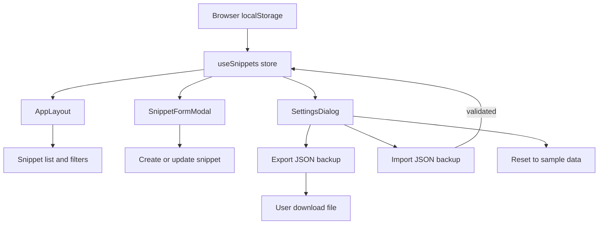
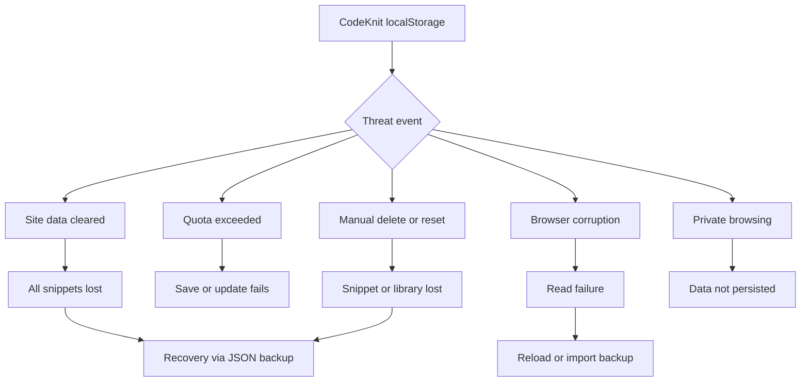
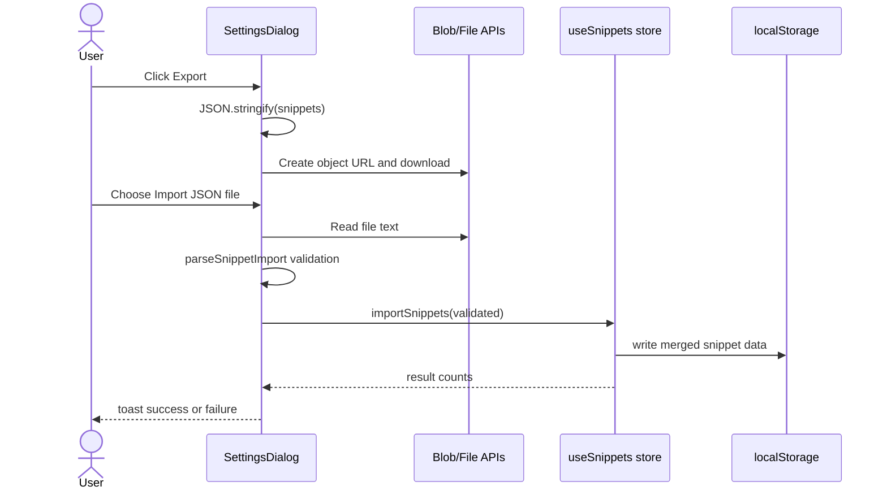

# Data loss and local storage corruption threats

CodeKnit stores all snippet data in browser`localStorage`. The data is tied to a single browser profile and origin, which creates several irreversible loss and corruption risks. This threat model describes those risks and shows how CodeKnit's built-in export, import, and reset controls act as recovery mechanisms.

## How CodeKnit stores snippet data

The application reads and writes snippets through the`useSnippets` hook imported from`@/lib/snippets/store` in`AppLayout.tsx`,`SettingsDialog.tsx`, and other components. The store exposes`snippets`,`status`,`error`,`reload`,`create`,`update`,`remove`,`toggleFavorite`,`recordCopied`,`reset`, and`importSnippets`.

The`SettingsDialog` confirms the storage model in its description:

> Your snippets are stored in this browser. Export a backup or import a previously exported CodeKnit library.

`AppLayout.tsx` also writes a non-snippet UI preference directly to`localStorage`:

```ts
localStorage.setItem("codeknit.layout", l);
```

This shows that the application uses`localStorage` as its persistence layer for both UI preferences and snippet data. The exact internal key used by`@/lib/snippets/store` for snippet records is not included in the source bundle, but the public store interface and UI confirm a browser-local persistence model.

Figure: Local storage data flow and recovery points



## Threat scenarios

The table lists the main data loss and corruption threats for a`localStorage`-only application.

| Threat | Trigger | Impact | Code evidence |
|---|---|---|---|
| Browser site data clearing | User clears cookies and site data, browser cleanup policy, or uninstall | All snippets are permanently lost unless a JSON backup exists |`SettingsDialog.tsx` export/import controls are the only recovery path |
| Local storage quota exceeded | Many large snippets, long code bodies, or repeated imports | Writes can fail; snippets may not save or update |`AppLayout.tsx` surfaces`status === "error"` and`reload` for load failures |
| Browser state corruption | Profile corruption, extension interference, or browser crash during write | Partial or unreadable`localStorage` state |`AppLayout.tsx` provides a`Try again` button for`status === "error"` |
| Private or guest browsing | User works in a private window or isolated profile | Data may not persist after the session or may be separate from normal profile |`AppSidebar.tsx` footer label says`Saved on this device` |
| Manual deletion or reset | User uses`Delete` or`Reset to sample data` | Snippet permanently removed or entire library replaced |`ConfirmDeleteDialog.tsx` and`SettingsDialog.tsx` destructive actions |
| Switching browsers or devices | Data is local only and has no account sync | Snippet library is not available on another browser or device |`SettingsDialog.tsx` import/export is the only migration mechanism |

Figure: Loss and corruption paths



## Built-in recovery controls

`SettingsDialog.tsx` contains the primary mitigation: a JSON export and import workflow. See [Settings and Data Management](doc:23aefc87-ca4f-4220-98f9-a85aea4a7855) for the complete feature overview.

### Export backup

The export action serializes the current snippet list with`JSON.stringify` and downloads it as a file named`codeknit-snippets.json`.

```ts
const exportJson = () => {
  const url = URL.createObjectURL(new Blob([JSON.stringify(snippets, null, 2)], { type: "application/json" }));
  const a = document.createElement("a");
  a.href = url;
  a.download = "codeknit-snippets.json";
  a.click();
  URL.revokeObjectURL(url);
  toast.success("Exported snippets", {
    description: `${snippets.length} snippets downloaded.`,
  });
};
```

This gives you a portable copy outside the browser, protecting against cache clearing, profile loss, and device changes.

### Import and validation

The import path reads the selected file as text, validates the entire file before touching saved data, and merges validated snippets.

```ts
const json = await file.text();
const preview = parseSnippetImport(json);
const result = await importSnippets(preview.snippets);
```

`SettingsDialog.tsx` reports skipped duplicates and imported counts. The comment in the source explicitly states:

```ts
// Validate the entire file before touching saved data.
```

This reduces the risk of a malformed backup partially overwriting your existing library. Duplicate snippets are skipped, and the existing library is kept.

### Reset to sample data

`SettingsDialog.tsx` also provides a destructive reset:

```ts
<Button variant="destructive" onClick={async () => {
  if (!confirm) return setConfirm(true);
  try {
    await reset();
    toast.success("Library reset");
    onOpenChange(false);
  } catch (error) {
    toast.error("Could not reset library", {
      description: error instanceof Error ? error.message : "Please try again.",
    });
  }
}}>{confirm ? "Confirm reset" : "Reset"}</Button>
```

The reset requires a second confirmation. However, it still replaces all saved snippets, so it is a recovery step for corrupted state but also a loss vector when used accidentally.

Figure: Backup and restore sequence



## Recommended mitigation practices

Because CodeKnit does not provide remote synchronization or automatic backups, you should rely on the export workflow as your main defense against data loss.

1. Export your library regularly from **Settings** before clearing browser data.
2. Store the downloaded`codeknit-snippets.json` file outside the browser, such as in a password manager or version-controlled file.
3. Avoid using private or guest browsing for your primary snippet library because data may not persist across sessions.
4. Import the JSON backup after switching browsers, recreating a profile, or recovering from corruption.
5. Keep backup files treated as sensitive because they contain your source code and possibly confidential snippets.

> [!WARNING]
> Clearing browser cookies and site data for CodeKnit will likely delete every snippet. The only guaranteed recovery is a previously exported`codeknit-snippets.json` file.

> [!NOTE]
> The snippet storage internals in`@/lib/snippets/store` are not included in the source bundle reviewed for this threat model. Exact quota handling and write-failure behavior may differ in the implemented store.

## Residual risk

Even with export and import controls, the following risks remain:

- The`localStorage` data is not encrypted at rest. Anyone with access to the browser profile can read it.
- There is no automatic scheduled backup. Recovery depends on consistent user action.
- A malicious or corrupted JSON file could still affect the import workflow if validation is incomplete. The validation step in`SettingsDialog.tsx` mitigates but may not eliminate this risk.
- The local storage quota is browser-controlled and not monitored in the provided UI beyond generic error toasts in`SnippetFormModal.tsx`.

## Related topics

- [Data Storage and Clipboard Security Controls](doc:a76d6ad0-4688-42fe-805e-75b7c7e11edc)
- [Understanding CodeKnit Snippet Storage and Data Persistence](doc:bc53c832-8a30-4641-96c2-23bf33e68fe5)
- [File Upload and Import Validation Security Threats](doc:cf9514b9-bbd2-4e9e-b2bb-0e00c49990f5)
- [LocalStorage Data Protection and Privacy Controls](doc:7c739dd4-22f5-4b8e-8ebc-c4968cfaefd1)
- [Import and Export Snippets](doc:04709ded-6fc6-431c-9075-f23bfa3d182e)
- [How to Export and Import Snippets](doc:3707d8af-df5d-4f1d-a7b4-b1c83d7c85b2)