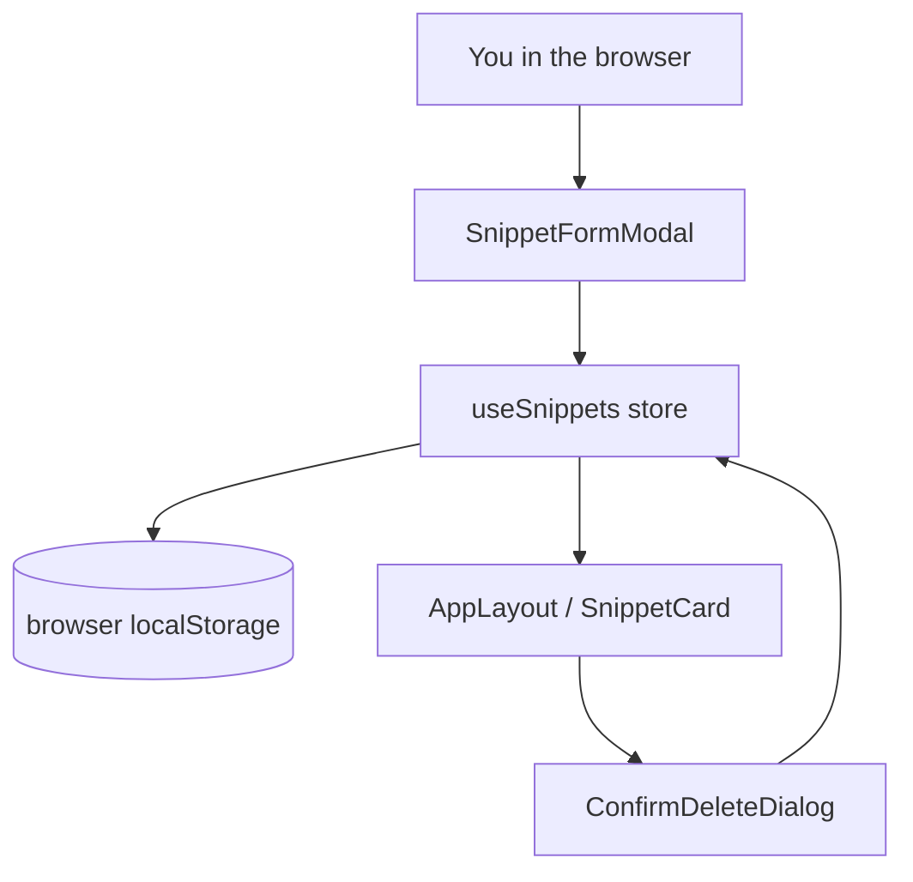
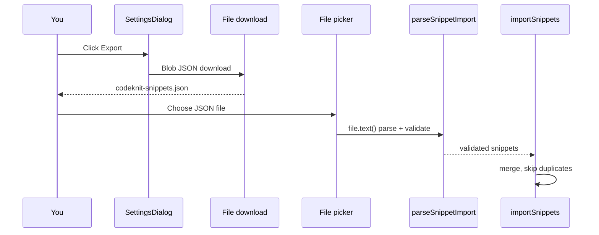

# Data privacy and confidentiality controls for stored snippets

CodeKnit treats every snippet you save as private, device-local data. This page documents the privacy model, where snippet content lives, what leaves the browser, and which controls protect the confidentiality of sensitive code.

## Privacy model at a glance

CodeKnit uses a **client-only storage model**. Snippet code, titles, categories, and tags are stored in your browser and never sent to a CodeKnit server.

Three points summarize the privacy posture:

1. **No accounts or authentication.** The app has no login flow and no user identity in any provided component.
2. **No server API calls.** The provided source set contains no`fetch`,`axios`, WebSocket, or server SDK calls that transmit snippet data.
3. **Explicit local-storage behavior.** The UI states "Saved on this device" in`AppSidebar.tsx` and "Your snippets are stored in this browser" in`SettingsDialog.tsx`.

## What is stored and where

Snippet data is stored in browser`localStorage` through the`useSnippets` store (`@/lib/snippets/store`). The screenshot-visible layout preference is stored directly in`localStorage` under the`codeknit.layout` key in`AppLayout.tsx`:

```tsx
const saved = localStorage.getItem("codeknit.layout");
if (saved === "list" || saved === "grid") setLayout(saved);
```

The snippet store implementation is not in the provided source set, but its storage location is confirmed by the settings description: "Your snippets are stored in this browser." See [Understanding CodeKnit Snippet Storage and Data Persistence](doc:bc53c832-8a30-4641-96c2-23bf33e68fe5) and [LocalStorage Data Protection and Privacy Controls](doc:7c739dd4-22f5-4b8e-8ebc-c4968cfaefd1) for the persistence model.

### Stored snippet fields

| Field | Purpose | Source evidence |
| --- | --- | --- |
|`id` | Unique identifier for delete, copy, favorite operations |`AppLayout.tsx` (`remove(deleting.id)`),`SnippetCard.tsx` (`key={s.id}`) |
|`title` | Required display name |`SnippetFormModal.tsx` (`errs.title = "Title is required."`) |
|`description` | Optional free-text summary |`SnippetFormModal.tsx` (`form.description`) |
|`language` | One of`JavaScript`,`Python`,`SQL`,`Markdown` |`SnippetFormModal.tsx`,`LanguageBadge.tsx` |
|`code` | The snippet body; required |`SnippetFormModal.tsx` (`errs.code = "Code is required."`) |
|`category` | User-defined grouping; required at save |`SnippetFormModal.tsx` |
|`tags` | Array of user-defined tags |`SnippetFormModal.tsx`,`TagInput` |
|`isFavorite` | Boolean star flag |`SnippetFormModal.tsx` (`Switch`) |
|`createdAt` | Creation timestamp |`SnippetDetailViewer.tsx` (`formatDate(s.createdAt)`) |
|`updatedAt` | Last edit timestamp |`SnippetCard.tsx` (`<time dateTime={s.updatedAt}>`) |
|`copyCount` | Number of clipboard copies |`SnippetCard.tsx` (`s.copyCount`) |
|`lastCopiedAt` | Timestamp of most recent copy |`SnippetDetailViewer.tsx` (`s.lastCopiedAt`) |

There is no field for passwords, tokens, or personally identifiable information.`code` is arbitrary text and can contain whatever you paste, but the app does not classify or specially encrypt it.

## Local-only data flow

Figure: Snippet lifecycle flow inside the browser



All read, create, update, and delete operations stay inside the browser.`SnippetCard.tsx` displays code from the store;`SnippetFormModal.tsx` writes through`create()` or`update()`;`ConfirmDeleteDialog.tsx` invokes`remove(deleting.id)`. None of these paths make a network request.

## No server transmission

The strongest privacy control is absence. Across the provided components, there is no network access for snippet content:

-`AppLayout.tsx` imports`useSnippets()` and filters in memory with`filterSnippets`.
- Search in`SearchFilterBar.tsx` and`AppLayout.tsx` runs against`useState`-driven filters, not a remote index.
-`SettingsDialog.tsx` exports with a local`Blob` and object URL.
-`package.json` lists no server SDK or analytics library. Dependencies are UI and utility packages (React, Radix, TanStack, Zod, Tailwind, Recharts).

Any future addition of analytics, error reporting, or a sync endpoint would require a code change and a new privacy review.

## Explicit export boundary

Export is the only path where snippet content leaves the browser, and it is user-initiated. In`SettingsDialog.tsx`,`exportJson()` builds a JSON file from your snippets and triggers a download:

```tsx
const url = URL.createObjectURL(new Blob([JSON.stringify(snippets, null, 2)], { type: "application/json" }));
const a = document.createElement("a");
a.href = url;
a.download = "codeknit-snippets.json";
a.click();
```

The export file contains **all** fields in the table above, including`code`,`tags`,`createdAt`,`updatedAt`,`copyCount`, and`lastCopiedAt`. Treat`codeknit-snippets.json` as a confidential backup. See [File Upload and Import Validation Security Threats](doc:cf9514b9-bbd2-4e9e-b2bb-0e00c49990f5) for the threat view.

Figure: User-initiated export and import flow



Import validates the file before it touches saved data.`SettingsDialog.tsx` calls`parseSnippetImport(json)` first, then passes the validated result to`importSnippets()`. Duplicate snippets are skipped rather than overwriting existing data.

## Delete and reset controls

You can remove individual snippets or reset the entire library:

- **Delete one snippet.**`ConfirmDeleteDialog.tsx` uses a destructive alert dialog and warns that the snippet "will be permanently removed." Deletion goes through`remove()` in the store.
- **Reset all snippets.**`SettingsDialog.tsx` uses a two-tap destructive action with a "Confirm reset" second press before calling`reset()`.

Neither action can send data anywhere; they only change local state and local storage.

## Clipboards are a separate boundary

Copy to clipboard uses the`useCopy` hook in`SnippetCard.tsx` and`SnippetDetailViewer.tsx`. When you select **Copy** or **Copy code**, snippet content goes to the system clipboard, which may sync across devices through your operating system account. The app records the action by incrementing`copyCount` through`recordCopied()`, but the copied text is outside the app's storage boundary. See [Data Storage and Clipboard Security Controls](doc:a76d6ad0-4688-42fe-805e-75b7c7e11edc) and [Data Privacy Controls for Local Client-Side Snippet Storage](doc:5f2eb48b-d5d8-4775-b639-d5a52c6ee25e).

## Rendering control prevents execution of snippet content

The code preview renders snippet text as React text nodes, not as HTML. In`CodePreview.tsx`,`Highlighted` returns:

```tsx
{tokens.map((t, i) =>
  t.type === "plain" ? t.value : <span key={i} className={CLASS[t.type]}>{t.value}</span>,
)}
```

This uses`{t.value}` interpolation and never`dangerouslySetInnerHTML`. Snippet content is therefore displayed as inert text, which protects confidentiality by preventing snippet code from executing in the page context. See [LocalStorage Data Exposure and Browser Isolation Threats](doc:6cb7d669-fbaa-4132-aa6f-cfec9f80ff45).

## Residual risks and limitations

The local-only model protects against server-side disclosure, but these limitations remain:

- **Browser profiles are the boundary.** Anyone with access to your unlocked browser profile can read`localStorage` and see all snippets. Use device or profile lock controls.
- **DevTools can read storage.** Browser developer tools expose`localStorage` contents without additional access controls.
- **Browser clearing destroys data.** If the browser purges site data, snippets are lost. Back up with export from`SettingsDialog`.
- **Backup files inherit your file system permissions.** Exporting creates a plain-text JSON file. Protect it like any confidential document.
- **The store implementation is not included in the provided source set.** This page verifies privacy behavior from the visible call sites in`AppLayout.tsx`,`SettingsDialog.tsx`, and the snippet components. A full audit should also review`@/lib/snippets/store`,`@/lib/snippets/import-export`, and`use-copy.ts`.

## Compliance notes

- **Data minimization.** The app stores only snippet fields and layout preferences. There is no analytics collection or advertising SDK in`package.json`.
- **Local processing helps with data residency.** Because snippet content does not cross a network boundary to a CodeKnit server, organizations with data-residency requirements can evaluate the browser and device as the processing location.
- **User-controlled export supports portability.** The JSON export in`SettingsDialog.tsx` provides a human-readable, user-initiated path to retrieve all stored data.
- **No retention policy beyond browser storage.** Deletion is immediate through the confirm dialog, and reset replaces your library with sample data.

Related pages: [Data Loss and Local Storage Corruption Threats](doc:a4919f59-de5a-4af8-a740-0b6bd9d6e10d) · [How to Export and Import Snippets](doc:3707d8af-df5d-4f1d-a7b4-b1c83d7c85b2) · [Snippet Creation and Management](doc:0c70c6f8-e58e-4c83-aca2-24ac900099af) · [Import and Export Snippets](doc:04709ded-6fc6-431c-9075-f23bfa3d182e) · [Data Privacy Controls for Local Client-Side Snippet Storage](doc:5f2eb48b-d5d8-4775-b639-d5a52c6ee25e)