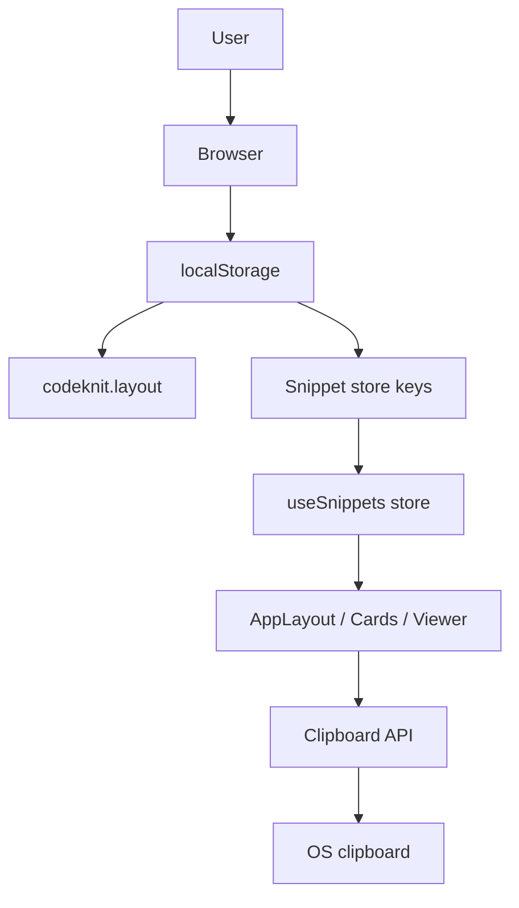
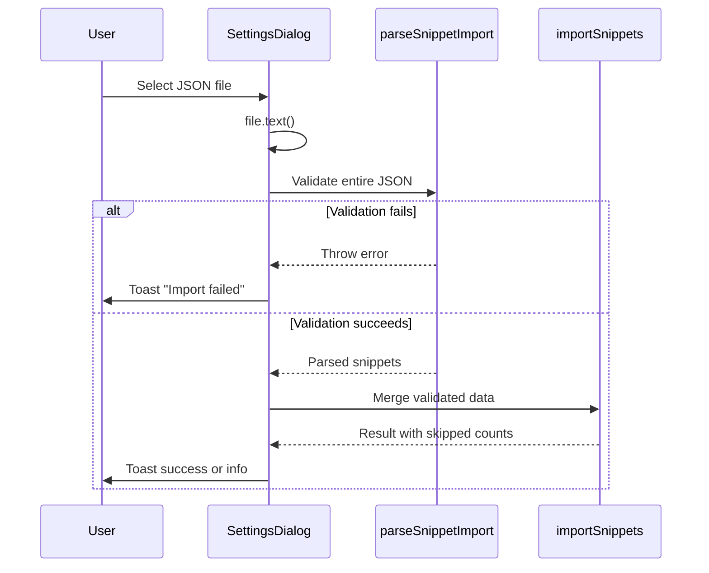
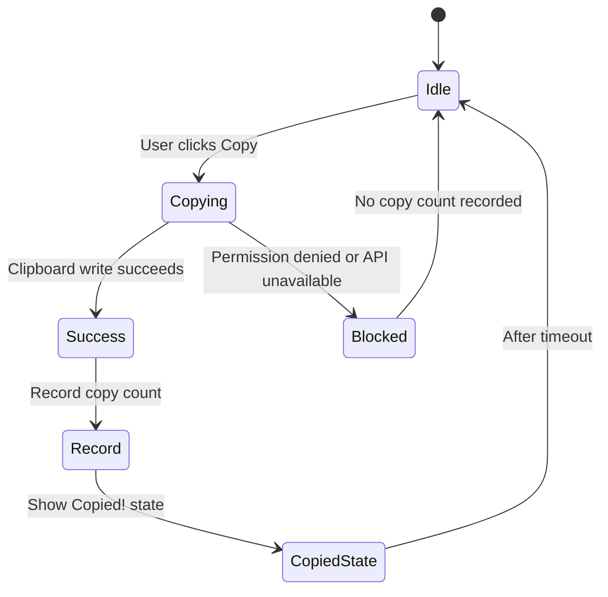
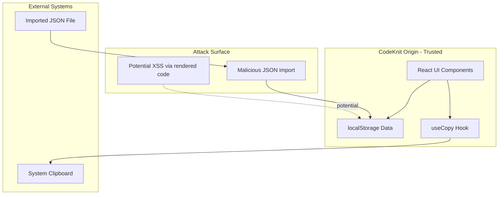

# Data storage and clipboard security controls

This document describes the security posture of CodeKnit's client-side data storage and clipboard operations. All snippet data resides in the browser's`localStorage`. The application makes no network calls to persist user data. Clipboard access uses a custom`useCopy` hook with graceful fallback when browser permissions block access.

## Storage architecture

CodeKnit stores snippet data and UI preferences in the browser's`localStorage`. There is no server-side persistence, authentication, or remote database. Snippet state lives exclusively on the device where the user runs the application.

The sidebar footer confirms the storage model with the label **“Saved on this device”** (`AppSidebar.tsx`), and the Settings dialog description reinforces it: **“Your snippets are stored in this browser.”** (`SettingsDialog.tsx`).

Figure: Local storage trust boundary



### Verified localStorage usage

The only directly verifiable`localStorage` key in the provided component source is the layout preference.

`AppLayout.tsx`:

```tsx
useEffect(() => {
  const saved = localStorage.getItem("codeknit.layout");
  if (saved === "list" || saved === "grid") setLayout(saved);
}, []);
const changeLayout = (l: "grid" | "list") => {
  setLayout(l);
  localStorage.setItem("codeknit.layout", l);
};
```

This read validates the stored value before applying it. Only the literal strings`"list"` and`"grid"` are accepted. Any other value, including corrupted or tampered data, is discarded and the default`"grid"` layout is used.

### Snippet store

The`useSnippets()` hook, imported from`@/lib/snippets/store`, manages snippet CRUD. The implementation file is not included in the provided source set, so its exact`localStorage` key naming and serialization logic cannot be verified from these files alone. The following can be verified from consuming components:

- Exposes`snippets`,`status`,`error`,`reload`,`remove`,`toggleFavorite`,`recordCopied`,`create`,`update`,`reset`, and`importSnippets`
- Surfaces load errors through`status === "error"` with a retry button (`AppLayout.tsx`)
- Validates imported JSON before committing through`parseSnippetImport` (`SettingsDialog.tsx`)

Figure: Snippet import validation flow



The inline comment in`SettingsDialog.tsx` states the security intent explicitly:

```tsx
// Validate the entire file before touching saved data.
const preview = parseSnippetImport(json);
const result = await importSnippets(preview.snippets);
```

## Clipboard security

Copy operations use a dedicated`useCopy()` hook from`./use-copy`, consumed by both`SnippetCard.tsx` and`SnippetDetailViewer.tsx`. The hook implementation is not in the provided source set; the following describes verified usage and the contract exposed to components.

### Hook contract

Both consumers destructure`{ copied, copy }` from`useCopy()` and use the pattern:

```tsx
if (await copy(s.code)) {
  onRecordCopy().catch(() => undefined);
}
```

`copy` returns a`Promise<boolean>` that resolves to`true` on success and`false` when the operation fails or is blocked. The`copied` boolean drives UI feedback: the button label switches between **“Copy”** and **“Copied!”**, and the icon toggles from`Copy` to`Check` (`SnippetCard.tsx`,`SnippetDetailViewer.tsx`).

### Error handling for blocked access

When the browser blocks clipboard access, for example, in a cross-origin iframe or when a permissions policy denies`clipboard-write`, the`copy` function resolves to`false` rather than throwing. Callers treat a failed copy as a no-op for tracking.

`SnippetCard.tsx`:

```tsx
onClick={async (e) => {
  e.stopPropagation();
  if (await copy(s.code)) {
    onRecordCopy().catch(() => undefined);
  }
}}
```

The copy count (`recordCopied`) increments only after a confirmed successful copy, preventing inflated statistics from failed or blocked operations.

Figure: Clipboard copy decision flow



### Clipboard API preconditions

The browser Clipboard API (`navigator.clipboard.writeText`) requires a secure context, a transient user gesture, and an embedding context that does not block`clipboard-write`. When any precondition fails,`useCopy` prevents a crash and reports failure through its boolean return value rather than an uncaught exception.

> [!WARNING]
> Code copied to the system clipboard leaves the browser's control. The system clipboard is a shared OS-level buffer accessible by other applications. Do not copy sensitive snippet code on shared or untrusted machines.

## Trust boundaries

Figure: Application trust boundaries



### localStorage origin isolation

`localStorage` is scoped by origin, scheme, host, and port. Each origin has an independent storage area isolated from other websites. CodeKnit data is accessible only to scripts executing on the same origin. This isolation is enforced by the browser, not by application code.

### Export implications

The **Export library** feature in`SettingsDialog.tsx` downloads all snippets as a plaintext JSON file:

```tsx
const url = URL.createObjectURL(new Blob([JSON.stringify(snippets, null, 2)], { type: "application/json" }));
const a = document.createElement("a");
a.href = url;
a.download = "codeknit-snippets.json";
a.click();
URL.revokeObjectURL(url);
```

The exported file has no encryption or access controls. Anyone with filesystem access to the downloaded file can read its contents.

### Import path hardening

The import mechanism restricts file selection through the`accept` attribute:

```tsx
<input
  ref={fileInputRef}
  type="file"
  accept=".json,application/json"
  className="hidden"
  aria-label="Choose CodeKnit JSON export"
  onChange={(event) => void importJson(event.target.files?.[0])}
/>
```

`parseSnippetImport` validates the full JSON structure before`importSnippets` merges anything into storage. Invalid JSON or malformed snippet objects throw, triggering an error toast and leaving existing data untouched.

## Data integrity and corruption handling

### Layout value sanitization

The`codeknit.layout` key is read with strict value validation in`AppLayout.tsx`:

```tsx
if (saved === "list" || saved === "grid") setLayout(saved);
```

Corrupted or unexpected values are rejected, and the application falls back to the`"grid"` default defined in`DEFAULTS`.

### Snippet store error state

`AppLayout.tsx` renders a distinct error state when the snippet store fails to load:

```tsx
{status === "error" && (
  <div className="flex flex-col items-center gap-3 rounded-xl border border-destructive/40 p-10 text-center">
    <AlertTriangle className="h-6 w-6 text-destructive" />
    <p className="text-sm">Couldn't load your snippets: {error}</p>
    <Button variant="secondary" onClick={reload}>Try again</Button>
  </div>
)}
```

The`reload` function retries reading from storage, providing a recovery path for transient read failures. The underlying error message is surfaced to the user through`{error}`.

### Destructive operations require confirmation

Snippet deletion uses a dedicated confirmation dialog with an explicit permanent warning in`ConfirmDeleteDialog.tsx`:

```tsx
<AlertDialogTitle>Delete this snippet?</AlertDialogTitle>
<AlertDialogDescription>
  "{title}" will be permanently removed. This can't be undone.
</AlertDialogDescription>
```

The **Reset** action in`SettingsDialog.tsx` uses a two-step confirmation: the first click changes the button to **Confirm reset**, and only a second click executes the reset.

## Security controls summary

| Area | Control | Source |
|------|---------|--------|
| Layout preference | Strict value validation on read |`AppLayout.tsx` |
| Import data | Full JSON validation before merge |`SettingsDialog.tsx` |
| Export data | Object URL revoked after download |`SettingsDialog.tsx` |
| Clipboard failure | Boolean return, no crash, no false copy count |`SnippetCard.tsx`,`SnippetDetailViewer.tsx` |
| Delete operations | Confirmation dialog with permanent warning |`ConfirmDeleteDialog.tsx` |
| Reset operation | Two-step confirmation |`SettingsDialog.tsx` |
| File import type |`accept` attribute restricts to JSON |`SettingsDialog.tsx` |
| Load failures | Error state with retry button |`AppLayout.tsx` |

## Limitations and unverified details

The following details could not be verified because the corresponding implementation files were not included in the provided source set:

- **`@/lib/snippets/store`**, The`useSnippets` hook implementation, including the exact`localStorage` key or keys used for snippet data, serialization format, and quota exception handling.
- **`./use-copy`**, The`useCopy` hook implementation, including the specific Clipboard API call (`navigator.clipboard.writeText` vs. a legacy`document.execCommand` fallback) and the exact error handling mechanism for blocked permissions.
- **`@/lib/snippets/import-export`**, The`parseSnippetImport` validation logic, including schema validation rules and duplicate detection.

## Related

- [Understanding CodeKnit Snippet Storage and Data Persistence](doc:bc53c832-8a30-4641-96c2-23bf33e68fe5)
- [Data Loss and Local Storage Corruption Threats](doc:a4919f59-de5a-4af8-a740-0b6bd9d6e10d)
- [LocalStorage Data Exposure and Browser Isolation Threats](doc:6cb7d669-fbaa-4132-aa6f-cfec9f80ff45)
- [Data Privacy and Confidentiality Controls for Stored Snippets](doc:4a1f03d7-1d2a-4620-8fa3-1df341b8df0b)
- [Clipboard Security and Copy Tracking Controls](doc:9da2135a-bf26-4cac-88ef-5dfc0b57611f)
- [How to Copy Code and Track Copy Count](doc:1bdbeea5-a86d-4fcf-ae76-4c596954414f)