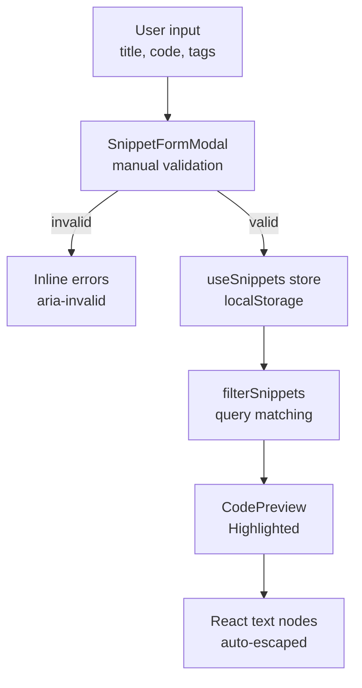
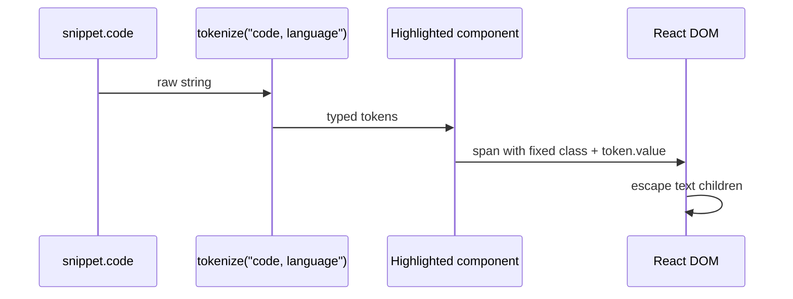
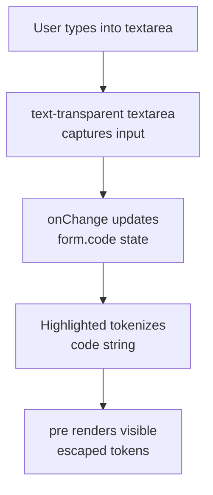
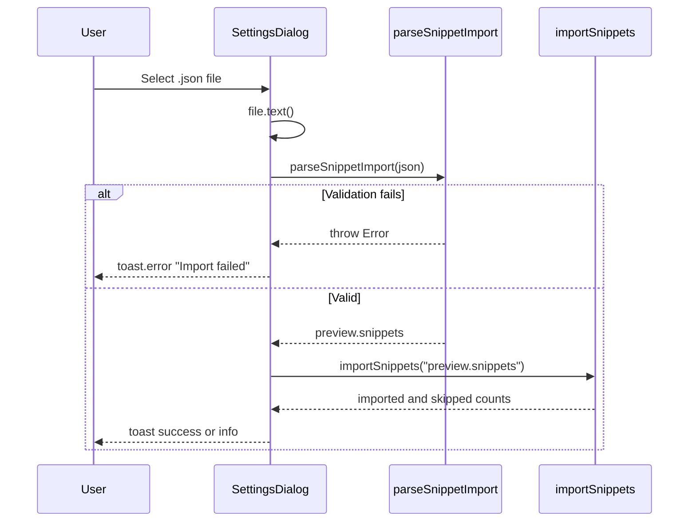

# Input validation and code injection prevention

CodeKnit is a browser-only snippet manager. User-authored content, snippet titles, descriptions, categories, tags, and code, is validated at form submission and rendered through React's text node pipeline and a custom tokenizer. This page documents the controls that prevent malicious input from being interpreted as executable HTML or script.

## Rendering and XSS prevention model

All user-controlled fields flow through React's default escaping. The components in the rendering path render snippet content as React text children, never as raw HTML. There is no`dangerouslySetInnerHTML`,`innerHTML`, or`document.write` usage in the components in scope.

The key rendering path is:

-`SnippetCard.tsx` renders`s.title`,`s.description`,`s.category`, and tags as JSX text children.
-`SnippetDetailViewer.tsx` renders`s.title`,`s.description`,`s.category`, and tags the same way.
-`ConfirmDeleteDialog.tsx` renders the snippet title as a quoted text child:`“{title}”`.
-`CodePreview.tsx` wraps highlighted code in`<pre><code><Highlighted code={shown} language={language} /></code></pre>`.

Figure: Snippet validation and rendering pipeline



### How`Highlighted` prevents HTML injection

`CodePreview.tsx` defines the`Highlighted` component. It calls the custom tokenizer and maps each token to a JSX element:

```tsx
const tokens = useMemo(() => tokenize(code, language), [code, language]);
return (
  <>
    {tokens.map((t, i) =>
      t.type === "plain" ? t.value : <span key={i} className={CLASS[t.type]}>{t.value}</span>,
    )}
  </>
);
```

Two controls are important here:

1. **No raw HTML**: token values are passed as React children (`{t.value}`), which React escapes automatically. A snippet containing`<script>`,``, or HTML tags is displayed as literal text.
2. **Fixed class mapping**: the class applied to each span comes from the`CLASS` record keyed by`TokenType`, not from user input. User text cannot inject attributes or class names.

The tokenizer itself is imported from`@/lib/snippets/highlight`:

```ts
import { tokenize, type TokenType } from "@/lib/snippets/highlight";
```

The`TokenType` values used in`CodePreview.tsx` are`comment`,`string`,`keyword`,`function`,`number`,`variable`,`heading`,`bold`,`link`,`punct`, and`plain`. Markdown tokens such as`heading`,`bold`, and`link` are rendered as styled spans, not as real`<h1>`,`<strong>`, or`<a>` elements. This prevents Markdown-style raw links from becoming clickable or executable anchors.

Figure: Code token rendering path



### How`CodeEditor` keeps typed input safe while editing

`CodeEditor.tsx` uses a stacked overlay: the underlying layer is a`pre` that displays tokenized, escaped code, and the top layer is a transparent`textarea` that captures all keyboard input.

```tsx
<div className="relative grid flex-1">
  <pre aria-hidden className="col-start-1 row-start-1 whitespace-pre px-4 py-3 text-foreground/90">
    <Highlighted code={value + "\n"} language={language} />
  </pre>
  <textarea
    ref={ref}
    id={id}
    value={value}
    onChange={(e) => onChange(e.target.value)}
    onKeyDown={onKeyDown}
    spellCheck={false}
    wrap="off"
    aria-invalid={invalid}
    placeholder="// Paste or write your code here"
    className="col-start-1 row-start-1 h-full w-full resize-none overflow-hidden whitespace-pre bg-transparent px-4 py-3 text-transparent caret-foreground outline-none placeholder:text-muted-foreground/50 selection:bg-primary/30"
  />
</div>
```

The visible code is always the tokenized, escaped version from`Highlighted`. The textarea text is set to`text-transparent` so the user types into an invisible but fully interactive form control that lies on top of the rendered code. This means the editor never displays raw untokenized input as the visible layer.

Even if the textarea text became visible, for example, if a stylesheet failed to load, the textarea is a native browser form control. Its value is rendered by the browser as literal text, not parsed as HTML. User input in the editor cannot create executable elements or attributes.

Figure: CodeEditor input and display overlay



## Input validation in form submission

`SnippetFormModal.tsx` uses controlled form state and manual validation. The form element has`noValidate`, which disables browser-native validation in favor of explicit application checks.

### Required-field validation

The`submit` handler runs before any save operation:

```ts
if (!form.title.trim()) errs.title = "Title is required.";
if (!form.code.trim()) errs.code = "Code is required.";
if (!form.category.trim()) errs.category = "Enter a category name.";
setErrors(errs);
if (Object.keys(errs).length) return;
```

Only after all three checks pass does the component call`create(data)` or`update(editing.id, data)`. The saved payload trims`title` and`category` but leaves`code` and`description` untrimmed:

```ts
const data = { ...form, title: form.title.trim(), category: form.category.trim() };
```

This preserves code indentation and intentional whitespace while still preventing empty titles or categories.

### Field binding and error accessibility

Each invalid field is linked to its error message:

```tsx
<Input
  id="sn-title"
  value={form.title}
  onChange={(e) => set("title", e.target.value)}
  aria-invalid={!!errors.title}
  aria-describedby={errors.title ? "sn-title-err" : undefined}
/>
```

The`CodeEditor` receives`invalid={!!errors.code}` and passes`aria-invalid` to the underlying`textarea`.

### Language selection

The language field is a`Select` populated only from the fixed`LANGUAGES` array:

```tsx
<Select value={form.language} onValueChange={(v) => set("language", v as Language)}>
  <SelectTrigger id="sn-lang"><SelectValue /></SelectTrigger>
  <SelectContent>{LANGUAGES.map((l) => <SelectItem key={l} value={l}>{l}</SelectItem>)}</SelectContent>
</Select>
```

Users cannot submit arbitrary language strings through this field. The only choices are the four defined in`LanguageBadge.tsx`:`JavaScript`,`Python`,`SQL`, and`Markdown`. The cast to`Language` does not add runtime validation, but the`Select` UI restricts input to the fixed option list.

## Import boundary validation

`SettingsDialog.tsx` validates JSON imports before touching saved data. The file input accepts only JSON:

```tsx
<input
  ref={fileInputRef}
  type="file"
  accept=".json,application/json"
  aria-label="Choose CodeKnit JSON export"
  onChange={(event) => void importJson(event.target.files?.[0])}
/>
```

The import handler reads the file as text, parses it with`parseSnippetImport`, and only then calls`importSnippets`:

```ts
const json = await file.text();
// Validate the entire file before touching saved data.
const preview = parseSnippetImport(json);
const result = await importSnippets(preview.snippets);
```

Validation failures throw and are caught by the surrounding`try/catch`, which shows an error toast and leaves existing snippets untouched. After any import attempt, the file input is reset so the same file can be selected again:

```ts
if (fileInputRef.current) fileInputRef.current.value = "";
```

Figure: JSON import validation flow



The exact schema enforcement inside`parseSnippetImport` lives in`@/lib/snippets/import-export`. That file is not part of the source snapshot used for this page.

## Search and filter input handling

`AppLayout.tsx` and`SearchFilterBar.tsx` use controlled text inputs for the search query. The query is stored as a plain string in`filters.query` and passed to`filterSnippets`:

```tsx
<Input
  aria-label="Search snippets"
  value={filters.query}
  onChange={(e) => update({ query: e.target.value })}
  placeholder="Search snippets, tags, or code..."
/>
```

`filterSnippets` returns the snippet list to display; it does not render the query into HTML. The`filterSnippets` implementation is in`@/lib/snippets/filter`, which is not included in the source snapshot. As long as filtering remains string comparison over plain object fields, there is no HTML or expression evaluation path from the query to the DOM.

## Security posture and boundaries

The relevant trust boundary is browser`localStorage`. CodeKnit runs entirely client-side, so validation is a user-facing correctness and rendering-safety control, not a server-side access control.

Controls confirmed in the provided source:

| Control | Location | Effect |
| --- | --- | --- |
| React default text escaping | All render components | Prevents HTML/script injection in titles, descriptions, tags, category, and code |
| No`dangerouslySetInnerHTML` |`CodePreview.tsx`,`CodeEditor.tsx`,`SnippetCard.tsx`,`SnippetDetailViewer.tsx`,`ConfirmDeleteDialog.tsx` | No raw HTML rendering path |
| Fixed token class mapping |`CodePreview.tsx``CLASS` record | User text cannot set CSS classes or attributes |
| Markdown rendered as spans |`CodePreview.tsx` token types | Markdown links, headings, and bold are not converted to native HTML elements |
| Transparent editor overlay |`CodeEditor.tsx` | Visible code comes from escaped tokenized spans, not raw textarea text |
| Required-field trimming |`SnippetFormModal.tsx``submit` | Blocks empty title, code, and category |
| Import file type restriction |`SettingsDialog.tsx` | Accepts`.json,application/json` only |
| Import full-file validation |`SettingsDialog.tsx``importJson` | Parses before any saved data is modified |

## Limitations of this analysis

The following modules are referenced by the provided components but were not included in the source snapshot, so their exact implementation cannot be audited here:

-`@/lib/snippets/highlight`, the`tokenize` and`TokenType` implementation used by`Highlighted`.
-`@/lib/snippets/import-export`, the`parseSnippetImport` validation logic.
-`@/lib/snippets/filter`, the`filterSnippets` query matching behavior.
-`@/lib/snippets/store` —`create`,`update`,`importSnippets`,`remove`,`reset`, and`reload`.
-`TagInput.tsx`, tag entry validation, if any.

## Related

- [Cross-Site Scripting (XSS) and Code Injection Attack Vectors](doc:a3460b0d-e321-4c24-a53d-314bd46b677a)
- [Syntax Highlighting and Code Preview in CodeKnit](doc:b67c41f8-ec7f-48e2-ac63-9599d5440993)
- [Code Syntax Highlighting for All Supported Languages](doc:77ced4d6-145b-408d-a100-08ef75a34994)
- [Snippet Creation and Editing](doc:d981ddc1-d11c-4573-b994-2c5c48ed414b)