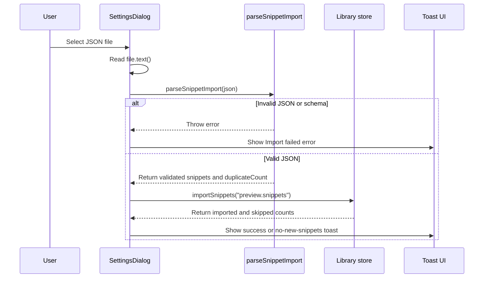

# JSON file validation and import security controls

This policy describes the security controls that CodeKnit applies when users import snippets from a JSON file. The import flow validates the file before it modifies stored data, skips duplicate snippets, and reports errors through the UI without corrupting the existing snippet library.

The import entry point lives in`SettingsDialog.tsx`. The`importJson` function orchestrates the entire workflow: it reads the selected`File`, passes the raw JSON text to`parseSnippetImport` from`@/lib/snippets/import-export` for validation, then passes validated snippets to`importSnippets` from`@/lib/snippets/store` for merging.

Figure: JSON import validation and merge flow



## Import entry point and file constraints

The import control is exposed through a hidden file input rendered inside`SettingsDialog.tsx`:

- The`<input type="file">` uses`accept=".json,application/json"` to guide the file picker toward JSON files.
- The input is hidden with`className="hidden"` and triggered by the **Import JSON** button.
- The button is disabled via`disabled={isImporting}` while an import is running to prevent concurrent import races.
- After each import attempt, the file input value is reset so the same file can be selected again after a failed validation.
- The input carries the`aria-label="Choose CodeKnit JSON export"` for accessible file selection.

The`accept` attribute is a client-side convenience filter, not a hard security boundary. The validation performed in`parseSnippetImport` is the authoritative control for rejecting malformed or unexpected file content.

The imported file is read entirely into memory using the`File.text()` API, with no explicit file size limit in the visible code. Storage limits and file size mitigation belong to the runtime environment, not the import logic.

## Validation-first workflow

The import flow separates validation from data mutation.`SettingsDialog.tsx` first validates the entire file and only then calls the store mutation:

```ts
const json = await file.text();
// Validate the entire file before touching saved data.
const preview = parseSnippetImport(json);
const result = await importSnippets(preview.snippets);
```

The inline comment in the source directly states the security intent: **validate the entire file before touching saved data**. This sequence ensures that malformed JSON, invalid data shapes, or other validation failures stop the import before any snippet is written to`localStorage`. The validation result is a`preview` object that includes at least:

-`snippets`, the validated snippet array to import
-`duplicateCount`, the number of items detected as duplicates during validation

The exact validation rules implemented inside`parseSnippetImport` are not included in the source excerpts for this document. Treat`@/lib/snippets/import-export` as the authoritative source for property-level constraints. What is observable from the calling code is that`parseSnippetImport` throws on invalid input, and that throw is caught by the import error handler. The`package.json` lists`zod` at version`^3.25.76` among dependencies, which suggests a schema-based validation approach, but this is not confirmed from the provided sources.

## Duplicate detection and merge behavior

CodeKnit merges imports into the existing library. The settings dialog states that existing snippets are kept and duplicates are skipped, as reflected in the helper text: "Merge snippets from a CodeKnit JSON export. Existing snippets are kept; duplicates are skipped." Duplicate detection occurs at two points:

1.`parseSnippetImport` computes`preview.duplicateCount` during validation.
2.`importSnippets` returns an object with`imported` and`skipped` counts for the merge step.

The total skipped count reported to the user combines both stages:

```ts
const skipped = result.skipped + preview.duplicateCount;
```

The UI then reports one of two outcomes:

- If`result.imported === 0`, CodeKnit shows an informational toast with the number of duplicates skipped.
- If at least one snippet was imported, CodeKnit shows a success toast that lists the imported count and, when applicable, the number of duplicate snippets skipped.

This behavior protects the user's existing data by making duplicate imports idempotent rather than causing overwrites or duplicate rows.

## Error handling and user feedback

`importJson` wraps the entire validation and merge sequence in a`try/catch/finally` block in`SettingsDialog.tsx`. This provides a clear boundary between failed validations and successful merges.

- Any error thrown by`file.text()`,`parseSnippetImport`, or`importSnippets` is caught.
- The UI displays`Import failed` with the error message when an`Error` instance is available, or the fallback message`Could not read this file.` otherwise.
- No partial import occurs because validation happens before`importSnippets` is called. If any validation error occurs, the snippet library remains unchanged.
- The`finally` block clears the file input so the import control returns to a clean state.

This prevents the import flow from leaving the library in a partially merged state when a file is invalid.

## User-visible import result messages

The import flow communicates its outcome through`sonner` toast notifications in`SettingsDialog.tsx`:

| Outcome | Toast type | Message |
| --- | --- | --- |
| No new snippets imported |`info` |`No new snippets imported` with duplicate count |
| Successful partial or full import |`success` |`Import complete` with imported count and optional skipped count |
| Invalid file or parse failure |`error` |`Import failed` with error description |

These messages keep the user informed without exposing raw JSON content or internal implementation details.

## Known limitations and residual risk

The visible import implementation does not enforce a maximum file size before reading content with`File.text()`. A sufficiently large file could consume significant memory in the browser tab. The`accept` attribute offers no protection against a file with misleading content; only`parseSnippetImport` determines validity. The merge behavior of`importSnippets` and the property-level schema enforced by`parseSnippetImport` are not fully visible in the provided source, so the exact granularity of field validation should be reviewed in`@/lib/snippets/import-export` and`@/lib/snippets/store` before relying on them for security-critical guarantees.

## Relationship to other security controls

JSON import validation is part of the broader client-side data protection model for CodeKnit. Since the app stores snippets in`localStorage` and never transmits them to a server, import validation focuses on preserving data integrity rather than preventing network-based attacks. However, the validation step still reduces the risk of malformed data corrupting the local snippet store.

Related pages:

- [Client-Side Data Export and Import Security](doc:be552d58-313a-43c6-8555-9e2d41052d38)
- [File Upload and Import Validation Security Threats](doc:cf9514b9-bbd2-4e9e-b2bb-0e00c49990f5)
- [Client-Side Data Privacy and User Consent Controls](doc:d4c8dfe6-7de6-4d1a-9727-7fbebf541be7)
- [Settings and Data Management](doc:23aefc87-ca4f-4220-98f9-a85aea4a7855)
- [Import and Export Snippets](doc:04709ded-6fc6-431c-9075-f23bfa3d182e)