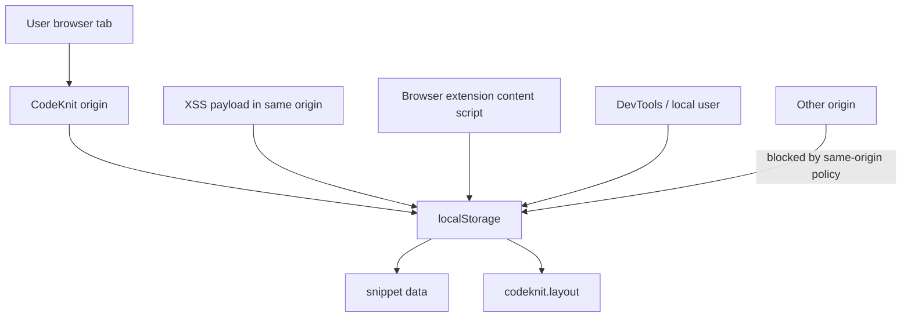
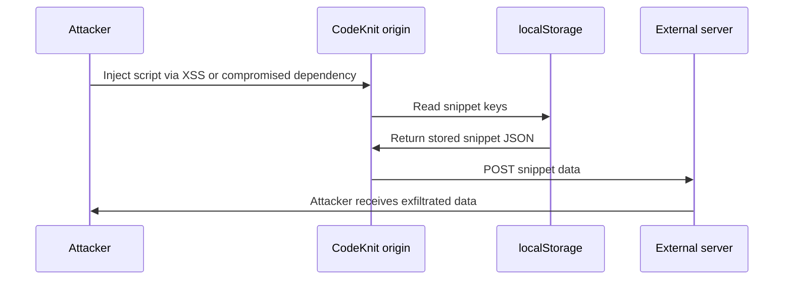
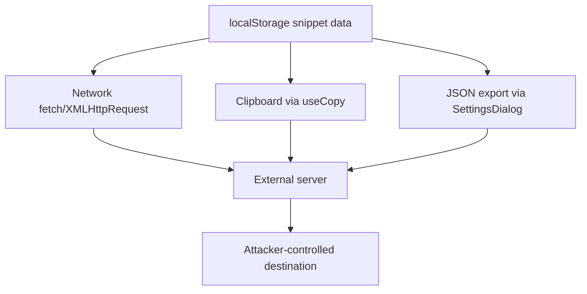

# LocalStorage data exposure and browser isolation threats

## Overview

CodeKnit stores snippet data and UI preferences in browser`localStorage`. This document analyzes the threats that arise from that storage choice: exposure to cross-site scripting (XSS), the limits of per-origin isolation, data visibility to scripts that execute in the same origin, and the paths an attacker can use to exfiltrate stored snippets.

The verified storage usage in the provided source is:

-`AppLayout.tsx` persists the grid/list layout preference:`localStorage.getItem("codeknit.layout")` on mount and`localStorage.setItem("codeknit.layout", l)` when the user toggles layout.
- Snippet data itself is loaded through`useSnippets()` from`@/lib/snippets/store` (`AppLayout.tsx`). Per planning notes,`SnippetRepository` defaults to`localStorage`, and the repository abstraction allows swapping implementations without UI changes.
-`AppSidebar.tsx` displays **"Saved on this device"** in the workspace footer, confirming local-only storage.
-`SettingsDialog.tsx` states: **"Your snippets are stored in this browser."**

## Threat model scope

This threat model covers four attack classes:

1. XSS that reaches code in the same origin and reads snippet data from`localStorage`.
2. Data exfiltration by scripts that already execute in the origin.
3. Browser extension and DevTools access that bypasses web-level isolation.
4. Cross-origin read attempts and the isolation boundary that limits them.

The following diagram shows the trust boundary around the origin and the actors that can reach`localStorage`.

Figure: LocalStorage trust boundary and access paths



## localStorage isolation per origin

`localStorage` is partitioned by **origin**, where origin is the tuple of scheme, host, and port. Any script that executes in the CodeKnit origin can read and write all keys under that origin, including snippet data and the`codeknit.layout` preference.

### What the code verifies

`AppLayout.tsx` uses the same`localStorage` object for UI state:

```ts
const saved = localStorage.getItem("codeknit.layout");
```

and writes:

```ts
localStorage.setItem("codeknit.layout", l);
```

Any script with access to the page can call the same APIs and retrieve snippet keys from the store. Because`localStorage` access requires no additional permission beyond executing in the origin, the primary defensive control is preventing an attacker from executing script there in the first place.

### Cross-origin limitation

Code from a different origin cannot read CodeKnit's`localStorage` because the browser enforces the same-origin policy on`localStorage` reads. A malicious site opened in another tab cannot call:

```js
localStorage.getItem(...) // sees only its own origin's storage
```

and retrieve CodeKnit snippets. This isolation holds only as long as the attacker cannot cause their code to execute **inside** the CodeKnit origin.

## Threat 1: XSS execution in the CodeKnit origin

If an attacker injects script that executes in the CodeKnit origin, that script has the same access as CodeKnit's own UI code. It can enumerate`localStorage` keys, read snippet objects, and send them to an external server.

### Render path and its defensive properties

`CodePreview.tsx` renders code content through`Highlighted`, which tokenizes input and returns React elements. The rendered output is generated as:

```tsx
{tokens.map((t, i) =>
  t.type === "plain" ? t.value : <span key={i} className={CLASS[t.type]}>{t.value}</span>,
)}
```

This is a React element tree, not an HTML string passed to`dangerouslySetInnerHTML`. React escapes text content by default when rendering`<span>{t.value}</span>`. There is no`dangerouslySetInnerHTML` call in the provided render path. Because snippet code and Markdown content are stored as string values and rendered as escaped React children, stored payloads in snippet text do not execute as HTML or script by default.

### Remaining XSS exposure

The primary XSS risk to`localStorage` is not the code preview render path, but any future code path that:

- Renders snippet content using`dangerouslySetInnerHTML`.
- Introduces a client-side HTML parser that inserts parsed nodes without sanitization.
- Uses`eval`,`new Function`, or similar on snippet values.

Since the store holds data in`localStorage`, a single XSS vulnerability in the origin converts from a UI-level issue into full data exposure of every stored snippet.

Figure: XSS-driven localStorage exfiltration flow



## Threat 2: Data visibility to any script in the origin

Even without XSS,`localStorage` data is readable by any JavaScript that executes in the CodeKnit origin. This includes:

- Third-party scripts bundled into the application.
- Browser extensions that inject content scripts into the page.
- Scripts injected through compromised CDN dependencies.

None of the provided UI code performs encryption before writing to`localStorage`.`AppLayout.tsx` stores`codeknit.layout` as plain text.`SettingsDialog.tsx` exports snippets as plain JSON:

```ts
const url = URL.createObjectURL(new Blob([JSON.stringify(snippets, null, 2)], { type: "application/json" }));
```

This confirms snippet data is held as plaintext JSON at rest in the browser, not encrypted.

### Visibility to browser extensions

Extensions with permission to access the site's content can read`localStorage` through content scripts unless the site uses a stricter isolation mechanism. The provided source contains no code that could prevent extension access, because`localStorage` security is browser-enforced rather than application-enforced. A malicious extension with broad host permissions can read snippet data without exploiting XSS.

## Threat 3: Data exfiltration paths

Once an attacker in the origin can read`localStorage`, multiple exfiltration paths are available.

### Direct network exfiltration

A script in the origin can read snippet data and send it out with standard web APIs such as`fetch` or`XMLHttpRequest`. The provided source does not implement a Content Security Policy (CSP) in the client bundle, and no outbound-network shaping is present in the UI components.

### Clipboard as an exfiltration channel

`SnippetCard.tsx` and`SnippetDetailViewer.tsx` use`useCopy()` to copy snippet code to the clipboard. A malicious script that can invoke clipboard writes or reads from`localStorage` can combine these to move data through the clipboard. Clipboard security is covered in detail in the [Data Storage and Clipboard Security Controls](doc:a76d6ad0-4688-42fe-805e-75b7c7e11edc) page.

### Export feature as a data aggregator

`SettingsDialog.tsx``exportJson` writes the full snippet array to a JSON file:

```ts
JSON.stringify(snippets, null, 2)
```

This is a legitimate user feature, but it also demonstrates that the full data set is available as a single plaintext JSON structure in memory and in storage. An attacker with script execution can call the same aggregation logic directly against the store.

Figure: Exfiltration channels from localStorage-backed snippet storage



## Threat 4: Data at rest in the browser profile

`localStorage` is persisted on disk in the user's browser profile. The provided code cannot control whether the browser encrypts that profile. Risks include:

- **Shared device**: Another user of the same OS account can open the browser and read CodeKnit's`localStorage`.
- **Malware on the machine**: Local malware can read browser`localStorage` directly from disk files.
- **Backup software**: Browser profile backups may include unencrypted`localStorage`.

These risks are inherent to the storage layer and are not addressed in the provided source code.`AppSidebar.tsx` does communicate the local-only nature of storage with **"Saved on this device"**, but this is informational rather than a technical control.

## Assessment of current controls

### Present controls

| Control | Evidence |
| --- | --- |
| No raw HTML rendering in code preview |`CodePreview.tsx``Highlighted` uses React elements with escaped text; no`dangerouslySetInnerHTML` |
| Custom tokenizer for syntax highlighting |`CodePreview.tsx` imports`tokenize` from`@/lib/snippets/highlight` |
| Local-only, no server transmission of snippets |`AppSidebar.tsx` displays "Saved on this device";`SettingsDialog.tsx` describes browser storage |
| User-controlled export/import |`SettingsDialog.tsx` requires explicit user action to export JSON |

### Missing controls to consider

| Gap | Impact |
| --- | --- |
| No CSP in client bundle | Increases XSS reach if a script injection bug appears |
| No encryption of stored snippets | Plaintext exposure at rest and to any script or extension in the origin |
| No session or device binding | Any process with browser profile access can read`localStorage` |
| No integrity or authenticity check on snippet data before render | Stored values are trusted as data; escaped rendering mitigates HTML injection but not context-dependent issues |

## Mitigations that would reduce exposure

These are architectural directions consistent with the repository abstraction described in the planning notes. The provided source does not implement them.

- **Restrict render paths**: Continue to use React element rendering. Never add`dangerouslySetInnerHTML` for snippet content without sanitization.
- **Add a strict Content Security Policy** at the server or static hosting layer to reduce script injection reach.
- **Consider an encrypted repository wrapper** so that values written to`localStorage` are opaque ciphertext. The repository abstraction in the planning notes makes this swappable without UI changes.
- **Prefer ephemeral memory or IndexedDB with explicit scope** for sensitive values if the threat model grows beyond local use.
- **Warn users about shared-device and browser-extension risk** when the snippet library contains secrets. The current UI communicates "stored in this browser" but does not mention extension visibility.

## Related documentation

- [Data Storage and Clipboard Security Controls](doc:a76d6ad0-4688-42fe-805e-75b7c7e11edc)
- [LocalStorage Data Protection and Privacy Controls](doc:7c739dd4-22f5-4b8e-8ebc-c4968cfaefd1)
- [Data Loss and Local Storage Corruption Threats](doc:a4919f59-de5a-4af8-a740-0b6bd9d6e10d)
- [Understanding CodeKnit Snippet Storage and Data Persistence](doc:bc53c832-8a30-4641-96c2-23bf33e68fe5)