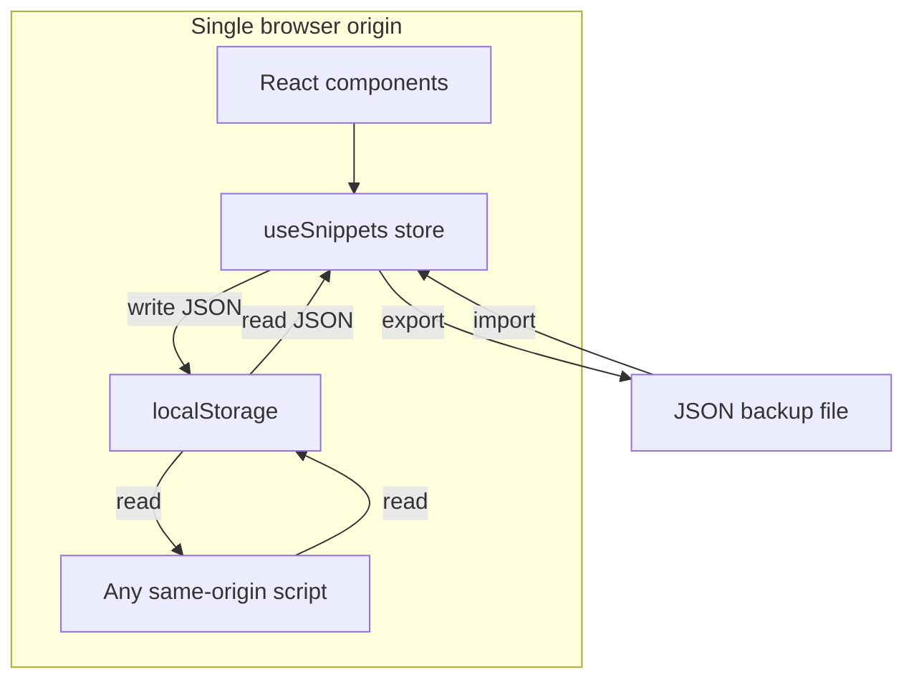
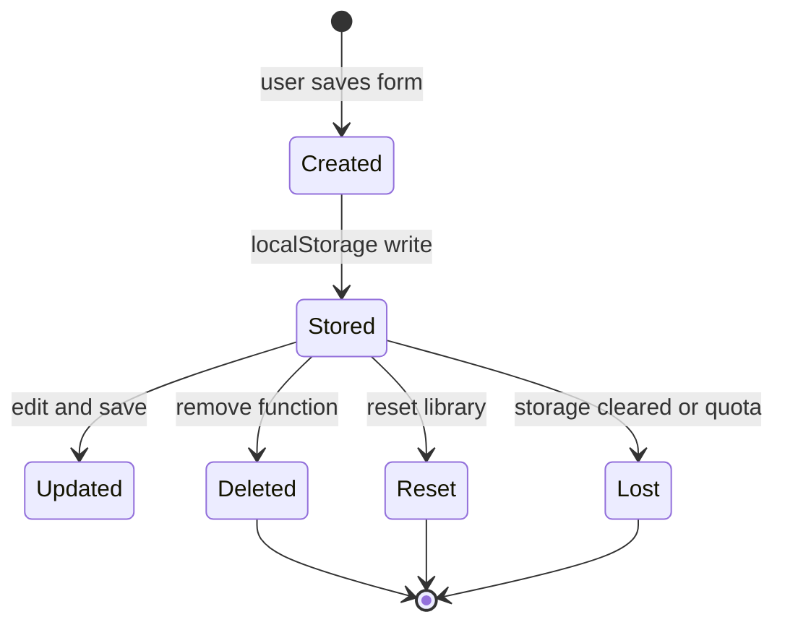

# LocalStorage data protection and privacy controls

Security policy for CodeKnit snippet storage in browser`localStorage`. This page documents what is persisted, how data is isolated, the XSS exposure that arises from client-side storage, encryption status, and retention behavior.

## Scope

This policy covers the snippet library and UI state that CodeKnit persists in`localStorage`. It is derived from component code in`AppLayout.tsx`,`AppSidebar.tsx`,`SettingsDialog.tsx`,`SnippetCard.tsx`,`SnippetDetailViewer.tsx`,`SnippetFormModal.tsx`, and the types consumed from`@/lib/snippets/types`.

> [!NOTE]
> The full implementation of`@/lib/snippets/store` was not part of the reviewed source set. Where key names or storage mechanics live inside that module, this document states the limitation explicitly.

## Storage architecture

CodeKnit is a client-side React application. The snippet library is held in browser`localStorage` and rendered by the`useSnippets` hook.`AppLayout.tsx` calls`useSnippets()` to obtain`{ snippets, status, error, reload, remove, toggleFavorite, recordCopied }`;`SettingsDialog.tsx` obtains`{ snippets, reset, importSnippets }`.

Figure: Storage trust boundary and data flows

The application has no server-side data path in the reviewed code.`SettingsDialog.tsx` states the model directly: **"Your snippets are stored in this browser."**`AppSidebar.tsx` reinforces the device-local boundary with the label **"Saved on this device."**

## Data persisted in localStorage

### Snippet library

The snippet collection is the primary protected dataset.`SnippetFormModal.tsx` creates a snippet through`useSnippets().create`, updates it through`useSnippets().update`, and the deletion flow initiated by`ConfirmDeleteDialog.tsx` and executed in`AppLayout.tsx` permanently removes it through`useSnippets().remove`.

The`Snippet` shape observed across components:

| Field | Type | Evidence |
| --- | --- | --- |
|`id` |`string` | Used as`React` key and lookup ID in`AppLayout.tsx` |
|`title` |`string` | Rendered in`SnippetCard.tsx`,`SnippetDetailViewer.tsx` |
|`description` |`string` optional | Checked with`s.description &&` in`SnippetCard.tsx` |
|`language` |`Language` |`JavaScript`,`Python`,`SQL`,`Markdown` via`LANG_DOT` in`LanguageBadge.tsx` |
|`code` |`string` | Rendered by`CodePreview.tsx`, edited in`CodeEditor.tsx` |
|`category` |`string` | Grouped in`AppLayout.tsx`, displayed in`SnippetCard.tsx` |
|`tags` |`string[]` | Flattened in`AppLayout.tsx`, edited by`TagInput.tsx` |
|`isFavorite` |`boolean` | Toggled through`useSnippets().toggleFavorite` |
|`copyCount` |`number` optional | Rendered as`Copied {count}` in`SnippetCard.tsx` |
|`createdAt` |`string` ISO date | Formatted by`formatDate` in`LanguageBadge.tsx` |
|`updatedAt` |`string` ISO date | Formatted by`formatDate` |
|`lastCopiedAt` |`string` optional | Sorted and filtered in`AppLayout.tsx` |

The raw storage key or serialization format used by`@/lib/snippets/store` is not visible in the reviewed files. The component contract confirms the store persists a collection of`Snippet` objects and returns a load`status` of`"loading"`,`"ready"`, or`"error"`, with an`error` message surfaced in`AppLayout.tsx`.

### UI preference

`AppLayout.tsx` directly writes the grid/list layout choice to`localStorage`:

- Read:`localStorage.getItem("codeknit.layout")`
- Write:`localStorage.setItem("codeknit.layout", l)`

The value is constrained to`"grid"` or`"list"` in`useEffect` and`changeLayout`. This preference is not part of the snippet library and is not exported or reset by`SettingsDialog.tsx`.

## Persistence model

Snippet data persists across page reloads and browser sessions within the same browser profile and origin. The persistence is synchronous browser storage:

1. A user creates a snippet in`SnippetFormModal.tsx`.
2.`create` or`update` is called on the`useSnippets` store.
3. The store writes the updated collection to`localStorage`.
4. A later`AppLayout.tsx` render reads the collection through`useSnippets`.

Operations that modify persisted state:

-`create(data)` and`update(id, data)` in`SnippetFormModal.tsx`
-`remove(id)` in`AppLayout.tsx` via`ConfirmDeleteDialog`
-`toggleFavorite(id)` in`AppLayout.tsx` and`SnippetDetailViewer.tsx`
-`recordCopied(id)` in`SnippetCard.tsx` and`SnippetDetailViewer.tsx`
-`reset()` and`importSnippets(...)` in`SettingsDialog.tsx`

Figure: Snippet persistence lifecycle

## Isolation boundaries

CodeKnit relies on the browser same-origin policy for isolation.`localStorage` is scoped per origin, not shared across different domains, ports, or protocols.

The code does not implement its own tenant, user, or workspace isolation.`AppSidebar.tsx` shows a fixed workspaces label **"My workspace"** with the hint **"Saved on this device"**, there is no account system and no server-side ownership check in the reviewed code.

Implications:

- Any page loaded from the same origin can read and write the same`localStorage`.
- A second browser profile or device does not receive snippet data automatically.
- There is no cross-device sync or cloud backup provided by the application itself.

## XSS and script access exposure

`localStorage` is readable by any JavaScript executing in the same origin. CodeKnit stores snippet content unencrypted in that storage, so an attacker-controlled script on the page can read all saved snippets without calling any application API.

This is a material risk for the snippet library because:

1. Snippet content is user-authored and often sensitive: code, SQL, Markdown, descriptions, and tags.
2.`AppLayout.tsx` reads the full snippet collection into state and renders it through components.
3. There is no storage access control in the reviewed code; access control is entirely delegated to the browser origin.

The rendering path in`CodePreview.tsx` returns plain text through React text nodes for normal tokens, so React's default escaping protects against direct DOM injection from stored snippet content. That does not protect`localStorage` itself from an injected script that reads the browser storage directly.

The risk model is:

- Any stored XSS or third-party script in the origin gains read access to all snippets.
- Any existing script can exfiltrate snippets as a JSON string.
- No HTTP-only, server-managed session, or cryptographic key protects the stored content.

For the related threat model, see [LocalStorage Data Exposure and Browser Isolation Threats](doc:6cb7d669-fbaa-4132-aa6f-cfec9f80ff45).

## Encryption considerations

Snippet data is persisted unencrypted in`localStorage`. The reviewed source contains no cryptographic operations:

- No use of`crypto.subtle`,`WebCrypto`, or an encryption library
- No reference to an encryption key or passphrase prompt
- No field-level encryption before storage

The`create`,`update`,`reset`, and`importSnippets` calls pass plain JavaScript objects.`SettingsDialog.tsx` exports snippets with`JSON.stringify(snippets, null, 2)` directly, confirming the in-memory representation is the persistence representation.

> [!WARNING]
> CodeKnit does not encrypt snippets at rest or in transit. Treat browser`localStorage` and JSON exports as plaintext storage. Do not store long-lived secrets or credentials in snippet code or text.

## Data retention and deletion

### Normal deletion

`ConfirmDeleteDialog.tsx` confirms permanent deletion before removal. The dialog text reads: **"Delete this snippet?"** and **"permanently removed. This can't be undone."** The resulting`remove(deleting.id)` call in`AppLayout.tsx` removes the snippet from the store; no archive or trash mechanism is visible.

### Reset

`SettingsDialog.tsx` provides **Reset to sample data**, described as **"Replaces all your snippets."** The first click changes the button label to **Confirm reset**; the second click calls`reset()`.

### Import merge

`SettingsDialog.tsx` imports a JSON file through`parseSnippetImport` and`importSnippets`. The UI states: **"Existing snippets are kept; duplicates are skipped."** Import is additive and does not require explicit user consent beyond selecting the file.

### Retention boundary

Snippet data remains until one of these events occurs:

- The user deletes a snippet via`ConfirmDeleteDialog`
- The user runs **Reset** in`SettingsDialog.tsx`
- The browser profile clears site data or`localStorage`
- The`localStorage` quota is exceeded or storage is corrupted

There is no scheduled expiry, automatic purge, or time-based retention policy in the reviewed components.

## Export/import security impact

`SettingsDialog.tsx` implements backup and restore as JSON files:

- **Export**: creates a`Blob` of`JSON.stringify(snippets, null, 2)` and triggers a download named`codeknit-snippets.json`
- **Import**: reads`file.text()`, validates through`parseSnippetImport`, then merges through`importSnippets`

Export is a convenience for data portability but also represents a plaintext copy of all snippets on disk. Import is a boundary where malformed or malicious JSON must be validated before touching saved data.`SettingsDialog.tsx` validates the entire file before calling`importSnippets`, and surfaces errors through`toast.error`.

For detailed import/export controls, see [File Upload and Import Validation Security Threats](doc:cf9514b9-bbd2-4e9e-b2bb-0e00c49990f5).

## Related pages

- [Client-Side Data Privacy and User Consent Controls](doc:d4c8dfe6-7de6-4d1a-9727-7fbebf541be7)
- [Data Privacy and Confidentiality Controls for Stored Snippets](doc:4a1f03d7-1d2a-4620-8fa3-1df341b8df0b)
- [Data Storage and Clipboard Security Controls](doc:a76d6ad0-4688-42fe-805e-75b7c7e11edc)
- [LocalStorage Data Exposure and Browser Isolation Threats](doc:6cb7d669-fbaa-4132-aa6f-cfec9f80ff45)
- [Data Loss and Local Storage Corruption Threats](doc:a4919f59-de5a-4af8-a740-0b6bd9d6e10d)
- [File Upload and Import Validation Security Threats](doc:cf9514b9-bbd2-4e9e-b2bb-0e00c49990f5)