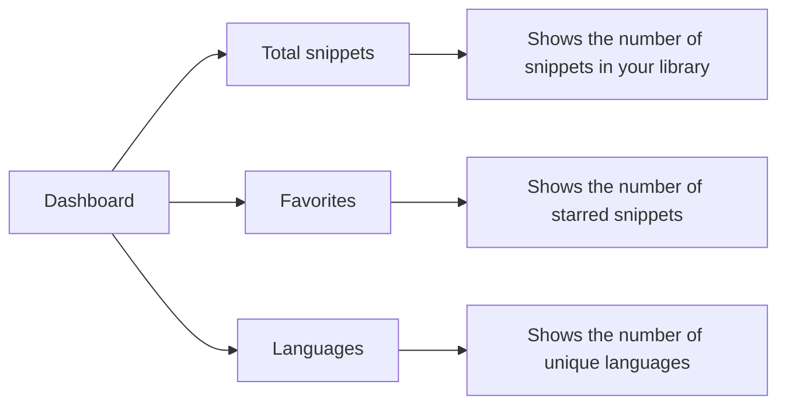
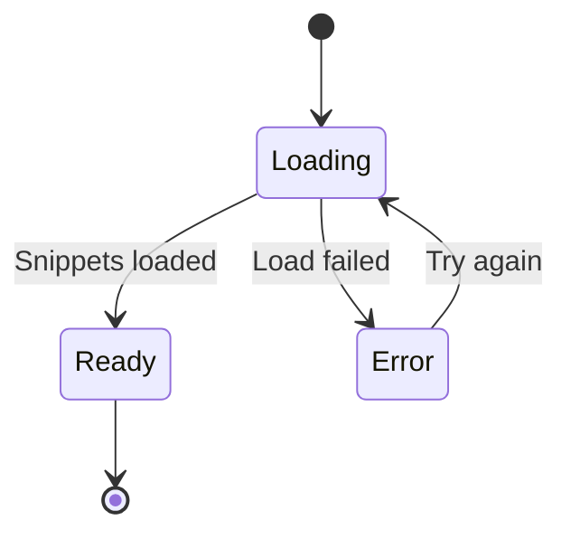

# Dashboard and statistics

## What the dashboard shows

The Dashboard is the home screen of your CodeKnit workspace. It gives you an at-a-glance summary of your snippet library, so you can see what you've saved, what you've starred, and which languages you work with. The Dashboard is for anyone who wants a quick overview before diving into specific snippets.

When you open the Dashboard, you see a friendly greeting, **Your code, organized.**, followed by the subtitle **Save, discover, and reuse your best snippets.** Below that are three summary cards:

- **Total snippets** – the total number of snippets in your library
- **Favorites** – the number of snippets you've starred for quick access
- **Languages** – the number of unique programming languages represented in your snippets

Figure: The three Dashboard stat cards

## Understanding each stat

The **Total snippets** card counts every snippet you've saved, regardless of language, category, or whether it's a favorite. The hint below the number reads **in your library**.

The **Favorites** card counts only the snippets you've marked with a star. Use it to see how many go-to snippets you've saved for fast recall. The hint reads **starred for quick access**.

The **Languages** card counts the distinct languages among all your snippets. For example, if you have 12 JavaScript snippets and 3 Python snippets, the card shows **2** because there are two unique languages. The hint lists the specific language names, separated by commas. If you haven't saved any snippets yet, the hint reads **none yet**.

> [!NOTE]
> The greeting and heading always appear on the Dashboard. The three stat cards appear only after your snippets finish loading, so you won't see stale or incomplete numbers.

## Where the numbers come from

The Dashboard reads directly from your snippet library, which is stored in your browser. Here are a few things to know about how the counts behave:

- **Total snippets** increases when you save a new snippet and decreases when you delete one.
- **Favorites** changes immediately when you star or unstar a snippet, whether from a snippet card, the detail view, or the editor.
- **Languages** updates automatically based on the language you select for each snippet. The supported languages are **JavaScript**, **Python**, **SQL**, and **Markdown**.

## Viewing your library from the dashboard

Below the stat cards, the Dashboard shows your snippets in the same list you see elsewhere in the app. This section is labeled **Your Snippets**. From here you can:

- Search and filter using the search box and filter controls
- Switch between grid and list views
- Open any snippet to read or copy its code
- Create a new snippet

The sidebar also shows live counts next to certain navigation items. **All Snippets**, **Favorites**, and **Recently Used** display badges with their current totals, so you can see the same information even when you're not on the Dashboard.

## What happens if something goes wrong

If CodeKnit cannot load your snippets, the Dashboard doesn't show the stat cards. Instead you see a message in the snippet area below explaining that your snippets couldn't be loaded, along with a **Try again** button you can use to reload.

Figure: Dashboard loading and error states

## How the dashboard fits your workflow

The Dashboard is the best starting point when you open CodeKnit. Use it to:

1. Check how many snippets you've accumulated
2. See whether you've starred the snippets you use most
3. Identify which languages you're saving code in

From there, you can jump into **All Snippets** to browse, **Favorites** to work with starred items, or use the search bar to find something specific.

## Related

- See [Product Overview](doc:ca8f433d-53d1-475b-a3a5-29b24f1ba173) for a broad introduction to CodeKnit.
- Learn how starring works in [Favorites](doc:b66c5560-9b68-42eb-922d-a8aecab0dfcb).
- Understand snippet data like language and copy count in [Snippets and Metadata](doc:35e64ac6-cbc1-45fa-877d-d3681fd10bde).
- Create your first snippet with [Your First Snippet – Quick Start](doc:72dab710-31b9-4980-becf-be9fbd6d4d94).
