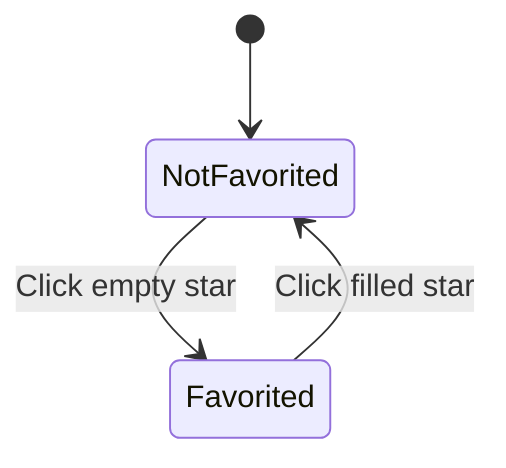
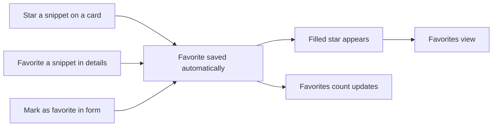

# Favorites

Favorites gives you a fast way to keep important snippets one click away. You can star any snippet in your library, then open a Favorites view that shows only those starred snippets. This is for anyone who repeatedly returns to the same code or text and wants to avoid searching or filtering for it every time.

A star uses two states:

Figure: Favorite states for a snippet

A favorite is simply a snippet you have starred. There are no levels or rankings, a snippet is either starred or it isn't.

## Marking and unmarking a snippet

You can star a snippet from three places:

- **Snippet card**, select the empty star icon in the upper-right corner of a card. The star fills in to show the snippet is now a favorite. Select the filled star again to remove it.
- **Snippet details**, open a snippet to see its full view, then select the **Favorite** button near the bottom. The button changes to **Favorited**, and the star fills in. Select it again to unmark the snippet.
- **New or edit form**, turn on the **Mark as favorite** switch while you create or edit a snippet. The saved snippet will already be starred.

Changes take effect immediately. You don't need to save separately after starring or unstarring.

## Finding your favorites

Open the **Favorites** link in the sidebar. The library then shows only the snippets you have starred, and the page title changes to **Favorites**.

The sidebar shows a count next to **Favorites**, so you can see how many snippets are starred before you open the view.

Figure: From a star to the Favorites view

If you unstar a snippet while you're viewing the Favorites list, it drops out of that list immediately. Use **Clear filters** to return to all snippets, or select another sidebar section.

## Where favorite counts appear

You can see favorite counts in two places:

- **Dashboard**, the dashboard shows a **Favorites** summary card with the number of starred snippets, described as "starred for quick access."
- **Sidebar**, the **Favorites** entry shows a small badge with the same count.

The count always reflects your current library, so it updates as soon as you star or unstar something.

## Where favorites are stored

Favorites are saved together with your snippet library on the device and browser where you use CodeKnit. You don't need to sign in or save separately. The choice persists when you refresh the page or close and reopen the browser.

Because data is stored on the current device, favorites don't automatically move to another device or browser unless you export and import your library.

## Limits to keep in mind

Favorites are intentionally simple:

- A snippet is either a favorite or not; you can't assign priority levels, shades of importance, or custom ordering inside the Favorites view.
- Sorting follows the same options available elsewhere in the library: **Recently Added**, **Oldest First**, or **A–Z**. There is no separate favorite-only sort.
- Favorites are tied to your local library on the device where you marked them.

## Related

- [Snippet Library](doc:9f431e10-b005-4cc0-80b1-0af4acdcb3d8)
- [Search and Filter](doc:3704cb56-cf68-421d-9db0-d3816a8af756)
- [Dashboard](doc:0cccb845-62f3-4e2b-b0ca-c7d768eaf700)
- [Snippet Organization](doc:8367ddb8-1051-4848-a093-3b4352805aa4)
